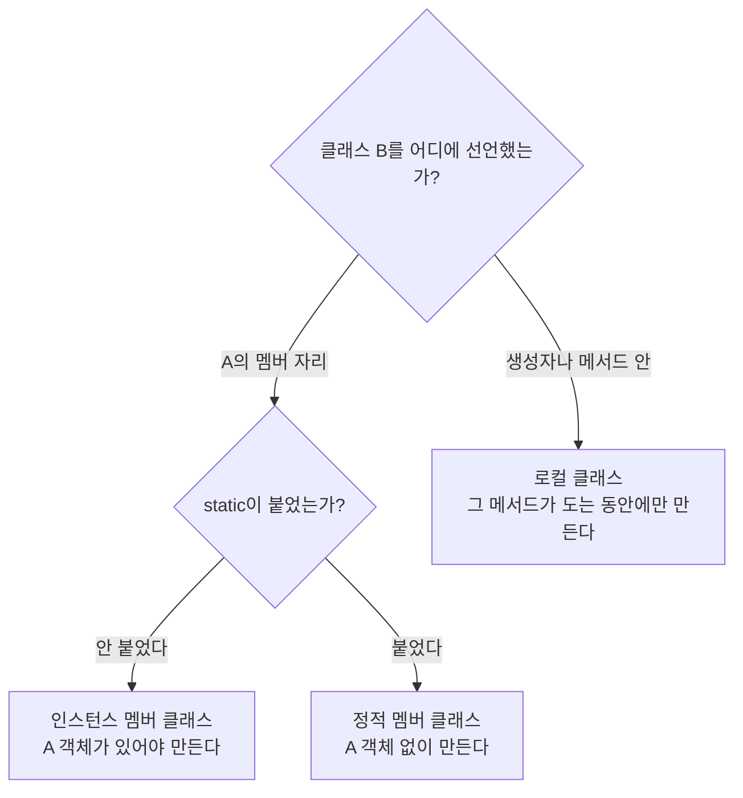


<div class="callout callout-summary" markdown="1">
<div class="callout-title callout-title--default" markdown="span">요약</div>

어떤 클래스 안에서만 쓰는 작은 클래스를 그 클래스 안에 넣어 두는 것이다. 책상 서랍 속 필통처럼 주인과 붙어 다니고 밖에서는 잘 안 보여서 코드가 덜 어지럽다. 넣는 자리에 따라 만들 수 있는 때가 다르다. 주인 객체가 먼저 있어야 만들 수 있는 것, 주인 객체 없이도 만들 수 있는 것, 메서드가 도는 동안에만 만들 수 있는 것이 있다. 주인 객체 없이 만드는 종류는 주인 객체마다 따로 가진 값을 쓸 수 없다.

</div>


## 예시로 보기

클래스 A만 쓰는 도우미 클래스 B를 다른 파일에 따로 두면 두 가지가 곤란하다. 누구나 B를 가져다 쓸 수 있고, B가 A의 필드를 쓰려면 A 객체를 일일이 넘겨받아야 한다. B를 A 안에 넣으면 B를 밖에서 숨길 수 있고 A의 멤버도 바로 쓴다[^1].

넣는 자리는 세 곳이다.

```java
class A {
    int field = 10;            // 객체마다 따로 갖는 필드
    static int sfield = 20;    // 클래스에 하나뿐인 필드

    class B {                  // ① A의 멤버 자리, static 없음
        void show() { System.out.println("B: " + field + ", " + sfield); }
    }

    static class C {           // ② A의 멤버 자리, static 있음
        void show() { System.out.println("C: " + sfield); }
    }

    void method() {
        int local = 30;
        class D {              // ③ 메서드 안
            void show() { System.out.println("D: " + field + ", " + local); }
        }
        D d = new D();
        d.show();
    }
}
```

```java
A a = new A();
A.B b = a.new B();      // A 객체 a가 먼저 있어야 한다
b.show();
A.C c = new A.C();      // A 객체 없이 만든다
c.show();
a.method();             // D는 method가 실행되는 동안에만 만들어진다
```

```
B: 10, 20
C: 20
D: 10, 30
```

`C`의 `show`에는 `field`가 없다. `C`는 A 객체 없이 만들어지므로 "어느 A 객체의 `field`인가"를 정할 수 없다. `field`를 쓰면 컴파일 오류가 난다[^s1].

①을 인스턴스 멤버 클래스, ②를 정적 멤버 클래스, ③을 로컬 클래스라고 부른다. ①과 ②를 묶어 멤버 클래스라고 한다. 셋을 통틀어 중첩 클래스이고, 감싸고 있는 A는 바깥 클래스다[^2].

<div class="callout callout-check" markdown="1">
<div class="callout-title" markdown="span">검증: 위 출력, 바깥 객체마다 따로 묶이는 인스턴스 멤버 클래스, `Outer.this`의 출력, 클래스 이름 `A$B`·`A$C`, `Button.ClickListener` 예제 출력, 카드 C3 — [30_java-nested-class_impl.java](/Hongs_Blog/studies/java/code/30_java-nested-class_impl/)</div>

</div>


## 정의

중첩 클래스는 다른 클래스 안에 선언한 클래스다. 서로 얽힌 클래스를 바깥에서 숨겨 코드의 복잡함을 줄인다[^1].

### 세 종류

| 종류 | 선언하는 자리 | 객체를 만들 수 있는 때 | 밖에서 만드는 법 |
|---|---|---|---|
| 인스턴스 멤버 클래스 | `class A { class B { … } }` | A 객체를 만든 뒤에만 | `A a = new A(); A.B b = a.new B();` |
| 정적 멤버 클래스 | `class A { static class B { … } }` | A 객체가 없어도 | `A.B b = new A.B();` |
| 로컬 클래스 | `class A { void method() { class B { … } } }` | 그 메서드가 실행되는 동안에만 | 밖에서는 못 만든다 |

앞의 세 칸은 슬라이드의 표이고, 넷째 칸은 그 조건을 코드로 적은 것이다[^2].



두 질문으로 셋을 가른다[^s2].

### 인스턴스 멤버 클래스

클래스 A의 멤버로 선언한 클래스 B다. 주로 A 안에서만 쓰기 때문에 보통 `private`으로 둔다[^3].

| 선언 | B를 쓸 수 있는 곳 |
|---|---|
| `public class B { }` | 다른 패키지에서도 |
| `class B { }` | 같은 패키지 안에서만 |
| `private class B { }` | 클래스 A 안에서만 |

B 객체는 자기를 만든 A 객체 하나에 묶인다. `a.new B()`에서 점 앞의 `a`가 그 객체다. A 객체가 둘이면 B 객체도 각자 자기 A의 필드를 읽는다[^s1].

```java
A a1 = new A();
A a2 = new A();
a2.field = 99;
a1.new B().show();   // B: 10, 20
a2.new B().show();   // B: 99, 20
```

### 정적 멤버 클래스

클래스 A의 멤버로 `static`을 붙여 선언한 클래스 B다. 보통 접근 제한자를 안 붙이거나 `public`으로 둔다[^4].

| 선언 | B를 쓸 수 있는 곳 |
|---|---|
| `public static class B { }` | 다른 패키지에서도 |
| `static class B { }` | 같은 패키지 안에서만 |
| `private static class B { }` | 클래스 A 안에서만 |

### 로컬 클래스

생성자나 메서드 안에 선언한 클래스다. 그 생성자나 메서드가 실행되는 동안에만 객체를 만들 수 있다[^5].

```java
public class A {
    public A() {
        class B { }      // 생성자 안의 로컬 클래스
    }

    public void method() {
        class B { }      // 메서드 안의 로컬 클래스
    }
}
```

로컬 클래스는 자기를 감싼 메서드의 지역 변수를 읽을 수 있다. 위 예의 `D`가 `local`을 읽는다. 다만 그 지역 변수는 값을 한 번 넣은 뒤 바꾸지 않아야 한다. `D` 선언 뒤에 `local = 31;`을 쓰면 `local variables referenced from an inner class must be final or effectively final` 오류다[^s1].

### 바깥 멤버 접근

정적 멤버 클래스 안에서는 바깥 클래스의 필드와 메서드를 쓰는 데 제한이 있다. 정적 멤버 클래스는 바깥 객체 없이도 쓸 수 있어야 하므로, 바깥 클래스의 인스턴스 필드와 인스턴스 메서드를 쓸 수 없다[^6].

| 멤버 클래스의 종류 | 쓸 수 있는 바깥 클래스의 멤버 |
|---|---|
| 인스턴스 멤버 클래스 | 바깥 클래스의 모든 필드와 메서드 |
| 정적 멤버 클래스 | 바깥 클래스의 정적 필드와 정적 메서드 |

정적 메서드가 인스턴스 필드를 못 쓰는 것과 같은 까닭이다([static 멤버](/Hongs_Blog/studies/java/java-static/)). 정적 멤버 클래스 안에서 `field`를 쓰면 `non-static variable field cannot be referenced from a static context` 오류가 난다[^s1].

### 바깥 객체 가리키기

중첩 클래스 안에서 `this`는 중첩 클래스의 객체다. 바깥 클래스의 객체를 얻으려면 바깥 클래스 이름 뒤에 `.this`를 붙인다[^7].

```
바깥클래스이름.this → 바깥 클래스의 객체
```

이름이 같은 변수가 세 군데 있을 때 차이가 드러난다[^s1].

```java
class Outer {
    String name = "outer";

    class Inner {
        String name = "inner";

        void print() {
            String name = "local";
            System.out.println(name);             // 지역 변수
            System.out.println(this.name);        // Inner 객체의 필드
            System.out.println(Outer.this.name);  // 바깥 Outer 객체의 필드
        }
    }
}
```

```java
Outer outer = new Outer();
Outer.Inner inner = outer.new Inner();
inner.print();
```

```
local
inner
outer
```

### 중첩 인터페이스

클래스의 멤버로 선언한 인터페이스다. 그 클래스와 긴밀하게 얽힌 구현 객체를 만들려고 쓴다[^8].

```java
class A {
    [public | private] [static] interface B {
        // 상수 필드
        // 추상 메서드
        // 디폴트 메서드
        // 정적 메서드
    }
}
```

안드로이드 같은 화면 프로그램에서 버튼을 누르는 것 같은 사건(이벤트)을 처리할 때 흔히 쓴다[^9].

```java
public class Button {
    // 정적 중첩 인터페이스
    public static interface ClickListener {
        // 추상 메서드
        void onClick();
    }
}
```

버튼은 눌렸을 때 무슨 일을 할지 모른다. 그 일은 버튼을 쓰는 쪽이 정한다. 그래서 버튼은 "눌리면 `onClick()`을 부르겠다"는 목록만 자기 안에 정해 두고, 쓰는 쪽이 그 목록을 채운 객체를 넣어 준다. 슬라이드에는 인터페이스 선언까지만 있다. 버튼이 그 객체를 받아 두었다가 부르는 부분을 채우면 이렇게 된다[^s3].

```java
class Button {
    static interface ClickListener {
        void onClick();
    }

    private ClickListener clickListener;           // 인터페이스 타입 필드

    void setClickListener(ClickListener clickListener) {
        this.clickListener = clickListener;        // 구현 객체를 받아 둔다
    }

    void click() {
        this.clickListener.onClick();              // 눌리면 받아 둔 객체의 메서드를 부른다
    }
}

class OkListener implements Button.ClickListener {
    @Override
    public void onClick() { System.out.println("OK 버튼을 눌렀다"); }
}

class CancelListener implements Button.ClickListener {
    @Override
    public void onClick() { System.out.println("Cancel 버튼을 눌렀다"); }
}
```

```java
Button btnOk = new Button();
btnOk.setClickListener(new OkListener());
btnOk.click();
btnOk.setClickListener(new CancelListener());
btnOk.click();
```

```
OK 버튼을 눌렀다
Cancel 버튼을 눌렀다
```

`click()` 안의 한 줄은 그대로인데 넣어 둔 객체에 따라 다른 일이 일어난다. 필드 [다형성](/Hongs_Blog/studies/java/java-polymorphism/)이다. 밖에서는 인터페이스 이름을 `Button.ClickListener`처럼 바깥 클래스 이름과 함께 쓴다.

## 활용

- 구현: [30_java-nested-class_impl.java](/Hongs_Blog/studies/java/code/30_java-nested-class_impl/)
- 컴파일하면 중첩 클래스도 따로 클래스 파일이 생긴다. 이름은 `바깥$안` 꼴이다. 위 예의 B와 C는 `A$B.class`, `A$C.class`가 된다[^s1].
- `OkListener`처럼 한 번만 쓸 구현 클래스에 일일이 이름을 붙이기 번거로우면 [익명 객체](/Hongs_Blog/studies/java/java-anonymous-object/)를 쓴다.
- 흔한 실수[^s1]

| 실수 | 오류 메시지의 핵심 |
|---|---|
| 인스턴스 멤버 클래스를 `new A.B()`로 만듦 | `an enclosing instance that contains A.B is required` |
| 정적 멤버 클래스에서 바깥의 인스턴스 필드를 씀 | `non-static variable field cannot be referenced from a static context` |
| `private class B`를 A 밖에서 씀 | `A.B has private access in A` |
| 로컬 클래스를 메서드 밖에서 씀 | `cannot find symbol` |

## 연결

- 선수: [클래스와 객체](/Hongs_Blog/studies/java/class-and-object/), [static 멤버](/Hongs_Blog/studies/java/java-static/), [접근 제한자](/Hongs_Blog/studies/java/java-access-modifier/), [인터페이스](/Hongs_Blog/studies/java/java-interface/)
- 필드·메서드·지역 변수가 사는 자리: [필드와 메서드](/Hongs_Blog/studies/java/java-fields-methods/)
- 이름 없는 로컬 클래스: [익명 객체](/Hongs_Blog/studies/java/java-anonymous-object/)

## 확인 문제

<details class="callout callout-question" markdown="1">
<summary class="callout-title" markdown="span">**C1** (가)~(바) 가운데 컴파일 오류가 나는 줄을 모두 고르고 이유를 쓰라.</summary>

```java
class A {
    int field = 1;
    static int sfield = 2;
    class B { int x = field; }            // (가)
    static class C { int y = field; }     // (나)
    static class E { int z = sfield; }    // (다)
}
class Main {
    public static void main(String[] args) {
        A.C c = new A.C();                // (라)
        A.B b1 = new A.B();               // (마)
        A a = new A();
        A.B b2 = a.new B();               // (바)
    }
}
```
**답:** (나), (마).<br>
**이유:** (나) 정적 멤버 클래스는 A 객체 없이 만들어지므로 A의 인스턴스 필드를 쓸 수 없다. (마) 인스턴스 멤버 클래스는 A 객체가 있어야 만든다. `a.new B()`처럼 써야 한다. (가)는 인스턴스 멤버 클래스라 바깥의 모든 필드를 쓰고, (다)는 정적 필드라 괜찮다. 흔한 오답은 (라)를 "A 객체가 없다"며 오류로 고르는 것이다[^s1].

</details>


<details class="callout callout-question" markdown="1">
<summary class="callout-title" markdown="span">**C2** 정적 멤버 클래스가 바깥 클래스의 인스턴스 필드를 쓸 수 없는 이유를 쓰라.</summary>

**답:** 정적 멤버 클래스의 객체는 바깥 객체 없이 만들 수 있다. 인스턴스 필드는 바깥 객체마다 따로 있는 값이다. 바깥 객체가 하나도 없거나 여럿일 수 있어서 "어느 객체의 필드인가"를 정할 수 없다.<br>
**이유:** 인스턴스 멤버 클래스는 `a.new B()`로 만들 때 바깥 객체 `a`에 묶이므로 그 객체의 필드를 읽으면 된다. 정적 멤버 클래스에는 묶인 바깥 객체가 없다.

</details>


<details class="callout callout-question" markdown="1">
<summary class="callout-title" markdown="span">**C3** 본문의 `Outer`와 `Inner`가 있을 때 이 코드의 출력은?</summary>

```java
Outer o1 = new Outer();
Outer o2 = new Outer();
o2.name = "second";
Outer.Inner in = o2.new Inner();
o1.name = "first";
in.print();
```
**답:**
```
local
inner
second
```
**이유:** `in`은 `o2.new Inner()`로 만들어 `o2`에 묶였다. `Outer.this.name`은 `o2`의 `name`인 `second`다. `o1`의 값을 바꾼 것은 `in`과 상관없다. 흔한 오답은 마지막 줄을 `first`나 `outer`로 쓰는 것이다[^s1].

</details>


[^1]: 소프트웨어 프로젝트 13회 강의 자료 「Software Project 13. Nested Declarations and Anonymous Objects」, p.3 (중첩 클래스의 뜻과 장점, Outer Class·Inner Class 그림)
[^2]: 같은 자료, p.4 (멤버 클래스와 로컬 클래스, 선언 위치와 객체 생성 조건 표)
[^3]: 같은 자료, p.5 (인스턴스 멤버 클래스, 접근 제한 표)
[^4]: 같은 자료, p.6 (정적 멤버 클래스, 접근 제한 표)
[^5]: 같은 자료, p.7 (로컬 클래스, 생성자와 메서드 안의 `class B { }`)
[^6]: 같은 자료, p.8 (바깥 멤버 접근 제한 표)
[^7]: 같은 자료, p.9 (`OuterClassName.this`)
[^8]: 같은 자료, p.10 (중첩 인터페이스의 뜻과 선언 꼴)
[^9]: 같은 자료, p.11 (`Button`과 `ClickListener`)
[^s1]: <span class="fn-tag" title="수업 자료에 없고 따로 보탠 내용">보충</span> `A`·`B`·`C`·`D`의 몸통과 실행 출력, 밖에서 만드는 법(`a.new B()`, `new A.C()`), 바깥 객체에 묶인다는 설명, 로컬 클래스의 지역 변수 규칙, `Outer`·`Inner` 예, 클래스 파일 이름, 오류 메시지, 카드 C1~C3은 원본에 없다. 슬라이드는 선언 꼴과 표만 싣는다. 구현 코드와 JDK 21 컴파일로 확인했다(Java Language Specification §8.1.3, §15.9.2).
[^s2]: <span class="fn-tag" title="수업 자료에 없고 따로 보탠 내용">보충</span> 분류 그림은 원본에 없다. 슬라이드 p.4의 표를 두 질문으로 옮겼다.
[^s3]: <span class="fn-tag" title="수업 자료에 없고 따로 보탠 내용">보충</span> `Button`의 필드 `clickListener`, `setClickListener`, `click`, 구현 클래스 `OkListener`·`CancelListener`와 실행 출력은 원본에 없다. 슬라이드 p.11은 `ClickListener` 선언까지만 싣고 p.13이 "안드로이드 같은 화면 프로그램의 이벤트 처리에 널리 쓴다"고 적는다. 구현 코드로 출력을 확인했다.

