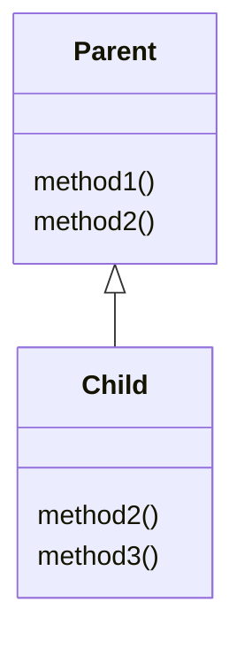


<div class="callout callout-summary" markdown="1">
<div class="callout-title callout-title--default" markdown="span">요약</div>

집안에 내려오는 김치찌개 조리법을 물려받았는데, 내 입맛에 맞게 고쳐서 내 공책에 다시 적어 두는 것과 같다. 그 뒤로 내가 끓이는 찌개는 늘 고쳐 적은 쪽이다. 원래 조리법이 없어진 것은 아니어서 "원래대로 끓인 다음 치즈를 얹는다"처럼 불러다 쓸 수도 있다. 지켜야 할 것이 있다. 이름과 받는 재료가 원래와 똑같아야 고쳐 쓴 것으로 쳐 준다. 조금이라도 다르면 고쳐 쓴 것이 아니라 새 조리법이 하나 더 생길 뿐이고, 원래 것이 그대로 쓰인다. 또 원래 누구나 볼 수 있던 것을 나만 보게 감출 수는 없다.

</div>


## 예시로 보기

[상속](/Hongs_Blog/studies/java/java-inheritance/)으로 물려받은 메서드가 자식에게 딱 맞지 않을 때가 있다. 동물은 모두 소리를 내지만 개와 고양이의 소리는 다르다. 자식마다 `bark()`, `meow()`처럼 다른 이름의 메서드를 만들면, 부르는 쪽이 동물의 종류를 일일이 확인해야 한다. 물려받은 메서드를 같은 이름으로 다시 쓰면 그럴 필요가 없다. 슬라이드의 예로 본다[^1].

```java
class Parent {
    void method1() { System.out.println("Parent.method1"); }
    void method2() { System.out.println("Parent.method2"); }
}

class Child extends Parent {
    @Override
    void method2() { System.out.println("Child.method2"); }   // 다시 썼다
    void method3() { System.out.println("Child.method3"); }   // 새로 보탰다
}
```

```java
Child child = new Child();
child.method1();
child.method2();
child.method3();
```

| 호출 | 도는 메서드 | 출력 | 까닭 |
|---|---|---|---|
| `child.method1()` | `Parent`의 것 | `Parent.method1` | `Child`가 다시 쓰지 않았다. 물려받은 것이 돈다 |
| `child.method2()` | `Child`의 것 | `Child.method2` | `Child`가 다시 썼다. `Parent`의 것은 가려진다 |
| `child.method3()` | `Child`의 것 | `Child.method3` | `Child`가 새로 보탠 메서드다 |



`method2`가 두 상자에 모두 있다. `Child` 객체에게 `method2`를 시키면 아래 상자의 것이 돈다[^s2].

<div class="callout callout-check" markdown="1">
<div class="callout-title" markdown="span">검증: 위 표의 출력, 부모 타입 변수로 불러도 자식 것이 도는 것, `super.method()` 예(작업 처리1, 작업 처리2), 매개변수가 다른 메서드가 부모 것을 가리지 못하는 것, 카드 C2의 답을 JDK 21에서 실행해 비교. 오류 문구 다섯은 따로 컴파일해 확인 — [22_java-overriding_impl.java](/Hongs_Blog/studies/java/code/22_java-overriding_impl/)</div>

</div>


## 정의

**메서드 오버라이딩**은 물려받은 메서드를 자식 클래스에서 다시 쓰는 것이다. 다시 쓰면 부모의 그 메서드는 가려지고 자식의 메서드가 먼저 쓰인다[^1].

어느 메서드가 돌지는 실행 중에 객체의 실제 타입을 보고 정한다. 그래서 슬라이드는 이것을 동적 다형성이라고 부른다[^2]. 변수의 타입이 부모여도 객체가 자식이면 자식의 것이 돈다.

```java
Parent p = new Child();
p.method2();              // Child.method2
Parent q = new Parent();
q.method2();              // Parent.method2
```

두 줄 모두 `Parent` 타입 변수로 `method2()`를 불렀다. 코드는 같고 결과가 다르다.

### 지켜야 할 것

1. 자식 메서드는 부모 메서드와 돌려주는 타입, 이름, 매개변수가 같아야 한다[^3].
2. 접근 범위를 부모보다 좁힐 수 없다. `public`이던 것을 `private`로 바꿀 수 없다[^3].

| 어긴 코드 | 번역기의 반응 |
|---|---|
| 부모 `public void makeSound()`, 자식 `void makeSound()` | `attempting to assign weaker access privileges; was public` |
| 부모 `int legs()`, 자식 `String legs()` | `return type String is not compatible with int` |
| 부모 `void makeSound()`, 자식 `void makeSound(int times)` | 오류 없음. 다시 쓴 것이 아니라 새 메서드가 하나 더 생긴다 |
| 부모 `void makeSound()`, 자식 `void makesound()` (소문자 s) | 오류 없음. 위와 같다 |
| 부모 `final void sleep()`, 자식 `void sleep()` | `overridden method is final` |

표의 값은 실행해 확인한 것이다[^s1]. 2번은 넓히는 쪽으로는 된다(부모 default, 자식 `public`). 부모 타입으로 그 메서드를 부를 수 있던 코드가 자식 객체를 만났을 때도 부를 수 있어야 하기 때문이다.

셋째·넷째 줄이 위험하다. 번역기가 아무 말도 하지 않는다. 이름이 같고 매개변수가 다르면 [오버로딩](/Hongs_Blog/studies/java/java-fields-methods/)이 되어 부모의 메서드는 가려지지 않고 그대로 남는다.

```java
class LoudDog extends Animal {
    public void makeSound(int times) { ... }   // 다시 쓴 줄 알았지만 새 메서드다
}

Animal a = new LoudDog();
a.makeSound();      // Some sound   ← 개인데 부모 것이 돈다
```

### @Override

다시 쓰는 메서드 위에 `@Override`를 붙인다[^4]. 이 표시는 번역기에게 "이 메서드는 부모 것을 다시 쓴 것이니 확인해 달라"고 부탁한다. 부모에 같은 모양의 메서드가 없으면 번역이 멈춘다[^s1].

```java
class Dog extends Animal {
    @Override
    public void makeSound(int times) { }
    // error: method does not override or implement a method from a supertype
}
```

위 표의 셋째·넷째 줄이 조용한 실수에서 번역 오류로 바뀐다. `@Override`를 붙이지 않아도 다시 쓰기는 되지만, 붙여야 이런 실수가 실행 전에 잡힌다.

### 부모 메서드 부르기

다시 쓰면 부모의 메서드는 가려진다. 자식 메서드 안에서 `super.`을 앞에 붙이면 가려진 부모 메서드를 부를 수 있다. 부모가 하던 일을 자식에 다시 쓰지 않고 가져다 쓴다[^5].

```java
class Parent {
    public void method() {
        System.out.println("작업 처리1");
    }
}

class Child extends Parent {
    @Override
    public void method() {
        super.method();                       // 부모 메서드 호출
        System.out.println("작업 처리2");
    }
}
// new Child().method() → 작업 처리1, 작업 처리2
```

<div class="callout callout-warning" markdown="1">
<div class="callout-title" markdown="span">원본 오류 의심</div>

원문: 슬라이드 p.9의 그림에서 부모는 `public void method()`, 자식은 `@Override void method()`로 `public`이 빠져 있다. / 문제점: 접근 범위를 `public`에서 default로 좁힌 것이라 컴파일되지 않는다. 바로 앞 p.8의 둘째 주의점과 어긋난다. / 수정안: 자식 메서드에도 `public`을 붙인다. / 근거: 슬라이드 코드 그대로 JDK 21로 컴파일하면 `method() in Child cannot override method() in Parent; attempting to assign weaker access privileges; was public` 오류가 난다. `public`을 붙이면 위 출력이 나온다.

</div>


### 스스로 설명해 보기

`class X { void hi() { System.out.println("X"); } void run() { hi(); } }`와 `class Y extends X { @Override void hi() { super.hi(); System.out.println("Y"); } }`에서 `new Y().run();`을 한 줄씩 따라간다.

<details class="callout callout-question" markdown="1">
<summary class="callout-title" markdown="span">1. `Y`에는 `run`이 없다. `new Y().run()`은 어느 `run`을 돌리는가?</summary>

`X`의 `run`이다. `Y`가 다시 쓰지 않았으므로 물려받은 것이 돈다.

</details>


<details class="callout callout-question" markdown="1">
<summary class="callout-title" markdown="span">2. `X`의 `run` 안에 있는 `hi()`는 `X`의 `hi`인가 `Y`의 `hi`인가?</summary>

`Y`의 `hi`다. `hi()`는 `this.hi()`와 같고, 지금 `this`는 `new Y()`로 만든 객체다. 어느 메서드가 돌지는 코드가 적힌 클래스가 아니라 실행 중인 객체의 실제 타입으로 정한다.

</details>


<details class="callout callout-question" markdown="1">
<summary class="callout-title" markdown="span">3. `Y`의 `hi` 안에 있는 `super.hi()`는 왜 다시 `Y`의 `hi`로 돌아오지 않는가?</summary>

`super.`은 실제 객체를 보지 않고 부모 클래스 `X`에 적힌 메서드를 곧바로 부른다. 그래서 `X`가 찍히고, 돌아와서 `Y`가 찍힌다. `super.`을 빼고 `hi()`라고 쓰면 자기 자신을 끝없이 부른다.

</details>


<details class="callout callout-question" markdown="1">
<summary class="callout-title" markdown="span">이 추적의 핵심 생각은?</summary>

부모 클래스에 적힌 코드라도 그 안에서 부르는 메서드는 실제 객체의 것으로 바뀌어 돈다. 부모는 뼈대(`run`)만 정하고, 자식이 알맹이(`hi`)를 갈아 끼울 수 있다.

</details>


<details class="callout callout-question" markdown="1">
<summary class="callout-title" markdown="span">같은 생각을 쓸 수 있는 다른 상황은?</summary>

`System.out.println(객체)`는 안에서 그 객체의 `toString()`을 부른다. `println`은 오래전에 쓰인 코드지만, 내가 만든 클래스에서 `toString()`을 다시 쓰면 내 것이 돈다.

</details>


## 활용

- 알아보는 신호: 부모의 메서드가 하는 일이 자식에게 맞지 않거나(통째로 갈기), 부모가 하는 일에 조금 더 보태고 싶을 때(`super.method()` 뒤에 덧붙이기).
- 대표 문제 1: `toString()`을 다시 써서 객체를 찍을 때 보기 좋은 글이 나오게 한다. 대표 문제 2: 유닛마다 다른 `attack()`을 부모 타입 배열 하나로 돌린다([객체 지향의 세 원칙](/Hongs_Blog/studies/java/oop-principles/)의 동물 예)[^s1].
- 다시 쓸 때는 늘 `@Override`를 붙인다.
- 흔한 실수: 오버로딩과 섞는 것. 오버로딩은 매개변수가 다른 메서드를 나란히 두는 것이고 번역할 때 고른다. 오버라이딩은 같은 모양을 자식이 다시 쓰는 것이고 실행할 때 고른다.
- 메서드에 `final`을 붙이면 자식이 다시 쓰지 못한다. 필드와 `static` 메서드는 다시 쓰기의 대상이 아니다. 같은 이름으로 자식에 만들어도 부모 타입 변수로는 부모 것이 쓰인다[^s1].

## 연결

- 선수: [상속](/Hongs_Blog/studies/java/java-inheritance/), [필드와 메서드](/Hongs_Blog/studies/java/java-fields-methods/), [접근 제한자](/Hongs_Blog/studies/java/java-access-modifier/)
- `super`의 다른 쓰임: [부모 생성자 호출](/Hongs_Blog/studies/java/java-super-constructor/)
- 부모 타입 변수 하나로 여러 자식을 다루기: [다형성](/Hongs_Blog/studies/java/java-polymorphism/)
- 자식이 꼭 다시 쓰게 만들기: [추상 클래스](/Hongs_Blog/studies/java/java-abstract-class/), [인터페이스](/Hongs_Blog/studies/java/java-interface/)

## 자주 하는 오해

<div class="callout callout-misconception" markdown="1">
<div class="callout-title" markdown="span">"변수의 타입이 부모면 부모의 메서드가 불린다"</div>

틀렸다. 그럴듯해 보이는 이유는 코드에 `Parent p`라고 적혀 있어서 `p.method2()`도 `Parent`의 것으로 읽히기 때문이다. 실제로는 변수의 타입은 "무엇을 부를 수 있는가"만 정하고, "누구의 것이 도는가"는 실행 중에 `p`가 가리키는 객체가 정한다. 확인하는 법: `Parent p = new Child(); p.method2();`가 `Child.method2`를 찍는다. 반대로 `p.method3()`은 번역되지 않는다. `Parent`에는 `method3`이 없기 때문이다.

</div>


<div class="callout callout-misconception" markdown="1">
<div class="callout-title" markdown="span">"이름만 같으면 오버라이딩이다"</div>

틀렸다. 이름과 매개변수가 모두 같아야 한다. 매개변수가 다르면 부모 것은 가려지지 않고, 자식에 메서드가 하나 더 생길 뿐이다. 번역기가 오류를 내지 않아서 다시 쓴 줄 알고 지나가기 쉽다. 확인하는 법: `LoudDog`에 `makeSound(int times)`만 두고 `Animal a = new LoudDog(); a.makeSound();`를 돌리면 `Some sound`가 나온다. `@Override`를 붙이면 번역 단계에서 `method does not override or implement a method from a supertype`으로 걸린다.

</div>


## 확인 문제

<details class="callout callout-question" markdown="1">
<summary class="callout-title" markdown="span">**C1** 메서드 오버라이딩이 무엇인지, 지켜야 할 것 두 가지, 가려진 부모 메서드를 부르는 방법을 쓰라.</summary>

**답:** 물려받은 메서드를 자식 클래스에서 다시 쓰는 것이다. 다시 쓰면 부모 것은 가려지고 자식 것이 먼저 쓰인다. 돌려주는 타입·이름·매개변수가 부모와 같아야 하고, 접근 범위를 더 좁힐 수 없다. 자식 메서드 안에서 `super.메서드()`로 부모 것을 부른다.

</details>


<details class="callout callout-question" markdown="1">
<summary class="callout-title" markdown="span">**C2** `class X { void hi() { System.out.println("X"); } void run() { hi(); } }`와 `class Y extends X { @Override void hi() { super.hi(); System.out.println("Y"); } }`에서 `new Y().run();`의 출력은?</summary>

**답:** `X`, `Y`가 한 줄씩 나온다.<br>
**이유:** `run`은 `X`의 것이 돌지만, 그 안의 `hi()`는 실제 객체 `Y`의 `hi`다. `Y`의 `hi`가 `super.hi()`로 `X`를 찍고 이어서 `Y`를 찍는다. `X`만 나온다고 답하는 것은 "`X`에 적힌 `run`이니 `X`의 `hi`를 부른다"고 본 것이다.

</details>


<details class="callout callout-question" markdown="1">
<summary class="callout-title" markdown="span">**C3** 부모가 `class Animal { public void makeSound() { } }`다. 번역 단계에서 오류가 나는 자식을 모두 고르라. (가) `@Override public void makeSound() { }` (나) `@Override void makeSound() { }` (다) `@Override public void makeSound(int n) { }` (라) `public void makeSound(int n) { }`</summary>

**답:** (나)와 (다).<br>
**이유:** (나) `public`을 default로 좁혔다. (다) 매개변수가 달라 다시 쓴 것이 아닌데 `@Override`가 붙어 있다. (라)는 `@Override`가 없으므로 그냥 새 메서드(오버로딩)로 받아들여져 오류가 없다. (라)를 오류로 고르기 쉽다.

</details>


<details class="callout callout-question" markdown="1">
<summary class="callout-title" markdown="span">**C4** `@Override`가 하는 일을 한 문장으로 쓰라. 붙이지 않으면 다시 쓰기가 안 되는가?</summary>

**답:** 바로 아래 메서드가 부모(또는 인터페이스)의 메서드를 다시 쓴 것이 맞는지 번역기가 확인하게 하고, 아니면 번역을 멈추게 한다. 붙이지 않아도 다시 쓰기는 된다. 다만 이름이나 매개변수를 잘못 쓴 실수가 걸러지지 않는다.

</details>


<details class="callout callout-question" markdown="1">
<summary class="callout-title" markdown="span">**C5** 다시 쓸 때 접근 범위를 좁힐 수 없게 한 이유를 `Animal a = new Dog(); a.makeSound();`로 설명하라.</summary>

**답:** 번역기는 변수 타입 `Animal`을 보고 `makeSound()`가 `public`이니 부를 수 있다고 허락한다. 실행 때 도는 것은 `Dog`의 것이다. `Dog`가 이것을 `private`로 좁힐 수 있다면, 허락받은 호출이 실행 중에 막힌 메서드에 닿게 된다. 그래서 자식은 부모가 내놓은 만큼은 내놓아야 한다[^s1].

</details>


[^1]: 소프트웨어 프로젝트 8회 강의 자료 「Software Project 08. Inheritance」, p.7 (Method Overriding, `Parent`·`Child`·`ChildExample` 그림: `child.method2()`가 부모 것이 아니라 자식 것에 닿는다)
[^2]: 소프트웨어 프로젝트 5회 강의 자료 「Software Project 05. Object-Oriented Programming」, p.30 ("dynamically determined based on the object's type at runtime", "dynamic polymorphism")
[^3]: 소프트웨어 프로젝트 8회 강의 자료 「Software Project 08. Inheritance」, p.8 (Points to note when overriding methods). 슬라이드는 돌려주는 타입·이름·매개변수를 묶어 "method signature"라고 부른다. Java Language Specification 8.4.2절에서 시그니처는 이름과 매개변수 타입만이고, 돌려주는 타입은 부모 것의 자식 타입으로 바꿀 수 있다(예: 부모 `Animal self()`, 자식 `Dog self()`. JDK 21에서 컴파일해 확인).
[^4]: 소프트웨어 프로젝트 5회 강의 자료 「Software Project 05. Object-Oriented Programming」, p.32 (`Dog`·`Cat`의 `@Override`). 08.Software Project 08. Inheritance.pdf, p.9의 그림에도 `@Override`가 있다. 두 슬라이드 모두 코드에만 쓰고 뜻은 적지 않았다.
[^5]: 소프트웨어 프로젝트 8회 강의 자료 「Software Project 08. Inheritance」, p.9 (Invoking Parent Methods, `super.method();`)
[^s1]: <span class="fn-tag" title="수업 자료에 없고 따로 보탠 내용">보충</span> 추적 표의 출력, 부모 타입 변수 예, 어긴 코드 표, `LoudDog` 예, `@Override`의 뜻과 오류, 접근 범위를 넓히는 것은 된다는 설명, 스스로 설명해 보기, 오해 두 항목, 대표 문제, `final`·필드·`static`, 카드 C2~C5는 원본에 없다. 모두 JDK 21에서 직접 실행·컴파일해 확인했다(필드와 `static` 메서드: 부모 타입 변수로 읽으면 부모의 값이 나온다).
[^s2]: <span class="fn-tag" title="수업 자료에 없고 따로 보탠 내용">보충</span> 클래스 그림은 슬라이드 p.7의 그림을 옮겨 다시 그린 것이다.

