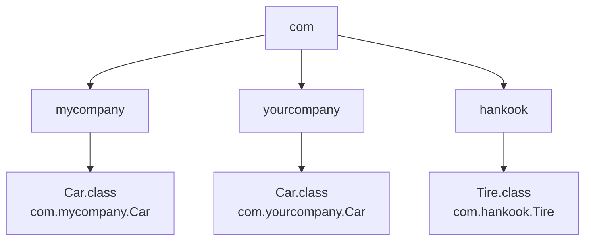


<div class="callout callout-summary" markdown="1">
<div class="callout-title callout-title--default" markdown="span">요약</div>

같은 반에 민수가 둘이면 "김민수", "이민수"처럼 성을 붙여 부른다. 클래스에도 성을 붙여서, 서로 다른 회사가 똑같은 이름으로 만든 클래스를 한 프로그램에서 함께 쓸 수 있다. 성은 폴더 구조와 짝이 맞아야 해서, 번역해 나온 파일을 다른 폴더로 옮기면 그 클래스를 찾지 못한다. 매번 성까지 붙여 부르기 번거로우면 파일 맨 위에 "이 파일에서 민수는 김민수다"라고 한 번 적어 두고 이름만 부른다. 단, 이름이 같은 둘을 한 파일에서 이렇게 적어 둘 수는 없다.

</div>


## 예시로 보기

내가 만든 `Car` 클래스가 있는데, 가져다 쓰려는 다른 회사 코드에도 `Car`가 있다. 이름만으로는 `new Car()`가 어느 쪽인지 가릴 수 없다. 자바는 클래스를 패키지라는 묶음에 넣고, 패키지 이름을 클래스 이름 앞에 붙여 가른다. 슬라이드의 그림대로 만들어 본다[^1].

```
src/
├── com/mycompany/Car.java      package com.mycompany;
├── com/yourcompany/Car.java    package com.yourcompany;
├── com/hankook/Tire.java       package com.hankook;
└── app/Main.java               package app;
```

```java
// src/com/mycompany/Car.java
package com.mycompany;              // Car 클래스의 패키지

import com.hankook.Tire;            // Tire 클래스의 전체 이름

public class Car {
    Tire tire = new Tire();         // com.hankook.Tire를 쓴다

    public String info() {
        return "mycompany Car + " + tire.info();
    }
}
```

```java
// src/app/Main.java
package app;

import com.mycompany.Car;

public class Main {
    public static void main(String[] args) {
        Car mine = new Car();                                         // import한 쪽
        com.yourcompany.Car yours = new com.yourcompany.Car();        // 전체 이름으로
        System.out.println(mine.info());
        System.out.println(yours.info());
        System.out.println(mine.getClass().getName());
        System.out.println(yours.getClass().getName());
    }
}
```

번역하고 실행한 결과다[^s1].

```
$ javac -d out $(find src -name "*.java")
$ find out -name "*.class"
out/app/Main.class
out/com/hankook/Tire.class
out/com/mycompany/Car.class
out/com/yourcompany/Car.class
$ java -cp out app.Main
mycompany Car + hankook Tire
yourcompany Car
com.mycompany.Car
com.yourcompany.Car
```

이름이 같은 `Car` 둘이 한 프로그램에서 함께 돈다. 클래스의 진짜 이름은 `com.mycompany.Car`처럼 패키지까지 붙인 전체 이름이기 때문이다. 번역해 나온 `.class` 파일도 패키지 이름과 똑같은 폴더 아래에 놓였다.

<div class="callout callout-check" markdown="1">
<div class="callout-title" markdown="span">검증: 위 명령과 출력, 아래의 옮긴 파일 실험과 오류 문구 셋은 패키지 폴더를 실제로 만들어 JDK 21에서 실행. 파일 하나로 되는 확인(전체 이름, 이름이 같은 `java.util.Date`와 `java.sql.Date`, import한 이름과 전체 이름이 같은 클래스인 것)은 — [18_java-package_impl.java](/Hongs_Blog/studies/java/code/18_java-package_impl/)</div>

</div>


## 정의

**패키지**는 이름이 같은 클래스를 가려내는 데 쓰는 묶음이다[^1].

- 패키지 이름은 보통 회사의 도메인 이름을 거꾸로 써서 만든다. 도메인은 세상에 하나뿐이라 서로 겹치지 않는다.
- 점(`.`)으로 위 패키지와 아래 패키지를 나눈다. `com.mycompany`는 `com` 아래의 `mycompany`다.
- 패키지에 든 바이트코드 파일(`.class`)은 따로 떼어 다른 폴더로 옮길 수 없다.



폴더를 위에서부터 따라 내려간 길이 곧 클래스의 전체 이름이다[^s2].

마지막 항목을 실험으로 확인한다. `out/com/mycompany/Car.class`를 `out/com/other/`로 옮기고 다시 실행하면 이렇게 된다[^s1].

```
Exception in thread "main" java.lang.NoClassDefFoundError: com/mycompany/Car
```

`Car.class` 안에는 "나는 `com.mycompany.Car`다"라고 적혀 있고, 자바는 그 이름대로 `com/mycompany/` 폴더에서 파일을 찾는다. 폴더와 이름이 어긋나면 찾지 못한다.

### 패키지 선언

`package` 키워드 뒤에 패키지 이름을 적는다. 소스 파일의 맨 위에 와야 한다[^2].

```java
package 상위패키지.하위패키지;

public class 클래스명 { ... }
```

- 패키지 이름은 모두 소문자로 쓴다.
- 겹치지 않게 회사 도메인을 거꾸로 쓰고, 끝에 프로젝트 이름을 붙인다: `com.samsung.projectname`, `com.lg.projectname`, `org.apache.projectname`.

### import 문

다른 패키지의 클래스를 쓰려면 `import` 문으로 그 클래스가 어느 패키지의 것인지 밝힌다[^3].

- `import` 문은 패키지 선언과 클래스 선언 사이에 쓴다.
- `import` 뒤에는 클래스의 전체 이름을 적는다: `import com.hankook.Tire;`

`import`는 긴 이름을 줄여 부르게 해 주는 것뿐이다. `import` 없이 전체 이름을 직접 써도 똑같이 돈다(위 `Main`의 `com.yourcompany.Car`)[^s1].

| 잘못 쓴 코드 | 번역기 오류 |
|---|---|
| `import` 없이 다른 패키지의 `Car`를 이름만으로 쓴다 | `cannot find symbol ... symbol: class Car` |
| 한 파일에서 `import com.mycompany.Car;`와 `import com.yourcompany.Car;`를 함께 쓴다 | `a type with the same simple name is already defined by the single-type-import of Car` |
| `import` 문을 `package` 선언보다 위에 쓴다 | `class, interface, enum, or record expected` |

둘째 줄이 요약의 조건이다. 이름이 같은 두 클래스를 한 파일에서 쓰려면 한쪽만 `import`하고 다른 쪽은 전체 이름으로 쓴다[^s1].

## 활용

- 자바가 주는 클래스도 패키지에 들어 있다. `String`의 전체 이름은 `java.lang.String`, `Arrays`는 `java.util.Arrays`다. `java.lang` 패키지만은 `import` 없이 쓸 수 있어서 `String`과 `System`에는 `import`를 쓰지 않았다[^s1].
- 자바 안에도 이름이 같은 클래스가 있다. `java.util.Date`와 `java.sql.Date`는 이름은 같고 서로 다른 클래스다[^s1].
- `package` 선언이 없는 파일의 클래스는 이름 없는 패키지에 들어간다. 지금까지 만든 연습 코드가 모두 그렇다[^s1].
- 패키지는 이름을 가르는 것 말고도, 누가 이 클래스와 멤버를 쓸 수 있는지의 경계가 된다([접근 제한자](/Hongs_Blog/studies/java/java-access-modifier/)).

## 연결

- 선수: [클래스와 객체](/Hongs_Blog/studies/java/class-and-object/), [JVM과 바이트코드](/Hongs_Blog/studies/java/jvm-bytecode/)
- 패키지 폴더째로 한 파일에 묶기: [라이브러리와 JAR](/Hongs_Blog/studies/java/java-library-jar/)
- 패키지를 다시 묶는 더 큰 단위: [모듈](/Hongs_Blog/studies/java/java-module/)

## 확인 문제

<details class="callout callout-question" markdown="1">
<summary class="callout-title" markdown="span">**C1** 패키지를 쓰는 까닭과, 패키지 이름을 짓는 규칙 두 가지를 쓰라. `package` 선언과 `import` 문은 파일의 어디에 쓰는가?</summary>

**답:** 이름이 같은 클래스를 가려내려고 쓴다. 이름은 모두 소문자로, 회사 도메인을 거꾸로 쓰고 끝에 프로젝트 이름을 붙인다. `package` 선언은 파일 맨 위, `import` 문은 패키지 선언과 클래스 선언 사이에 쓴다.

</details>


<details class="callout callout-question" markdown="1">
<summary class="callout-title" markdown="span">**C2** `out/com/mycompany/Car.class`를 `out/com/other/` 폴더로 옮기면 왜 프로그램이 `Car`를 찾지 못하는가?</summary>

**답:** 클래스의 이름은 패키지까지 붙인 `com.mycompany.Car`이고, 자바는 그 이름을 폴더 길 `com/mycompany/Car.class`로 바꿔 찾는다. 파일을 옮기면 그 길에 파일이 없다. 파일 안에 적힌 패키지 이름도 그대로라 새 폴더와 맞지 않는다.<br>
**이유:** "`import` 문을 고치면 된다"는 오답이다. 옮긴 `.class` 파일 속의 이름은 여전히 `com.mycompany.Car`다. 패키지를 바꾸려면 소스의 `package` 선언을 고쳐 다시 번역해야 한다.

</details>


<details class="callout callout-question" markdown="1">
<summary class="callout-title" markdown="span">**C3** `com.mycompany.Car`와 `com.yourcompany.Car`를 `app.Main` 한 파일에서 둘 다 쓰려 한다. 되는 것을 고르라. (가) 둘 다 `import`하고 `Car`라고 쓴다. (나) 하나만 `import`하고 다른 하나는 `com.yourcompany.Car`라고 쓴다. (다) 아무것도 `import`하지 않고 둘 다 전체 이름으로 쓴다.</summary>

**답:** (나)와 (다).<br>
**이유:** (가)는 `Car`라는 짧은 이름이 둘을 가리키게 되어 `a type with the same simple name is already defined` 오류가 난다. `import`는 줄임말을 정하는 것이라, 같은 줄임말을 두 클래스에 줄 수 없다.

</details>


[^1]: 소프트웨어 프로젝트 7회 강의 자료 「Software Project 07. Class (2)」, p.9 (Java Packages, `com/mycompany/Car.class`와 `com/yourcompany/Car.class` 폴더 그림, 옮긴 `Car.class`에 X 표시)
[^2]: 같은 자료, p.10 (Package declaration)
[^3]: 같은 자료, p.11 (Import statement, `package com.mycompany; import com.hankook.Tire;` 예)
[^s1]: <span class="fn-tag" title="수업 자료에 없고 따로 보탠 내용">보충</span> 슬라이드에는 폴더 그림과 `Car`의 코드 조각만 있다. 네 파일의 전체 코드, 명령과 출력, 옮긴 파일의 오류, 오류 표, 전체 이름으로 직접 쓰기, `java.lang`·`java.util.Date`·이름 없는 패키지, 카드 C2·C3은 원본에 없다. 패키지 폴더를 만들어 JDK 21에서 직접 실행해 확인했다.
[^s2]: <span class="fn-tag" title="수업 자료에 없고 따로 보탠 내용">보충</span> 그림은 슬라이드 p.9의 폴더 그림에 `hankook`(p.11)과 전체 이름을 보태 다시 그린 것이다.

