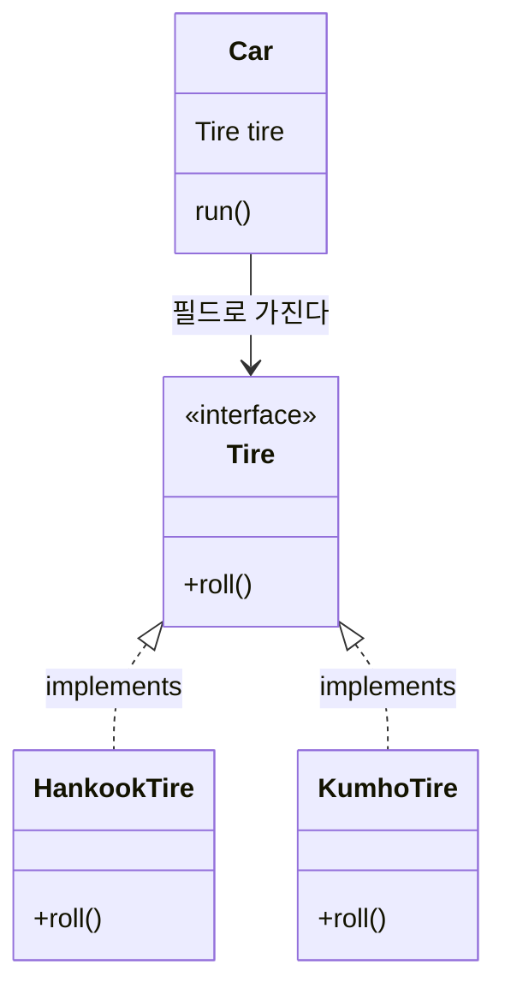
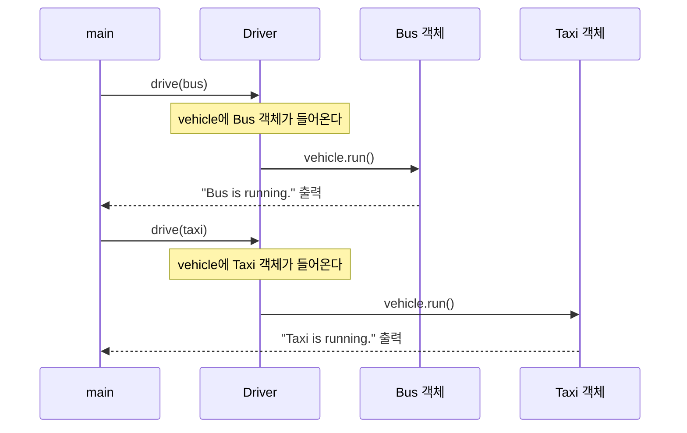


<div class="callout callout-summary" markdown="1">
<div class="callout-title callout-title--default" markdown="span">요약</div>

벽의 콘센트는 모양만 맞으면 선풍기를 꽂든 충전기를 꽂든 전기를 준다. 코드에서도 똑같이 쓴 호출 한 줄이, 그 자리에 지금 어떤 객체가 꽂혀 있느냐에 따라 다른 일을 한다. 그래서 새 부품을 만들어 끼워도 쓰는 쪽 코드는 고치지 않는다. 다만 이것은 자리에 약속된 메서드를 부품이 자기 것으로 다시 만들어 두었을 때만 통한다. 약속에 없는 메서드는 부를 수 없고, 메서드가 아닌 변수는 꽂힌 부품이 아니라 자리에 적힌 이름을 따른다.

</div>


## 예시로 보기

자동차가 `HankookTire tire`처럼 특정 회사의 타이어 클래스를 필드 타입으로 박아 두면, 다른 회사 타이어로 바꿀 때 `Car` 클래스를 열어 고쳐야 한다. 필드 타입을 인터페이스 `Tire`로 두면 `Car`는 그대로 두고 타이어만 갈아 끼울 수 있다.

```java
interface Tire {
    void roll();
}

class HankookTire implements Tire {
    @Override
    public void roll() { System.out.println("Hankook Tire"); }
}

class KumhoTire implements Tire {
    @Override
    public void roll() { System.out.println("Kumho Tire"); }
}

class Car {
    Tire tire = new HankookTire();
    void run() {
        tire.roll();
    }
}
```

```java
Car myCar = new Car();
myCar.run();
myCar.tire = new KumhoTire();
myCar.run();
```

```
Hankook Tire
Kumho Tire
```

| 줄 | `myCar.tire`에 든 객체 | `run()` 안의 `tire.roll()`이 실행하는 것 | 출력 |
|---|---|---|---|
| `Car myCar = new Car();` | HankookTire 객체 | — | — |
| `myCar.run();` | HankookTire 객체 | `HankookTire`의 `roll` | Hankook Tire |
| `myCar.tire = new KumhoTire();` | KumhoTire 객체 | — | — |
| `myCar.run();` | KumhoTire 객체 | `KumhoTire`의 `roll` | Kumho Tire |

`Car`의 `run()`은 한 글자도 바뀌지 않았는데 출력이 달라졌다. 이렇게 같은 호출이 객체에 따라 다른 결과를 내는 성질이 다형성이다. [객체 지향의 세 원칙](/Hongs_Blog/studies/java/oop-principles/)에서 이름만 본 그 원칙이 실제로는 이렇게 돌아간다.

콘센트 비유가 틀어지는 곳이 있다. 콘센트는 꽂힌 것이 무엇이든 같은 전기를 준다. 코드에서는 반대로 꽂힌 객체가 무슨 일을 할지 정한다. 자리는 "무엇을 부를 수 있는가"만 정한다.

<div class="callout callout-check" markdown="1">
<div class="callout-title" markdown="span">검증: 위 출력, 매개변수 다형성의 출력, 새 클래스 `Subway`를 더했을 때, 필드와 정적 메서드가 변수 타입을 따르는 것, 카드 C3·C4·C5 — [29_java-polymorphism_impl.java](/Hongs_Blog/studies/java/code/29_java-polymorphism_impl/)</div>

</div>


## 어떻게 돌아가는가

### 호출 한 줄은 두 번 정해진다

`tire.roll();` 한 줄을 두고 컴파일러와 실행 환경이 서로 다른 것을 본다.

| 때 | 누가 | 무엇을 보나 | 정하는 것 |
|---|---|---|---|
| 컴파일할 때 | 컴파일러 | 변수의 타입(`Tire`) | `roll()`을 불러도 되는가. `Tire`에 선언이 없으면 오류 |
| 실행할 때 | 자바 가상 기계 | 변수에 들어 있는 객체의 클래스(`KumhoTire`) | 어느 몸통을 실행하는가 |

실행할 때 객체를 보고 몸통을 고르는 둘째 단계를 동적 바인딩이라고 부른다. 객체 A가 인터페이스의 메서드를 부르면, 실제로 그 일을 하는 것은 인터페이스 뒤에 있는 객체 B다. B를 C로 바꿔 끼우면 같은 호출이 C의 메서드를 실행한다. 위 예에서는 `Car`가 A이고, `HankookTire`와 `KumhoTire` 객체가 B와 C다.

다형성이 일어나려면 세 가지가 갖춰져야 한다.

1. 구현 객체(또는 자식 객체)가 인터페이스(또는 부모) 타입 변수에 들어 있다. [자동 변환](/Hongs_Blog/studies/java/java-casting/)이다.
2. 그 객체의 클래스가 메서드를 다시 정의했다. [메서드 오버라이딩](/Hongs_Blog/studies/java/java-overriding/)이다.
3. 그 변수로 메서드를 부른다.

### 필드 다형성

필드의 타입을 인터페이스로 두고, 그 필드에 여러 구현 객체를 바꿔 넣는 것이다. `예시로 보기`의 `Car`와 `Tire`가 이것이다.



`Car`에서 나가는 화살표는 `Tire`에서 멈춘다. `Car`의 `run()`은 두 타이어 클래스의 이름을 모른다.

### 매개변수 다형성

메서드의 매개변수 타입을 인터페이스로 두고, 부를 때 여러 구현 객체를 넘기는 것이다.

```java
interface Vehicle {
    void run();
}

class Driver {
    public void drive(Vehicle vehicle) {
        vehicle.run();
    }
}

class Bus implements Vehicle {
    @Override
    public void run() { System.out.println("Bus is running."); }
}

class Taxi implements Vehicle {
    @Override
    public void run() { System.out.println("Taxi is running."); }
}
```

```java
Driver driver = new Driver();
Bus bus = new Bus();
Taxi taxi = new Taxi();

driver.drive(bus);
driver.drive(taxi);
```

```
Bus is running.
Taxi is running.
```

`driver.drive(bus)`로 부르는 순간 `Vehicle vehicle = bus;`와 같은 대입이 일어난다. 자동 변환이다. 그다음 `vehicle.run()`은 들어온 객체의 `run`을 실행한다.



`Driver` 안의 코드 `vehicle.run()`은 두 번 다 같은 줄이다. 화살표가 닿는 곳만 다르다.


### 지켜 주는 것과 지켜 주지 않는 것

**지켜 주는 것.** 변수의 타입에 선언된 인스턴스 메서드를 부르면, 늘 변수에 든 객체의 클래스에서 다시 정의한 몸통이 실행된다. 변수의 타입이 무엇이든, 몇 번 다른 변수로 옮겨 담았든 같다. 그래서 `Driver`를 고치지 않고 새 탈것을 더할 수 있다.

```java
class Subway implements Vehicle {
    @Override
    public void run() { System.out.println("Subway is running."); }
}
```

`new Driver().drive(new Subway());`는 `Subway is running.`을 찍는다. `Driver`는 `Subway`가 생기기 전에 쓴 코드 그대로다[^s3].

**지켜 주지 않는 것.** 객체를 보고 고르는 것은 인스턴스 메서드뿐이다[^s3].

```java
class Parent {
    String name = "parent";
    String getName() { return name; }
    static String kind() { return "Parent"; }
}

class Child extends Parent {
    String name = "child";
    @Override
    String getName() { return name; }
    static String kind() { return "Child"; }
}
```

```java
Parent p = new Child();
```

| 식 | 값 | 무엇을 따랐나 |
|---|---|---|
| `p.getName()` | `child` | 든 객체(Child). 인스턴스 메서드 |
| `p.name` | `parent` | 변수의 타입(Parent). 필드 |
| `p.kind()` | `Parent` | 변수의 타입(Parent). 정적 메서드 |

- 필드는 다시 정의되지 않는다. 자식이 같은 이름의 필드를 두면 부모의 필드를 가릴 뿐이고, 어느 쪽을 읽을지는 변수의 타입이 정한다.
- 정적 메서드는 객체가 아니라 클래스에 붙어 있어서 객체를 보고 고를 것이 없다([static 멤버](/Hongs_Blog/studies/java/java-static/)).
- 변수의 타입에 없는 메서드는 객체에 있어도 부를 수 없다. 컴파일 단계에서 막힌다.

### 깨지는 경우

| 상황 | 언제 드러나나 | 결과 |
|---|---|---|
| `Vehicle`을 구현하지 않은 객체를 `drive`에 넘김 | 컴파일할 때 | `incompatible types: Bike cannot be converted to Vehicle` |
| 변수의 타입에 없는 메서드를 부름 | 컴파일할 때 | `cannot find symbol` |
| 필드나 매개변수에 `null`이 들어 있음 | 실행할 때 | `NullPointerException` |

셋째가 가장 조심할 곳이다. `Tire tire;`로 선언만 하고 객체를 넣지 않으면 `tire.roll()`에서 프로그램이 멈춘다. 고를 객체가 없기 때문이다([참조 비교와 null](/Hongs_Blog/studies/java/java-reference-equality/))[^s3].

### 스스로 설명해 보기

`예시로 보기`의 네 줄을 본다.

<details class="callout callout-question" markdown="1">
<summary class="callout-title" markdown="span">1. `Tire tire = new HankookTire();`가 컴파일되는 이유</summary>

`HankookTire`가 `implements Tire`로 선언되어 있어서 자동 변환이 된다. 세 조건 가운데 첫째다.

</details>


<details class="callout callout-question" markdown="1">
<summary class="callout-title" markdown="span">2. `tire.roll();`을 컴파일러가 통과시키는 이유</summary>

변수의 타입 `Tire`에 `roll()` 선언이 있어서다. 컴파일러는 `tire`에 어떤 객체가 들어 있을지는 보지 않는다.

</details>


<details class="callout callout-question" markdown="1">
<summary class="callout-title" markdown="span">3. 둘째 `myCar.run()`이 "Kumho Tire"를 찍는 이유</summary>

바로 앞 줄에서 `myCar.tire`가 가리키는 객체가 KumhoTire로 바뀌었다. 실행할 때 자바 가상 기계는 `tire`에 든 객체의 클래스에서 `roll`의 몸통을 찾는다. 그 클래스가 `KumhoTire`다.

</details>


<details class="callout callout-question" markdown="1">
<summary class="callout-title" markdown="span">이 구조의 핵심 아이디어는?</summary>

"무엇을 부를 수 있는가"는 변수의 타입이 컴파일할 때 정하고, "어느 몸통을 실행하는가"는 변수에 든 객체가 실행할 때 정한다. 둘을 떼어 놓았기 때문에 쓰는 쪽 코드를 그대로 두고 객체만 바꿀 수 있다.

</details>


<details class="callout callout-question" markdown="1">
<summary class="callout-title" markdown="span">이 방법을 쓸 수 있는 다른 상황은?</summary>

배열의 원소 타입을 인터페이스로 두고 여러 구현 객체를 섞어 담은 뒤 반복문에서 같은 메서드를 부른다. 메서드의 리턴 타입을 인터페이스로 두고 상황에 따라 다른 구현 객체를 돌려준다. 버튼이 눌렸을 때 할 일을 인터페이스 타입 필드에 넣어 둔다([중첩 클래스](/Hongs_Blog/studies/java/java-nested-class/)의 `Button`).

</details>


## 활용

- 구현: [29_java-polymorphism_impl.java](/Hongs_Blog/studies/java/code/29_java-polymorphism_impl/)
- 인터페이스 대신 부모 클래스나 [추상 클래스](/Hongs_Blog/studies/java/java-abstract-class/)를 변수의 타입으로 두어도 똑같이 돌아간다. `Animal a = new Dog("바둑이"); a.sound();`가 그 예다.
- 시험에서 자주 묻는 꼴: 변수의 타입과 든 객체가 다른 코드를 주고 출력을 묻는다. 메서드 호출은 객체를, 필드와 정적 메서드는 변수의 타입을 따라가며 읽는다.

## 연결

- 원칙 수준의 소개: [객체 지향의 세 원칙](/Hongs_Blog/studies/java/oop-principles/)
- 세 조건의 재료: [참조 타입 변환과 instanceof](/Hongs_Blog/studies/java/java-casting/), [메서드 오버라이딩](/Hongs_Blog/studies/java/java-overriding/), [인터페이스](/Hongs_Blog/studies/java/java-interface/)
- 클래스 상속으로 만드는 다형성: [상속](/Hongs_Blog/studies/java/java-inheritance/), [추상 클래스](/Hongs_Blog/studies/java/java-abstract-class/)
- 구현 클래스를 따로 선언하지 않고 그 자리에서 만들어 넘기기: [익명 객체](/Hongs_Blog/studies/java/java-anonymous-object/)

## 자주 하는 오해

<div class="callout callout-misconception" markdown="1">
<div class="callout-title" markdown="span">"변수의 타입이 실행될 메서드를 정한다"</div>

틀렸다. 실행될 몸통은 변수에 들어 있는 객체의 클래스가 정한다. 그럴듯해 보이는 이유는 둘이다. 컴파일 오류는 변수의 타입을 기준으로 나기 때문에 타입이 모든 것을 정하는 것처럼 보인다. 또 필드와 정적 메서드는 정말로 변수의 타입을 따른다. 실제로는 호출 한 줄이 두 번 정해진다. 변수의 타입은 "부를 수 있는가"만 정하고, "무엇이 실행되는가"는 객체가 정한다. 확인하는 법: `Parent p = new Child();`에서 `p.getName()`은 `child`, `p.name`은 `parent`다. 같은 변수인데 메서드와 필드가 다른 쪽을 따른다.

</div>


## 확인 문제

<details class="callout callout-question" markdown="1">
<summary class="callout-title" markdown="span">**C1** 다형성이 일어나기 위한 세 조건을 쓰라.</summary>

**답:** ① 구현 객체(자식 객체)가 인터페이스(부모) 타입 변수에 들어 있다(자동 변환). ② 그 객체의 클래스가 메서드를 다시 정의했다(오버라이딩). ③ 그 변수로 메서드를 부른다.<br>
**이유:** ①이 없으면 변수와 객체의 타입이 같아 바꿔 끼울 것이 없다. ②가 없으면 어느 객체든 같은 몸통이 실행된다. 흔한 오답은 ②를 빠뜨리는 것이다.

</details>


<details class="callout callout-question" markdown="1">
<summary class="callout-title" markdown="span">**C2** `Subway` 클래스를 새로 만들었는데 `Driver` 클래스는 고치지 않아도 되는 이유를 쓰라.</summary>

**답:** `Driver`의 `drive`는 매개변수 타입이 `Vehicle`이고 그 안에서 `Vehicle`에 선언된 `run()`만 부른다. `Subway`가 `Vehicle`을 구현했으니 자동 변환으로 넘길 수 있고, `run()`의 몸통은 실행할 때 Subway 객체에서 찾는다.<br>
**이유:** `Driver`의 코드 어디에도 `Bus`, `Taxi`, `Subway`라는 이름이 없다. 매개변수 타입이 `Bus`였다면 `drive(Subway)` 메서드를 따로 더해야 했다.

</details>


<details class="callout callout-question" markdown="1">
<summary class="callout-title" markdown="span">**C3** 본문의 `Vehicle`, `Bus`, `Taxi`, `Subway`가 있을 때 이 코드의 출력은?</summary>

```java
Vehicle[] list = { new Taxi(), new Bus(), new Subway(), new Bus() };
for (Vehicle v : list) v.run();
```
**답:**
```
Taxi is running.
Bus is running.
Subway is running.
Bus is running.
```
**이유:** `v.run()`은 네 번 다 같은 줄이지만 그때마다 `v`에 든 객체의 `run`이 실행된다[^s3].

</details>


<details class="callout callout-question" markdown="1">
<summary class="callout-title" markdown="span">**C4** 본문의 `Parent`, `Child`에서 `Parent p = new Child();`일 때 `p.name`, `p.getName()`, `p.kind()`, `((Child) p).name`의 값을 쓰고, 어느 것이 객체를 따르고 어느 것이 변수의 타입을 따르는지 가르라.</summary>

**답:** `parent`, `child`, `Parent`, `child`. 객체를 따르는 것은 인스턴스 메서드 `getName()` 하나다. 필드 `name`과 정적 메서드 `kind()`는 변수의 타입을 따른다. 넷째는 강제 변환으로 식의 타입이 `Child`가 되어 Child의 필드를 읽는다.<br>
**이유:** 다시 정의(오버라이딩)되는 것은 인스턴스 메서드뿐이다. 흔한 오답은 `p.name`을 `child`로 쓰는 것이다[^s3].

</details>


<details class="callout callout-question" markdown="1">
<summary class="callout-title" markdown="span">**C5** `예시로 보기`의 `Car`, `Tire`, `HankookTire`, `KumhoTire`가 있을 때 이 코드의 출력은?</summary>

```java
Car car = new Car();
Tire t = car.tire;
car.tire = new KumhoTire();
t.roll();
car.run();
```
**답:**
```
Hankook Tire
Kumho Tire
```
**이유:** `t`는 처음의 HankookTire 객체를 가리킨다. `car.tire`에 새 객체를 넣어도 `t`가 가리키는 곳은 그대로다. `car.run()`은 `car.tire`에 지금 든 KumhoTire의 `roll`을 실행한다. 흔한 오답은 `t.roll()`도 `Kumho Tire`라고 쓰는 것이다[^s3].

</details>


[^s3]: 구현 코드와 JDK 21 컴파일로 확인했다(Java Language Specification §8.3의 필드 가리기, §8.4.8.2의 정적 메서드 가리기).

