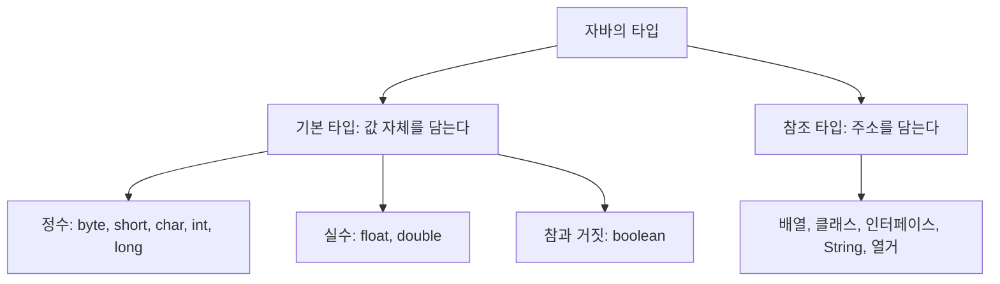


<div class="callout callout-summary" markdown="1">
<div class="callout-title callout-title--default" markdown="span">요약</div>

변수는 값 하나를 넣어 두는 이름표 붙은 칸이다. 칸을 만들 때 크기와 넣을 수 있는 값의 종류를 함께 정하는데, 이것이 타입이다. 작은 칸은 메모리를 덜 쓰지만 큰 수가 안 들어간다. 자바는 값을 넣지 않은 칸을 읽으려 하면 실행하기도 전에 막고, 칸은 그것을 만든 중괄호 안에서만 쓸 수 있다.

</div>


## 예시로 보기

계산 결과를 나중에 다시 쓰려면 어딘가 적어 둬야 한다. 그 자리가 변수다.

```java
int value = 100;
```

이 한 줄은 두 가지 일을 한다. `int value`는 메모리에 정수 하나가 들어갈 칸을 잡고 `value`라는 이름을 붙인다(선언). `= 100`은 그 칸에 100을 넣는다(초기화). 모양은 C와 같다[^1].

```
        메모리
      +---------+
value |   100   |
      +---------+
       0x3245F4EE   <- 이 칸의 주소
```

값을 넣지 않고 읽으면 어떻게 될까? C라면 쓰레기 값이 나온다. 자바는 번역 단계에서 막는다[^1].

```java
int value;
int result = value + 10;   // 컴파일 오류
```

`javac`는 `variable value might not have been initialized`라고 알려 주고 `.class`를 만들지 않는다[^s1].

<div class="callout callout-check" markdown="1">
<div class="callout-title" markdown="span">검증: 타입별 크기와 범위, `'A'`가 65인 것, boolean 식 다섯 개, 범위 예제, printf 서식 표의 모든 줄, Scanner로 한 줄 읽기, 카드 C2 — [02_java-primitive-types_impl.java](/Hongs_Blog/studies/java/code/02_java-primitive-types_impl/)</div>

</div>


## 타입의 종류

자바의 타입은 크게 둘로 갈린다[^2].

- 기본 타입(Primitive Type): 칸에 값 자체가 들어간다. 여덟 가지다.
- 참조 타입(Reference Type): 칸에 값이 있는 곳의 주소가 들어간다. 배열, 클래스, 인터페이스, 문자열, 열거가 여기에 든다. [참조 타입과 메모리 영역](/Hongs_Blog/studies/java/java-reference-types/)에서 다룬다.



### 정수 타입

타입은 변수를 선언할 때 넣을 수 있는 값의 종류와 범위를 정한다. 정수 타입은 다섯이고 메모리 크기가 서로 다르다[^3].

| 타입 | 크기 | 범위(식) | 범위(수) |
|---|---|---|---|
| `byte` | 1바이트(8비트) | $$-2^7$$ ~ $$2^7 - 1$$ | −128 ~ 127 |
| `short` | 2바이트(16비트) | $$-2^{15}$$ ~ $$2^{15} - 1$$ | −32,768 ~ 32,767 |
| `char` | 2바이트(16비트) | $$0$$ ~ $$2^{16} - 1$$ | 0 ~ 65,535 (유니코드) |
| `int` | 4바이트(32비트) | $$-2^{31}$$ ~ $$2^{31} - 1$$ | −2,147,483,648 ~ 2,147,483,647 |
| `long` | 8바이트(64비트) | $$-2^{63}$$ ~ $$2^{63} - 1$$ | 약 ±922경 |

비트가 $$n$$개면 나타낼 수 있는 값은 $$2^n$$가지다. 그 절반을 음수에, 나머지 절반을 0과 양수에 쓴다. 그래서 범위가 $$-2^{n-1}$$부터 $$2^{n-1} - 1$$까지다. `byte`로 해 보면 $$2^8 = 256$$가지를 −128 ~ −1(128개)과 0 ~ 127(128개)로 나눈다. 0이 양수 쪽 자리를 하나 차지해서 양수 끝이 1 작다[^s2]. 비트로 음수를 적는 방법은 [정수의 2진 표현과 2의 보수](/Hongs_Blog/studies/data-and-information/twos-complement/)에 있다.

`int`의 최댓값은 약 21억이다. 한국 인구(약 5천만)는 들어가지만 세계 인구(약 80억)는 안 들어간다.

`char`만 음수가 없다. `char`는 글자를 담는 타입인데, 컴퓨터는 글자를 번호로 기억한다. `'A'`는 65번, `'가'`는 44032번이다[^s2]. 번호에는 음수가 필요 없으므로 16비트를 모두 0 이상에 쓴다.

### 실수 타입과 boolean

| 타입 | 크기 | 담는 값 |
|---|---|---|
| `float` | 4바이트(32비트) | 소수점이 있는 수 |
| `double` | 8바이트(64비트) | 소수점이 있는 수. `float`보다 자릿수가 많다 |
| `boolean` | 아래 참고 | `true` 또는 `false` |

`boolean`에는 참(`true`)과 거짓(`false`) 두 값만 들어간다. 조건문과 반복문에서 실행 흐름을 바꾸는 데 쓴다[^4].

```java
int x = 10;
boolean r1 = (x == 20);          // false
boolean r2 = (x != 20);          // true
boolean r3 = (x > 20);           // false
boolean r4 = (0 < x && x < 20);  // true
boolean r5 = (x < 0 || x > 200); // false
```

슬라이드의 표는 `boolean`의 크기를 1비트로 적는다[^5]. 값이 둘뿐이라 정보로는 1비트면 충분하다는 뜻이다. 실제로 메모리를 몇 비트 쓰는지는 자바 규격이 정해 두지 않았다[^s3].

### 코드에 직접 적은 값

코드에 직접 적은 값을 리터럴이라 부른다. 자바는 소수점 없는 수를 `int`로, 소수점 있는 수를 `double`로 본다[^s1]. 그래서 다른 타입에 넣을 때는 끝에 글자를 붙인다.

```java
long big = 3000000000L;   // L이 없으면 컴파일 오류: integer number too large
float f = 170.5f;         // f가 없으면 컴파일 오류: possible lossy conversion from double to float
```

## 변수의 범위

변수는 자기가 선언된 중괄호 `{ }` 안에서만 쓸 수 있다. 조건문이나 반복문의 중괄호 안에서 만든 변수는 그 중괄호를 나가면 사라진다[^6].

```java
public static void main(String[] args) {
    int var1;                 // 메서드 블록에서 선언

    if (...) {
        int var2;             // if 블록에서 선언
        // var1, var2 쓸 수 있다
    }

    for (...) {
        int var3;             // for 블록에서 선언
        // var1, var3 쓸 수 있다. var2는 못 쓴다
    }

    // var1만 쓸 수 있다. var2, var3은 못 쓴다
}
```

안쪽 중괄호에서는 바깥 변수가 보인다. 바깥에서는 안쪽 변수가 보이지 않는다. 블록 밖에서 `var2`를 쓰면 `javac`가 `cannot find symbol`이라며 멈춘다[^s1]. 블록이 끝난 뒤에도 값이 필요하면 변수를 블록 바깥에서 선언한다.

## 출력과 입력

**출력.** 화면에 값을 찍는 명령은 셋이다[^7].

| 명령 | 하는 일 |
|---|---|
| `System.out.println(값)` | 값을 찍고 줄을 바꾼다 |
| `System.out.print(값)` | 값을 찍고 줄을 바꾸지 않는다 |
| `System.out.printf("서식", 값, ...)` | 서식에 맞춰 찍는다 |

`printf`의 서식 안에서 `%`로 시작하는 자리에 뒤의 값이 차례로 들어간다.

```java
int age = 20;
String area = "동작구";
System.out.printf("나는 %s에 살고 있다.%n", area);   // 나는 동작구에 살고 있다.
System.out.printf("나는 %d살이다.%n", age);          // 나는 20살이다.
```

서식 글자의 뜻은 다음과 같다. 출력 칸의 `_`는 빈칸이다[^8].

| 종류 | 서식 | 뜻 | 123, 123.45, "abc"를 찍으면 |
|---|---|---|---|
| 정수 | `%d` | 정수 | `123` |
| | `%6d` | 6칸, 왼쪽을 비운다 | `___123` |
| | `%-6d` | 6칸, 오른쪽을 비운다 | `123___` |
| | `%06d` | 6칸, 왼쪽을 0으로 채운다 | `000123` |
| 실수 | `%10.2f` | 전체 10칸(정수부 7칸 + 점 + 소수 2칸), 왼쪽을 비운다 | `____123.45` |
| | `%-10.2f` | 전체 10칸, 오른쪽을 비운다 | `123.45____` |
| | `%010.2f` | 전체 10칸, 왼쪽을 0으로 채운다 | `0000123.45` |
| 문자열 | `%s` | 문자열 | `abc` |
| | `%6s` | 6칸, 왼쪽을 비운다 | `___abc` |
| | `%-6s` | 6칸, 오른쪽을 비운다 | `abc___` |
| 특수 | `\t`, `\n`, `%%` | 탭, 줄 바꿈, `%` 글자 | |

숫자는 전체 칸 수, `-`는 왼쪽 붙이기, 앞의 `0`은 빈자리를 0으로 채우기, `.2`는 소수 둘째 자리까지다.

**입력.** 키보드로 친 것을 읽으려면 `Scanner`를 쓴다[^9].

```java
import java.util.Scanner;                    // 맨 위에 적는다

Scanner scanner = new Scanner(System.in);    // 키보드와 이은 Scanner를 만든다
System.out.print("이름을 입력하세요: ");
String name = scanner.nextLine();            // 엔터를 칠 때까지 기다렸다가 한 줄을 읽는다
System.out.println("입력된 이름: " + name);
scanner.close();                             // 다 쓰면 닫는다(권장)
```

`nextLine()`은 엔터가 눌릴 때까지 기다리고, 그때까지 친 것을 통째로 문자열로 돌려준다. 20을 쳐도 숫자 20이 아니라 글자 `"20"`이 온다. 계산하려면 숫자로 바꿔야 한다. 방법은 [타입 변환](/Hongs_Blog/studies/java/java-type-conversion/)에 있다.

## 활용

- 정수는 보통 `int`, 실수는 보통 `double`을 쓴다. 리터럴의 기본 타입이 이 둘이라 변환 없이 쓸 수 있다[^s1]. 21억을 넘을 수 있는 값(전체 조회 수, 밀리초 단위 시각)에는 `long`을 쓴다.
- 흔한 실수: `if` 안에서 선언한 변수를 `if` 밖에서 찍으려 한다. 선언을 `if` 위로 올린다.
- 흔한 실수: `nextLine()`으로 받은 `"20"`에 1을 더해 `"201"`을 얻는다.

## 연결

- 선수: [JVM과 바이트코드](/Hongs_Blog/studies/java/jvm-bytecode/)
- 타입끼리 값을 옮길 때: [타입 변환](/Hongs_Blog/studies/java/java-type-conversion/). 범위를 넘을 때: [연산자와 오버플로](/Hongs_Blog/studies/java/java-operators/)
- 정수 범위가 이런 모양인 이유: [정수의 2진 표현과 2의 보수](/Hongs_Blog/studies/data-and-information/twos-complement/). `float`와 `double`의 속 모양: [부동소수점](/Hongs_Blog/studies/data-and-information/floating-point/)
- 2의 거듭제곱과 비트 수: [진법과 자릿수](/Hongs_Blog/studies/college-math/positional-notation/)

## 확인 문제

<details class="callout callout-question" markdown="1">
<summary class="callout-title" markdown="span">**C1** 기본 타입 여덟 가지를 쓰고, 정수 타입 다섯 개의 크기(비트)와 `byte`, `char`의 범위를 쓰라.</summary>

**답:** `byte`(8), `short`(16), `char`(16), `int`(32), `long`(64), `float`, `double`, `boolean`. `byte`는 −128 ~ 127, `char`는 0 ~ 65,535.<br>
**이유:** 부호 있는 $$n$$비트 정수는 $$-2^{n-1}$$ ~ $$2^{n-1} - 1$$이다. `char`는 글자 번호라 음수가 없다. 흔한 오답은 `byte`를 −127 ~ 127이나 0 ~ 255로 쓰는 것이다.

</details>


<details class="callout callout-question" markdown="1">
<summary class="callout-title" markdown="span">**C2** <code>System.out.printf("[%5d&#124;%-5s&#124;%.1f]", 42, "ab", 3.14159);</code>의 출력을 빈칸까지 정확히 쓰라.</summary>

**답:** <code>[   42&#124;ab   &#124;3.1]</code><br>
**이유:** `%5d`는 5칸에 오른쪽으로 붙여 앞에 빈칸 3개. `%-5s`는 5칸에 왼쪽으로 붙여 뒤에 빈칸 3개. `%.1f`는 소수 첫째 자리까지라 3.1이다.

</details>


<details class="callout callout-question" markdown="1">
<summary class="callout-title" markdown="span">**C3** 다음 중 컴파일 오류가 나는 것을 모두 고르고 이유를 쓰라. ① `int a; int b = a + 1;` ② `long c = 3000000000;` ③ `if (true) { int d = 1; } System.out.println(d);` ④ `char e = 'A';`</summary>

**답:** ①, ②, ③.<br>
**이유:** ①은 값을 넣지 않은 변수를 읽었다. ②는 30억이 `int` 범위(약 21억)를 넘는데 끝에 `L`이 없다. ③은 `d`가 `if`의 중괄호 안에서만 살아 있다. ④는 문제없다.

</details>


[^1]: 소프트웨어 프로젝트 2회 강의 자료 「Software Project 02. Java Language Basics (1)」, p.18 (변수 선언, 초기화하지 않은 변수, 메모리 그림)
[^2]: 같은 자료, p.19~20 (기본 타입과 참조 타입)
[^3]: 같은 자료, p.21 (정수 타입 표)
[^4]: 같은 자료, p.22 (boolean과 예제 코드)
[^5]: 같은 자료, p.23 (타입별 비트 수 표)
[^6]: 같은 자료, p.35 (중괄호 블록과 변수의 범위)
[^7]: 같은 자료, p.36 (println, print, printf)
[^8]: 같은 자료, p.37 (printf 서식 표)
[^9]: 같은 자료, p.38~39 (Scanner)
[^s1]: <span class="fn-tag" title="수업 자료에 없고 따로 보탠 내용">보충</span> 컴파일 오류 메시지 세 가지, 리터럴의 기본 타입과 `L`·`f` 붙이기, 활용의 첫 항목, 카드 C2·C3은 원본에 없다. 오류 메시지는 JDK 21에서 직접 컴파일해 확인했다. 리터럴의 타입은 Java Language Specification §3.10.1, §3.10.2에 있다.
[^s2]: <span class="fn-tag" title="수업 자료에 없고 따로 보탠 내용">보충</span> 범위가 음수 쪽으로 하나 더 긴 이유의 설명, 인구 비교, `'A'` = 65와 `'가'` = 44032, 타입 분류 다이어그램은 원본에 없다. 다이어그램은 원본 p.20의 분류 그림을 근거로 그렸고, 글자 번호는 구현 코드로 확인했다.
[^s3]: <span class="fn-tag" title="수업 자료에 없고 따로 보탠 내용">보충</span> Java Virtual Machine Specification §2.3.4는 boolean 값을 JVM 안에서 int로 다루고 boolean 배열은 byte 배열처럼 다룬다고만 적는다.

