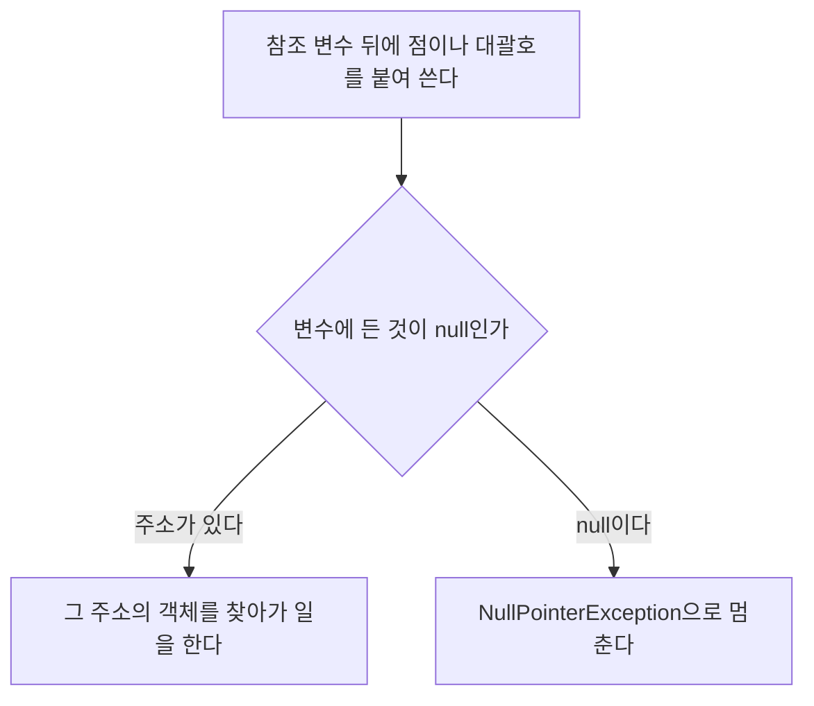


<div class="callout callout-summary" markdown="1">
<div class="callout-title callout-title--default" markdown="span">요약</div>

주소가 적힌 쪽지 두 장이 같은지 볼 때, 자바의 같다 기호는 쪽지에 적힌 주소만 견준다. 그래서 똑같이 생긴 집이라도 주소가 다르면 다르다고 답한다. 빠르고 뜻이 분명하지만, 내용이 같은지 알고 싶을 때 쓰면 틀린 답을 얻는다. 쪽지가 백지일 수도 있다. 아무 집도 가리키지 않는다는 표시인데, 백지를 들고 집에 찾아가려 하면 프로그램이 그 자리에서 멈춘다.

</div>


## 예시로 보기

[참조 타입 변수](/Hongs_Blog/studies/java/java-reference-types/)에는 값이 아니라 주소가 들어 있다. 그러면 그런 변수 둘이 "같다"는 것은 무슨 뜻일까? 가리키는 곳이 같다는 뜻일 수도, 가리키는 곳의 내용이 같다는 뜻일 수도 있다. 둘을 가르지 않으면 비교가 엉뚱한 답을 낸다.

```java
int[] refVar1 = {1, 2, 3};
int[] refVar2 = {1, 2, 3};
int[] refVar3 = refVar2;

System.out.println(refVar1 == refVar2);   // false
System.out.println(refVar2 == refVar3);   // true
```

`refVar1`과 `refVar2`는 내용이 똑같은데 `false`다. 슬라이드의 그림이 이 상황이다[^1].

```
  스택 영역                 힙 영역

  refVar1 [ 주소 ] ------> 객체1: [1][2][3]

  refVar2 [ 주소 ] --+
                     +---> 객체2: [1][2][3]
  refVar3 [ 주소 ] --+
```

`{1, 2, 3}`을 두 번 적었으니 배열이 둘 생겼다. `refVar1`은 첫째를, `refVar2`와 `refVar3`은 둘째를 가리킨다. `==`는 화살표가 같은 곳에 닿는지만 본다.

<div class="callout callout-check" markdown="1">
<div class="callout-title" markdown="span">검증: 위 출력과 `!=`의 결과, `Arrays.equals`, null로 객체를 쓸 때의 세 가지 `NullPointerException`과 그 메시지, 막는 방법 네 가지, 빈 문자열과 null의 차이, 카드 C2 — [08_java-reference-equality_impl.java](/Hongs_Blog/studies/java/code/08_java-reference-equality_impl/)</div>

</div>


## 정의

### ==와 !=

참조 타입 변수 둘에 `==`를 쓰면 두 변수에 든 메모리 주소를 비교한다. 두 변수가 같은 객체를 가리키면 `true`다. `!=`는 그 반대로, 서로 다른 객체를 가리키면 `true`다[^1].

`==`가 하는 일은 기본 타입에서도 똑같다. 칸에 든 것을 비교한다. 기본 타입은 칸에 값이 있으니 값이 비교되고, 참조 타입은 칸에 주소가 있으니 주소가 비교된다[^s1].

`==`가 `true`인 예 셋과 `false`인 예 둘이다[^s1].

| 코드 | `a == b` | 까닭 |
|---|---|---|
| `int[] a = {1}; int[] b = a;` | `true` | 주소를 베꼈다 |
| `String a = null; String b = null;` | `true` | 둘 다 아무것도 가리키지 않는다 |
| `int a = 1000; int b = 1000;` | `true` | 기본 타입은 값을 비교한다 |
| `int[] a = {1}; int[] b = {1};` | `false` | 객체가 둘이다 |
| `int[] a = {1}; int[] b = null;` | `false` | 한쪽은 객체를, 한쪽은 아무것도 가리키지 않는다 |

**왜 이렇게 만들었나.** 주소 비교는 수 하나를 견주면 끝난다. 내용 비교는 객체가 얼마나 크든 끝까지 훑어야 하고, 무엇을 "같은 내용"으로 볼지도 종류마다 다르다. 그래서 자바는 `==`에는 값싸고 뜻이 하나뿐인 주소 비교를 주고, 내용 비교는 종류마다 따로 메서드를 두었다. 문자열은 `equals()`([String](/Hongs_Blog/studies/java/java-string/)), 배열은 `Arrays.equals()`다[^s1].

### null

`null`은 참조 타입 변수에 주소가 없다는 것을 나타내는 값이다[^2]. 가리킬 객체가 아직 없거나 더는 없을 때 넣는다.

```java
String refVar1 = "자바";
String refVar2 = null;
```

```
  스택 영역                힙 영역

  refVar1 [ 50번지 ] ----> 50번지: "자바"
  refVar2 [  null  ]
```

`null`도 변수 칸에 들어 있는 값이다. 그래서 `null`인 변수 자체는 스택에 멀쩡히 있다[^2]. 없는 것은 그 칸이 가리킬 객체다. `null`인지는 `==`로 확인한다. `refVar2 == null`은 `true`다.

기본 타입 변수에는 `null`을 넣을 수 없다. `int` 칸에는 주소가 아니라 값이 들어가기 때문이다[^s1].

### NullPointerException

`null`인 변수로 객체의 데이터나 메서드를 쓰려 하면 `NullPointerException`이라는 예외가 난다[^2]. 프로그램이 그 줄에서 멈춘다.

```java
String refVar = null;
int len = refVar.length();   // NullPointerException
```

`refVar.length()`는 "`refVar`가 가리키는 객체에게 길이를 물어라"다. 가리키는 객체가 없으니 물을 곳이 없다. JDK 21은 메시지로 `Cannot invoke "String.length()" because ... is null`이라고 어떤 호출이 문제였는지 알려 준다[^s2].

배열도 같다[^s2].

```java
int[] arr = null;
arr[0] = 10;          // NullPointerException: Cannot store to int array because ... is null
int n = arr.length;   // NullPointerException: Cannot read the array length because ... is null
```

고치려면 변수에 실제 객체의 주소를 넣어 변수가 객체를 제대로 가리키게 한다[^2].



### 스스로 설명해 보기

다음 코드의 각 줄에서 무슨 일이 일어나는지 답한다[^s3].

```java
String s = null;                              // 1
boolean a = (s == null);                      // 2
boolean b = (s != null) && (s.length() > 0);  // 3
boolean c = "자바".equals(s);                  // 4
boolean d = s.equals("자바");                  // 5
```

<details class="callout callout-question" markdown="1">
<summary class="callout-title" markdown="span">1. 2번 줄은 왜 예외가 나지 않는가</summary>

`s == null`은 `s`가 가리키는 객체를 찾아가지 않는다. `s`의 칸에 든 것이 `null`인지만 본다(`==`는 칸에 든 것을 비교한다). 결과는 `true`다.

</details>


<details class="callout callout-question" markdown="1">
<summary class="callout-title" markdown="span">2. 3번 줄에는 `s.length()`가 있는데 왜 예외가 나지 않는가</summary>

`&&`는 앞이 `false`면 뒤를 계산하지 않는다([연산자와 오버플로](/Hongs_Blog/studies/java/java-operators/)). `s != null`이 `false`라 `s.length()`는 실행되지 않는다. 결과는 `false`다. `&&`를 `&`로 바꾸면 뒤도 계산해서 예외가 난다.

</details>


<details class="callout callout-question" markdown="1">
<summary class="callout-title" markdown="span">3. 4번 줄과 5번 줄은 같은 비교인데 왜 5번만 예외가 나는가</summary>

점 앞에 있는 쪽이 일을 맡는 객체다. 4번은 `"자바"`라는 실제 객체에게 "너는 `s`와 같으냐"고 묻는다. 물을 곳이 있고, `null`과는 같지 않으므로 `false`다. 5번은 `s`가 가리키는 객체에게 묻는데 `s`가 `null`이라 물을 곳이 없다.

</details>


<details class="callout callout-question" markdown="1">
<summary class="callout-title" markdown="span">이 추적의 핵심 생각은?</summary>

예외는 `null`을 "가지고 있을 때"가 아니라 `null`을 "따라가려 할 때" 난다. 칸을 보는 연산(`==`, `!=`, 대입)은 안전하고, 칸이 가리키는 곳으로 가는 연산(`.`, `[ ]`)이 위험하다.

</details>


<details class="callout callout-question" markdown="1">
<summary class="callout-title" markdown="span">같은 생각을 쓸 수 있는 다른 상황은?</summary>

참조 타입 배열을 `new String[3]`으로 만들면 칸이 모두 `null`이다([배열](/Hongs_Blog/studies/java/java-array/)). `arr[0]`을 읽는 것은 안전하지만 `arr[0].length()`는 예외다. 객체의 필드가 참조 타입일 때도 같다.

</details>


## 예제

**null일 수 있는 변수를 안전하게 쓰기.** 방법은 넷이다[^s3].

| 방법 | 코드 | `s`가 `null`일 때 |
|---|---|---|
| 쓰기 전에 확인 | `if (s != null) { ... s.length() ... }` | 블록을 건너뛴다 |
| `&&`로 이어 확인 | `s != null && s.length() > 0` | `false` |
| 삼항으로 기본값 | `(s != null) ? s.length() : 0` | 0 |
| 비교는 리터럴 쪽에서 | `"자바".equals(s)` | `false` |

**null은 빈 것과 다르다.** 빈 문자열 `""`과 길이 0인 배열 `new int[0]`은 객체가 있다. 내용만 없다. 그래서 `"".length()`는 0을 주고, `null`에 `.length()`를 부르면 예외다. 빈 봉투와 봉투가 아예 없는 것의 차이다[^s3].

**null을 문자열에 이어 붙이면** 예외 없이 `"null"`이라는 네 글자가 붙는다. `"값: " + s`는 `"값: null"`이다. 화면에 `null`이 찍혀 나오면 이 경우다[^s3].

## 활용

- `NullPointerException`이 나면 메시지에서 어떤 호출이 문제였는지 읽고, 그 줄에서 점이나 대괄호 앞에 있는 변수가 어디서 `null`이 되었는지 거슬러 올라간다.
- 지역 변수에 아무것도 넣지 않고 쓰면 실행 전에 컴파일 오류(`might not have been initialized`)로 걸린다. `null`을 넣어 두면 컴파일은 통과하고 실행 중에 멈춘다[^s2]. 급한 마음에 `= null`을 붙여 컴파일 오류만 없애면 문제가 뒤로 밀릴 뿐이다.
- 흔한 실수: 배열의 내용이 같은지 `==`로 본다. `Arrays.equals(a, b)`를 쓴다.
- 흔한 실수: 문자열을 `==`로 비교한다. 어떤 때는 맞고 어떤 때는 틀려서 더 찾기 어렵다([String](/Hongs_Blog/studies/java/java-string/)).

## 연결

- 선수: [참조 타입과 메모리 영역](/Hongs_Blog/studies/java/java-reference-types/)
- `==`가 문자열에서 헷갈리는 까닭: [String](/Hongs_Blog/studies/java/java-string/)
- `new`로 만든 참조 타입 배열의 칸이 `null`인 것: [배열](/Hongs_Blog/studies/java/java-array/)
- 예외가 무엇이고 어떻게 다루는가: [예외와 예외 클래스](/Hongs_Blog/studies/java/java-exception/)

## 자주 하는 오해

<div class="callout callout-misconception" markdown="1">
<div class="callout-title" markdown="span">"== 는 두 객체의 내용이 같은지 본다"</div>

틀렸다. 참조 타입에서 `==`는 두 변수가 같은 객체를 가리키는지만 본다. `int`에서는 `==`가 값을 비교하니까 배열이나 문자열에서도 내용을 비교하리라 믿기 쉽다. 실제로 `==`는 늘 칸에 든 것을 비교하고, 참조 타입의 칸에는 주소가 있다. 확인하는 법: `new int[] {1, 2, 3} == new int[] {1, 2, 3}`은 `false`이고 `Arrays.equals`로 견주면 `true`다.

</div>


<div class="callout callout-misconception" markdown="1">
<div class="callout-title" markdown="span">"null은 0이나 빈 문자열과 같은 것이다"</div>

틀렸다. `null`은 객체가 없다는 표시이고, 0과 `""`은 엄연한 값이다. 셋 다 "아무것도 없음"처럼 읽히고 C에서는 `NULL`이 0이라 더 헷갈린다. 자바에서는 `""`에 `.length()`를 부르면 0이 나오고 `null`에 부르면 예외가 난다. `int` 변수에는 `null`을 넣을 수조차 없다. 확인하는 법: `String e = ""; System.out.println(e == null);`은 `false`를 찍는다.

</div>


## 확인 문제

<details class="callout callout-question" markdown="1">
<summary class="callout-title" markdown="span">**C1** 참조 타입 변수에서 `==`와 `!=`가 비교하는 것, `null`의 뜻, `NullPointerException`이 나는 때를 쓰라.</summary>

**답:** `==`는 두 변수에 든 주소가 같은지(같은 객체를 가리키는지), `!=`는 다른지 본다. `null`은 변수에 주소가 없다, 곧 아무 객체도 가리키지 않는다는 값이다. `null`인 변수로 객체의 데이터나 메서드를 쓰려 할 때 `NullPointerException`이 난다.<br>
**이유:** "`null`인 변수를 만들 때 난다"는 오답이다. `null`을 넣거나 `== null`로 비교하는 것은 안전하다.

</details>


<details class="callout callout-question" markdown="1">
<summary class="callout-title" markdown="span">**C2** 다음 코드가 끝난 뒤 `x == y`, `x == z`, `x[0]`, `y[0]`의 값은?</summary>

```java
int[] x = {5};
int[] y = {5};
int[] z = x;
z[0] = 6;
```
**답:** `x == y`는 `false`, `x == z`는 `true`, `x[0]`은 6, `y[0]`은 5.<br>
**이유:** `x`와 `z`는 같은 배열을 가리켜 `z`로 고친 것이 `x`에 보인다. `y`는 처음 내용만 같았던 다른 배열이다.

</details>


<details class="callout callout-question" markdown="1">
<summary class="callout-title" markdown="span">**C3** `String s = null;`일 때 예외가 나는 것을 모두 고르라. ① `s == null` ② `s.length()` ③ `"a".equals(s)` ④ `s.equals("a")` ⑤ `"x" + s` ⑥ `s != null && s.length() > 0`</summary>

**답:** ②와 ④.<br>
**이유:** 둘만 `s`가 가리키는 객체를 찾아간다. ①은 칸만 본다. ③은 `"a"` 쪽에서 묻는다. ⑤는 `"xnull"`이 된다. ⑥은 `&&`가 뒤를 건너뛴다.

</details>


<details class="callout callout-question" markdown="1">
<summary class="callout-title" markdown="span">**C4** 자바가 참조 타입의 `==`를 내용 비교가 아니라 주소 비교로 정한 까닭을 쓰고, 내용을 비교하려면 무엇을 쓰는지 쓰라.</summary>

**답:** 주소 비교는 수 하나만 견주면 되어 빠르고, 어떤 종류의 객체에서도 뜻이 같다. 내용 비교는 객체를 끝까지 훑어야 하고 "같은 내용"의 기준이 종류마다 다르다. 그래서 내용 비교는 종류마다 메서드로 따로 둔다. 문자열은 `equals()`, 배열은 `Arrays.equals()`.<br>
**이유:** `==`가 기본 타입에서 하는 일(칸에 든 것 비교)과도 그대로 이어진다.

</details>


[^1]: 소프트웨어 프로젝트 4회 강의 자료 「Software Project 04. Reference Types」, p.6 (==와 != 연산, refVar1~3 그림)
[^2]: 같은 자료, p.7 (null 값, NullPointerException, 스택과 힙 그림)
[^s1]: <span class="fn-tag" title="수업 자료에 없고 따로 보탠 내용">보충</span> 첫 예시의 코드, `==`가 기본 타입과 참조 타입에서 같은 일을 한다는 설명, 예 다섯 개의 표, 설계 이유, 기본 타입에 `null`을 넣을 수 없다는 것은 원본에 없다. 값은 구현 코드로 확인했다. Java Language Specification §15.21.3(참조 비교), §4.1(null 타입)에 있다.
[^s2]: <span class="fn-tag" title="수업 자료에 없고 따로 보탠 내용">보충</span> 예외 메시지 세 가지, 초기화하지 않은 지역 변수의 컴파일 오류, 다이어그램 1개는 원본에 없다. JDK 21에서 직접 실행하고 컴파일해 확인했다. 메시지의 `...` 자리에는 변수 이름이 들어가는데, 컴파일 방식에 따라 `<local6>` 같은 번호로 나오기도 한다.
[^s3]: <span class="fn-tag" title="수업 자료에 없고 따로 보탠 내용">보충</span> 스스로 설명해 보기, 예제 세 가지, 활용 항목, 오해 항목, 카드 C1~C4는 원본에 없다. 값은 구현 코드로 확인했다.

