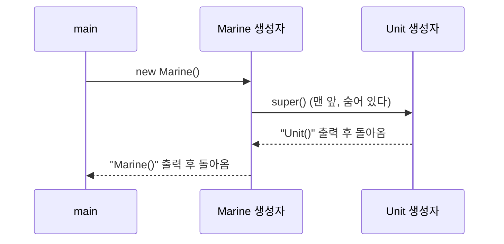


<div class="callout callout-summary" markdown="1">
<div class="callout-title callout-title--default" markdown="span">요약</div>

2층을 올리려면 1층이 먼저 서 있어야 한다. 자식 객체를 만들 때도 부모에게서 물려받은 부분이 먼저 채워지고, 그다음에 자식이 보탠 부분이 채워진다. 이 순서는 따로 적지 않아도 저절로 지켜진다. 자식의 처음 값 채우는 코드 맨 앞에 "부모 것부터 채워라"라는 한 줄이 보이지 않게 들어가기 때문이다. 단, 그 숨은 한 줄은 부모에게 아무 값도 넘기지 않는다. 부모가 값을 꼭 받아야 채워지게 만들어져 있으면, 넘길 값을 직접 적어 주어야 한다.

</div>


## 예시로 보기

[상속](/Hongs_Blog/studies/java/java-inheritance/)에서 자식 객체는 부모의 필드도 가진다고 했다. 그러면 `new Marine()`을 할 때 부모에게서 받은 `name`과 `health`는 누가 채우는가? 자식 생성자에 부모 필드를 채우는 코드를 다시 쓰면 상속으로 없앤 겹침이 되살아난다. 자바는 부모의 생성자를 먼저 돌려 부모 부분을 채운다.

```java
class Unit {
    Unit() {
        System.out.println("Unit()");
    }
}

class Marine extends Unit {
    Marine() {
        // 여기에 번역기가 super(); 를 넣는다
        System.out.println("Marine()");
    }
}
```

```java
new Marine();
// Unit()
// Marine()
```

`Marine` 생성자에는 `Unit`을 부르는 코드가 없는데 `Unit()`이 먼저 찍힌다. 자식 생성자의 맨 앞에 숨은 `super()`가 있어서 부모 생성자를 부른다[^1]. super는 "위"라는 뜻으로, 한 층 위의 부모를 가리킨다.

<div class="callout callout-check" markdown="1">
<div class="callout-title" markdown="span">검증: 위 출력, 세 층의 순서(A(), B(), C()), `super("Firebat", 50)` 예(Firebat 50 8), 부모 생성자 안의 `this`가 자식 객체와 같은 객체인 것, 카드 C3의 답을 JDK 21에서 실행해 비교. 오류 문구 둘은 따로 컴파일해 확인 — [21_java-super-constructor_impl.java](/Hongs_Blog/studies/java/code/21_java-super-constructor_impl/)</div>

</div>


## 정의

자식 객체를 만들면 부모 생성자가 먼저 돌고, 그다음 자식 생성자의 나머지가 돈다. 부모 생성자는 자식 생성자 맨 앞의 `super()` 호출이 부른다. 이 줄을 쓰지 않으면 번역기가 넣어 준다[^1].

```java
// 자식 생성자 선언
public 자식클래스(…) {
    super();
    …
}
```

부모의 부모가 있으면 같은 일이 위로 이어진다. `class A`, `class B extends A`, `class C extends B`에서 `new C()`를 하면 맨 위부터 `A()`, `B()`, `C()` 순서로 돈다[^s1].



불리는 순서는 자식이 먼저지만, 자식은 첫 줄에서 곧장 부모를 부르고 기다린다. 그래서 본문이 도는 순서는 부모가 먼저다[^s2].

<div class="callout callout-warning" markdown="1">
<div class="callout-title" markdown="span">원본 오류 의심</div>

원문: 슬라이드 p.6은 "When creating a child object, the parent object is first created. Then, the child object is created"라고 적고, 힙 영역에 "부모 객체"와 "자식 객체" 두 개를 따로 그렸다. / 문제점: `new`를 한 번 하면 힙에 생기는 객체는 하나다. 그 하나 안에 부모에게서 받은 칸과 자식이 보탠 칸이 함께 있고, 부모 생성자가 부모 쪽 칸을 먼저 채운다. 부모 객체가 따로 생기지 않는다. / 수정안: "부모 객체가 먼저 만들어진다"를 "부모 생성자가 먼저 돌아 부모 쪽 칸을 채운다"로 읽는다. / 근거: 부모 생성자 안에서 `this`를 저장해 두고 `new Tank()`가 돌려준 주소와 `==`로 견주면 `true`다. 부모 생성자 안에서 `getClass().getSimpleName()`을 찍으면 `Tank`(자식 이름)가 나온다. 부모 생성자가 채우고 있는 것이 바로 그 자식 객체다.

</div>


```
스택              힙
┌──────┐          ┌ Marine 객체 (하나) ───────────┐
│  m   │────────▶ │ Unit에서 받은 칸: name, health │ ← Unit 생성자가 먼저 채운다
└──────┘          │ Marine이 보탠 칸: damage       │ ← Marine 생성자가 그다음 채운다
                  └────────────────────────────────┘
```

### 부모가 값을 받아야 할 때

숨은 `super()`는 매개변수 없는 부모 생성자를 부른다. 부모에 그런 생성자가 없으면 넣어 줄 수가 없다[^s1].

```java
class Infantry {
    String name;
    int health;

    Infantry(String name, int health) {   // 매개변수 없는 생성자가 없다
        this.name = name;
        this.health = health;
    }
}

class Firebat extends Infantry {
    Firebat() {
        System.out.println("Firebat()");
    }
}
```

```
error: constructor Infantry in class Infantry cannot be applied to given types;
  required: String,int
  found:    no arguments
```

`Firebat` 생성자에는 `Infantry`라는 글자가 없는데 오류는 `Infantry`의 생성자를 말한다. 숨은 `super()`가 걸린 것이다. `super(값)`으로 어느 부모 생성자에 무엇을 넘길지 직접 적어 고친다.

```java
class Firebat extends Infantry {
    int damage;

    Firebat() {
        super("Firebat", 50);     // 부모 생성자에 값을 넘긴다
        this.damage = 8;
    }
}
// new Firebat() → name "Firebat", health 50, damage 8
```

`super(...)`는 생성자의 첫 줄에만 쓸 수 있다. 다른 줄 뒤에 쓰면 `call to super must be first statement in constructor` 오류가 난다. 부모 쪽이 채워지기 전에 자식이 그 칸을 쓰는 일을 막으려는 것이다[^s1].

## 활용

- 부모 클래스에 매개변수 있는 생성자만 만들었다면, 모든 자식의 모든 생성자가 `super(값)`을 써야 한다. 자식에 생성자를 하나도 안 써도 같은 오류가 난다. 번역기가 넣어 주는 기본 생성자 안에도 `super()`가 있기 때문이다[^s1].
- 흔한 실수: 부모에 생성자를 하나 보태고 나서 잘 돌던 자식들이 한꺼번에 깨지는 것. 부모의 기본 생성자가 사라져서다([생성자](/Hongs_Blog/studies/java/java-constructor/)).
- `super(...)`와 `this(...)`는 둘 다 첫 줄이어야 하므로 한 생성자에 함께 쓸 수 없다[^s1].
- `super`는 부모의 가려진 메서드를 부를 때도 쓴다(`super.method()`). 그쪽은 [메서드 오버라이딩](/Hongs_Blog/studies/java/java-overriding/)에 있다.

## 연결

- 선수: [상속](/Hongs_Blog/studies/java/java-inheritance/), [생성자](/Hongs_Blog/studies/java/java-constructor/)
- 스택의 변수와 힙의 객체: [참조 타입과 메모리 영역](/Hongs_Blog/studies/java/java-reference-types/)
- `new`로 직접 만들 수 없는 부모도 자식을 만들 때 생성자가 돈다: [추상 클래스](/Hongs_Blog/studies/java/java-abstract-class/)

## 확인 문제

<details class="callout callout-question" markdown="1">
<summary class="callout-title" markdown="span">**C1** 자식 객체를 만들 때 생성자가 도는 순서와, 그 순서를 만드는 것이 무엇인지 쓰라.</summary>

**답:** 부모 생성자가 먼저 돌고 자식 생성자의 나머지가 돈다. 자식 생성자 맨 앞의 `super()` 호출이 부모 생성자를 부르며, 쓰지 않으면 번역기가 넣어 준다.

</details>


<details class="callout callout-question" markdown="1">
<summary class="callout-title" markdown="span">**C2** 부모가 `class Infantry { Infantry(String name) { } }`다. 번역 단계에서 오류가 나는 자식을 모두 고르라. (가) `class A extends Infantry { A() { super("a"); } }` (나) `class B extends Infantry { B() { } }` (다) `class C extends Infantry { }` (라) `class D extends Infantry { D() { System.out.println("d"); super("d"); } }`</summary>

**답:** (나), (다), (라).<br>
**이유:** (나) 숨은 `super()`가 매개변수 없는 부모 생성자를 찾는데 없다. (다) 생성자를 안 써도 번역기가 넣는 기본 생성자에 `super()`가 있어 같은 오류다. (라) `super(...)`가 첫 줄이 아니다. (다)를 되는 것으로 고르는 오답이 가장 흔하다.

</details>


<details class="callout callout-question" markdown="1">
<summary class="callout-title" markdown="span">**C3** `class P { P() { System.out.println("P"); } P(int x) { System.out.println("P" + x); } }`와 `class K extends P { K() { System.out.println("K"); } K(int x) { super(x); System.out.println("K" + x); } }`가 있다. `new K(); new K(7);`의 출력은?</summary>

**답:** `P`, `K`, `P7`, `K7`이 한 줄씩 나온다.<br>
**이유:** `K()`에는 숨은 `super()`가 있어 `P()`가 먼저 돈다. `K(int)`는 `super(x)`를 직접 썼으므로 `P(int)`가 돈다. 셋째 줄을 `P`로 답하는 것은 직접 쓴 `super(x)`를 놓친 것이다[^s1].

</details>


<details class="callout callout-question" markdown="1">
<summary class="callout-title" markdown="span">**C4** `super(...)`를 생성자의 첫 줄에만 쓰게 한 이유는?</summary>

**답:** 자식의 코드는 부모에게서 받은 칸을 쓸 수 있다. 부모 생성자가 그 칸을 채우기 전에 자식 코드가 먼저 돌면 덜 채워진 값을 쓰게 된다. 첫 줄로 못 박아 부모 쪽이 늘 먼저 채워지게 한다.

</details>


[^1]: 소프트웨어 프로젝트 8회 강의 자료 「Software Project 08. Inheritance」, p.6 (Parent Constructor Invocation, `자식클래스 변수 = new 자식클래스();`, 숨은 `super();`, 스택의 변수가 힙의 자식 객체를 가리키는 그림)
[^s1]: <span class="fn-tag" title="수업 자료에 없고 따로 보탠 내용">보충</span> 슬라이드에는 숨은 `super()`와 그림만 있다. `Unit`·`Marine`의 출력, 세 층의 순서, 매개변수 있는 부모 생성자와 `super(값)`, 오류 문구, 첫 줄 규칙과 그 이유, 활용의 항목, 카드 C2~C4는 원본에 없다. 모두 JDK 21에서 직접 실행·컴파일해 확인했다. `super(...)`가 첫 줄이어야 한다는 규칙은 JDK 21 기준이다.
[^s2]: <span class="fn-tag" title="수업 자료에 없고 따로 보탠 내용">보충</span> 순서 그림과 메모리 그림은 원본에 없다. 위 코드의 실행 결과와 `this` 비교 실험을 근거로 그렸다.

