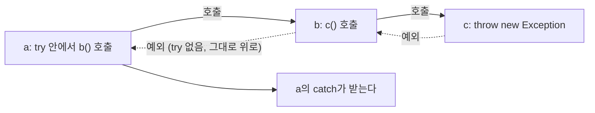


<div class="callout callout-summary" markdown="1">
<div class="callout-title callout-title--default" markdown="span">요약</div>

사고를 그 자리에서 수습하지 않고 "이 일을 시킨 쪽이 알아서 하라"고 위로 넘기는 방법이다. 일을 맡은 쪽은 사고를 어떻게 수습할지 모를 때가 많고, 시킨 쪽이 더 잘 안다. 넘기려면 "나는 이런 사고를 넘길 수 있다"고 미리 밝혀 두어야 한다. 끝까지 아무도 받지 않으면 프로그램이 끝난다. 사고를 직접 일으켜 넘기는 것도 같은 길을 탄다.

</div>


## 예시로 보기

이름으로 클래스를 찾는 메서드 `findClass`를 만든다. 클래스가 없으면 무엇을 할까? 다른 이름으로 다시 찾을지, 사용자에게 알릴지, 그냥 넘어갈지는 `findClass`를 부른 쪽 사정에 달렸다. 그래서 `findClass`는 처리하지 않고 부른 쪽에 넘긴다[^1].

```java
public static void main(String[] args) {
    try {
        findClass();
    } catch (ClassNotFoundException e) {
        System.out.println("Exception: " + e.getMessage());
    }
}

public static void findClass() throws ClassNotFoundException {
    Class.forName("java.lang.String2");
}
```

```text
Exception: java.lang.String2
```

`findClass` 안에는 `try`가 없다. 대신 선언 끝에 `throws ClassNotFoundException`이 붙었다. 예외는 `findClass` 안에서 났지만, `findClass`를 부른 `main`의 `catch`가 받았다[^s1].

## 정의

**`throws`** 는 메서드 안에서 난 예외를 그 메서드를 부른 쪽으로 넘긴다. 메서드 선언의 맨 끝에 쓰고, 넘길 예외 클래스를 쉼표로 나눠 적는다[^2].

```java
리턴타입 메서드이름(매개변수, …) throws 예외클래스1, 예외클래스2, … {
}
```

넘길 예외 클래스가 많으면 `throws Exception`이나 `throws Throwable` 하나로 모든 예외를 넘길 수 있다[^3]. 부모 타입 하나가 자손 예외를 모두 받기 때문이다.

**`throw`** 는 예외 객체를 직접 만들어 그 자리에서 일으킨다. `throw` 뒤에 예외 객체를 준다. 왜 사고가 났는지 알리는 글은 생성자의 인자로 넣는다[^4].

```java
throw new Exception();
throw new RuntimeException("예외메시지");
```

두 낱말은 s 하나 차이지만 자리와 하는 일이 다르다[^s2].

| | `throws` | `throw` |
|---|---|---|
| 쓰는 자리 | 메서드 선언의 끝 | 메서드 몸통 안의 한 줄 |
| 뒤에 오는 것 | 예외 클래스 이름(여러 개 가능) | 예외 객체 하나(`new …`) |
| 하는 일 | "이 예외를 부른 쪽에 넘길 수 있다"고 밝힌다 | 지금 이 줄에서 예외를 일으킨다 |

### 여러 층을 거쳐 올라가는 흐름

넘겨받은 쪽도 처리하지 않고 다시 넘길 수 있다. `a`가 `b`를, `b`가 `c`를 부르고 `c`에서 예외를 일으킨다[^s2].

```java
static void c() throws Exception {
    System.out.println("c1");
    throw new Exception("boom");
}
static void b() throws Exception {
    System.out.println("b1");
    c();
    System.out.println("b2");
}
static void a() {
    try {
        System.out.println("a1");
        b();
        System.out.println("a2");
    } catch (Exception e) {
        System.out.println("caught " + e.getMessage());
    }
    System.out.println("a3");
}
```

| 순서 | 실행되는 곳 | 찍히는 것 | 일어나는 일 |
|---|---|---|---|
| 1 | `a`의 `try` | `a1` | `b()`를 부른다 |
| 2 | `b` | `b1` | `c()`를 부른다 |
| 3 | `c` | `c1` | `throw`로 예외를 일으킨다. `c`가 여기서 끝난다 |
| 4 | `b` | (없음) | `c()`를 부른 줄에서 예외를 받았는데 `try`가 없다. `b`도 여기서 끝나고 예외를 위로 넘긴다. `b2`는 건너뛴다 |
| 5 | `a`의 `catch` | `caught boom` | `b()`를 부른 줄이 `try` 안이다. `a2`는 건너뛰고 `catch`가 받는다 |
| 6 | `a` | `a3` | `try-catch` 다음 줄부터 정상으로 이어 간다 |



실선은 부르는 방향, 점선은 예외가 올라가는 방향이다. 예외는 부른 순서를 거꾸로 밟아 올라가다가 처음 만나는 맞는 `catch`에서 멈춘다[^s2].

`main`까지 올라갔는데 `main`도 `throws`로 넘기면 받을 곳이 없다. 자바 실행기가 오류 화면을 찍고 프로그램을 끝낸다.

```java
public static void main(String[] args) throws ClassNotFoundException {
    System.out.println("start");
    findClass();
    System.out.println("end");
}
```

```text
start
Exception in thread "main" java.lang.ClassNotFoundException: java.lang.String2
	…
	at E5.findClass(E5.java:2)
	at E5.main(E5.java:5)
```

`end`는 찍히지 않는다[^s3].

<div class="callout callout-check" markdown="1">
<div class="callout-title" markdown="span">검증: 슬라이드 예제의 출력, 위 여섯 단계 표의 출력 순서, `throw`에 넣은 글이 `getMessage()`로 나오는 것, `throws`에 예외 둘을 적은 경우와 `Exception` 하나로 뭉친 경우, 카드 C2의 답 — [36_java-throw_impl.java](/Hongs_Blog/studies/java/code/36_java-throw_impl/)</div>

</div>


## 활용

- 일반 예외를 낼 수 있는 메서드를 부르면 고를 수 있는 길은 둘뿐이다. `try-catch`로 받거나, 내 메서드에 `throws`를 붙여 다시 넘긴다. 둘 다 안 하면 `unreported exception …; must be caught or declared to be thrown` 오류로 번역되지 않는다. 오류 문구가 두 길을 그대로 말한다[^s3].
- 실행 예외는 `throws`를 적지 않아도 저절로 위로 올라간다. `throw new RuntimeException("…")`만 쓰고 `throws`가 없어도 번역된다[^s3].
- `throws Exception`으로 뭉치면 편하지만, 부른 쪽은 어떤 사고가 올 수 있는지 선언만 봐서는 알 수 없다. 부른 쪽의 `catch`도 `Exception`으로 뭉뚱그려 받게 된다.
- 어디서 받을지는 "수습할 방법을 아는 곳"으로 정한다. 다시 물어볼 수 있는 화면 쪽 코드, 다른 값으로 다시 해 볼 수 있는 쪽이 받는다.

## 연결

- 선수: [try-catch-finally](/Hongs_Blog/studies/java/java-try-catch/). 넘긴 예외는 결국 어딘가의 `catch`가 받는다.
- `throws`가 꼭 필요한 예외와 아닌 예외: [예외와 예외 클래스](/Hongs_Blog/studies/java/java-exception/)
- `throw`로 일으킬 예외를 직접 만들기: [사용자 정의 예외](/Hongs_Blog/studies/java/java-custom-exception/)
- `throws`는 메서드 선언의 일부다: [필드와 메서드](/Hongs_Blog/studies/java/java-fields-methods/). [생성자](/Hongs_Blog/studies/java/java-constructor/)에도 붙일 수 있다[^s3].

## 확인 문제

<details class="callout callout-question" markdown="1">
<summary class="callout-title" markdown="span">**C1** `throws`와 `throw`를 쓰는 자리와 뒤에 오는 것을 각각 쓰라.</summary>

**답:** `throws`는 메서드 선언의 맨 끝에 쓰고, 뒤에 넘길 예외 클래스 이름을 쉼표로 나눠 적는다. `throw`는 메서드 몸통 안에 쓰고, 뒤에 예외 객체 하나(`new 예외클래스("메시지")`)를 준다.<br>
**이유:** `throw ClassNotFoundException;`처럼 클래스 이름만 쓰거나 `throws new …`로 쓰는 것이 흔한 실수다. `throw`는 객체를, `throws`는 클래스 이름을 받는다.

</details>


<details class="callout callout-question" markdown="1">
<summary class="callout-title" markdown="span">**C2** 출력을 순서대로 쓰라. `static void inner() throws Exception { try { System.out.println("1"); throw new Exception("E"); } finally { System.out.println("2"); } }` 그리고 `try { inner(); System.out.println("3"); } catch (Exception e) { System.out.println("4 " + e.getMessage()); } System.out.println("5");`</summary>

**답:** `1`, `2`, `4 E`, `5`.<br>
**이유:** `inner`의 `try`에는 `catch`가 없다. 예외는 잡히지 않지만 `finally`는 돌아서 2가 찍히고, 그 뒤 예외가 부른 쪽으로 올라간다. 부른 쪽 `try`에서 `inner()` 뒤의 3은 건너뛰고 `catch`가 `4 E`를 찍는다. 처리했으므로 5까지 간다.

</details>


<details class="callout callout-question" markdown="1">
<summary class="callout-title" markdown="span">**C3** 번역되지 않는 메서드를 모두 고르라. ① `static void m1() { throw new RuntimeException("a"); }` ② `static void m2() { throw new Exception("b"); }` ③ `static void m3() throws Exception { throw new Exception("c"); }` ④ `static void m4() { m3(); }` ⑤ `static void m5() { try { m3(); } catch (Exception e) { } }` ⑥ `static void m6() throws Exception { m3(); }`</summary>

**답:** ②와 ④다.<br>
**이유:** `Exception`은 일반 예외다. ②는 일으키면서 받지도 넘기지도 않았고, ④는 일반 예외를 넘기는 `m3`을 부르면서 받지도 넘기지도 않았다. ①은 실행 예외라 `throws`가 없어도 된다. ③과 ⑥은 넘겼고, ⑤는 받았다.

</details>


<details class="callout callout-question" markdown="1">
<summary class="callout-title" markdown="span">**C4** `findClass`가 `ClassNotFoundException`을 안에서 `try-catch`로 처리하지 않고 `throws`로 넘기는 편이 나은 경우는 언제인가?</summary>

**답:** 클래스를 못 찾았을 때 무엇을 할지가 부른 쪽마다 다를 때다. `findClass` 안에서 받아 글만 찍고 끝내면, 부른 쪽은 실패했다는 사실조차 모르고 다음 일을 이어 간다.<br>
**이유:** 예외는 수습 방법을 아는 곳에서 받는다. 일을 맡은 메서드보다 시킨 쪽이 그것을 아는 경우가 많다.

</details>


[^1]: 소프트웨어 프로젝트 15회 강의 자료 「Software Project 15. Exception handling」, p.16 (ThrowingException.java)
[^2]: 같은 자료, p.15 (throws의 뜻과 쓰는 자리, method1이 method2를 부르는 그림)
[^3]: 같은 자료, p.17 (throws Exception, throws Throwable)
[^4]: 같은 자료, p.19 (throw와 생성자 인자로 주는 메시지)
[^s1]: <span class="fn-tag" title="수업 자료에 없고 따로 보탠 내용">보충</span> 실행 결과는 원본에 없고 검증 코드로 확인했다. `ClassNotFoundException`의 `getMessage()`는 못 찾은 클래스 이름을 돌려준다.
[^s2]: <span class="fn-tag" title="수업 자료에 없고 따로 보탠 내용">보충</span> `throws`와 `throw`를 견준 표, 세 층 예제와 단계 표, 다이어그램은 원본에 없다. 원본 p.15의 그림(부른 곳에서 예외 처리)을 세 층으로 늘린 것이다. 출력 순서는 검증 코드로 확인했다.
[^s3]: <span class="fn-tag" title="수업 자료에 없고 따로 보탠 내용">보충</span> `main`이 `throws`로 넘겼을 때의 화면, 번역 오류 문구, 실행 예외에는 `throws`가 필요 없다는 것, 생성자에도 붙일 수 있다는 것, 카드 C2·C3·C4는 원본에 없다. JDK 21에서 직접 실행해 확인했다. 화면의 `E5`는 실험에 쓴 클래스 이름이고 `…`는 줄인 자리다.

