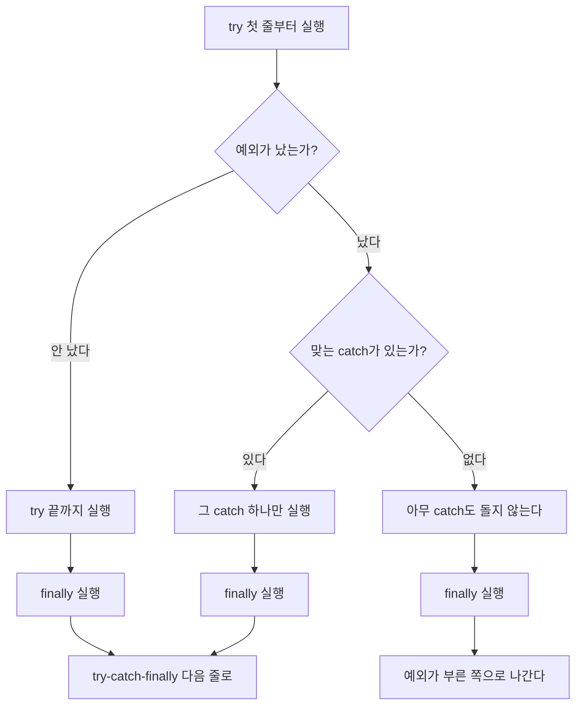


<div class="callout callout-summary" markdown="1">
<div class="callout-title callout-title--default" markdown="span">요약</div>

사고가 날 수 있는 줄들을 울타리 하나에 넣고, 사고가 나면 할 일과, 사고가 나든 안 나든 마지막에 꼭 할 일을 따로 적어 두는 방법이다. 사고가 나도 프로그램이 끝나지 않고 다음 줄로 넘어간다. 단, 울타리 안에서 사고가 난 줄 뒤의 줄들은 건너뛴다. 사고 종류별로 할 일을 여러 개 적을 수 있지만 그중 하나만 돌고, 좁은 종류를 넓은 종류보다 먼저 적어야 한다.

</div>


## 예시로 보기

문자열 길이를 찍는 메서드에 `null`을 넘기면 프로그램이 그 자리에서 끝나고 `[Program end]`는 찍히지 않는다([예외와 예외 클래스](/Hongs_Blog/studies/java/java-exception/)의 첫 예). 사고 하나 때문에 남은 일을 전부 못 하게 된다. 사고가 날 수 있는 두 줄을 `try`로 감싼다[^1].

```java
public static void printLength(String data) {
    try {
        int result = data.length();
        System.out.println("length: " + result);
    } catch (NullPointerException e) {
        System.out.println(e.getMessage());
    } finally {
        System.out.println("continue..");
    }
}

public static void main(String[] args) {
    System.out.println("[Program start]");
    printLength("Hello World");
    printLength(null);
    System.out.println("[Program end]");
}
```

```text
[Program start]
length: 11
continue..
Cannot invoke "String.length()" because "<parameter1>" is null
continue..
[Program end]
```

두 번째 호출에서 사고가 났지만 프로그램은 끝까지 갔다. 넷째 줄은 `catch` 안에서 찍은 사고 설명이다. `continue..`는 사고가 없던 첫 호출에서도, 사고가 난 둘째 호출에서도 찍혔다[^s1].

## 정의

예외 처리 코드는 예외가 났을 때 프로그램이 갑자기 끝나지 않고 정상으로 계속 돌게 하는 코드다. `try`, `catch`, `finally` 세 덩어리로 이루어지고, 생성자와 메서드 안에 쓴다[^2].

```java
try {
    // 예외가 날 수 있는 코드
} catch (예외클래스 e) {
    // 그 예외가 났을 때 할 일
} finally {
    // 예외가 나든 안 나든 꼭 할 일
}
```

| 덩어리 | 언제 도는가 |
|---|---|
| `try` | 늘 첫 줄부터 돈다. 예외가 나면 그 줄에서 멈추고 나머지 줄은 건너뛴다 |
| `catch` | `try`에서 난 예외가 괄호 안 클래스의 객체일 때만 돈다 |
| `finally` | 늘 돈다. 없어도 된다 |

`catch`의 괄호 안 `e`는 사고 객체를 받는 변수다. `e.getMessage()`는 사고 설명 글을 돌려준다. `e.toString()`은 "클래스 이름: 설명"을 돌려주고, `e.printStackTrace()`는 거기에 사고가 난 자리까지의 호출 순서를 붙여 찍는다[^1][^s1].

### 실행 순서

세 덩어리가 도는 순서는 세 가지뿐이다. 예외가 없을 때, 잡는 예외가 났을 때, 못 잡는 예외가 났을 때다[^2].



세 길 모두 `finally`를 지난다. 달라지는 것은 그 뒤다[^s2].

아래 메서드로 세 길을 하나씩 밟아 본다. `arr`는 `{"7", "x"}`이다.

```java
static int parse(String[] arr, int i) {
    try {
        System.out.println("A");
        int v = Integer.parseInt(arr[i]);
        System.out.println("B");
        return v;
    } catch (NumberFormatException e) {
        System.out.println("C");
        return -1;
    } finally {
        System.out.println("D");
    }
}
```

| 호출 | `arr[i]` | 난 예외 | 찍히는 순서 | 메서드가 끝나는 모습 |
|---|---|---|---|---|
| `parse(arr, 0)` | `"7"` | 없음 | A B D | 7을 돌려준다 |
| `parse(arr, 1)` | `"x"` | `NumberFormatException` | A C D | −1을 돌려준다 |
| `parse(arr, 2)` | 없는 칸 | `ArrayIndexOutOfBoundsException` | A D | 예외가 부른 쪽으로 나간다 |

둘째 줄에서 B가 빠졌다. 예외가 난 줄 뒤의 `try` 줄은 건너뛰기 때문이다. 셋째 줄에서는 맞는 `catch`가 없어 C도 안 찍혔지만 D는 찍혔다. 첫째와 둘째 줄에서는 `return`을 만난 뒤에 D가 찍혔다. `return`으로 메서드를 나가는 길에도 `finally`를 거친다[^s2].

<div class="callout callout-check" markdown="1">
<div class="callout-title" markdown="span">검증: 위 표의 세 줄, 이 문서의 슬라이드 예제 세 개의 출력, <code>catch (A &#124; B)</code> 예, 카드 C2의 답 — [35_java-try-catch_impl.java](/Hongs_Blog/studies/java/code/35_java-try-catch_impl/)</div>

</div>


### 예외 종류별로 처리하기

`catch`를 여러 개 이어 쓰면 예외 종류마다 다른 일을 할 수 있다. `catch`의 괄호 안 클래스가 `try`에서 난 예외의 종류와 맞으면 그 `catch`가 뽑혀 돈다[^3].

```java
String[] array = {"100", "1oo"};

for (int i = 0; i <= array.length; i++) {
    try {
        int value = Integer.parseInt(array[i]);
        System.out.println("array[" + i + "] = " + value);
    } catch (ArrayIndexOutOfBoundsException e) {
        System.out.println("Array index out of bounds." + e.getMessage());
    } catch (NumberFormatException e) {
        System.out.println("Number format exception." + e.getMessage());
    }
}
```

`"1oo"`는 숫자 0 자리에 영어 글자 o가 들어 있다. 반복 조건이 `i < array.length`가 아니라 `i <= array.length`라서 `i`는 0, 1, 2까지 간다[^4].

| `i` | `array[i]` | 일어나는 일 | 찍히는 줄 |
|---|---|---|---|
| 0 | `"100"` | 예외 없음 | `array[0] = 100` |
| 1 | `"1oo"` | 숫자로 못 바꾼다 → 둘째 `catch` | `Number format exception.For input string: "1oo"` |
| 2 | 없는 칸 | 칸 번호가 범위 밖 → 첫째 `catch` | `Array index out of bounds.Index 2 out of bounds for length 2` |

`try`가 `for` 안에 있으므로 한 바퀴에서 예외가 나도 다음 바퀴는 돈다.

**`catch`가 여러 개여도 하나만 돈다.** 위에서부터 차례로 맞춰 보고, 처음 맞는 `catch` 하나만 돌린 뒤 나머지는 건너뛴다[^5].

**자식 클래스 `catch`를 먼저, 부모 클래스 `catch`를 나중에 쓴다.** 처리할 예외 클래스들이 [상속](/Hongs_Blog/studies/java/java-inheritance/) 관계이면 이 순서를 지켜야 한다[^5]. `catch (Exception e)`는 `Exception`의 모든 자손 객체를 받는다. 부모 타입 변수에 자식 객체를 넣을 수 있다는 [다형성](/Hongs_Blog/studies/java/java-polymorphism/)의 규칙 그대로다. 부모 `catch`가 위에 있으면 아래의 자식 `catch`까지 내려갈 예외가 하나도 남지 않는다.

순서를 지킨 예다. 칸 번호 사고만 따로 다루고 나머지는 한꺼번에 받는다[^6].

```java
} catch (ArrayIndexOutOfBoundsException e) {
    System.out.println("Array index out of bounds." + e.getMessage());
} catch (Exception e) {
    System.out.println("There is an exception.");
}
```

```text
array[0] = 100
There is an exception.
Array index out of bounds.Index 2 out of bounds for length 2
```

두 `catch`의 순서를 바꾸면 번역되지 않는다[^s3].

```text
error: exception ArrayIndexOutOfBoundsException has already been caught
```

서로 부모·자식이 아닌 예외 둘을 똑같이 처리하고 싶으면 한 `catch`에 <code>&#124;</code>로 묶는다: <code>catch (ArrayIndexOutOfBoundsException &#124; NumberFormatException e)</code>. 부모·자식 사이인 둘을 묶으면 번역되지 않는다[^s3].

### 스스로 설명해 보기

<details class="callout callout-question" markdown="1">
<summary class="callout-title" markdown="span">1. `parse(arr, 1)`에서 B가 찍히지 않는 이유</summary>

`Integer.parseInt("x")`가 예외를 내면 `try`는 그 줄에서 멈춘다. 예외가 난 줄 뒤에 있는 `System.out.println("B")`와 `return v`는 건너뛰고 바로 맞는 `catch`로 간다.

</details>


<details class="callout callout-question" markdown="1">
<summary class="callout-title" markdown="span">2. `parse(arr, 2)`에서 C는 안 찍히고 D는 찍히는 이유</summary>

난 예외는 `ArrayIndexOutOfBoundsException`이고 `catch`는 `NumberFormatException`만 받는다. 둘은 부모·자식이 아니라서 맞지 않는다. 그래서 `catch`는 돌지 않는다. `finally`는 예외가 잡혔는지와 상관없이 늘 돌기 때문에 D는 찍힌다. 그다음 예외가 `parse`를 부른 쪽으로 나간다.

</details>


<details class="callout callout-question" markdown="1">
<summary class="callout-title" markdown="span">3. `catch (Exception e)`를 맨 위에 두면 아래 `catch`가 쓸모없어지는 이유</summary>

`catch`는 위에서부터 맞춰 보고 처음 맞는 하나만 돈다. `ArrayIndexOutOfBoundsException` 객체는 `Exception` 타입 변수에도 들어가므로 늘 맨 위 `catch`에서 맞는다. 아래 `catch`까지 내려가는 경우가 없다. 번역기가 이것을 알아채고 오류로 막는다.

</details>


<details class="callout callout-question" markdown="1">
<summary class="callout-title" markdown="span">이 방법의 핵심 아이디어는?</summary>

정상일 때 할 일(`try`), 사고가 났을 때 할 일(`catch`), 어느 쪽이든 마무리로 할 일(`finally`)을 서로 다른 자리에 나눠 적는다. 사고 검사를 줄마다 `if`로 끼워 넣지 않아도 된다.

</details>


<details class="callout callout-question" markdown="1">
<summary class="callout-title" markdown="span">이 방법을 쓸 수 있는 다른 상황은?</summary>

사용자가 입력한 글자를 숫자로 바꿀 때(`NumberFormatException`), 이름으로 클래스를 찾을 때(`ClassNotFoundException`), 잔액보다 많은 돈을 찾으려 할 때([사용자 정의 예외](/Hongs_Blog/studies/java/java-custom-exception/)의 계좌 예).

</details>


## 활용

- `try` 안에는 사고가 날 수 있는 줄과, 그 줄이 성공해야만 뜻이 있는 줄을 같이 넣는다. 위 예에서 `"length: "`를 찍는 줄이 `try` 안에 있는 이유다. 길이를 못 구했는데 찍을 수는 없다.
- `try`만 단독으로는 못 쓴다. `catch`나 `finally` 가운데 하나는 붙어야 한다. 없으면 `'try' without 'catch', 'finally' or resource declarations` 오류가 난다[^s3].
- `try` 안에서 선언한 변수는 `catch`와 `finally`에서 못 쓴다. 중괄호가 다르기 때문이다([제어문](/Hongs_Blog/studies/java/java-control-flow/)의 블록 규칙과 같다). 바깥에서 쓸 변수는 `try` 앞에서 선언한다[^s3].
- `catch` 안을 비워 두면 사고가 났다는 흔적이 전혀 남지 않는다. 적어도 `e.getMessage()`를 찍어 둔다.
- 일반 예외는 `try`에서 그 예외가 날 수 있을 때만 `catch`에 쓸 수 있다. 날 리 없는 일반 예외를 `catch`에 쓰면 `exception ClassNotFoundException is never thrown in body of corresponding try statement` 오류가 난다[^s3].

## 연결

- 선수: [예외와 예외 클래스](/Hongs_Blog/studies/java/java-exception/)(어떤 예외에 처리 코드가 꼭 필요한가), [다형성](/Hongs_Blog/studies/java/java-polymorphism/)(부모 `catch`가 자식 예외를 받는 이유)
- 어떤 `catch`가 맞는지 고르는 일은 [instanceof](/Hongs_Blog/studies/java/java-casting/) 검사를 위에서부터 차례로 하는 것과 같다.
- 직접 처리하지 않고 부른 쪽에 넘기려면: [예외 던지기](/Hongs_Blog/studies/java/java-throw/)

## 자주 하는 오해

<div class="callout callout-misconception" markdown="1">
<div class="callout-title" markdown="span">"finally는 예외가 났을 때만 돈다"</div>

틀렸다. `finally`는 예외가 없을 때도, 예외를 잡았을 때도, 못 잡았을 때도 돈다. `try`나 `catch`에서 `return`을 만나도 돈다. 이름이 `catch` 뒤에 붙어 있어서 "사고 뒤처리"처럼 보이기 때문에 헷갈린다. 위의 `parse(arr, 0)`이 반례다. 예외가 없는데 A B 다음에 D가 찍힌다. 맨 처음 예제에서도 `printLength("Hello World")`가 `continue..`를 찍었다.

</div>


<div class="callout callout-misconception" markdown="1">
<div class="callout-title" markdown="span">"catch가 예외를 잡으면 try의 멈춘 자리로 돌아가 이어서 실행한다"</div>

틀렸다. `catch`가 끝나면 `try`로 돌아가지 않고 `finally`를 거쳐 그 아래 줄로 간다. `try`에서 예외가 난 줄 뒤의 줄들은 영영 실행되지 않는다. `parse(arr, 1)`에서 B가 끝내 찍히지 않는 것으로 확인할 수 있다. "처리했으니 하던 일을 계속한다"고 생각하기 쉽지만, 계속하는 것은 `try` 안이 아니라 `try-catch-finally` 덩어리 다음부터다.

</div>


## 확인 문제

<details class="callout callout-question" markdown="1">
<summary class="callout-title" markdown="span">**C1** `try`, `catch`, `finally` 덩어리가 각각 언제 도는지 쓰라.</summary>

**답:** `try`는 늘 첫 줄부터 돌고, 예외가 나면 그 줄에서 멈춘다. `catch`는 `try`에서 난 예외가 괄호 안 클래스의 객체일 때만, 여러 개 가운데 처음 맞는 하나만 돈다. `finally`는 예외가 나든 안 나든, 잡든 못 잡든 늘 돈다.<br>
**이유:** "`catch`가 여러 개면 맞는 것이 모두 돈다"가 흔한 오답이다. 하나만 돈다.

</details>


<details class="callout callout-question" markdown="1">
<summary class="callout-title" markdown="span">**C2** 아래 코드의 출력을 순서대로 쓰라. `int[] nums = {4, 0};` `for (int i = 0; i < 3; i++) { try { System.out.println(8 / nums[i]); } catch (ArithmeticException e) { System.out.println("X"); } catch (RuntimeException e) { System.out.println("Y"); } finally { System.out.println("Z"); } }` `System.out.println("end");`</summary>

**답:** `2`, `Z`, `X`, `Z`, `Y`, `Z`, `end` (한 줄에 하나씩).<br>
**이유:** `i = 0`: 8 / 4 = 2, 예외 없음, `finally`. `i = 1`: 0으로 나눠 `ArithmeticException` → 첫째 `catch`(X), `finally`. `i = 2`: 없는 칸이라 `ArrayIndexOutOfBoundsException` → 첫째 `catch`와는 안 맞고, `RuntimeException`의 자손이라 둘째 `catch`(Y), `finally`. 예외를 모두 잡았으므로 `end`까지 간다. `i = 1`에서 X와 Y가 둘 다 찍힌다고 답하면 틀린다. `ArithmeticException`도 `RuntimeException`의 자손이지만 처음 맞는 하나만 돈다.

</details>


<details class="callout callout-question" markdown="1">
<summary class="callout-title" markdown="span">**C3** `try { … } catch (Exception e) { … } catch (NumberFormatException e) { … }`와 `try { … } catch (NumberFormatException e) { … } catch (Exception e) { … }` 가운데 번역되는 것은? 다른 쪽은 왜 안 되는가?</summary>

**답:** 뒤의 것만 번역된다.<br>
**이유:** `NumberFormatException`은 `Exception`의 자손이다. 앞의 것은 부모 `catch`가 위에서 모든 예외를 받아 버려 아래 `catch`에 올 예외가 없다. 번역기가 `exception NumberFormatException has already been caught`로 막는다. 자식을 먼저, 부모를 나중에 쓴다.

</details>


<details class="callout callout-question" markdown="1">
<summary class="callout-title" markdown="span">**C4** 슬라이드의 반복문 예제(`for (int i = 0; i <= array.length; i++)` 안에 `try-catch`)가 전체로 하는 일을 한 문장으로 쓰라.</summary>

**답:** 문자열 배열의 칸을 하나씩 숫자로 바꿔 찍되, 숫자가 아닌 칸이나 없는 칸을 만나면 그 사실을 알리는 글만 찍고 멈추지 않고 다음 칸으로 넘어간다.<br>
**이유:** `try`가 반복문 안쪽이라 한 바퀴의 사고가 다음 바퀴를 막지 않는다. `try`가 반복문 전체를 감쌌다면 첫 사고에서 반복이 끝난다.

</details>


<details class="callout callout-question" markdown="1">
<summary class="callout-title" markdown="span">**C5** `"length: "`를 찍는 줄을 `try` 밖(뒤)으로 빼면 무엇이 문제인가?</summary>

**답:** `result`는 `try` 안에서 선언한 변수라 밖에서는 쓸 수 없어 번역되지 않는다. 변수 선언을 `try` 앞으로 옮겨 번역되게 해도, `null`이 들어왔을 때 길이를 못 구했는데 길이를 찍으려 하게 된다.<br>
**이유:** 앞 줄이 성공해야만 뜻이 있는 줄은 같은 `try` 안에 둔다. 예외가 나면 같이 건너뛰게 하려는 것이다.

</details>


[^1]: 소프트웨어 프로젝트 15회 강의 자료 「Software Project 15. Exception handling」, p.8 (WithExceptionHandling.java. `e.toString()`과 `e.printStackTrace()`는 주석으로 들어 있다)
[^2]: 같은 자료, p.5~6 (예외 처리 코드의 뜻, 세 덩어리, 예외가 없을 때와 있을 때의 흐름 그림)
[^3]: 같은 자료, p.10 (예외 종류에 맞는 catch가 뽑힌다)
[^4]: 같은 자료, p.11~12 (MultipleCatchBlockExample1.java, 반복 조건과 parseInt 줄 강조)
[^5]: 같은 자료, p.13 (하나만 실행된다, 자식 클래스 catch를 먼저)
[^6]: 같은 자료, p.14 (MultipleCatchBlockExample2.java)
[^s1]: <span class="fn-tag" title="수업 자료에 없고 따로 보탠 내용">보충</span> 실행 결과는 원본에 없고 검증 코드로 확인했다. `"<parameter1>"` 자리는 `javac -g`로 번역하면 `"data"`로 나온다. `toString()`이 "클래스 이름: 설명"을 돌려주고 `printStackTrace()`가 호출 순서를 붙여 찍는 것은 JDK 21에서 원본의 주석 두 줄을 풀어 실행해 확인했다.
[^s2]: <span class="fn-tag" title="수업 자료에 없고 따로 보탠 내용">보충</span> 흐름 그림은 원본 p.5~6의 두 그림을 하나로 합치고 "맞는 catch가 없을 때"의 길을 더한 것이다. `parse` 메서드와 표, `return` 뒤에도 `finally`가 돈다는 설명, 스스로 설명해 보기, 오해 두 항목은 원본에 없다. 검증 코드로 확인했다.
[^s3]: <span class="fn-tag" title="수업 자료에 없고 따로 보탠 내용">보충</span> 실행 결과 표, 번역 오류 문구들, <code>&#124;</code>로 묶는 문법, `try` 안 변수의 범위, 카드 C2·C5는 원본에 없다. 출력은 검증 코드로, 번역 오류는 JDK 21 javac로 직접 확인했다.

