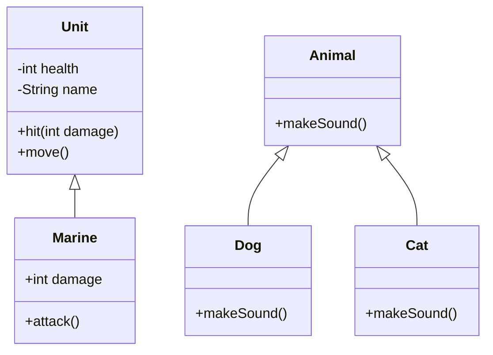


<div class="callout callout-summary" markdown="1">
<div class="callout-title callout-title--default" markdown="span">요약</div>

객체를 잘 쓰기 위한 약속이 셋 있다. 첫째, 자판기처럼 속은 감추고 버튼만 내놓는다. 밖에서 속을 함부로 건드려 망가뜨리지 못한다. 둘째, 자식이 부모의 것을 물려받듯 이미 만든 틀의 내용을 새 틀이 그대로 받아 쓴다. 같은 코드를 두 번 쓰지 않는다. 셋째, "소리 내"라는 같은 말에 개는 짖고 고양이는 운다. 같은 이름의 동작이 대상에 따라 다르게 돈다. 다만 셋째에는 두 갈래가 있어서, 어느 동작이 돌지를 코드를 번역할 때 정하는 경우와 실행하면서 정하는 경우를 가려야 한다.

</div>


## 예시로 보기

[클래스와 객체](/Hongs_Blog/studies/java/class-and-object/)만 알고 게임을 짜면 세 가지가 곤란하다.

- 해병의 체력을 아무 코드나 `-100`으로 바꿀 수 있다. 체력이 음수인 해병이 돌아다닌다.
- 해병, 화염방사병, 건설로봇이 모두 체력과 이동을 가진다. 유닛 종류마다 같은 코드를 다시 쓴다.
- 유닛 종류마다 공격 방식이 다른데, 부르는 쪽이 종류를 일일이 확인해 다른 이름의 메서드를 불러야 한다.

세 원칙은 이 셋을 하나씩 푼다.

### 캡슐화: 속은 감추고 허락한 것만 내놓는다

```java
class Unit {
    private int health;                 // 밖에서 못 건드린다
    private String name;

    Unit(String name, int health) {
        this.name = name;
        this.health = health;
    }

    int getHealth() { return health; }
    boolean isAlive() { return health > 0; }

    void hit(int damage) {              // 체력을 깎는 길은 이것뿐이다
        health = Math.max(0, health - damage);
    }

    void move() {
        System.out.println(name + " moves");
    }
}
```

체력 40짜리 해병이 30씩 두 번 맞으면 체력은 10, 0이 된다. `-20`이 되지 않는다. 체력을 바꾸는 길이 `hit` 하나뿐이고, 그 안에서 0 아래로 내려가지 않게 막기 때문이다. 밖에서 `u.health = -100;`이라고 쓰면 번역 단계에서 `health has private access in Unit` 오류가 나고 프로그램이 만들어지지 않는다[^s1].

```
                 ┌─ 객체 ──────────────────────┐
외부 객체 ──호출 가능──────▶ public 메서드     │
          ──읽기/쓰기 가능─▶ public 필드       │
          ──✕ 읽기/쓰기 불가   private 필드    │
          ──✕ 호출 불가        private 메서드  │
                 └─────────────────────────────┘
```

`public`은 밖에 내놓는다는 표시, `private`는 감춘다는 표시다[^1]. 자세한 규칙은 [접근 제한자](/Hongs_Blog/studies/java/java-access-modifier/)에 있다.

### 상속: 부모의 것을 물려받아 쓴다

```java
class Marine extends Unit {             // Marine은 Unit의 자식이다
    int damage = 6;

    Marine() {
        super("Marine", 40);
    }

    void attack() {
        System.out.println("Marine attacks with " + damage);
    }
}
```

```java
Marine m = new Marine();
m.move();      // Marine moves          ← Marine에는 move를 쓰지 않았다
m.attack();    // Marine attacks with 6
```

`Marine`에는 `move`도 `hit`도 적지 않았는데 쓸 수 있다. 부모 `Unit`에서 물려받았기 때문이다. 자식은 물려받은 것에 자기 것(`damage`, `attack`)을 보탠다[^2].

### 다형성: 같은 이름이 다르게 돈다

같은 이름을 두 가지 방법으로 다르게 돌게 할 수 있다[^3].

**메서드 오버로딩(overloading).** 한 클래스 안에 이름이 같고 매개변수가 다른 메서드를 여러 개 둔다. overload는 "겹쳐 싣는다"는 뜻이다[^4].

```java
class Calculator {
    public int add(int x, int y) { return x + y; }
    public double add(double x, double y) { return x + y; }
}
```

`add(1, 2)`는 `3`, `add(1.5, 2.0)`은 `3.5`가 나온다. 넘긴 값의 타입을 보고 어느 `add`인지가 번역 단계에서 정해진다.

**메서드 오버라이딩(overriding).** 부모에 이미 있는 메서드를 자식이 다시 쓴다. override는 "위에 덮어쓴다"는 뜻이다[^5].

```java
class Animal {
    public void makeSound() { System.out.println("Some sound"); }
}
class Dog extends Animal {
    @Override
    public void makeSound() { System.out.println("Bark"); }
}
class Cat extends Animal {
    @Override
    public void makeSound() { System.out.println("Meow"); }
}
```

```java
Animal[] zoo = { new Animal(), new Dog(), new Cat() };
for (Animal a : zoo) {
    a.makeSound();      // Some sound / Bark / Meow
}
```

반복문 안의 코드는 `a.makeSound()` 한 줄인데 세 번 다 다른 소리가 난다. 변수 `a`의 타입은 늘 `Animal`이지만, 실행 중에 `a`가 실제로 가리키는 객체가 무엇인지를 보고 메서드를 고른다.

<div class="callout callout-check" markdown="1">
<div class="callout-title" markdown="span">검증: 캡슐화(10, 0, false), 상속, 오버로딩(3, 3.5, 3.0), 오버라이딩(Some sound, Bark, Meow), 아래 "변수 타입과 실제 객체" 예의 출력을 JDK 21에서 실행해 비교. `private` 접근 오류 문구는 따로 컴파일해 확인 — [12_oop-principles_impl.java](/Hongs_Blog/studies/java/code/12_oop-principles_impl/)</div>

</div>


## 세 원칙

| 원칙 | 하는 일 | 얻는 것 |
|---|---|---|
| 캡슐화(encapsulation) | 객체의 필드와 메서드를 하나로 묶고, 실제 구현을 밖에서 못 보게 감춘다. 밖의 객체는 속 구조를 모르고, 객체가 허락한 필드와 메서드만 쓴다[^1] | 밖에서 잘못 써서 객체가 망가지는 일을 막는다 |
| 상속(inheritance) | 부모 객체가 자기 필드와 메서드를 자식 객체에게 물려주어 자식이 쓰게 한다[^2] | 같은 코드를 자식에 다시 쓰지 않는다. 고칠 곳이 줄어 손보는 시간이 준다 |
| 다형성(polymorphism) | 이름이 같은 메서드나 연산자가 클래스에 따라 다르게 동작한다. 오버로딩과 오버라이딩이 여기에 든다[^3] | 부르는 쪽 코드가 대상의 종류를 몰라도 된다 |



빈 세모 화살표는 자식에서 부모 쪽으로 그린다. `-`는 감춘 것(private), `+`는 내놓은 것(public)이다[^s2].

### 다형성의 두 갈래

| | 오버로딩 | 오버라이딩 |
|---|---|---|
| 어디에 | 같은 이름, 다른 매개변수의 메서드 여러 개 | 부모에 있는 메서드를 자식이 다시 쓴다 |
| 언제 고르나 | 코드를 번역할 때(컴파일 시점) | 실행하면서(런타임) |
| 무엇을 보고 | 넘긴 값의 타입(변수에 적힌 타입) | 실제 객체의 타입 |
| 슬라이드의 이름 | 정적 다형성 | 동적 다형성 |

표의 앞 두 줄과 마지막 줄은 슬라이드[^4][^5], 셋째 줄은 아래 실험으로 확인한 것이다[^s1].

**변수 타입과 실제 객체.** 두 갈래가 한 코드에서 갈린다.

```java
static String who(Animal a) { return "who(Animal)"; }
static String who(Dog d)    { return "who(Dog)"; }

Animal x = new Dog();
System.out.println(who(x));   // who(Animal)
x.makeSound();                // Bark
Dog y = new Dog();
System.out.println(who(y));   // who(Dog)
```

`x`가 가리키는 것은 개다. 그런데 오버로딩된 `who`는 변수에 적힌 타입 `Animal`만 보고 `who(Animal)`을 고른다. 오버라이딩된 `makeSound`는 실제 객체가 개인 것을 보고 `Bark`를 낸다.

### 스스로 설명해 보기

<details class="callout callout-question" markdown="1">
<summary class="callout-title" markdown="span">1. `who(x)`가 `who(Dog)`가 아니라 `who(Animal)`을 부르는 이유는?</summary>

오버로딩은 번역 단계에서 정해진다. 번역기는 코드에 적힌 것만 본다. `x`는 `Animal x`로 선언되어 있으므로 `Animal`을 받는 `who`를 골라 둔다. 실행 중에 `x`가 개를 가리킨다는 사실은 그때 가서야 알 수 있는 정보다.

</details>


<details class="callout callout-question" markdown="1">
<summary class="callout-title" markdown="span">2. 바로 다음 줄 `x.makeSound()`는 왜 `Bark`인가?</summary>

`makeSound`는 `Dog`가 부모 것을 다시 쓴 메서드다. 다시 쓴 메서드는 실행 중에 객체의 실제 타입을 보고 고른다. `x`가 가리키는 객체는 `new Dog()`로 만든 개다.

</details>


<details class="callout callout-question" markdown="1">
<summary class="callout-title" markdown="span">3. `c.add(1, 2.0)`의 출력이 `3`이 아니라 `3.0`인 이유는?</summary>

두 값의 타입이 `int`와 `double`이다. `add(int, int)`에는 `2.0`을 넣을 수 없고, `add(double, double)`에는 `1`을 `1.0`으로 넓혀 넣을 수 있다([타입 변환](/Hongs_Blog/studies/java/java-type-conversion/)). 그래서 `double` 쪽이 골라지고 결과도 `double`이다.

</details>


<details class="callout callout-question" markdown="1">
<summary class="callout-title" markdown="span">이 예의 핵심 생각은?</summary>

메서드를 고르는 때가 두 번 있다. 이름과 매개변수 타입으로 "어느 모양의 메서드인가"를 번역할 때 정하고, 그 모양의 메서드 중 "누구의 것을 돌릴까"를 실행할 때 객체를 보고 정한다.

</details>


<details class="callout callout-question" markdown="1">
<summary class="callout-title" markdown="span">같은 생각을 쓸 수 있는 다른 상황은?</summary>

`System.out.println`은 `int`용, `double`용, `String`용이 따로 있는 오버로딩이다. 반면 `println(객체)`가 안에서 부르는 `toString()`은 클래스마다 다시 쓴 오버라이딩이라, 실행 중 실제 객체의 것이 돈다.

</details>


## 활용

- 캡슐화는 `private` 필드와 그 필드를 다루는 메서드로 짠다. 값을 읽고 쓰는 메서드를 따로 두는 관례는 [접근 제한자](/Hongs_Blog/studies/java/java-access-modifier/)의 getter와 setter를 본다.
- 상속의 문법(`extends`)과 한계는 [상속](/Hongs_Blog/studies/java/java-inheritance/), 다시 쓰기의 규칙은 [메서드 오버라이딩](/Hongs_Blog/studies/java/java-overriding/)에 있다.
- 흔한 실수: 오버라이딩하려다 매개변수를 다르게 써서 오버로딩이 되는 것. 번역기는 아무 말 없이 새 메서드로 받아들인다. `@Override`를 붙이면 잡아 준다.
- 시험에서 자주 묻는 짝: 오버로딩 — 컴파일 시점 — 정적, 오버라이딩 — 런타임 — 동적[^4][^5].

## 연결

- 선수: [클래스와 객체](/Hongs_Blog/studies/java/class-and-object/)
- 세 원칙이 없을 때와 견주기: [절차 지향과 객체 지향 비교](/Hongs_Blog/studies/java/procedural-vs-oop/)
- 부모 타입 변수로 자식 객체를 다루는 일을 본격적으로: [다형성](/Hongs_Blog/studies/java/java-polymorphism/)

## 자주 하는 오해

<div class="callout callout-misconception" markdown="1">
<div class="callout-title" markdown="span">"변수가 개를 가리키고 있으니 오버로딩도 개 쪽 메서드가 불린다"</div>

틀렸다. 오버로딩은 실행 중의 객체를 보지 않는다. 그럴듯해 보이는 이유는 오버라이딩이 실제 객체를 보고 고르기 때문에, 이름이 비슷한 오버로딩도 그럴 것이라 짐작하기 때문이다. 실제로는 `Animal x = new Dog(); who(x);`가 `who(Animal)`을 부른다. 번역기가 변수에 적힌 타입만 보고 미리 골라 두었기 때문이다. 확인하는 법: 위 코드를 돌려 `who(Animal)`, `Bark`, `who(Dog)`가 차례로 나오는지 본다.

</div>


<div class="callout callout-misconception" markdown="1">
<div class="callout-title" markdown="span">"캡슐화는 필드를 전부 private로 만들고 값을 읽고 쓰는 메서드를 달아 주는 것이다"</div>

반만 맞다. 필드마다 값을 그대로 읽고 그대로 쓰는 메서드를 달면, 밖에서 아무 값이나 넣을 수 있는 것은 그대로다. 슬라이드가 든 캡슐화의 이유는 "밖에서 잘못 써서 객체가 망가지지 않게"다[^1]. 그러려면 `hit`처럼 객체가 스스로 규칙(체력은 0 이상)을 지키는 메서드만 내놓아야 한다. 확인하는 법: `hit(30)`을 두 번 불러 체력이 `-20`이 아니라 `0`인지 본다.

</div>


## 확인 문제

<details class="callout callout-question" markdown="1">
<summary class="callout-title" markdown="span">**C1** 객체 지향의 세 원칙을 이름과 함께 한 문장씩 쓰라.</summary>

**답:** 캡슐화 — 필드와 메서드를 묶고 구현을 감춰, 밖에서는 허락된 것만 쓰게 한다. 상속 — 부모의 필드와 메서드를 자식이 물려받아 쓴다. 다형성 — 같은 이름의 메서드가 클래스에 따라 다르게 동작한다(오버로딩, 오버라이딩).<br>
**이유:** 흔한 오답은 다형성을 "여러 클래스를 만드는 것"이라 쓰는 것이다. 핵심은 "같은 이름, 다른 동작"이다.

</details>


<details class="callout callout-question" markdown="1">
<summary class="callout-title" markdown="span">**C2** 캡슐화를 하는 이유를 체력이 있는 유닛 예로 설명하라.</summary>

**답:** 체력 필드를 밖에 내놓으면 아무 코드나 `-100` 같은 값을 넣을 수 있다. 필드를 감추고 `hit` 같은 메서드로만 바꾸게 하면, 그 메서드 안에서 "0 아래로는 안 내려간다"를 지킬 수 있다. 밖에서 잘못 써서 객체가 망가지는 일을 막는 것이 이유다.<br>
**이유:** "코드를 숨겨서 보안을 지킨다"는 흔한 오답이다. 남이 소스를 못 보게 하는 것이 아니라, 다른 코드가 객체의 상태를 규칙 밖으로 밀어내지 못하게 하는 것이다.

</details>


<details class="callout callout-question" markdown="1">
<summary class="callout-title" markdown="span">**C3** 다음 중 번역 단계에서 오류가 나는 줄은? 예시의 `Unit`을 쓴다. (가) `Unit u = new Unit("Marine", 40);` (나) `u.hit(30);` (다) `u.health = 5;` (라) `System.out.println(u.getHealth());`</summary>

**답:** (다). `health has private access in Unit`.<br>
**이유:** `health`는 `private`라 `Unit` 밖에서 읽지도 쓰지도 못한다. (나)와 (라)는 내놓은 메서드를 부르는 것이라 된다. (라)를 고르는 오답은 "읽는 것도 막힌다"까지는 맞지만, 읽는 길로 `getHealth`를 내놓았다는 것을 놓친 것이다.

</details>


<details class="callout callout-question" markdown="1">
<summary class="callout-title" markdown="span">**C4** `Animal x = new Dog();`일 때 `who(x)`와 `x.makeSound()`의 출력을 차례로 쓰라. `who`는 `who(Animal)`과 `who(Dog)` 두 개가 있다.</summary>

**답:** `who(Animal)`, `Bark`.<br>
**이유:** 오버로딩(`who`)은 변수에 적힌 타입 `Animal`로 번역 때 고른다. 오버라이딩(`makeSound`)은 실제 객체 `Dog`로 실행 때 고른다. 둘 다 `Dog` 쪽이라고 쓰는 것이 가장 흔한 오답이다.

</details>


<details class="callout callout-question" markdown="1">
<summary class="callout-title" markdown="span">**C5** (가) `print(int)`와 `print(String)`을 한 클래스에 둔다. (나) `Shape`의 `area()`를 `Circle`이 다시 쓴다. 각각 오버로딩인가 오버라이딩인가? 어느 쪽이 실행 중에 정해지는가?</summary>

**답:** (가) 오버로딩, 번역할 때 정해진다. (나) 오버라이딩, 실행 중에 정해진다.<br>
**이유:** 한 클래스 안에서 매개변수가 다르면 오버로딩, 부모와 자식 사이에서 같은 모양을 다시 쓰면 오버라이딩이다[^s1].

</details>


[^1]: 소프트웨어 프로젝트 5회 강의 자료 「Software Project 05. Object-Oriented Programming」, p.19~23 (Encapsulation: 외부 객체가 public 메서드·필드에는 닿고 private 필드·메서드에는 닿지 못하는 그림)
[^2]: 같은 자료, p.24~27 (Inheritance: 부모의 Field 1 + Method 1을 물려받고 Field 2 + Method 2를 보태는 그림)
[^3]: 같은 자료, p.28 (Polymorphism)
[^4]: 같은 자료, p.29 (Method Overloading, `Calculator`의 `add` 두 개, "determined at compile time", "static polymorphism")
[^5]: 같은 자료, p.30~32 (Method Overriding, `Animal`·`Dog`·`Cat`의 `makeSound`, "dynamically determined based on the object's type at runtime", "dynamic polymorphism")
[^s1]: <span class="fn-tag" title="수업 자료에 없고 따로 보탠 내용">보충</span> `Unit`·`Marine` 코드, 동물 배열 반복문, `who` 실험, 표의 "무엇을 보고" 줄, 스스로 설명해 보기, 오해 두 항목, 카드 C2~C5는 원본에 없다. 슬라이드의 그림(p.22, p.27)과 코드(p.29, p.32)를 실행할 수 있는 예로 옮겼다. 출력과 오류 문구는 JDK 21에서 직접 실행해 확인했다. 오버로딩이 컴파일 시점의 타입으로 정해진다는 것은 Java Language Specification 15.12절에 적혀 있다.
[^s2]: <span class="fn-tag" title="수업 자료에 없고 따로 보탠 내용">보충</span> 접근을 나타낸 글자 그림은 슬라이드 p.22의 그림을 옮긴 것이고, 클래스 그림은 원본에 없다. 이 문서의 코드를 근거로 그렸다.

