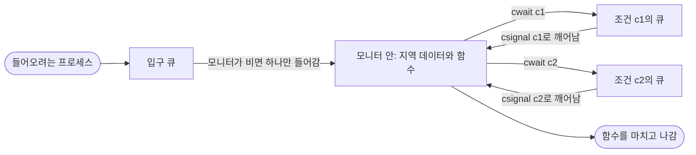


<div class="callout callout-summary" markdown="1">
<div class="callout-title callout-title--default" markdown="span">요약</div>

모니터는 공유 데이터와 그 데이터를 다루는 함수들을 한 방에 넣고, 방에는 한 번에 한 프로세스만 들어가게 한 프로그래밍 언어 구조다. 세마포어처럼 semWait과 semSignal을 코드 곳곳에 흩어 놓지 않아도, 방에 들어가는 것만으로 상호 배제가 된다. 그래서 짝을 빠뜨리는 실수가 줄어든다. 다만 "버퍼가 빌 때까지 기다리기" 같은 조건 맞추기는 여전히 프로그래머가 조건 변수로 직접 해야 한다.

</div>


## 예시로 보기

세마포어로 생산자-소비자를 풀면 `semWait(s)`, `semSignal(s)`가 생산자와 소비자 코드에 흩어진다. 한 곳만 틀려도 전체가 깨진다. 모니터로 풀면 버퍼와 `append`, `take` 함수를 한 모니터에 넣는다. 생산자와 소비자는 그냥 `append(x)`, `take(x)`를 부른다. 모니터 안에는 한 번에 한 프로세스만 있을 수 있으므로 버퍼 상호 배제는 저절로 된다.

```c
monitor boundedbuffer;
char buffer[N];
int nextin, nextout, count;
cond notfull, notempty;           /* 조건 변수 */

void append(char x) {
    if (count == N) cwait(notfull);      /* 가득 참: 빈 칸이 생길 때까지 */
    buffer[nextin] = x;
    nextin = (nextin + 1) % N;
    count++;
    csignal(notempty);                   /* 기다리는 소비자 하나를 깨움 */
}

void take(char x) {
    if (count == 0) cwait(notempty);     /* 비어 있음: 물건이 생길 때까지 */
    x = buffer[nextout];
    nextout = (nextout + 1) % N;
    count--;
    csignal(notfull);                    /* 기다리는 생산자 하나를 깨움 */
}
```

## 정확히 말하면

모니터는 세마포어와 같은 일을 하면서 다루기 쉬운 언어 구조다. Concurrent Pascal, Pascal-Plus, Modula-2, Modula-3, Java에 있다. 세 가지 특징이 있다.

1. 모니터의 지역 데이터는 모니터의 함수만 만질 수 있다.
2. 프로세스는 모니터의 함수 하나를 불러서 모니터에 들어간다.
3. 한 번에 한 프로세스만 모니터 안에서 실행될 수 있다. 다른 프로세스는 입구에서 기다린다.

**조건 변수.** 모니터 안에서만 쓰는 특별한 변수로 순서를 맞춘다.

| 연산 | 하는 일 |
|---|---|
| `cwait(c)` | 부른 프로세스를 조건 c에서 멈춘다. 모니터는 다른 프로세스가 쓸 수 있게 풀린다 |
| `csignal(c)` | 같은 조건에서 cwait으로 멈춘 프로세스 하나를 다시 실행시킨다. 기다리는 프로세스가 없으면 아무 일도 하지 않는다 |

세마포어의 semSignal과 달리 `csignal`은 기다리는 프로세스가 없으면 그냥 사라진다. 나중에 cwait하는 프로세스를 위해 저장되지 않는다.



모니터 안에는 늘 많아야 하나가 있다. 나머지는 입구 큐에 서 있거나, 조건 변수마다 따로 있는 큐에서 신호를 기다린다. cwait한 프로세스는 모니터를 비워 주므로 입구 큐의 다음 프로세스가 들어올 수 있다[^s2].

### 호어 방식과 메사 방식

깨운 프로세스를 언제 실행하느냐로 모니터는 두 방식으로 나뉜다.

| | 호어(Hoare) 방식 | 메사(Mesa) 방식 (Lampson·Redell) |
|---|---|---|
| 신호 연산 | `csignal(x)`: 깨운 프로세스가 **바로** 실행된다. 신호를 보낸 프로세스는 나가거나 멈춘다 | `cnotify(x)`: 깨운 프로세스는 모니터가 빌 때 실행된다. 보낸 프로세스는 계속 실행한다 |
| 깨어난 쪽이 할 일 | 조건이 그대로 맞으므로 `if`로 한 번 확인하면 된다 | 그사이 다른 프로세스가 끼어들어 조건이 바뀌었을 수 있으므로 `while`로 다시 확인한다 |
| 그 밖에 | Concurrent Pascal은 csignal 뒤에 아무 코드도 두지 않게 한다 | 모든 대기자를 깨우는 `cbroadcast`를 쓸 수 있다 |

## 활용

- 자바의 `synchronized` 메서드와 `wait()`, `notify()`, `notifyAll()`이 메사 방식 모니터다. 그래서 자바에서는 `wait()`를 `while` 반복 안에서 부르라고 한다.
- 파이썬 `threading.Condition`도 메사 방식이다.

## 연결

- 선수: [세마포어](/Hongs_Blog/studies/operating-systems/semaphore/), [생산자-소비자 문제](/Hongs_Blog/studies/operating-systems/producer-consumer/)
- 다른 동기화 방법: [메시지 전달](/Hongs_Blog/studies/operating-systems/message-passing/)

## 확인 문제

<details markdown="1"><summary markdown="span"><b>C1</b> 모니터의 세 가지 특징을 쓰라.</summary>


**답:** ① 지역 데이터는 모니터 함수만 접근 ② 함수를 불러서 들어감 ③ 한 번에 한 프로세스만 안에서 실행.

</details>

<details markdown="1"><summary markdown="span"><b>C2</b> 메사 방식에서는 <code>if (count == 0) cwait(notempty);</code>를 <code>while</code>로 바꿔야 하는 이유는?</summary>


**답:** cnotify를 받은 소비자는 바로 실행되지 않고, 모니터가 빌 때까지 기다린다. 그사이 다른 소비자가 먼저 들어와 물건을 가져갈 수 있다. 깨어났을 때 버퍼가 다시 비어 있을 수 있으므로 조건을 다시 확인해야 한다.<br>
**흔한 오답:** "신호를 놓칠 수 있어서". 문제는 신호를 놓치는 것이 아니라 신호 이후 상황이 바뀌는 것이다.

</details>

<details markdown="1"><summary markdown="span"><b>C3</b> 세마포어 semSignal과 모니터 csignal은 기다리는 프로세스가 없을 때 각각 어떻게 다른가?</summary>


**답:** semSignal은 세마포어 값을 1 늘려 둔다. 나중에 semWait하는 프로세스는 막히지 않고 지나간다. csignal은 기다리는 프로세스가 없으면 아무 효과도 남기지 않는다. 나중에 cwait하는 프로세스는 막힌다.

</details>

[^s2]: 조건 변수 두 개는 보기를 위해 고른 수다.

