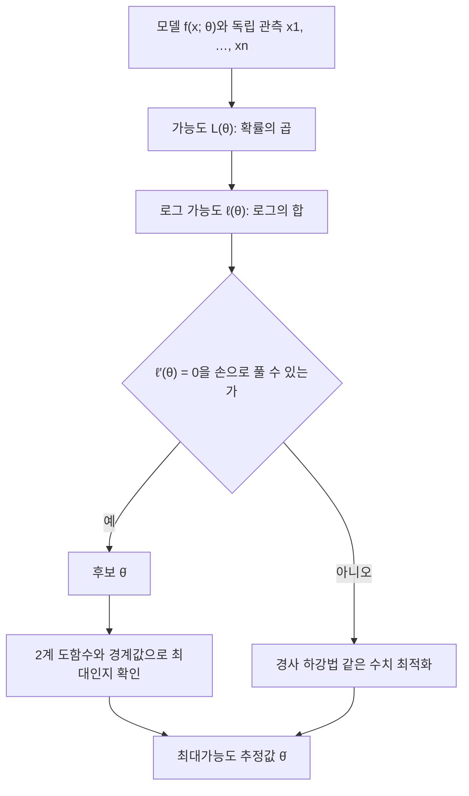



요약

여러 후보 설명 중에서 지금 본 데이터가 나올 가능성을 가장 크게 만드는 것을 고르는 방법이다. 동전을 10번 던져 앞면이 7번이면, 앞면 확률 0.7이 이 결과를 가장 그럴듯하게 만든다. 확률을 곱한 식에 로그를 씌워 합으로 바꾸고 미분해 0으로 놓는 기계적인 절차라, 거의 모든 통계 모델과 기계학습 학습의 기본이다. 하지만 데이터가 적으면 극단적인 답(세 번 모두 앞면이면 앞면 확률 1)을 내고, 모델 가정이 틀리면 그럴듯하게 틀린 답을 낸다.

## 예시로 보기

동전을 10번 던져 앞면이 7번 나왔다. 앞면 확률이 $$p$$라면 이 결과(순서까지 고정)가 나올 확률은 $$p^7(1 - p)^3$$이다.

| 후보 $$p$$ | 0.5 | 0.6 | 0.7 | 0.8 | 0.9 |
|---|---|---|---|---|---|
| $$p^7(1 - p)^3$$ ($$\times 10^{-3}$$) | 0.98 | 1.79 | 2.22 | 1.68 | 0.48 |

0.7에서 가장 크다. 데이터를 고정하고 $$p$$를 움직이며 본 이 함수가 아래의 가능도 $$L(p)$$이고, 가장 높은 곳이 최대가능도 추정값 $$\hat p = 0.7$$이다.

파란 곡선은 위 표의 $$p^7(1 - p)^3$$을 꼭대기가 1이 되게 나눈 것이고, 점이 표의 다섯 값이다. 같은 비율 70/100이면 봉우리는 같은 0.7인데 훨씬 좁다. 자료가 많을수록 그럴듯한 $$p$$의 범위가 줄어든다[^s1].

## 정의

**적용 조건.** 데이터가 모수 $$\theta$$로 정해지는 확률 모델 $$f(x; \theta)$$에서 독립으로 나왔다고 볼 수 있을 때.

**알아보는 신호.** "모수를 추정하라", "모델을 데이터에 맞춰라", "손실 함수는 음의 로그 가능도" 같은 말.

정의

독립인 관측 $$x_1, \dots, x_n$$에 대해 **가능도 함수**는 $$L(\theta) = \prod_{i=1}^{n}f(x_i; \theta)$$, **로그 가능도**는 $$\ell(\theta) = \sum_{i=1}^{n}\ln f(x_i; \theta)$$($$\sum$$은 차례로 모두 더한다는 기호)다. **최대가능도 추정값**은 $$\hat\theta = \arg\max_\theta L(\theta) = \arg\max_\theta\ell(\theta)$$다[^1].

로그는 증가함수라 최댓점이 같다. 곱을 합으로 바꿔 미분하기 쉽고, 아주 작은 확률의 곱이 컴퓨터에서 0으로 뭉개지는 것도 막는다.

'예' 갈래가 아래 대표 문제 1(포아송 도착률)의 길이고, '아니오' 갈래가 대표 문제 2(로지스틱 회귀)의 길이다.[^s2]

**대표적인 결과.**

| 모델 | MLE |
|---|---|
| 베르누이($$p$$), 성공 $$k$$번 / $$n$$번 | $$\hat p = \frac kn$$ |
| 포아송($$\lambda$$) | $$\hat\lambda = \bar x$$ |
| 지수($$\lambda$$) | $$\hat\lambda = \frac{1}{\bar x}$$ |
| 정규($$\mu, \sigma^2$$) | $$\hat\mu = \bar x$$, $$\hat\sigma^2 = \frac1n\sum(x_i - \bar x)^2$$ |

정규분포의 $$\hat\sigma^2$$는 $$n$$으로 나눠 [편향](/Hongs_Blog/studies/probability-statistics/estimators/)이 있다. MLE가 늘 불편인 것은 아니다.

**성질 [증명 생략: Wasserman "Parametric Inference" 장].** 모델이 맞고 규칙성 조건이 맞으면 MLE는 일치 추정량이고, $$n$$이 크면 대략 정규분포를 따르며 분산은 $$\frac{1}{nI(\theta)}$$($$I$$는 피셔 정보량)로 가능한 한 가장 작다. **불변성:** $$g(\theta)$$의 MLE는 $$g(\hat\theta)$$다. 지수분포의 평균 $$\frac1\lambda$$의 MLE는 $$\frac{1}{\hat\lambda} = \bar x$$다.

베르누이 MLE의 유도

1. *로그 가능도:* $$\ell(p) = k\ln p + (n - k)\ln(1 - p)$$, $$0 < p < 1$$.
2. *미분:* $$\ell'(p) = \frac kp - \frac{n - k}{1 - p}$$.
3. *0으로 놓기:* $$k(1 - p) = (n - k)p$$에서 $$p = \frac kn$$.
4. *최대 확인:* $$\ell''(p) = -\frac{k}{p^2} - \frac{n - k}{(1 - p)^2} < 0$$이라 [극대](/Hongs_Blog/studies/calculus/curve-analysis/)다. 구간 끝($$p \to 0, 1$$)에서 $$\ell \to -\infty$$라 전역 최대다($$0 < k < n$$일 때). ∎

### 스스로 설명해 보기

1. 증명 1단계에서 $$\binom nk$$ 같은 상수를 빼도 되는 이유는?

상수배는 로그를 취하면 $$p$$와 무관한 덧셈 상수가 되어, 미분하면 사라지고 최댓점을 바꾸지 않는다.

2. 4단계에서 2계 도함수만으로는 부족하고 끝점을 따로 보는 이유는?

2계 도함수가 음수라는 것은 그 점이 지역 최대라는 뜻이다. 전역 최대인지 보려면 경계에서의 값과 비교해야 한다. 여기서는 $$\ell$$이 오목해서(2계 도함수가 늘 음수) 지역 최대가 곧 전역 최대이기도 하다([볼록성](/Hongs_Blog/studies/calculus/convexity/)).

3. 최대가능도의 핵심 아이디어는?

"모수 → 데이터" 방향의 확률 모델을 데이터를 고정한 채 모수의 함수로 거꾸로 읽고, 그 함수를 최적화 문제로 푼다.

4. 같은 방법을 쓰는 다른 상황은?

[선형회귀](/Hongs_Blog/studies/probability-statistics/linear-regression/)(정규 잡음의 MLE = 최소제곱), 로지스틱 회귀와 신경망 분류([교차 엔트로피](/Hongs_Blog/studies/probability-statistics/cross-entropy-kl/) 최소화 = MLE), 언어 모델 학습.

## 예제

**대표 문제 1: 포아송 도착률.** 5분 동안 분마다 들어온 요청 수가 $$2, 3, 1, 4, 0$$이다.

1. *모델:* 분당 요청 수 $$\sim \mathrm{Pois}(\lambda)$$($$X \sim$$ 분포는 "$$X$$가 그 분포를 따른다"), 서로 독립.
2. *로그 가능도:* $$\ell(\lambda) = \sum(x_i\ln\lambda - \lambda - \ln x_i!) = 10\ln\lambda - 5\lambda + \text{상수}$$.
3. *미분:* $$\frac{10}{\lambda} - 5 = 0$$에서 $$\hat\lambda = 2$$ = 표본평균.
4. *해석:* 도착률의 MLE는 관측 평균이다. 2계 도함수 $$-\frac{10}{\lambda^2} < 0$$이라 최대다.

**대표 문제 2: 닫힌 꼴이 없을 때.** 로지스틱 회귀는 $$\ell$$을 0으로 놓은 식을 손으로 풀 수 없다. $$\ell$$이 오목하므로 [경사 하강법](/Hongs_Blog/studies/calculus/gradient-descent/)(기울기는 [행렬 미분](/Hongs_Blog/studies/calculus/matrix-calculus/)의 $$X^\top(\mathbf{y} - \mathbf{p})$$)으로 수치적으로 최대화한다.

검증: 예시의 최댓점 0.7(가능도와 로그 가능도 모두 격자 탐색), 표의 네 닫힌 꼴(무작위 자료에서 수치 최적화와 일치), 카드의 값, 불변성과 일치성(표본 10·100·1만 개), 가능도를 모수로 적분한 값 $$\frac{1}{1320}$$, 예제 사다리의 값 — [30_mle_verify.py](/Hongs_Blog/studies/probability-statistics/code/30_mle_verify/)

## 활용

- **모델 학습의 표준.** 분류 모델의 교차 엔트로피 손실, 회귀의 제곱 오차, 언어 모델의 다음 단어 예측 손실은 모두 음의 로그 가능도다.
- **분포 맞추기.** 요청 간격에 지수분포, 오류 수에 포아송을 맞출 때 모수를 MLE로 정한다.
- **흔한 실수.** 데이터가 적을 때 MLE를 그대로 믿는 것(3번 모두 앞면 → $$\hat p = 1$$). 사전 분포로 보정하는 [MAP](/Hongs_Blog/studies/probability-statistics/bayesian-inference/)나 정칙화를 쓴다.
- 연습: [최대가능도 예제 사다리](/Hongs_Blog/studies/probability-statistics/mle-ladder/)

## 연결

- 선수: [추정량](/Hongs_Blog/studies/probability-statistics/estimators/), [결합분포](/Hongs_Blog/studies/probability-statistics/joint-distributions/)(독립이면 결합 확률이 곱), [최적화](/Hongs_Blog/studies/calculus/curve-analysis/)
- 이어지는 개념: [베이즈 추론과 MAP](/Hongs_Blog/studies/probability-statistics/bayesian-inference/), [선형회귀](/Hongs_Blog/studies/probability-statistics/linear-regression/), [교차 엔트로피](/Hongs_Blog/studies/probability-statistics/cross-entropy-kl/)

## 자주 하는 오해

"가능도 $$L(\theta)$$는 모수 $$\theta$$가 그 값일 확률이다"

틀렸다. 식이 확률 $$f(x; \theta)$$로 되어 있어 그렇게 읽기 쉽다. 하지만 가능도는 데이터를 고정하고 $$\theta$$를 움직인 함수라, $$\theta$$에 대해 적분해도 1이 되지 않는다. 동전 예시에서 $$\int_0^1 p^7(1 - p)^3dp = \frac{1}{1320}$$($$\int$$는 넓이를 구하는 적분 기호)이다. "$$\theta$$일 확률"을 말하려면 사전 분포를 두고 [베이즈 추론](/Hongs_Blog/studies/probability-statistics/bayesian-inference/)을 해야 한다.

## 과목별 관점

**자료와 정보 (2-1학기).** "가진 것은 데이터뿐"일 때 확률 분포를 찾는 두 길 가운데 하나로 배운다. 분포의 모양까지 자료에서 바로 읽는 길이 [히스토그램 밀도 추정](/Hongs_Blog/studies/data-and-information/histogram-density/), [파젠 창](/Hongs_Blog/studies/data-and-information/parzen-window/), [k-이웃 밀도 추정](/Hongs_Blog/studies/data-and-information/knn-density/)이다. 모양은 안다고 두고 그 모양을 정하는 숫자만 자료에서 찾는 길이 최대가능도 추정이다[^i1]. 슬라이드는 가능도를 "우도", 모수를 "매개변수", 이 문서의 $$L(\theta)$$를 $$p(D \mid \boldsymbol\theta)$$로 쓴다. $$D$$는 자료 전체, 굵은 $$\boldsymbol\theta$$는 매개변수 여러 개를 묶은 목록이다.

- **근사와 추정.** 근사는 자료에서 확률변수의 분포 모양을 함수(확률밀도함수)로 나타내는 일이다. 추정은 뽑은 표본으로 모집단의 평균이나 분산 같은 값을 계산하는 일, 곧 밀도함수의 매개변수를 찾는 일이다[^i1].
- **매개변수가 하는 일.** 정규분포를 "$$x = 3$$을 넣으면 $$p(3)$$이 나오는 상자"로 그린다. 상자의 모양을 정하는 손잡이가 평균 $$\mu$$와 분산 $$\sigma^2$$이고, 이 둘이 매개변수다. 표본 $$N$$개와 같은 퍼짐을 만들어 내는 손잡이 값을 찾는 것이 문제다[^i2].
- **매개변수를 무엇으로 보는가.** 고정된 값으로 보면 최대가능도 추정이고, 확률변수로 보면 베이지언 추정([베이즈 추론과 MAP](/Hongs_Blog/studies/probability-statistics/bayesian-inference/))이다. 슬라이드는 추정에 쓰는 자료의 수가 그대로면 상수로, 자료가 더해지거나 빠지면 변수로 본다고 설명한다. 최대가능도 추정은 가장 간단한 매개변수 추정법이고, 표본이 많을수록 잘 맞는다[^i3].
- **일반 원리.** 표본 $$\mathbf{x}_0, \dots, \mathbf{x}_{N-1}$$이 서로 독립이면 자료 전체가 나올 확률은 표본별 확률의 곱 $$p(D \mid \boldsymbol\theta) = \prod_{k=0}^{N-1} p(\mathbf{x}_k \mid \boldsymbol\theta)$$다($$\prod$$는 차례로 모두 곱한다는 기호). 이 값을 가장 크게 하는 $$\boldsymbol\theta$$를 찾는다. 매개변수가 $$\theta_1, \dots, \theta_p$$로 여럿이면 하나씩 편미분해 세로로 쌓은 것을 $$\nabla_{\boldsymbol\theta}$$(기울기)로 쓴다. 로그를 씌운 $$l(\boldsymbol\theta) = \ln p(D \mid \boldsymbol\theta)$$에서는 곱이 합으로 바뀌어, 풀 식이 $$\nabla_{\boldsymbol\theta}\, l = \sum_{k=0}^{N-1} \nabla_{\boldsymbol\theta} \ln p(\mathbf{x}_k \mid \boldsymbol\theta) = \mathbf{0}$$이 된다[^i4]. 슬라이드 그림은 점 열 개 남짓 위에 후보 종 모양 곡선을 여럿 겹쳐 그리고, 아래에 $$\theta$$에 따른 $$p(D \mid \theta)$$를 그렸다. 그 봉우리 자리가 $$\hat\theta$$다[^i4].
- **예 1: 평균만 모를 때.** $$\mathbf{x}$$가 숫자 $$d$$개짜리 목록이고 [다변량 정규분포](/Hongs_Blog/studies/probability-statistics/multivariate-normal/)를 따르며, 공분산 행렬 $$\boldsymbol\Sigma$$는 알고 평균 $$\boldsymbol\mu$$만 모른다. 표본 하나의 로그 확률은 $$\ln p(\mathbf{x}_k \mid \boldsymbol\mu) = -\frac12 \ln\left[(2\pi)^d \vert \boldsymbol\Sigma\vert \right] - \frac12 (\mathbf{x}_k - \boldsymbol\mu)^\top \boldsymbol\Sigma^{-1} (\mathbf{x}_k - \boldsymbol\mu)$$다. 앞 항에는 $$\boldsymbol\mu$$가 없어 미분하면 사라지고, 뒤 항을 $$\boldsymbol\mu$$로 미분하면 $$\boldsymbol\Sigma^{-1}(\mathbf{x}_k - \boldsymbol\mu)$$가 남는다([행렬 미분](/Hongs_Blog/studies/calculus/matrix-calculus/)). 모두 더해 0으로 놓으면 $$\sum_k \boldsymbol\Sigma^{-1}(\mathbf{x}_k - \hat{\boldsymbol\mu}) = \mathbf{0}$$이다. 양쪽에 $$\boldsymbol\Sigma$$를 곱해 $$\boldsymbol\Sigma^{-1}$$을 없애면 $$\sum_k (\mathbf{x}_k - \hat{\boldsymbol\mu}) = \mathbf{0}$$, 곧 $$\hat{\boldsymbol\mu} = \frac1N \sum_k \mathbf{x}_k$$다. 공분산이 무엇이든 평균의 추정값은 표본을 그냥 평균 낸 것이다[^i5]. 세 점 $$(1, 2)$$, $$(3, 0)$$, $$(2, 4)$$면 $$\hat{\boldsymbol\mu} = (2, 2)$$다[^is1].
- **예 2: 평균과 분산을 둘 다 모를 때.** 1차원 정규분포에서 $$\theta_1 = \mu$$, $$\theta_2 = \sigma^2$$으로 둔다. 표본 하나의 로그 확률은 $$\ln p(x_k \mid \boldsymbol\theta) = -\frac12 \ln(2\pi\theta_2) - \frac{1}{2\theta_2}(x_k - \theta_1)^2$$이다. $$\theta_1$$로 미분하면 $$\frac{1}{\theta_2}(x_k - \theta_1)$$, $$\theta_2$$로 미분하면 $$-\frac{1}{2\theta_2} + \frac{(x_k - \theta_1)^2}{2\theta_2^2}$$이다. 각각 모든 표본에 대해 더해 0으로 놓고 풀면 $$\hat\theta_1 = \frac1N \sum_k x_k$$, $$\hat\theta_2 = \frac1N \sum_k (x_k - \hat\theta_1)^2$$이 나온다[^i6]. 위 표의 정규 줄과 같은 결과다. 자료 2, 4, 4, 6이면 $$\hat\theta_1 = 4$$, $$\hat\theta_2 = \frac{4 + 0 + 0 + 4}{4} = 2$$다[^is1].
- **MLE 바이어스.** 예 2의 $$\hat\theta_2$$는 $$N$$으로 나눈다. 평균적으로 참 분산보다 작게 나오는 값이다. 한쪽으로 치우치지 않게 하려면 $$N - 1$$로 나눈다. 위 자료에서는 $$\frac{8}{3} \approx 2.67$$이다[^i7]. 왜 $$N - 1$$인지는 [표본분포와 추정량](/Hongs_Blog/studies/probability-statistics/estimators/)에 있다.
- **강의의 마무리.** 함수의 모양은 알고 매개변수만 모를 때 잰 자료로 매개변수를 찾는 일을 함수 근사라 하고, 두 변수 사이의 함수 관계를 찾으면 회귀 분석, 그 함수가 직선이면 [선형회귀](/Hongs_Blog/studies/probability-statistics/linear-regression/)다. 확률 분포에서는 "자료를 만들어 낼 확률이 가장 높은 매개변수"를 찾고, 정규분포 꼴이면 로그 가능도를 쓴다[^i8].

원본 오류 의심

원문: 슬라이드 p.5 "평균 $$\mu$$과 분산 $$\sigma$$", p.14 "$$\boldsymbol\theta = (\theta_1, \theta_2) = (\mu, \sigma)$$", p.15 "$$\sigma = \frac{1}{N-1}\sum(x_k - \mu)^2$$". / 문제점: 분산은 $$\sigma^2$$이고 $$\sigma$$는 표준편차다. p.14의 로그 확률 식 $$-\frac12\ln 2\pi\theta_2 - \frac{1}{2\theta_2}(x_k - \theta_1)^2$$은 $$\theta_2$$가 분산일 때만 맞다. 같은 쪽의 편미분 기호 $$\partial$$도 $$\sigma$$로 찍혀 있다. / 수정안: $$\theta_2 = \sigma^2$$, $$\sigma^2 = \frac{1}{N-1}\sum(\cdots)^2$$, $$\frac{\partial}{\partial\theta_1}$$. / 근거: $$\theta_2 = \sigma^2$$으로 두면 자료 2, 4, 4, 6에서 두 편미분의 합이 $$(4, 2)$$에서 정확히 0이고 격자 탐색의 최댓점과 같다(30_mle_verify.py).

원본 오류 의심

원문: 슬라이드 p.15가 $$N - 1$$로 나눈 식을 "true parameters"라 부른다. / 문제점: 참 매개변수는 자료로 계산할 수 있는 값이 아니다. $$N - 1$$로 나눈 값도 표본에서 계산한 추정값이고, 다만 평균적으로 참 분산과 같다. / 수정안: "편향 없는 추정값". / 근거: [표본분포와 추정량](/Hongs_Blog/studies/probability-statistics/estimators/)의 $$(n - 1)\sigma^2$$ 유도.

검증: 예 1의 기울기 합이 표본평균 $$(2, 2)$$에서 0인 것(공분산 행렬 세 가지, 분수로 정확히)과 그곳이 최대인 것, 예 2의 $$(4, 2)$$에서 두 편미분의 합이 0이고 격자 탐색과 같은 것, $$N - 1$$로 나눈 $$\frac83$$, 주사위 4개 전수에서 $$N$$으로 나눈 값의 평균이 참 분산의 $$\frac34$$인 것 — [30_mle_verify.py](/Hongs_Blog/studies/probability-statistics/code/30_mle_verify/)

## 확인 문제

**C1** 동전 10번 중 앞면 7번일 때 앞면 확률의 MLE는?

**답:** $$\ell(p) = 7\ln p + 3\ln(1 - p)$$, $$\ell' = \frac7p - \frac{3}{1 - p} = 0$$에서 $$\hat p = 0.7$$.

**C2** 대기 시간이 지수분포를 따른다고 보고 관측 평균이 2.5초였다. 발생률 $$\lambda$$의 MLE는?

**답:** $$\ell(\lambda) = n\ln\lambda - \lambda\sum x_i$$, $$\frac n\lambda - \sum x_i = 0$$에서 $$\hat\lambda = \frac{1}{\bar x} = 0.4$$(초당).

**C3** 가능도를 그대로 최대화하지 않고 로그를 취하는 이유 두 가지는?

**답:** (1) 독립 관측의 곱이 합이 되어 미분이 쉽다. (2) 작은 확률 수천 개의 곱은 부동소수점에서 0으로 뭉개지지만, 로그의 합은 안정적이다. 로그는 증가함수라 최댓점은 그대로다.

**C4** "관측 결과가 나올 확률"과 "가능도"는 같은 식인데 무엇이 다른가?

**답:** 확률 $$f(x; \theta)$$는 모수를 고정하고 데이터의 함수로 본 것이라 데이터에 대해 합하면 1이다. 가능도 $$L(\theta)$$는 데이터를 고정하고 모수의 함수로 본 것이라 모수에 대해 적분해도 1이 아니며, 모수의 확률도 아니다.

**C5** 정규분포에서 뽑은 자료 2, 4, 4, 6으로 평균과 분산의 최대가능도 추정값을 구하라. 한쪽으로 치우치지 않은 분산 추정값은 얼마인가?

**답:** 평균 $$\hat\mu = \frac{2 + 4 + 4 + 6}{4} = 4$$. 분산 $$\hat\sigma^2 = \frac{(-2)^2 + 0 + 0 + 2^2}{4} = 2$$. 치우치지 않은 값은 4 대신 3으로 나눈 $$\frac83 \approx 2.67$$. 
**이유:** 로그 가능도를 평균과 분산으로 각각 편미분해 0으로 놓으면 평균은 표본평균, 분산은 편차 제곱을 $$N$$으로 나눈 값이 나온다. $$N$$으로 나눈 값은 평균적으로 참 분산보다 작다[^i7].

[^1]: Wasserman, *All of Statistics*, "Parametric Inference" 장(최대가능도, 일치성, 점근 정규성, 피셔 정보량, 불변성).
[^s1]: 보충 그림 한 장은 원본에 없다. [30_mle_plot.py](/Hongs_Blog/studies/probability-statistics/code/30_mle_plot/)로 그렸고, 그림에 쓴 값(예시 표의 다섯 값, 두 곡선의 최댓점 0.7)을 같은 코드로 확인했다.
[^s2]: 보충 다이어그램 1개는 원본에 없다. 이 문서 정의와 베르누이 MLE 유도, 대표 문제 1·2의 단계를 한 흐름으로 그렸다.
[^i1]: 자료와 정보 11회 강의 자료 「D&I_강의11_확률 분포 찾기」, p.2 (근사와 추정), p.3 (가진 것은 데이터뿐, 확률 분포의 모양 찾기)
[^i2]: 같은 자료, p.4 (분포의 형태는 알 때 매개변수 추정), p.5 (가우시안 분포의 매개변수, 변수·매개변수·확률값 그림)
[^i3]: 같은 자료, p.6~7 (최대 확률이 되는 매개변수, 고정값으로 보면 최대 우도 추정·확률변수로 보면 베이지언 추정), p.8 (가장 간단한 추정법, 표본이 많을수록 좋아진다)
[^i4]: 같은 자료, p.9 (우도의 정의와 곱), p.10 (후보 곡선과 $$p(D \mid \theta)$$ 그림), p.11~12 (기울기 연산자, 로그 우도, $$\nabla_\theta l = 0$$)
[^i5]: 같은 자료, p.13 (예 1: $$d$$차원 가우시안, 평균만 모를 때)
[^i6]: 같은 자료, p.14 (예 2: 1차원 가우시안, 평균과 분산을 둘 다 모를 때)
[^i7]: 같은 자료, p.15 (MLE 바이어스: $$N$$으로 나눈 식과 $$N - 1$$로 나눈 식)
[^i8]: 같은 자료, p.16 (요약)
[^is1]: 보충 세 점과 자료 2, 4, 4, 6의 숫자 예, 카드 C5는 원본에 없다. 원본의 두 예는 식만 있어 손으로 따라갈 값을 넣었다. 검증 코드로 확인했다.

