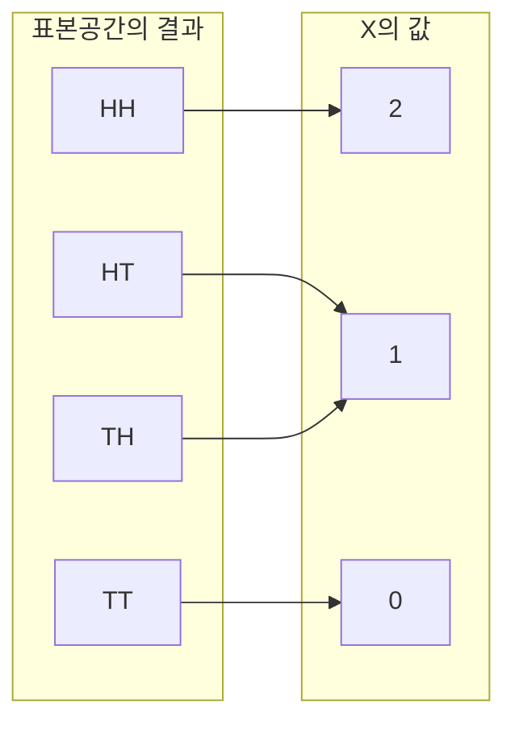



요약

확률변수는 실험 결과마다 수를 하나 붙이는 규칙이다. "동전 열 번 중 앞면 수", "요청 처리 시간"처럼 결과 자체보다 거기서 뽑은 수에 관심이 있을 때 쓴다. 수를 붙이고 나면 "이 값이 나올 확률" 표(분포)만 알면 되고, 합·평균·최댓값 같은 계산을 할 수 있다. 이름과 달리 변수도 아니고 무작위한 것도 아니라, 결과에서 수로 가는 정해진 함수라는 점이 처음에 헷갈린다.

## 예시로 보기

동전을 두 번 던지고 앞면의 수를 $$X$$라 하자. 결과 $$HH, HT, TH, TT$$에 $$X$$는 각각 $$2, 1, 1, 0$$을 붙인다.

| 값 $$x$$ | 그 값을 주는 결과 | $$P(X = x)$$ | $$P(X \le x)$$ |
|---|---|---|---|
| 0 | $$TT$$ | $$\frac14$$ | $$\frac14$$ |
| 1 | $$HT, TH$$ | $$\frac12$$ | $$\frac34$$ |
| 2 | $$HH$$ | $$\frac14$$ | 1 |

셋째 열이 아래 정의의 PMF, 넷째 열이 CDF다. $$X$$는 결과를 수로 바꾸는 함수이고, 무작위성은 어떤 결과가 나오느냐에서 온다.

결과 하나에서 화살표가 정확히 하나씩 나가고, 값 1에는 화살표가 둘 모인다. 그래서 $$P(X = 1)$$은 두 결과의 확률 $$\frac14$$를 더한 $$\frac12$$이다.[^s2]

## 정의

정의

표본공간 $$\Omega$$ 위의 **확률변수**는 함수 $$X : \Omega \to \mathbb{R}$$이다. 값이 유한하거나 셀 수 있게 많으면 **이산** 확률변수라 한다. 이산 확률변수의 **확률질량함수(PMF)**는 $$p_X(x) = P(X = x)$$이고, $$\sum_x p_X(x) = 1$$($$\sum$$은 차례로 모두 더한다는 기호)이다. 모든 확률변수의 **누적분포함수(CDF)**는 $$F_X(x) = P(X \le x)$$다[^1].

$$\{X = x\}$$는 "$$X$$가 $$x$$를 주는 결과들의 집합" $$\{\omega : X(\omega) = x\}$$를 줄여 쓴 사건이다.

**CDF의 성질.** 감소하지 않고, 오른쪽에서 연속이며, $$x \to -\infty$$에서 0, $$x \to \infty$$에서 1이다. 이산 확률변수의 CDF는 계단 모양이고 점프 크기가 그 점의 PMF다. 구간 확률은 $$P(a < X \le b) = F(b) - F(a)$$다.

왼쪽은 두 주사위 합 $$S$$의 PMF, 오른쪽은 CDF다. CDF는 값이 있는 곳에서만 계단처럼 뛰고, 뛰는 높이가 왼쪽 막대의 높이와 같다. 합 7에서는 $$\frac{6}{36}$$만큼 뛴다[^s1].

**지시 확률변수.** 사건 $$A$$가 일어나면 1, 아니면 0인 $$I_A$$다. $$P(I_A = 1) = P(A)$$이고, "개수"를 지시 확률변수의 합으로 쪼개는 데 쓴다([기댓값과 선형성](/Hongs_Blog/studies/probability-statistics/expectation/)).

**확률변수의 독립.** $$X$$와 $$Y$$가 **독립**이라는 것은 모든 $$x, y$$에서 $$P(X = x, Y = y) = P(X = x)\,P(Y = y)$$라는 뜻이다. [사건의 독립](/Hongs_Blog/studies/probability-statistics/independence/)을 모든 값 쌍으로 늘린 것이다.

## 예제

**두 주사위와 그 합.** 첫 주사위 $$X_1$$, 둘째 $$X_2$$, 합 $$S = X_1 + X_2$$.

1. *$$X_1$$과 $$X_2$$:* 모든 $$a, b$$에서 $$P(X_1 = a, X_2 = b) = \frac{1}{36} = \frac16 \cdot \frac16$$이라 독립이다.
2. *$$X_1$$과 $$S$$:* $$P(X_1 = 1, S = 12) = 0$$인데 $$P(X_1 = 1)P(S = 12) = \frac16 \cdot \frac{1}{36} > 0$$이라 독립이 아니다. 한 쌍의 값만 어겨도 독립이 아니다.
3. *함수의 분포:* $$S$$의 PMF는 결과 36개를 합으로 모아 세면 된다. 확률변수의 함수도 확률변수다.

검증: 예시 표의 PMF와 CDF, CDF의 단조·오른쪽 연속·점프 크기, 두 주사위의 독립과 비독립, 지시 확률변수, 카드의 PMF — [07_random-variables_verify.py](/Hongs_Blog/studies/probability-statistics/code/07_random-variables_verify/)

## 활용

- **알고리즘 분석.** "무작위 입력에서 비교 횟수", "해시 테이블 한 칸의 원소 수"는 확률변수다. 분포나 평균을 구하는 것이 평균 경우 분석이다.
- **시뮬레이션.** 난수로 결과를 만들고 확률변수 값을 계산해 모으면 분포를 어림할 수 있다.
- 알고리즘에서: CDF 표를 한 번 만들어 두고 구간 확률을 뺄셈 한 번으로 답하는 것은 [누적 합과 차분 배열](/Hongs_Blog/studies/algorithms/prefix-sum/)의 구간 합과 같은 방법이다. [실패율](/Hongs_Blog/studies/algorithms/pg42889/)은 스테이지마다 멈춘 사람 수(PMF에 인원을 곱한 표)를 전체 인원에서 앞에서부터 빼 가며, 각 스테이지에 도달한 사람 수를 구한다.

## 연결

- 선수: [확률의 공리와 계산](/Hongs_Blog/studies/probability-statistics/probability-axioms/), [함수](/Hongs_Blog/studies/college-math/function/)
- 이어지는 개념: [기댓값과 선형성](/Hongs_Blog/studies/probability-statistics/expectation/), [이항분포](/Hongs_Blog/studies/probability-statistics/binomial/)

## 과목별 관점

**자료와 정보 (2-1학기).** 이 문서는 실험 결과에 수를 붙이는 함수에서 출발한다. 강의는 반대쪽에서 온다. 손에 든 것은 자료 $$N$$개뿐이고, 그 자료를 "어떤 확률변수가 내놓은 값들"로 보기로 정한다[^i1]. 그렇게 보면 자료 묶음은 표본 묶음이 되고, 표본이 나온 분포를 함수 하나로 적을 수 있다. 분포 함수는 어떤 값이 얼마나 자주 나오는지를 적은 것이다. 그 함수의 모양을 정하는 수 몇 개(파라미터)가 자료에서 뽑아낸 정보가 된다. 정규분포라면 평균과 분산 두 수다[^i2].

- **자료를 보는 두 가지 눈.** 자료를 점으로 보면 거리와 모양을 따지는 기하가 된다. 확률변수로 보면 분포를 따지는 통계가 된다. 강의는 뒤쪽을 전통적인 자료 분석 방법이라고 부른다[^i3].
- **자료를 적는 법.** 키 자료는 $$x = \{x_1, \dots, x_N\}$$, 몸무게 자료는 $$y = \{y_1, \dots, y_N\}$$, 둘을 묶으면 $$(x_i, y_i)$$의 모임이다. 속성이 $$D$$개면 한 사람의 자료를 $$\mathbf X_i = [x_1, \dots, x_D]^\top$$로 세워 적고, 전체를 $$\mathbf X = \{\mathbf X_1, \dots, \mathbf X_N\}$$으로 쓴다[^i4]. 속성이 여럿일 때의 분포는 [공분산 행렬과 다변량 정규분포](/Hongs_Blog/studies/probability-statistics/multivariate-normal/)에서 다룬다.
- **낱말.** 슬라이드의 "분절(discrete) 변수"는 이 문서의 이산 확률변수다. 값이 이어져 있는 쪽은 연속(continuous) 변수라 부른다[^i5].

## 확인 문제

**C1** 주사위 두 개를 던져 큰 눈을 $$X$$라 할 때(같으면 그 눈) $$X$$의 PMF를 구하라.

**답:** $$P(X = k) = \frac{2k - 1}{36}$$ ($$k = 1, \dots, 6$$). 두 눈이 모두 $$k$$ 이하인 경우 $$k^2$$개에서 모두 $$k - 1$$ 이하인 경우 $$(k-1)^2$$개를 빼면 $$2k - 1$$개다. 합은 $$\frac{1 + 3 + \cdots + 11}{36} = 1$$.

**C2** 이산 확률변수 $$X$$의 CDF가 $$x < 0$$에서 0, $$0 \le x < 1$$에서 0.2, $$1 \le x < 3$$에서 0.5, $$x \ge 3$$에서 1이다. $$X$$의 PMF를 쓰라.

**답:** 점프가 있는 곳이 값이고 점프 크기가 확률이다. $$P(X = 0) = 0.2$$, $$P(X = 1) = 0.3$$, $$P(X = 3) = 0.5$$.

**C3** 확률변수를 "무작위로 값이 바뀌는 변수"가 아니라 "함수"로 정의하는 이유는?

**답:** 함수로 두면 같은 실험 결과에서 여러 확률변수(앞면 수, 최댓값, 합)를 동시에 정의하고, 그들 사이의 관계(독립, 합)를 표본공간 위에서 따질 수 있다. 확률은 결과가 무엇이 나올지에만 있고, 결과가 정해지면 $$X$$의 값은 정해진다.

[^1]: Blitzstein, Hwang, *Introduction to Probability* 2판, 3.1절 "Random variables", 3.2절 "Distributions and probability mass functions", 3.6절 "Cumulative distribution functions", 3.7절 "Functions of random variables", 3.8절 "Independence of rvs".
[^s1]: 보충 그림 한 장은 원본에 없다. [07_random-variables_plot.py](/Hongs_Blog/studies/probability-statistics/code/07_random-variables_plot/)로 그렸고, 그림에 쓴 값(PMF의 합 1, $$P(S = 7) = \frac{6}{36}$$, 합 7에서 CDF가 뛰는 높이 $$= P(S = 7)$$)을 같은 코드로 확인했다.
[^s2]: 보충 다이어그램 1개는 원본에 없다. 이 문서 예시 표(동전 두 번, 앞면 수)의 결과 → 값 대응을 그렸다.
[^i1]: 자료와 정보 6회 강의 자료 「D&I_강의06-확률변수」, p.2 (데이터를 보는 관점)
[^i2]: 자료와 정보 6회 강의 자료 「D&I_강의06-확률변수」, p.5 (데이터를 확률변수로 취급하면: 데이터 세트, 표본 세트, 확률 분포의 모델)
[^i3]: 자료와 정보 6회 강의 자료 「D&I_강의06-확률변수」, p.14 (요약: point와 geometry, random variable과 statistics)
[^i4]: 자료와 정보 6회 강의 자료 「D&I_강의06-확률변수」, p.8 (데이터의 표현, 벡터화)
[^i5]: 자료와 정보 8회 강의 자료 「D&I_강의08-조건확률」, p.2 (확률과 통계: 연속 변수와 분절 변수)

