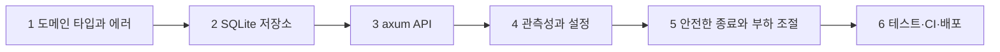


여섯 단계에 걸쳐 단축 URL 서비스를 만든다. 긴 주소를 받으면 `aZ09xyz` 같은 7글자 코드를 돌려주고, 누가 그 코드로 들어오면 원래 주소로 보낸다. 단계마다 파일 하나가 완성된 프로그램이고, 앞 단계 코드를 그대로 이어받는다. 두 단계 파일을 나란히 놓고 비교하면 무엇이 더해졌는지 바로 보인다.



| 단계 | 문서 | 코드 |
|---|---|---|
| 1 | 이 문서 | [24_capstone-1_p1.rs](/Hongs_Blog/studies/rust/code/24_capstone-1_p1/) |
| 2 | [SQLite 저장소](/Hongs_Blog/studies/rust/capstone-2/) | [46_capstone-2_p1.rs](/Hongs_Blog/studies/rust/code/46_capstone-2_p1/) |
| 3 | [axum API](/Hongs_Blog/studies/rust/capstone-3/) | [46_capstone-3_p1.rs](/Hongs_Blog/studies/rust/code/46_capstone-3_p1/) |
| 4 | [관측성과 설정](/Hongs_Blog/studies/rust/capstone-4/) | [46_capstone-4_p1.rs](/Hongs_Blog/studies/rust/code/46_capstone-4_p1/) |
| 5 | [안전한 종료와 부하 조절](/Hongs_Blog/studies/rust/capstone-5/) | [46_capstone-5_p1.rs](/Hongs_Blog/studies/rust/code/46_capstone-5_p1/) |
| 6 | [테스트·CI·배포](/Hongs_Blog/studies/rust/capstone-6/) | [50_capstone-6_p1.rs](/Hongs_Blog/studies/rust/code/50_capstone-6_p1/) |

## 목표

서버도 DB도 없이, 표준 라이브러리와 `thiserror`만으로 이 서비스의 "말"을 정한다.

- 사용자가 준 주소를 담는 `Url` 타입. 만들어졌다면 이미 검사를 통과한 값이다.
- 짧은 코드를 담는 `Code` 타입. 언제나 정확히 7글자, `0-9A-Za-z`만 쓴다(base62).
- 코드를 뽑는 생성기 `CodeGen`.
- 규칙을 어겼을 때 무엇이 틀렸는지 말해 주는 에러 열거형 `DomainError`.

이 단계를 건너뛰고 핸들러 안에서 `String`으로 주소를 주고받으면, 검사를 빠뜨린 경로 하나로 `javascript:` 주소가 저장된다. 그 링크를 누른 사람의 브라우저에서 스크립트가 돈다. 3단계에서 보겠지만 줄바꿈이 섞인 주소는 리다이렉트 응답을 500 에러로 바꾼다. 검사를 타입 안에 가두면 이런 구멍이 컴파일 단계에서 막힌다.

## 사용 개념

- [타입으로 잘못된 상태 막기](/Hongs_Blog/studies/rust/type-driven-design/): 뉴타입과 검사하는 생성자.
- [Option과 Result](/Hongs_Blog/studies/rust/option-result/): `parse`가 `Result<Self, DomainError>`를 돌려준다.
- [라이브러리 에러 설계](/Hongs_Blog/studies/rust/library-errors/): `thiserror`로 만든 에러 열거형.
- [꼭 구현할 표준 트레이트](/Hongs_Blog/studies/rust/standard-traits/): `Display`, `FromStr`, `Debug`, `PartialEq`, `Hash`.
- [테스트 전략](/Hongs_Blog/studies/rust/testing-strategy/): proptest로 "어떤 씨앗이든 만든 코드는 다시 읽힌다"를 테스트한다.

## 설계 결정

| 결정 | 고른 것 | 다른 길과 고르지 않은 까닭 |
|---|---|---|
| 주소 검사 | 직접 쓴 작은 검사기: 길이, 보이는 ASCII, `http`·`https`, 호스트 있음, `user@` 없음 | `url` 크레이트(WHATWG 파서)가 정석이다. 이 과목의 의존성 목록에 없어서 쓰지 않았다. 실제 서비스라면 `url`로 파싱한 뒤 아래 규칙을 덧붙인다 |
| 글자 제한 | `0x21..=0x7E`(공백·한글·제어 문자 거절) | 한글 주소를 받으려면 퍼센트 인코딩을 해서 저장해야 한다. 그대로 두면 HTTP 헤더에 못 넣는다 |
| 길이 상한 | 2048바이트 | 상한이 없으면 1MB짜리 "주소"가 DB와 로그를 채운다. 숫자 자체는 설계 선택이다 |
| 코드 길이 | 7글자, 62^7 = 3,521,614,606,208가지 | 6글자면 568억 가지다. 링크가 10억 개쯤 쌓여도 7글자는 새 코드가 겹칠 확률이 0.03%라서 재시도 몇 번이면 충분하다 |
| 난수 | SplitMix64, 씨앗은 std `RandomState`와 현재 시각 | `rand`·`getrandom`이 의존성 목록에 없다. 이 생성기는 암호학적으로 안전하지 않다. 코드를 추측해 남의 비공개 링크를 찾는 공격을 막아야 하면 OS 난수로 바꾼다 |
| 에러 | 열거형 하나에 변형 7개, 메시지는 소문자 영어 | 메시지를 API 응답에 그대로 실을 것이라서, 내부 정보가 없는 짧은 문장만 쓴다 |

## 코드 설명

**하위목표 1: 에러부터 정한다.** 무엇이 틀릴 수 있는지를 먼저 적으면 검사기가 그 목록을 따라가기만 하면 된다. `#[error("…")]`가 `Display`를 만들고, `{len}`처럼 필드를 메시지에 끼워 넣을 수 있다[^1].

```rust
#[derive(Debug, Clone, PartialEq, Eq, thiserror::Error)]
pub enum DomainError {
    #[error("url is empty")]
    EmptyUrl,
    #[error("url is {len} bytes, longer than the {max}-byte limit")]
    UrlTooLong { len: usize, max: usize },
    #[error("url contains a character outside visible ASCII at byte {index}")]
    InvalidCharacter { index: usize },
    // … UnsupportedScheme, MissingHost, UserInfo, InvalidCode
}
```

`PartialEq`를 붙인 까닭은 테스트에서 `assert_eq!(Url::parse(x), Err(DomainError::…))`로 정확한 변형을 비교하기 위해서다.

**하위목표 2: 검사를 통과해야만 `Url`이 생긴다.** 필드 `String`이 비공개라서 바깥에서는 `Url::parse`를 거치지 않고 `Url`을 만들 수 없다. 검사 순서는 싼 것부터다.

```rust
pub fn parse(input: &str) -> Result<Self, DomainError> {
    let s = input.trim();
    if s.is_empty() { return Err(DomainError::EmptyUrl); }
    if s.len() > MAX_URL_LEN { return Err(DomainError::UrlTooLong { len: s.len(), max: MAX_URL_LEN }); }
    if let Some(index) = s.bytes().position(|b| !(0x21..=0x7e).contains(&b)) {
        return Err(DomainError::InvalidCharacter { index });
    }
    let rest = strip_prefix_ignore_case(s, "https://")
        .or_else(|| strip_prefix_ignore_case(s, "http://"))
        .ok_or(DomainError::UnsupportedScheme)?;
    let authority = rest.split(['/', '?', '#']).next().unwrap_or("");
    if authority.contains('@') { return Err(DomainError::UserInfo); }
    // … 호스트가 비었는지 본다
    Ok(Self(s.to_owned()))
}
```

`https://bank.com@evil.example/`는 사람 눈에는 bank.com처럼 보이지만 실제로 가는 곳은 `evil.example`이다. `@` 앞부분은 사용자 이름 자리이기 때문이다. 단축 URL은 원래 주소를 숨기는 서비스라서 이런 속임수에 특히 약하다. 그래서 `UserInfo`로 거절한다.

글자를 보이는 ASCII로 묶은 것은 3단계와 이어진다. axum의 `Redirect`는 주소를 `Location` 헤더 값으로 바꾸다가 실패하면 500 응답을 낸다[^2]. 여기서 막아 두면 그 경로가 아예 생기지 않는다.

**하위목표 3: `Code`는 길이와 글자 두 가지만 본다.**

```rust
pub fn parse(s: &str) -> Result<Self, DomainError> {
    if s.len() == CODE_LEN && s.bytes().all(|b| b.is_ascii_alphanumeric()) {
        Ok(Self(s.to_owned()))
    } else {
        Err(DomainError::InvalidCode)
    }
}
```

`s.len()`은 글자 수가 아니라 바이트 수다. `"abcdéf"`는 6글자지만 `é`가 2바이트라서 7바이트다. 길이 검사는 통과하고, 글자 검사에서 걸린다. 자체 테스트에 이 경우가 들어 있다.

**하위목표 4: 고르게 코드를 뽑는다.** 64비트 난수에서 바이트 8개를 꺼내 하나씩 글자로 바꾼다. 바이트는 0~255인데 62로 나눈 나머지를 그냥 쓰면 앞쪽 글자가 더 자주 나온다. 256 = 62 × 4 + 8이라서 나머지 0~7이 한 번씩 더 나오기 때문이다. 248(= 62 × 4) 이상인 바이트를 버리면 62글자가 같은 확률로 나온다(거절 샘플링).

```rust
for b in self.next_u64().to_le_bytes() {
    if b < 248 && out.len() < CODE_LEN {
        out.push(char::from(ALPHABET[usize::from(b % 62)]));
    }
}
```

**하위목표 5: 테스트한다.** 예시 몇 개로 보는 테스트와, 무작위 입력 수백 개로 보는 성질 테스트(property-based testing)을 같이 쓴다. proptest는 무작위 입력으로 실패를 찾으면 더 작은 입력으로 줄여서(shrinking) 보여 준다[^3].

```rust
proptest! {
    #[test]
    fn generated_codes_always_parse(seed in any::<u64>()) {
        let mut g = CodeGen::from_seed(seed);
        for _ in 0..20 {
            let c = g.next_code();
            prop_assert_eq!(Code::parse(c.as_str()), Ok(c.clone()));
        }
    }
}
```

자체 테스트은 코드 1만 개(7만 글자)를 뽑아 글자별 횟수도 센다. 기대값은 70,000 / 62 ≈ 1,129이다. 실행했을 때 최소 1,044, 최대 1,203이 나왔다.

<div class="callout callout-check" markdown="1">
<div class="callout-title" markdown="span">검증: rustfmt·clippy(`-D warnings`)·테스트 4개(proptest 3개 포함)·자체 테스트 통과, `ALL CHECKS PASSED` — [24_capstone-1_p1.rs](/Hongs_Blog/studies/rust/code/24_capstone-1_p1/)</div>

</div>


## 변형 문제

**변형 1.** `Url::parse` 첫 줄의 `trim()`을 지우면 자체 테스트의 어느 줄이 무슨 에러로 실패하는가?

<details class="callout callout-answer" markdown="1">
<summary class="callout-title" markdown="span">답</summary>

첫 검사 `Url::parse("  https://example.com/a?b=c  ")`가 실패한다. 앞의 공백(0x20)은 `0x21..=0x7E` 밖이라서 `InvalidCharacter { index: 0 }`가 나온다. 복사해 붙인 주소에는 앞뒤 공백이 흔하다. 그래서 거절하는 대신 걷어 내는 쪽을 골랐다.

</details>


**변형 2.** 248 대신 256을 기준으로 삼아 모든 바이트를 쓰면(`b % 62`만 남기면) 어떤 글자가 얼마나 더 자주 나오는가?

<details class="callout callout-answer" markdown="1">
<summary class="callout-title" markdown="span">답</summary>

나머지 0~7, 즉 `'0'`~`'7'` 여덟 글자가 더 자주 나온다. 이 글자들은 바이트 256개 중 5개가 가리키고(확률 5/256 ≈ 1.95%), 나머지 54글자는 4개가 가리킨다(4/256 ≈ 1.56%). 25% 더 자주 나온다. 코드가 몇 개 겹치는 것보다, 추측하기 쉬워지는 것이 더 큰 문제다.

</details>


**변형 3.** 링크가 10억 개 저장돼 있을 때 새로 뽑은 7글자 코드가 이미 있는 코드와 겹칠 확률은? 2단계의 재시도 5번이 모두 겹칠 확률은?

<details class="callout callout-answer" markdown="1">
<summary class="callout-title" markdown="span">답</summary>

한 번 겹칠 확률은 $$10^9 / 62^7 \approx 2.84 \times 10^{-4}$$, 1만 번에 3번쯤이다. 다섯 번 연속 겹칠 확률은 $$(2.84 \times 10^{-4})^5 \approx 1.8 \times 10^{-18}$$이다. 실제로는 일어나지 않는다. 그래도 2단계는 "재시도 소진"을 에러로 처리한다. 생성기 씨앗이 고장 나 같은 코드만 낼 때 무한 반복 대신 에러가 나야 하기 때문이다.

</details>


[^1]: thiserror 2.0.21 문서, "Details"의 `#[error]` 형식 — https://docs.rs/thiserror/2.0.21/thiserror/
[^2]: axum 0.8.9 소스, `impl IntoResponse for Redirect`(`HeaderValue::try_from` 실패 시 `INTERNAL_SERVER_ERROR`) — https://docs.rs/axum/0.8.9/src/axum/response/redirect.rs.html
[^3]: proptest 1.12.0 문서, 크레이트 소개("Hypothesis-like property-based testing and shrinking") — https://docs.rs/proptest/1.12.0/proptest/

