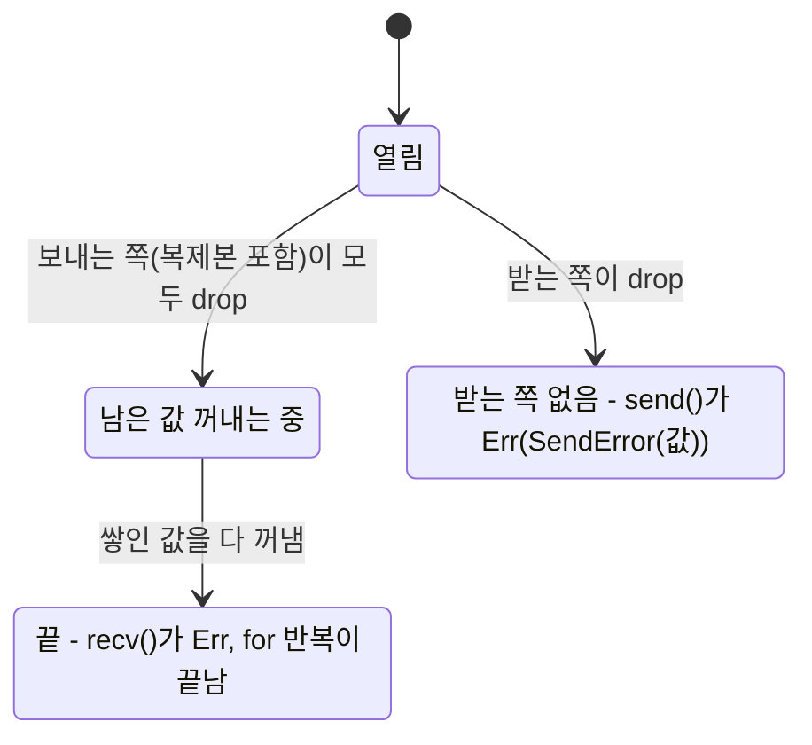


<div class="callout callout-summary" markdown="1">
<div class="callout-title callout-title--default" markdown="span">요약</div>

채널은 스레드 사이에 놓인 우체통이다. 보내는 쪽이 값을 넣으면 그 값의 주인도 함께 넘어가서, 두 스레드가 같은 값을 동시에 만질 일이 처음부터 없다. 보내는 쪽은 여럿일 수 있지만 꺼내는 쪽은 하나뿐이고, 꺼내는 쪽은 보내는 쪽이 하나라도 남아 있으면 "아직 더 올 수 있다"고 보고 계속 기다린다. 우체통 크기를 정하지 않으면 꺼내는 쪽이 느릴 때 쌓이는 양에 끝이 없다.

</div>


## 예시로 보기

요청을 처리하는 스레드 여럿이 로그 줄을 만들고, 그 줄을 파일 하나에 써야 한다. `Mutex<File>`로 감싸 모두가 직접 쓰게 할 수도 있다. 그러면 스레드마다 잠금을 잡으려고 기다리고, 잠금을 쥐는 범위를 잘못 잡으면 느려지거나 멈춘다([Mutex와 RwLock](/Hongs_Blog/studies/rust/mutex-rwlock/)). 할 일이 "값을 넘기기"뿐이라면 더 단순한 길이 있다. 파일은 쓰는 스레드 하나만 쥐고, 나머지는 줄을 그 스레드에 보낸다. Go의 표어대로, 메모리를 함께 써서 소통하지 말고 소통해서 메모리를 나눈다[^1].

```rust
use std::sync::mpsc;
use std::thread;

/// 생산자 p명이 각자 (번호, 순번)을 n개 보낸다.
fn fan_in(p: usize, n: usize) -> Vec<(usize, usize)> {
    let (tx, rx) = mpsc::channel();   // (보내는 쪽, 받는 쪽)
    for id in 0..p {
        let tx = tx.clone();          // 보내는 쪽은 복제할 수 있다
        thread::spawn(move || {
            for i in 0..n {
                tx.send((id, i)).unwrap();
            }
        });                           // 스레드가 끝나면 복제본 tx도 버려진다
    }
    drop(tx); // 원본도 버려야 아래 반복이 끝난다
    rx.into_iter().collect()          // 보내는 쪽이 모두 사라질 때까지 받는다
}
```

생산자 3명이 1,000개씩 보내자 3,000개가 모두 왔다. 생산자끼리는 순서가 섞였지만, 한 생산자가 보낸 메시지는 보낸 순서 그대로 왔다. 여러 곳에서 하나로 모으는 이 모양을 fan-in이라 부른다.

`drop(tx)` 줄을 빼면 어떻게 될까? 생산자 스레드들이 다 끝나도 `fan_in`이 쥔 원본 `tx`가 살아 있다. 받는 쪽은 그 `tx`로 무언가 더 올 수 있다고 보고 영원히 기다린다. 컴파일러는 이 멈춤을 잡아 주지 않는다.

보낸 값은 받는 쪽의 것이 된다. 보낸 뒤에 다시 쓰면 컴파일되지 않는다[^1].

```text
error[E0382]: borrow of moved value: `s`
    ... value moved here                  (tx.send(s))
    ... value borrowed here after move    (println!("{s}"))
```

<div class="callout callout-check" markdown="1">
<div class="callout-title" markdown="span">검증: fan-in 3,000개와 생산자별 순서, 복제본이 남아 있으면 `recv_timeout`이 시간 초과인 것, 연결이 끊긴 뒤에도 쌓인 메시지는 받는 것, 받는 쪽이 사라지면 `send`가 값을 돌려주는 것, `sync_channel(2)`·`sync_channel(0)`의 `try_send`, 일꾼 풀의 합 338,350, `while let`이 일꾼들을 한 줄로 세우는 시간, E0382·E0277·E0658을 실행·컴파일해 확인했다 — [35_channels_verify.rs](/Hongs_Blog/studies/rust/code/35_channels_verify/)</div>

</div>


## 정의

`std::sync::mpsc`의 mpsc는 "보내는 쪽 여럿, 받는 쪽 하나(multiple producer, single consumer)"의 머리글자다[^1]. 채널을 만드는 함수는 둘이다[^2].

| | `mpsc::channel()` | `mpsc::sync_channel(n)` |
|---|---|---|
| 돌려주는 것 | `(Sender<T>, Receiver<T>)` | `(SyncSender<T>, Receiver<T>)` |
| 담을 수 있는 수 | 끝이 없다(무제한 버퍼) | 미리 잡아 둔 `n`칸 |
| `send`가 기다리나 | 자리가 없어서 기다리는 일이 없다 | 칸이 차 있으면 빈 칸이 날 때까지 기다린다[^3] |
| `n = 0`일 때 | — | 랑데부: 받는 쪽이 꺼낼 때까지 `send`가 돌아오지 않는다[^3] |

운영체제 수업의 분류로 보면 `channel()`은 "논블로킹 send, 블로킹 receive"이고, `sync_channel(0)`은 양쪽이 모두 기다리는 랑데부다. 보내는 쪽 여럿이 받는 쪽 하나에 보내는 모양은 다대일 메일박스, 곧 포트다([메시지 전달](/Hongs_Blog/studies/operating-systems/message-passing/)).

| 연산 | 하는 일 | 실패할 때 |
|---|---|---|
| `send(v)` | 값을 넣는다 | 받는 쪽이 사라졌으면 `Err(SendError(v))`. 넣으려던 값을 돌려준다[^4] |
| `try_send(v)` (`SyncSender`) | 기다리지 않고 넣어 본다 | 칸이 차 있으면 `Full(v)`, 받는 쪽이 사라졌으면 `Disconnected(v)`[^5] |
| `recv()` | 값이 올 때까지 기다린다 | 보내는 쪽이 모두 사라졌고 쌓인 값도 없으면 `Err(RecvError)`[^6] |
| `try_recv()` | 기다리지 않고 꺼내 본다 | 비었으면 `Empty`, 끊겼으면 `Disconnected`[^6] |
| `recv_timeout(d)` | `d`까지만 기다린다 | 시간이 지나면 `Timeout`[^6] |
| `for v in rx` / `rx.iter()` | 끊길 때까지 계속 받는다 | 끊기면 반복이 끝난다. panic하지 않는다[^6] |

세 타입이 스레드를 건널 수 있는지는 다음과 같다([스레드와 Send·Sync](/Hongs_Blog/studies/rust/threads-send-sync/)).

| 타입 | Send | Sync |
|---|---|---|
| `Sender<T>` | 예 (`T: Send`) | 예 (`T: Send`, 1.72부터)[^4] |
| `SyncSender<T>` | 예 (`T: Send`) | 예 (`T: Send`)[^5] |
| `Receiver<T>` | 예 (`T: Send`) | **아니오**[^6] |

`Receiver`는 한 스레드만 가질 수 있다[^6]. 다른 스레드로 통째로 옮기는 것은 되지만, 두 스레드가 `&rx`를 함께 쥐면 컴파일되지 않는다.

```text
error[E0277]: `std::sync::mpsc::Receiver<i32>` cannot be shared between threads safely
  = help: the trait `Sync` is not implemented for `std::sync::mpsc::Receiver<i32>`
  = note: required for `&std::sync::mpsc::Receiver<i32>` to implement `Send`
```

## 채널이 닫히는 규칙

받는 쪽이 "이제 끝"을 아는 길은 하나뿐이다. 보내는 쪽이 복제본까지 **모두** 사라지는 것이다[^2][^6].



| 장면 | 결과(검증 코드) |
|---|---|
| 원본 `tx`를 버렸지만 복제본 `tx2`가 남았다 | `recv_timeout(50ms)` → `Err(Timeout)`. `recv()`였다면 영원히 기다린다 |
| `tx2`까지 버렸다 | `recv()` → `Err(RecvError)` |
| `"a"`, `"b"`를 보내고 `tx`를 버렸다 | `recv()` → `Ok("a")`, `try_recv()` → `Ok("b")`, 그다음 `Err(Disconnected)` |
| 받는 쪽을 버린 뒤 `send("lost?")` | `Err`가 왔고, `.0`으로 `"lost?"`를 돌려받았다 |

두 가지를 기억해 둔다. 첫째, 연결이 끊겨도 이미 들어간 값은 사라지지 않는다. 받는 쪽은 남은 값을 다 꺼낸 뒤에야 끊김을 본다[^6]. 둘째, `send`가 `Ok`라고 받는 쪽이 그 값을 읽었다는 뜻은 아니다. `Ok`가 돌아온 직후 받는 쪽이 사라질 수 있다[^4]. 받았다는 확인이 꼭 필요하면 `sync_channel(0)`을 쓰거나[^5], 답장용 채널을 하나 더 만든다.

이 규칙은 종료 신호로도 쓴다. The Rust Book의 스레드 풀은 풀을 버릴 때 보내는 쪽을 먼저 `drop`한다. 그러면 일꾼들의 `recv`가 모두 `Err`를 받아 반복을 끝내고, 풀은 그다음에 일꾼들을 `join`한다. 보내는 쪽을 버리기 전에 `join`하면, 일꾼은 오지 않을 일을 기다리고 `main`은 끝나지 않는 일꾼을 기다린다[^8].

## sync_channel: 칸 수 정하기

`sync_channel(2)`에 `try_send`를 세 번 하면 두 번은 들어가고 세 번째는 `Err(Full(3))`이다. 하나를 `recv`한 뒤에는 다시 들어간다. `sync_channel(0)`은 칸이 없어서, 받으려고 기다리는 스레드가 없으면 `try_send`가 늘 `Full`이다[^5].

칸 수를 정하면 받는 쪽이 느릴 때 보내는 쪽이 그 속도에 맞춰 기다린다. 쌓이는 양은 `n`을 넘지 않는다. 운영체제 수업의 유한 버퍼([생산자-소비자 문제](/Hongs_Blog/studies/operating-systems/producer-consumer/))가 `sync_channel(n)` 한 줄이 된다. `Mutex`와 `Condvar`로 같은 버퍼를 직접 짜는 법은 [모니터 ↔ Mutex](/Hongs_Blog/studies/rust/monitor-vs-mutex/)에 있다. 무제한 `channel()`에는 이 브레이크가 없다. 브레이크가 없을 때 큐가 얼마나 커지는지는 [백프레셔와 큐 제한](/Hongs_Blog/studies/rust/backpressure/)에서 잰다.

## fan-out: 일꾼 여럿에게 나눠 주기

받는 쪽은 하나뿐이고 `Sync`도 아니다. 그래서 일꾼 여럿이 한 큐에서 일을 나눠 받으려면 `Arc<Mutex<Receiver<T>>>`로 감싼다. `Arc`로 여럿이 함께 갖고, `Mutex`로 한 번에 한 일꾼만 꺼내게 한다[^7]. 한 곳에서 여러 곳으로 나눠 주는 이 모양을 fan-out이라 부른다.

```rust
let job_rx = Arc::new(Mutex::new(job_rx));
// 일꾼마다 다음 반복을 돈다
loop {
    let job = job_rx.lock().unwrap().recv(); // 잠금은 이 문장 끝에서 풀린다
    match job {
        Ok(x) => res_tx.send((id, x * x)).unwrap(), // 결과는 다른 채널로 모은다(fan-in)
        Err(_) => break,                            // 일을 보내는 쪽이 모두 사라졌다
    }
}
```

일꾼 4명이 1부터 100까지의 제곱을 나눠 구해 합 338,350을 얻었다. 일꾼마다 맡은 개수는 실행할 때마다 달랐다. `[23, 28, 6, 43]`, `[100, 0, 0, 0]`, `[4, 12, 2, 82]`가 나왔다. 일이 아주 짧으면 한 일꾼이 잠금을 풀자마자 다시 잡아 다 가져가기도 한다. 이 코드에는 일을 고르게 나누는 장치가 없다.

**잠금을 쥐는 범위가 전부다.** 위 반복을 `while let`으로 줄이면 겉보기에는 같다.

```rust
while let Ok(job) = rx.lock().unwrap().recv() {
    work(job); // 이 동안에도 잠금을 쥐고 있다
}
```

`let` 문장 오른쪽에서 생긴 임시 값(여기서는 `MutexGuard`)은 그 문장이 끝날 때 버려진다. `while let`·`if let`·`match`는 딸린 블록이 끝날 때까지 임시 값을 버리지 않는다[^7]. 그래서 한 일꾼이 일하는 동안 다른 일꾼은 `recv`조차 못 한다. 일꾼 4명과 20ms짜리 일 8개로 쟀더니 `let` 판은 50ms, `while let` 판은 187~196ms였다. 이론값은 각각 2묶음 × 20ms = 40ms, 8개 × 20ms = 160ms다. 일꾼이 넷이어도 한 줄로 선 셈이다. clippy의 `significant_drop_in_scrutinee`(nursery 묶음)를 켜면 이 코드에 "temporary with significant `Drop` in `while let` scrutinee will live until the end of the `while let` expression"이라는 경고가 뜬다[^13].

## 다른 채널들

| 채널 | 받는 쪽 | 특징 | 쓰는 곳 |
|---|---|---|---|
| `std::sync::mpsc` | 하나 | 1.67부터 crossbeam-channel을 바탕으로 한 구현을 쓴다. API는 그대로다[^9] | 스레드 사이, 의존성 없이 |
| `std::sync::mpmc` | 여럿 | rustc 1.99에서 아직 불안정 기능이다(`mpmc_channel`, 컴파일해 E0658 확인) | 안정판에서는 못 쓴다 |
| crossbeam-channel | 여럿 | 받는 쪽도 복제한다. `bounded(0)` 랑데부, 여러 채널을 함께 기다리는 `select!`[^10] | 스레드 사이 fan-out, 여러 채널 기다리기 |
| `tokio::sync::mpsc` | 하나 | async용. 크기 제한 판은 차면 `send(..).await`가 기다리고, 무제한 판은 `send`가 늘 바로 끝난다[^11] | async 태스크 사이 |
| `tokio::sync::oneshot` | 하나 | 값 하나만 보낸다[^12] | 요청 하나에 답장 하나 |
| `tokio::sync::broadcast` | 여럿 | 모든 받는 쪽이 모든 값을 본다[^12] | 여러 태스크에 같은 소식 |
| `tokio::sync::watch` | 여럿 | 기록 없이 가장 최근 값만 남는다[^12] | 설정 값, 상태 |

crossbeam-channel은 하네스에 없어 이 과목의 코드로 돌려 보지 않았다. 동기 코드와 async 코드를 이을 때는 tokio 문서의 지침을 따른다. 크기 제한 채널이면 양쪽 모두 tokio 채널을 쓰고, 동기 쪽에서는 `blocking_send`나 `blocking_recv`를 부른다[^11].

## 활용

- **한 스레드가 자원을 쥐고 나머지는 부탁한다.** 파일, 소켓, 외부 라이브러리 핸들처럼 한 곳만 만져야 하는 자원을 스레드 하나에 두고, 나머지는 채널로 일을 보낸다. 잠금 순서를 따질 일이 없어진다. tokio 튜토리얼의 관리자 태스크(manager task)가 같은 모양이다[^12].
- **답장 받기.** 요청에 답이 필요하면 요청 메시지 안에 답장용 채널의 보내는 쪽을 넣어 보낸다. tokio 튜토리얼은 이 자리에 `oneshot`을 쓴다[^12].
- **종료 신호.** 보내는 쪽을 모두 버리는 것이 "일 끝"을 알리는 가장 단순한 신호다. 위의 스레드 풀이 이렇게 끝난다[^8]. async 서버를 질서 있게 끝내는 법은 [안전한 종료](/Hongs_Blog/studies/rust/graceful-shutdown/)에서 잇는다.
- **흔한 실수.**
  - 원본 `tx`를 `drop`하지 않아 받는 쪽 반복이 끝나지 않는다. [동시성 연습](/Hongs_Blog/studies/rust/concurrency-practice/) p3에서 이 멈춤을 `recv_timeout`으로 확인한다.
  - fan-out 일꾼에서 `while let Ok(job) = rx.lock().unwrap().recv()`를 쓴다. 일꾼이 한 줄로 선다.
  - 받는 쪽이 느린데 무제한 `channel()`을 쓴다. tokio 튜토리얼은 무제한 큐가 결국 메모리를 다 채워 시스템이 예측할 수 없게 무너진다고 경고한다[^12].
  - 종료 중에 `send(..).unwrap()`을 한다. 받는 쪽이 먼저 사라지면 panic이다. 종료가 있는 프로그램에서는 `Err`를 "받는 쪽이 끝났다"는 뜻으로 보고 반복을 끝낸다.
- **clippy.** `significant_drop_in_scrutinee`는 nursery 묶음이라 기본으로 꺼져 있다. 채널과 잠금을 함께 쓰는 코드라면 `#![warn(clippy::significant_drop_in_scrutinee)]`로 켜 볼 만하다[^13].

## 연결

- 선수: [소유권과 이동](/Hongs_Blog/studies/rust/ownership-move/)(보낸 값은 옮겨 간다), [스레드와 Send·Sync](/Hongs_Blog/studies/rust/threads-send-sync/), [Mutex와 RwLock](/Hongs_Blog/studies/rust/mutex-rwlock/)(fan-out의 `Mutex<Receiver>`)
- 운영체제: [메시지 전달](/Hongs_Blog/studies/operating-systems/message-passing/), [생산자-소비자 문제](/Hongs_Blog/studies/operating-systems/producer-consumer/). 메시지 전달과 모니터가 같은 문제의 두 풀이라는 이야기가 Rust에서는 채널과 `Mutex`+`Condvar`로 나타난다([모니터 ↔ Mutex](/Hongs_Blog/studies/rust/monitor-vs-mutex/)).
- 다음: async 채널과 `select!`는 [취소·타임아웃·select](/Hongs_Blog/studies/rust/cancellation-timeouts-select/), 큐 크기와 부하는 [백프레셔와 큐 제한](/Hongs_Blog/studies/rust/backpressure/), 종료는 [안전한 종료](/Hongs_Blog/studies/rust/graceful-shutdown/)
- 연습: [동시성 연습](/Hongs_Blog/studies/rust/concurrency-practice/)

## 확인 문제

<details class="callout callout-question" markdown="1">
<summary class="callout-title" markdown="span">**C1** 출력을 예측하라.</summary>

```rust
let (tx, rx) = mpsc::channel::<i32>();
let tx2 = tx.clone();
drop(tx);
println!("{:?}", rx.recv_timeout(Duration::from_millis(50)));
drop(tx2);
println!("{:?}", rx.recv());
```
**답:** `Err(Timeout)` 다음 `Err(RecvError)`.<br>
**이유:** 원본을 버려도 복제본 `tx2`가 살아 있으니 채널은 열려 있다. 아무것도 오지 않으므로 50ms 뒤 시간 초과다. `tx2`까지 버리면 보내는 쪽이 하나도 없고 쌓인 값도 없으니 `recv`가 곧바로 `Err`다. 검증 코드 출력과 같다.

</details>


<details class="callout callout-question" markdown="1">
<summary class="callout-title" markdown="span">**C2** 컴파일되는가? 안 되면 왜이고, 어떻게 고치나?</summary>

```rust
let (_tx, rx) = mpsc::channel::<i32>();
thread::scope(|s| {
    s.spawn(|| rx.try_recv());
    s.spawn(|| rx.try_recv());
});
```
**답:** 안 된다. `error[E0277]: std::sync::mpsc::Receiver<i32> cannot be shared between threads safely`. 두 클로저가 `&rx`를 함께 쥐는데, `&Receiver`가 다른 스레드로 가려면 `Receiver`가 `Sync`여야 한다. `Receiver`는 `Sync`가 아니다. 일꾼 여럿이 나눠 받으려면 `Mutex<Receiver>`로 감싸 한 번에 한 스레드만 꺼내게 한다(`spawn`이면 `Arc<Mutex<Receiver>>`).<br>
**흔한 오답:** "`scope`는 `'static`이 필요 없으니 된다." `scope`가 풀어 주는 것은 `'static` 조건뿐이다. `Send` 조건은 그대로다.

</details>


<details class="callout callout-question" markdown="1">
<summary class="callout-title" markdown="span">**C3** 셋 중 무엇을 쓰나? `channel()`, `sync_channel(n)`, `sync_channel(0)`. (가) 요청 스레드들이 로그 줄을 파일 쓰는 스레드에 보낸다. 디스크가 느려지면 요청 스레드가 잠깐 기다려도 되지만, 메모리를 끝없이 쓰면 안 된다. (나) 일꾼 8명이 결과를 하나씩 `main`에 돌려준다. (다) 두 스레드가 한 단계씩 맞물려 번갈아 움직여야 한다.</summary>

**답:** (가) `sync_channel(n)`. 쌓이는 줄이 `n`을 넘지 않고, 차면 보내는 쪽이 기다린다. (나) `channel()`. 쌓일 양이 8개로 정해져 있어 끝없이 쌓일 걱정이 없고, 일꾼이 기다릴 이유도 없다. (다) `sync_channel(0)`. 받는 쪽이 꺼내야 `send`가 돌아오는 랑데부다.<br>
**흔한 오답:** "(가)도 `channel()`이면 빠르다." 디스크가 계속 느리면 큐가 끝없이 커져 메모리가 바닥난다. 빠른 것은 `send`뿐이다.

</details>


[^1]: The Rust Programming Language, 16.2 Transferring Data Between Threads with Message Passing (Channels and Ownership Transference, Creating Multiple Producers) — https://doc.rust-lang.org/book/ch16-02-message-passing.html
[^2]: std 문서, Module `std::sync::mpsc` (Disconnection, channel·sync_channel 설명) — https://doc.rust-lang.org/std/sync/mpsc/index.html
[^3]: std 문서, Function `std::sync::mpsc::sync_channel` — https://doc.rust-lang.org/std/sync/mpsc/fn.sync_channel.html
[^4]: std 문서, Struct `std::sync::mpsc::Sender` (`send`, Auto Trait Implementations) — https://doc.rust-lang.org/std/sync/mpsc/struct.Sender.html
[^5]: std 문서, Struct `std::sync::mpsc::SyncSender` (`send`, `try_send`) — https://doc.rust-lang.org/std/sync/mpsc/struct.SyncSender.html
[^6]: std 문서, Struct `std::sync::mpsc::Receiver` (`recv`, `try_recv`, `recv_timeout`, `iter`, `!Sync`) — https://doc.rust-lang.org/std/sync/mpsc/struct.Receiver.html
[^7]: The Rust Programming Language, 21.2 From Single-Threaded to Multithreaded Server (Sending Requests to Threads via Channels, Implementing the execute Method) — https://doc.rust-lang.org/book/ch21-02-multithreaded.html
[^8]: The Rust Programming Language, 21.3 Graceful Shutdown and Cleanup (Signaling to the Threads to Stop Listening for Jobs) — https://doc.rust-lang.org/book/ch21-03-graceful-shutdown-and-cleanup.html
[^9]: Rust Blog, Announcing Rust 1.67.0 (`std::sync::mpsc` implementation updated) — https://blog.rust-lang.org/2023/01/26/Rust-1.67.0/
[^10]: crossbeam-channel 문서, Crate `crossbeam_channel` — https://docs.rs/crossbeam-channel/latest/crossbeam_channel/
[^11]: tokio 문서, Module `tokio::sync::mpsc` (Bounded and unbounded channels, Communicating between sync and async code, Disconnection) — https://docs.rs/tokio/latest/tokio/sync/mpsc/index.html
[^12]: Tokio Tutorial, Channels (Tokio's channel primitives, Spawn manager task, Receive responses, Backpressure and bounded channels) — https://tokio.rs/tokio/tutorial/channels
[^13]: Clippy Lints, `significant_drop_in_scrutinee` — https://rust-lang.github.io/rust-clippy/master/index.html (rustc 1.99.0의 `cargo clippy --explain`과 실제 경고 출력으로 확인했다)

