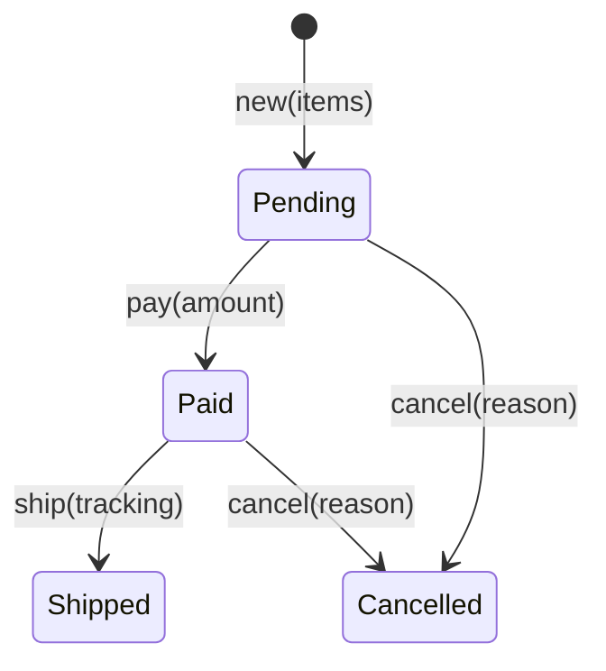


3단원의 도구, 구조체와 열거형, `Option`과 `Result`, `HashMap`, "타입으로 잘못된 상태 막기"를 한 문제 안에서 함께 쓰는 세 문제다. 세 문제 모두 바깥에서 들어온 글(명령, 문장, 설정 파일)을 받아 안쪽의 타입으로 바꾸고, 잘못된 입력은 panic 대신 `Err`로 돌려준다.

<div class="callout callout-check" markdown="1">
<div class="callout-title" markdown="span">검증: 세 문제의 출력과 변형 문제의 답(컴파일 오류 포함)을 rustc 1.99.0으로 확인했다 — [p1](/Hongs_Blog/studies/rust/code/14_data-modeling-practice_p1/) · [p2](/Hongs_Blog/studies/rust/code/14_data-modeling-practice_p2/) · [p3](/Hongs_Blog/studies/rust/code/14_data-modeling-practice_p3/)</div>

</div>


## p1 · 주문 상태를 열거형으로

쇼핑몰 주문은 대기(`Pending`) → 결제(`Paid`) → 배송(`Shipped`)으로 간다. 대기나 결제 상태에서는 취소(`Cancelled`)할 수 있다. 운송장 번호는 배송된 주문에만 있다.



- (가) `bool` 필드 없이 열거형 `Order`를 정의하라. 상태마다 그 상태에서만 뜻이 있는 데이터를 담는다.
- (나) 전환 메서드 `pay`, `ship`, `cancel`을 만들라. 그림에 없는 전환은 `Err(TransitionError::NotAllowed { from, action })`, 공백뿐인 운송장 번호는 `Err(TransitionError::EmptyTracking)`이다. 운송장 번호를 꺼내는 `tracking()`도 만든다.
- (다) 2개짜리 새 주문에 명령 `"ship CJ1"`, `"pay 5000"`, `"pay 5000"`, `"ship CJ9"`, `"cancel 변심"`을 차례로 적용하는 `run`을 만들라. 성공하면 새 상태 이름을, 실패하면 `거절 {에러:?}`를 남기고 상태는 그대로 둔다. 출력은 다음과 같아야 한다.

```text
거절 NotAllowed { from: "Pending", action: "ship" }, Paid, 거절 NotAllowed { from: "Paid", action: "pay" }, Shipped, 거절 NotAllowed { from: "Shipped", action: "cancel" }
```

사용 개념: [열거형과 패턴 매칭](/Hongs_Blog/studies/rust/enums-pattern-matching/), [타입으로 잘못된 상태 막기](/Hongs_Blog/studies/rust/type-driven-design/)의 열거형 상태, [구조체와 메서드](/Hongs_Blog/studies/rust/structs-methods/)의 `self`를 받는 메서드, [Option과 Result](/Hongs_Blog/studies/rust/option-result/).

풀이 전략: 그림의 상자 하나가 변형 하나다. 화살표 하나가 메서드의 `match` 갈래 하나이고, 화살표가 없는 조합은 모두 `_` 갈래의 `Err`로 모은다. 전환은 옛 상태를 다 쓰고 새 상태를 만드는 일이므로 `self`를 값으로 받는다. Rust 책의 블로그 글 예도 상태를 바꾸는 메서드가 `self`를 받아 옛 상태를 소비한다[^1].

<details class="callout callout-answer" markdown="1">
<summary class="callout-title" markdown="span">풀이</summary>

1. *상태와 데이터 적기:* 결제 금액은 결제 뒤에만, 운송장 번호는 배송 뒤에만 있다. 취소된 주문에는 사유만 남긴다.

```rust
enum Order {
    Pending { items: u32 },
    Paid { items: u32, amount: u64 },
    Shipped { items: u32, amount: u64, tracking: String },
    Cancelled { reason: String },
}

enum TransitionError {
    NotAllowed { from: &'static str, action: &'static str },
    EmptyTracking,
}
```

`bool` 두 개(`paid`, `shipped`)와 `Option<String>` 운송장으로 쓰면 "결제 안 했는데 배송됨" 같은 조합도 만들 수 있다. 열거형에서는 그런 값을 만들 길이 없다.

{: start="2"}
2. *화살표를 갈래로:* 맞는 상태면 안의 데이터를 꺼내 새 변형에 옮겨 담는다. 나머지는 `other`로 받아 이름만 에러에 적는다. `name()`은 변형마다 `"Pending"` 같은 이름을 돌려주는 `match`다.

```rust
fn pay(self, amount: u64) -> Result<Order, TransitionError> {
    match self {
        Order::Pending { items } => Ok(Order::Paid { items, amount }),
        other => Err(TransitionError::NotAllowed { from: other.name(), action: "pay" }),
    }
}
```

`cancel`은 갈래 하나에 <code>Order::Pending { .. } &#124; Order::Paid { .. }</code>를 함께 적어 두 상태에서 받는다.

{: start="3"}
3. *입력 검사 먼저:* `ship`은 상태를 보기 전에 운송장 번호를 본다. 앞뒤 공백을 지우고 비었으면 `EmptyTracking`이다. 맞으면 지운 글을 `String`으로 담는다.

```rust
fn ship(self, tracking: &str) -> Result<Order, TransitionError> {
    if tracking.trim().is_empty() {
        return Err(TransitionError::EmptyTracking);
    }
    match self {
        Order::Paid { items, amount } => Ok(Order::Shipped {
            items, amount, tracking: tracking.trim().to_string(),
        }),
        other => Err(TransitionError::NotAllowed { from: other.name(), action: "ship" }),
    }
}
```

{: start="4"}
4. *꺼내기:* 운송장은 `Shipped`에만 있으므로 `tracking(&self) -> Option<&str>`이 `Shipped`에서만 `Some`을 돌려준다. `Order::new(2).pay(5000)`에 `ship(" CJ123 ")`을 이으면 `tracking()`은 `Some("CJ123")`이다.
5. *명령 적용하기:* 명령을 `split_once(' ')`로 이름과 인자로 나눈다. 전환이 `self`를 가져가므로, 실패해도 옛 상태를 남기려고 `order.clone()`에 전환을 부른다. 성공하면 `order`를 새 상태로 바꾼다.

```rust
let next = match cmd {
    "pay" => order.clone().pay(arg.parse().unwrap_or(0)),
    "ship" => order.clone().ship(arg),
    "cancel" => order.clone().cancel(arg),
    _ => Err(TransitionError::NotAllowed { from: order.name(), action: "unknown" }),
};
```

출력은 문제의 줄과 같다. 다른 입력 `"pay 100"`, `"ship  "`, `"cancel 품절"`은 `Paid, 거절 EmptyTracking, Cancelled`다. 두 번째 명령의 인자가 공백 하나라서 `EmptyTracking`이고, 상태는 `Paid`로 남아 취소된다.

</details>


**변형.** `run`에서 `order.clone()`의 `clone()`을 빼면 컴파일되는가? 복제하지 않고 같은 일을 하려면 전환 메서드의 반환 타입을 어떻게 바꾸면 되는가?

<details class="callout callout-answer" markdown="1">
<summary class="callout-title" markdown="span">답</summary>

컴파일되지 않는다. 같은 모양의 작은 판(`Pending`, `Paid` 둘뿐인 `Order`)으로 확인하면 E0382(use of moved value: `order`)이고, 컴파일러는 `order.pay()`에 "moved due to this method call, in previous iteration of loop", `Ok(o) => order = o`에 "this reinitialization might get skipped"를 단다. 성공 갈래는 `order`에 새 값을 넣지만 실패 갈래는 넣지 않는다. 그래서 실패한 다음 바퀴에는 이미 옮겨 간 `order`를 다시 쓰게 된다.

실패할 때 옛 상태를 에러와 함께 돌려주면 된다.

```rust
fn try_pay(self, amount: u64) -> Result<Order, (Order, TransitionError)> {
    match self {
        Order::Pending { items } => Ok(Order::Paid { items, amount }),
        other => {
            let from = other.name();
            Err((other, TransitionError::NotAllowed { from, action: "pay" }))
        }
    }
}
```

부르는 쪽은 `Err((o, e)) => { order = o; … }`로 옛 상태를 되찾는다. 두 갈래 모두 `order`에 값을 넣으므로 `clone()` 없이 컴파일된다. 결제된 주문에 `try_pay`를 부르면 원래와 같은 주문과 `NotAllowed { from: "Paid", action: "pay" }`가 돌아온다. [타입으로 잘못된 상태 막기](/Hongs_Blog/studies/rust/type-driven-design/)의 `Conn::login`이 `(Conn, &'static str)`를 돌려준 것과 같은 모양이다.

</details>


## p2 · 단어 빈도 상위 k개

문장을 받아 가장 많이 나온 단어 `k`개를 `(단어, 횟수)`로 돌려주는 `fn top_k(text: &str, k: usize) -> Vec<(String, usize)>`를 써라.

- 단어는 공백으로 나눈다. 앞뒤의 글자·숫자가 아닌 문자(쉼표, 느낌표)는 지우고 소문자로 바꾼다. 그 결과가 비면 단어가 아니다.
- 횟수가 많은 순서, 횟수가 같으면 단어의 사전 순서다.
- 같은 입력이면 실행할 때마다 같은 결과여야 한다.

예: `top_k("The cat and the hat, and THE bat!", 2)`는 `[("the", 3), ("and", 2)]`다.

사용 개념: [컬렉션](/Hongs_Blog/studies/rust/collections/)의 `entry`와 `HashMap`의 순서, [슬라이스와 String·&str](/Hongs_Blog/studies/rust/slices-strings/)의 `&str` 다루기.

풀이 전략: 세기는 `HashMap`의 몫이고, 순서는 정렬의 몫이다. `HashMap`은 꺼내는 순서를 약속하지 않으므로[^2], 꺼낸 뒤 **모든 동점을 가르는** 키로 정렬한다.

<details class="callout callout-answer" markdown="1">
<summary class="callout-title" markdown="span">풀이</summary>

1. *단어 다듬기:* <code>raw.trim_matches(&#124;c: char&#124; !c.is_alphanumeric())</code>는 앞뒤의 그런 문자를 뺀 `&str`을 돌려준다. 원래 글 안을 가리키는 슬라이스라 복사가 없다. 맵의 키로 오래 두어야 하므로 `to_lowercase()`로 `String`을 만든다. `"hat,"`은 `"hat"`, `"THE"`는 `"the"`가 되고 `"..."`는 빈 글이라 건너뛴다.
2. *세기:* `*counts.entry(word).or_insert(0) += 1;`. `or_insert`는 키가 없으면 0을 넣고, 어느 쪽이든 값의 `&mut`를 돌려준다[^3].
3. *순서 정하기:* `counts.into_iter().collect()`로 `Vec<(String, usize)>`을 만들고 정렬한다. 키는 `(Reverse(*c), w.clone())`이다. `Reverse`는 감싼 값의 순서를 뒤집는다[^4]. 튜플은 앞 칸부터 비교하므로 "횟수 내림차순, 같으면 단어 오름차순"이 된다.

```rust
let mut pairs: Vec<(String, usize)> = counts.into_iter().collect();
pairs.sort_by_key(|(w, c)| (Reverse(*c), w.clone()));
pairs.truncate(k);
```

`sort_by_key`는 안정 정렬이다. 같은 키의 원소는 원래 순서를 지킨다[^5]. 하지만 정렬 전 순서가 `HashMap`에서 꺼낸 임의의 순서이므로, 안정 정렬만으로는 결과가 고정되지 않는다. 단어까지 키에 넣어야 동점이 사라진다.

{: start="4"}
4. *자르기:* `truncate(k)`는 `k`가 길이보다 크면 아무것도 지우지 않는다. `top_k("x y", 10)`은 2개다.
5. *확인:* 예의 답은 `[("the", 3), ("and", 2)]`다. `top_k("b a c b a c d", 3)`은 `[("a", 2), ("b", 2), ("c", 2)]`, `top_k("... !!!", 3)`은 빈 `Vec`이다. `top_k("q w e r t y q w e q", 4)`는 `[("q", 3), ("e", 2), ("w", 2), ("r", 1)]`이고, 100번 돌려도 같았다.

</details>


**변형.** 키 함수의 `w.clone()`은 키를 만들 때마다 단어를 새로 할당한다. `w.as_str()`로 바꾸면 컴파일되는가? 할당을 줄이면서 같은 순서로 정렬하는 방법 두 가지를 써라.

<details class="callout callout-answer" markdown="1">
<summary class="callout-title" markdown="span">답</summary>

컴파일되지 않는다. "lifetime may not live long enough"와 "returning this value requires that `'1` must outlive `'2`"가 나온다. `sort_by_key`의 시그니처는 `F: FnMut(&T) -> K`다[^5]. 키 타입 `K`는 정렬 전체에서 하나로 정해져 있어서, 호출마다 다른 원소를 빌린 `&str`을 담을 수 없다.

- 비교 함수로 정렬한다. 두 원소를 빌려 직접 비교하므로 할당이 없다.

```rust
pairs.sort_by(|(wa, ca), (wb, cb)| cb.cmp(ca).then_with(|| wa.cmp(wb)));
```

`cb.cmp(ca)`는 `b`와 `a`를 바꿔 넣어 내림차순을 만든다. `then_with`는 앞 비교가 같을 때만 단어를 비교한다.
- 키를 원소마다 한 번만 만든다. <code>sort_by_cached_key(&#124;(w, c)&#124; (Reverse(*c), w.clone()))</code>는 키 함수를 원소마다 많아야 한 번 부른다. std 문서의 최악 비용도 `sort_by_key`의 $$O(m \cdot n \log n)$$에서 $$O(m \cdot n + n \log n)$$으로 준다($$m$$은 키 함수 하나의 비용)[^5].

`[("b", 2), ("a", 2), ("z", 5), ("c", 1), ("y", 5)]`을 세 방법으로 정렬하면 모두 `[("y", 5), ("z", 5), ("a", 2), ("b", 2), ("c", 1)]`이다.

</details>


## p3 · 설정 파일 읽기

다음 모양의 설정 글을 읽어 `Config`로 바꾸는 `fn parse_config(src: &str) -> Result<Config, ConfigError>`를 써라.

```text
# 서버
host = 0.0.0.0
port = 8080
```

- 빈 줄과 `#`로 시작하는 줄은 건너뛴다. 나머지 줄은 `키 = 값`이다. 키와 값의 앞뒤 공백은 지운다.
- `host`와 `port`는 꼭 있어야 한다. `port`는 1~65535다. `workers`는 없으면 4다.
- 실패는 이 열거형으로 돌려준다. 줄 번호는 1부터 센다.

```rust
#[derive(Debug, PartialEq)]
struct Config { host: String, port: NonZero<u16>, workers: usize }

#[derive(Debug, PartialEq)]
enum ConfigError {
    BadLine { line: usize, text: String },     // '='가 없는 줄
    Duplicate { line: usize, key: String },    // 같은 키가 두 번
    Missing(&'static str),                     // 꼭 있어야 할 키가 없음
    BadValue { key: &'static str, value: String },
}
```

| 입력 | 결과 (`{:?}`) |
|---|---|
| 위의 예 | `Ok(Config { host: "0.0.0.0", port: 8080, workers: 4 })` |
| `"host = a\nport 8080"` | `BadLine { line: 2, text: "port 8080" }` |
| `"host = a\nport = 1\nhost = b"` | `Duplicate { line: 3, key: "host" }` |
| `"port = 80"` | `Missing("host")` |
| `"host = a\nport = 0"` | `BadValue { key: "port", value: "0" }` |
| `"host = a\nport = 70000"` | `BadValue { key: "port", value: "70000" }` |
| `"host = a\nport = 1\nworkers = many"` | `BadValue { key: "workers", value: "many" }` |

사용 개념: [Option과 Result](/Hongs_Blog/studies/rust/option-result/)의 `ok_or`·`?`·`map_err`, [열거형과 패턴 매칭](/Hongs_Blog/studies/rust/enums-pattern-matching/)의 `let ... else`, [타입으로 잘못된 상태 막기](/Hongs_Blog/studies/rust/type-driven-design/)의 `NonZero`, [컬렉션](/Hongs_Blog/studies/rust/collections/).

풀이 전략: 두 단계로 나눈다. 먼저 줄을 `HashMap<&str, &str>`으로 모으며 줄 단위 오류(줄 번호가 필요한 것)를 잡는다. 다음에 맵에서 필드를 하나씩 꺼내며 "꼭 있어야 함", "검사해야 함", "없으면 기본값"을 처리한다.

<details class="callout callout-answer" markdown="1">
<summary class="callout-title" markdown="span">풀이</summary>

1. *줄 나누기:* `src.lines().enumerate()`로 줄과 번호를 함께 받는다. `=`가 없으면 `let ... else`로 곧바로 돌아간다. `else` 블록은 반드시 함수를 빠져나가야 한다[^6].

```rust
for (i, raw) in src.lines().enumerate() {
    let line = raw.trim();
    if line.is_empty() || line.starts_with('#') {
        continue;
    }
    let Some((k, v)) = line.split_once('=') else {
        return Err(ConfigError::BadLine { line: i + 1, text: line.to_string() });
    };
    let (k, v) = (k.trim(), v.trim());
    if map.insert(k, v).is_some() {
        return Err(ConfigError::Duplicate { line: i + 1, key: k.to_string() });
    }
}
```

맵의 키와 값은 `src` 안을 가리키는 `&str`이다. 이 단계에서는 글을 하나도 베끼지 않는다. `insert`는 키가 없었으면 `None`, 이미 있었으면 값을 바꾸고 옛 값을 `Some`으로 돌려준다[^2]. 그래서 겹친 키를 한 줄로 잡는다.

{: start="2"}
2. *꼭 있어야 하는 값:* `map.get("host")`는 `Option`이다. `ok_or(ConfigError::Missing("host"))`로 `Result`로 바꾸고 `?`를 붙이면, 없을 때 그 자리에서 `Err`를 돌려준다[^7].
3. *검사가 필요한 값:* `port`는 `u16`으로 읽은 뒤 `NonZero::new`에 넣는다. `"70000"`은 `u16` 범위(최대 65535)를 넘어 `parse`에서, `"0"`은 `NonZero::new`가 `None`을 돌려줘서 걸린다[^8].

```rust
let port = port_text
    .parse::<u16>()
    .ok()
    .and_then(NonZero::new)
    .ok_or_else(|| ConfigError::BadValue { key: "port", value: port_text.to_string() })?;
```

에러 값을 만들 때 `to_string()`이 할당하므로, 실패할 때만 만들도록 `ok_or` 대신 `ok_or_else`를 쓴다.

{: start="4"}
4. *없으면 기본값:* `workers`는 `match map.get("workers")`에서 `None => 4`, `Some(w) => w.parse().map_err(…)?`다.
5. *소유한 값으로 내보내기:* `Config`의 `host`는 `host.to_string()`으로 `String`이 된다. `Config`가 `src`보다 오래 살 수 있게 하려는 것이다. 맵의 `&str`은 `src`를 빌린 것이라 `src`가 사라지면 쓸 수 없다([수명](/Hongs_Blog/studies/rust/lifetimes/)).
6. *확인:* 표의 일곱 입력이 모두 표의 결과를 낸다. `workers = 16`을 주면 16이다.

</details>


**변형.** 지금 코드에 `workers = 0`을 넣으면 어떻게 되는가? 일꾼 0명은 말이 안 된다. 타입으로 막아라. 그리고 `port`를 읽는 두 단계(`parse::<u16>` 다음 `NonZero::new`)를 한 단계로 줄일 수 있는가?

<details class="callout callout-answer" markdown="1">
<summary class="callout-title" markdown="span">답</summary>

지금은 `Ok`이고 `workers`가 0이다. `usize`는 0도 담을 수 있으니 컴파일러도 막지 않는다.

필드를 `workers: NonZero<usize>`로 바꾸고 바로 `NonZero`로 읽는다. `NonZero`는 문자열에서 읽는 `FromStr`을 구현하므로 `parse::<NonZero<usize>>()`가 된다. `"0"`은 `Err`라서 `map_err`가 `BadValue`로 바꾼다.

```rust
fn parse_workers(text: Option<&str>) -> Result<NonZero<usize>, ConfigError> {
    match text {
        None => Ok(NonZero::new(4).expect("4는 0이 아니다")),
        Some(w) => w.parse::<NonZero<usize>>().map_err(|_| ConfigError::BadValue {
            key: "workers",
            value: w.to_string(),
        }),
    }
}
```

`parse_workers(Some("0"))`은 `BadValue { key: "workers", value: "0" }`, `None`은 4, `Some("16")`은 16이다.

`port`도 `port_text.parse::<NonZero<u16>>()` 한 번으로 된다. `"0"`, `"1"`, `"8080"`, `"65535"`, `"65536"`, `"70000"`, `"-1"`, `"abc"`, `""`에서 두 단계 판과 결과가 모두 같았다. 이제 `workers`를 쓰는 코드는 "0이면 어떡하지"를 다시 검사하지 않아도 된다. 검사는 입구에서 한 번이고, 통과했다는 사실이 타입에 남는다.

</details>


[^1]: The Rust Programming Language, 18.3 Implementing an Object-Oriented Design Pattern, Encoding States and Behavior as Types (`request_review`·`approve`가 `self`를 받아 옛 상태를 소비) — https://doc.rust-lang.org/book/ch18-03-oo-design-patterns.html
[^2]: std 문서, Struct `std::collections::HashMap` (`keys`·`iter`는 임의의 순서, `insert`가 돌려주는 값) — https://doc.rust-lang.org/std/collections/struct.HashMap.html
[^3]: The Rust Programming Language, 8.3 Storing Keys with Associated Values in Hash Maps (Adding a Key and Value Only If a Key Isn't Present, Updating a Value Based on the Old Value) — https://doc.rust-lang.org/book/ch08-03-hash-maps.html
[^4]: std 문서, Struct `std::cmp::Reverse` — https://doc.rust-lang.org/std/cmp/struct.Reverse.html
[^5]: std 문서, Primitive Type `slice`, `sort_by_key`(안정 정렬, 시그니처, 최악 비용), `sort_by_cached_key`(키 함수를 원소마다 많아야 한 번) — https://doc.rust-lang.org/std/primitive.slice.html
[^6]: The Rust Programming Language, 6.3 Concise Control Flow with if let and let...else — https://doc.rust-lang.org/book/ch06-03-if-let.html
[^7]: std 문서, Module `std::option` (`?` 연산자, `ok_or`·`ok_or_else`) — https://doc.rust-lang.org/std/option/index.html
[^8]: std 문서, Struct `std::num::NonZero` (`new`는 0이면 `None`) — https://doc.rust-lang.org/std/num/struct.NonZero.html

