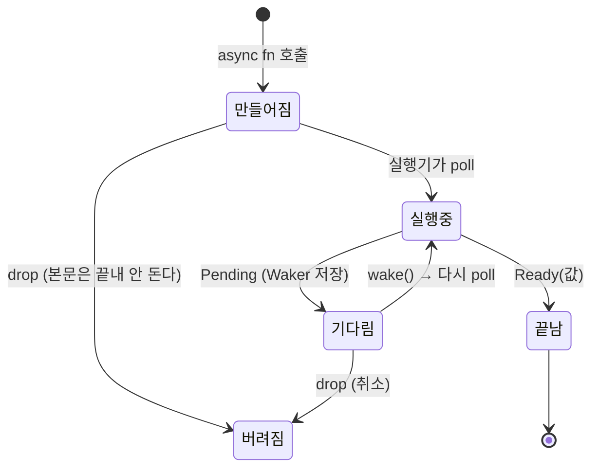


<div class="callout callout-summary" markdown="1">
<div class="callout-title callout-title--default" markdown="span">요약</div>

식당 진동벨과 같다. 주문하면 음식 대신 벨을 받고, 벨이 울리면 그때 가서 음식을 받는다. 기다리는 동안 손이 비니 스레드 하나로 수천 개의 기다림을 돌볼 수 있다. 대신 벨은 누군가 계속 들여다봐 줘야 울리고(실행기가 필요하다), 기다리는 동안 다른 일을 하지 않고 붙잡고 있는 코드가 하나라도 끼면 모두가 멈춘다.

</div>


## 예시로 보기

웹 서버가 요청 1만 개를 동시에 받는다. 요청마다 데이터베이스 응답을 50ms 기다린다. 요청마다 운영체제 스레드를 하나씩 주면 스레드 1만 개가 대부분의 시간을 그냥 잔다. 스레드마다 스택 메모리와 전환 비용이 든다([스레드](/Hongs_Blog/studies/operating-systems/thread/)).

기다리는 일을 "나중에 결과를 줄 값" 하나로 만들고, 적은 수의 스레드가 그 값들을 돌아가며 확인하면 된다. Rust에서 이 값을 퓨처(future)라고 부른다. 퓨처는 `Future` 트레이트를 구현한 값이다[^1].

```rust
async fn fetch(id: u32) -> u32 {   // 부르면 u32가 아니라 "u32를 줄 퓨처"가 나온다
    sleep(Duration::from_millis(100)).await;
    id * 10
}

let f = fetch(1);      // 아직 아무 일도 하지 않는다
let v = f.await;       // 여기서 비로소 돈다. 기다리는 동안 이 스레드는 다른 퓨처를 돌볼 수 있다
```

`async`를 붙인 함수나 블록은 바로 실행되지 않는다. 퓨처로 바뀌고, `.await`할 때 비로소 돈다[^2]. 퓨처를 만들기만 하고 버리면 컴파일러가 경고한다.

```
warning: unused implementer of `Future` that must be used
  = note: futures do nothing unless you `.await` or poll them
```

진동벨 비유는 한 곳에서 틀린다. 진동벨은 식당이 알아서 울려 주지만, Rust 퓨처는 누군가 `poll`을 불러 줘야만 한 걸음 나아간다. 아무도 부르지 않으면 영원히 그대로다[^1].

<div class="callout callout-check" markdown="1">
<div class="callout-title" markdown="span">검증: 직접 만든 퓨처 두 개와 최소 실행기로 poll 횟수·wake 횟수, 게으름(만든 직후 본문 실행 0번), 상태 기계 크기를 확인했다 — [36_futures-async-await_impl.rs](/Hongs_Blog/studies/rust/code/36_futures-async-await_impl/). 컴파일러 경고·오류와 clippy 린트 그룹은 rustc 1.99.0으로 확인했다 — [36_futures-async-await_verify.rs](/Hongs_Blog/studies/rust/code/36_futures-async-await_verify/)</div>

</div>


## poll과 Waker: 퓨처가 움직이는 방법

`Future` 트레이트에는 메서드가 하나뿐이다[^1].

```rust
pub trait Future {
    type Output;
    fn poll(self: Pin<&mut Self>, cx: &mut Context<'_>) -> Poll<Self::Output>;
}
// enum Poll<T> { Ready(T), Pending }
```

실행기(executor)는 퓨처를 끝날 때까지 돌리는 코드다. 실행기가 `poll`을 부르면 퓨처는 둘 중 하나로 답한다[^1].

- `Poll::Ready(값)`: 다 됐다. 값을 가져가라.
- `Poll::Pending`: 아직이다. 다시 불러도 될 때 알려 주겠다.

"알려 주겠다"는 약속은 `Context` 안의 `Waker`로 지킨다. `Pending`을 내는 퓨처는 `Waker`를 복사해 저장해 두고, 진행할 수 있게 되면 `wake()`를 부른다[^1]. 그러면 실행기가 그 퓨처를 다시 `poll`한다. `Pending`을 내고 아무도 깨우지 않으면 그 태스크는 영원히 멈춘다[^3].



운영체제의 프로세스 상태(실행 · 준비 · 대기)와 모양이 닮았다([프로세스 상태](/Hongs_Blog/studies/operating-systems/process-states/)). 다른 점은 둘이다. 퓨처는 `.await`에서만 스스로 물러난다. 그리고 `Pending`에서 `Ready`로 가는 길을 커널이 아니라 `Waker`가 연다.

### 직접 만든 퓨처와 실행기

세 번 `Pending`을 내고 네 번째에 `Ready`를 내는 퓨처다. `Pending`을 내기 전에 `wake_by_ref()`로 "바로 다시 불러 달라"고 알린다.

```rust
struct Countdown { left: u32 }

impl Future for Countdown {
    type Output = &'static str;
    fn poll(mut self: Pin<&mut Self>, cx: &mut Context<'_>) -> Poll<Self::Output> {
        if self.left == 0 {
            Poll::Ready("발사")
        } else {
            self.left -= 1;
            cx.waker().wake_by_ref();
            Poll::Pending
        }
    }
}
```

실행기는 표준 문서 `Wake` 트레이트 예제의 `block_on`과 같은 모양이다[^6]. 퓨처를 `poll`하고, `Pending`이면 스레드를 재운다(`thread::park`). `Waker`는 깨우면 그 스레드를 깨운다(`unpark`).

```rust
fn block_on<F: Future>(fut: F) -> F::Output {
    let mut fut = pin!(fut);
    let waker = Waker::from(Arc::new(ThreadWaker(thread::current())));
    let mut cx = Context::from_waker(&waker);
    loop {
        match fut.as_mut().poll(&mut cx) {
            Poll::Ready(v) => return v,
            Poll::Pending => thread::park(),
        }
    }
}
```

| 퓨처 | poll 횟수 | wake 횟수 | 결과 |
|---|---|---|---|
| `Countdown { left: 3 }` | 4 | 3 | `"발사"` |
| `Countdown { left: 0 }` | 1 | 0 | `"발사"` |
| 다른 스레드가 50ms 뒤 깨우는 `Delay` | 2 | 1 | 52ms 걸림 |

`Delay`는 첫 `poll`에서 `Waker`를 저장하고 `Pending`을 낸다. 50ms 뒤 타이머 스레드가 `wake()`를 부를 때까지 실행기 스레드는 잠들어 CPU를 쓰지 않는다. 그래서 `poll`이 딱 두 번이다.

표준 문서는 이 `block_on`이 정확성보다 단순함을 고른 예라고 밝힌다. 실제 실행기는 중첩 호출과 엉뚱한 `unpark`까지 다룬다[^6]. 실제 서비스에서는 tokio 같은 런타임을 쓴다([tokio 런타임과 태스크](/Hongs_Blog/studies/rust/tokio-runtime-tasks/)).

## async fn은 상태 기계다

컴파일러는 `async fn` 본문을 `.await` 자리마다 끊어 상태 기계(state machine)로 바꾼다. 상태 기계는 "지금 몇 번째 `.await`에서 멈췄나"와 "그 뒤에 쓸 지역 변수"를 담은 열거형 값이다[^3]. `poll`이 불릴 때마다 멈췄던 자리에서 다음 `.await`까지 돈다.

그래서 `.await`를 건너 살아 있는 지역 변수만 퓨처 안에 저장된다. 1,024바이트 배열로 확인하면 차이가 바로 보인다.

```rust
async fn holds_buffer_across_await() -> u8 {
    let buf = [7u8; 1024];
    yield_once().await;      // buf를 이 뒤에서도 쓴다 → 퓨처 안에 저장
    buf[1023]
}

async fn drops_buffer_before_await() -> u8 {
    let last = { let buf = [7u8; 1024]; buf[1023] };  // buf는 여기서 끝
    yield_once().await;
    last
}
```

| 퓨처 | `size_of_val` (aarch64, rustc 1.99.0) |
|---|---|
| `holds_buffer_across_await()` | 1,027바이트 |
| `drops_buffer_before_await()` | 4바이트 |

퓨처의 크기는 컴파일할 때 정해진다. 큰 배열을 들고 `.await`하면 퓨처가 그만큼 커지고, 그 퓨처를 스택에 두면 스택이 넘칠 수 있다. clippy의 `large_futures` 린트가 이것을 잡는다[^9].

## Pin: 퓨처를 옮기지 못하게 고정하기

상태 기계 안의 지역 변수가 다른 지역 변수를 빌리고 있을 수 있다. `let r = &buf;` 다음에 `.await`가 있으면, 퓨처 안에 `buf`와 그것을 가리키는 `r`이 함께 들어간다. 이런 값을 자기 참조(self-referential) 값이라 부른다. 이 퓨처를 메모리의 다른 자리로 옮기면 `r`은 옛 자리를 가리키게 된다[^4].

```
옮기기 전                     옮긴 뒤 (Pin이 없다면)
0x100 [ buf: 7 7 7 ... ]      0x900 [ buf: 7 7 7 ... ]
0x500 [ r: 0x100      ] ──┐   0xD00 [ r: 0x100      ] ──→ 0x100 (이미 빈 자리)
          └──────────────┘
```

`Pin<&mut T>`는 "이 값은 버려질 때까지 지금 주소에서 움직이지 않는다"는 약속을 타입에 담는다[^4]. 그래서 `poll`은 `self: Pin<&mut Self>`를 받는다. 실행기는 퓨처를 먼저 고정한 뒤에만 `poll`할 수 있다. `pin!(fut)`은 스택에, `Box::pin(fut)`은 힙에 고정한다.

대부분의 타입은 주소가 바뀌어도 문제가 없다. 이런 타입은 `Unpin`을 자동으로 구현하고, `Pin`의 제약을 받지 않는다[^4]. 컴파일러가 만든 async 퓨처는 `Unpin`이 아닐 수 있다. 그래서 고정된 async 퓨처를 `&mut`로 꺼내려 하면 막힌다.

```
error[E0277]: `F` cannot be unpinned
```

`unsafe`를 쓰지 않는 한 고정된 값을 잘못 다룰 방법은 없다[^4]. 보통 코드에서 `Pin`을 직접 만질 일은 `pin!`, `Box::pin`, 손으로 `Future`를 구현할 때 정도다.

## Send: 퓨처를 다른 스레드로 넘길 수 있나

여러 스레드가 퓨처를 나눠 돌리는 실행기는 `.await`에서 멈춘 퓨처를 다른 스레드로 옮길 수 있다. 그래서 그런 실행기에 넘길 퓨처는 `Send`여야 한다. 퓨처가 `.await`를 건너 들고 있는 값이 모두 `Send`일 때만 퓨처도 `Send`다[^8].

```rust
require_send(async {
    let r = Rc::new(1);   // Rc는 Send가 아니다
    tick().await;         // r을 들고 .await
    println!("{r}");
});
// error: future cannot be sent between threads safely
```

`Rc`의 범위를 `.await` 전에 끝내면 통과한다. 이 규칙은 [스레드와 Send·Sync](/Hongs_Blog/studies/rust/threads-send-sync/)의 규칙을 상태 기계에 그대로 적용한 결과다. 퓨처 안에 저장되는 변수만 따진다.

## 보장하는 것과 보장하지 않는 것

| 보장한다 | 보장하지 않는다 |
|---|---|
| 퓨처는 `poll`되기 전에는 아무 일도 하지 않는다[^1] | 퓨처가 언젠가 끝난다는 것. 아무도 `poll`하지 않거나 `wake`가 빠지면 영원히 멈춘다 |
| `.await` 자리에서만 다른 퓨처에게 차례가 넘어간다 | `.await` 사이의 코드가 짧다는 것. 오래 도는 계산이나 블로킹 호출은 같은 스레드의 모든 퓨처를 멈춘다 |
| 고정된 퓨처는 버려질 때까지 주소가 그대로다[^4] | `Ready`를 낸 뒤 다시 `poll`했을 때의 동작. panic하거나 영원히 멈출 수 있다(UB는 아니다)[^1] |
| `.await`를 건너 `Send`가 아닌 값을 들면 컴파일러가 알린다 | 퓨처가 어느 스레드에서 돌지. 실행기가 정한다 |

**실패 장면 1 — wake 빠뜨리기.** 위 `Countdown`에서 `cx.waker().wake_by_ref();` 줄을 지우면 첫 `poll`이 `Pending`을 낸 뒤 `block_on`이 `thread::park()`로 잠들고 아무도 깨우지 않는다. 프로그램이 멈춘다.

**실패 장면 2 — 블로킹.** async 함수 안에서 `std::thread::sleep(300ms)`를 부르면 그 300ms 동안 같은 스레드의 다른 퓨처가 하나도 `poll`되지 않는다. tokio에서 잰 값은 [tokio 런타임과 태스크](/Hongs_Blog/studies/rust/tokio-runtime-tasks/)에 있다.

## 스스로 설명해 보기

<details class="callout callout-question" markdown="1">
<summary class="callout-title" markdown="span">`Countdown`의 `poll`에서 `self.left -= 1`을 쓸 수 있는 근거는? `self`는 `Pin<&mut Self>`인데.</summary>

`Countdown`의 필드는 `u32` 하나라 `Countdown`은 `Unpin`이다. `Unpin`인 타입은 `Pin<&mut Self>`에서 `&mut Self`를 자유롭게 얻는다(`DerefMut`). 그래서 `mut self`로 받아 필드를 고칠 수 있다.

</details>


<details class="callout callout-question" markdown="1">
<summary class="callout-title" markdown="span">`Delay`가 `poll`될 때마다 `Waker`를 새로 저장하는 이유는? 첫 번째 것을 계속 쓰면 안 되나?</summary>

퓨처는 다른 태스크나 다른 실행기로 옮겨질 수 있다. 그러면 깨워야 할 대상이 바뀐다. 가장 최근 `poll`에서 받은 `Context`의 `Waker`가 지금 깨워야 할 대상이다. 그래서 매번 덮어쓴다[^3].

</details>


<details class="callout callout-question" markdown="1">
<summary class="callout-title" markdown="span">`block_on`이 `Pending`을 받고 `thread::park()`로 잔다. `wake()`가 `park()`보다 먼저 불리면 어떻게 되나?</summary>

`unpark`는 표를 한 장 남겨 둔다. 그 뒤의 `park`는 표를 쓰고 바로 돌아온다[^10]. 그래서 순서가 뒤바뀌어도 깨움을 잃지 않는다. `park`는 이유 없이 깨어날 수도 있지만[^10], 그때는 다시 `poll`해 보고 `Pending`이면 또 자면 되므로 결과는 맞다.

</details>


<details class="callout callout-question" markdown="1">
<summary class="callout-title" markdown="span">이 설계의 핵심 아이디어를 한 문장으로 말하면? 다른 곳에도 쓸 수 있나?</summary>

"기다림을 값으로 만들고, 진행할 수 있을 때만 다시 불러 달라고 알린다." 운영체제의 인터럽트와 대기 큐([인터럽트](/Hongs_Blog/studies/operating-systems/interrupt/)), 이벤트 루프를 쓰는 JavaScript·파이썬 asyncio가 같은 아이디어다.

</details>


## 활용

- **실제 쓰임.** 표준 라이브러리에는 `Future` 트레이트와 `Waker`만 있고 실행기는 없다. 실제 서비스는 tokio를 실행기로 쓰고, axum·sqlx·reqwest 같은 라이브러리가 모두 tokio 위의 퓨처를 돌려준다([axum으로 HTTP 서비스 만들기](/Hongs_Blog/studies/rust/axum-http/), [sqlx로 데이터베이스 쓰기](/Hongs_Blog/studies/rust/sqlx-database/)).
- **언제 async를 쓰나.** 기다림(네트워크·디스크·타이머)이 많고 동시에 다룰 일이 많을 때다. CPU 계산이 대부분이면 스레드가 낫다([스레드와 Send·Sync](/Hongs_Blog/studies/rust/threads-send-sync/)).
- **`Future`를 직접 구현할 때.** 라이브러리 바닥(타이머, 소켓 감싸기)이나 여러 퓨처를 묶는 조합기를 만들 때 정도다. 평소에는 `async fn`과 `async` 블록으로 충분하다. 테스트에서는 `Waker::noop()`(1.85부터)로 깨울 필요 없는 퓨처를 한 번 `poll`해 볼 수 있다[^5].
- **흔한 실수.**
  - `.await`를 빼먹는다. 퓨처는 만들어지기만 하고 돌지 않는다. 컴파일러 경고(`unused_must_use`)가 잡는다.
  - `let _ = 퓨처;`로 경고를 지운다. 여전히 돌지 않는다. clippy `let_underscore_future`가 기본으로 경고한다[^9].
  - `std::sync::Mutex`의 잠금을 든 채 `.await`한다. clippy `await_holding_lock`이 기본으로 경고한다[^9]. 자세한 것은 [tokio 런타임과 태스크](/Hongs_Blog/studies/rust/tokio-runtime-tasks/).
  - `async` 블록 안의 `return`과 `?`는 바깥 함수가 아니라 그 블록의 퓨처를 끝낸다[^2][^7].
- **관련 clippy 린트**(rustc 1.99.0의 clippy로 그룹 확인)[^9]: `await_holding_lock`·`let_underscore_future`(기본 경고), `unused_async`(pedantic, `.await`가 없는 async 함수), `future_not_send`(nursery, `Send`가 아닌 퓨처를 돌려주는 함수), `large_futures`(퓨처 크기).
- **성능 특성.** 퓨처 하나의 비용은 상태 기계의 크기와 `poll` 호출 몇 번이다. 운영체제 스레드처럼 스택을 따로 잡지 않는다. tokio 태스크 하나는 할당 한 번과 64바이트가 든다고 tokio 문서가 밝힌다[^8].

## 연결

- 선수: [트레이트](/Hongs_Blog/studies/rust/traits/) (`Future`는 트레이트다), [스레드와 Send·Sync](/Hongs_Blog/studies/rust/threads-send-sync/)
- 다음: [tokio 런타임과 태스크](/Hongs_Blog/studies/rust/tokio-runtime-tasks/) (진짜 실행기), [취소·타임아웃·select](/Hongs_Blog/studies/rust/cancellation-timeouts-select/) (퓨처를 버리면 취소다)
- 운영체제: 실행기가 퓨처를 돌리는 방식은 사용자 수준 스레드와 닮았다. 커널은 실행기 스레드만 알고, 그 안에서 어느 퓨처가 돌지는 실행기가 정한다. 한 퓨처가 커널 호출에 막히면 그 스레드의 모든 퓨처가 멈추는 약점도 같다([사용자 수준 스레드와 커널 수준 스레드](/Hongs_Blog/studies/operating-systems/ult-klt/)).
- 클로저와 닮은 점: async 블록도 클로저처럼 주변 변수를 빌리거나(`async {}`) 가져간다(`async move {}`) ([클로저](/Hongs_Blog/studies/rust/closures/)).

## 자주 하는 오해

<div class="callout callout-misconception" markdown="1">
<div class="callout-title" markdown="span">"async fn을 부르면 백그라운드에서 일이 시작된다"</div>

틀렸다. 그럴듯해 보이는 이유는 JavaScript의 `Promise`나 Java의 `CompletableFuture.supplyAsync`가 만드는 순간 일을 시작하기 때문이다. Rust의 퓨처는 게으르다. 만든 직후에는 본문이 한 줄도 돌지 않고, `.await`하거나 실행기에 넘겨(`spawn`) `poll`될 때 비로소 돈다[^1][^3]. `fetch(1)`과 `fetch(2)`를 만들어 두고 차례로 `.await`하면 각각 100ms가 차례로 걸려 200ms다. 같이 기다리려면 `tokio::join!`이나 `spawn`을 쓴다. 검증 코드에서 퓨처를 만든 직후 본문 실행 횟수가 0이고, 만들고 버린 퓨처의 본문은 끝내 돌지 않았다.

</div>


<div class="callout callout-misconception" markdown="1">
<div class="callout-title" markdown="span">"async를 쓰면 빨라진다"</div>

틀렸다. async는 기다리는 동안 스레드를 놓아 주는 방법이지, 계산을 빠르게 하는 방법이 아니다. CPU만 쓰는 계산을 async 함수에 넣으면 `.await`가 없어 오히려 같은 스레드의 다른 퓨처를 모두 멈춘다. 계산은 스레드나 `spawn_blocking`으로 보낸다.

</div>


## 확인 문제

<details class="callout callout-question" markdown="1">
<summary class="callout-title" markdown="span">**C1** `Countdown { left: 2 }`를 위의 `block_on`으로 돌린다. `poll`은 몇 번, `wake`는 몇 번 불리는가? `wake_by_ref` 줄을 지우면?</summary>

**답:** `poll` 3번, `wake` 2번. 줄을 지우면 첫 `Pending` 뒤 `thread::park()`에서 영원히 잠든다.<br>
**이유:** `left`가 2 → 1 → 0으로 줄며 두 번 `Pending`을 내고, 세 번째 `poll`에서 `Ready`다. `Pending`마다 한 번씩 깨운다. 검증 코드에서 `left: 3`은 4번·3번, `left: 0`은 1번·0번이었다.

</details>


<details class="callout callout-question" markdown="1">
<summary class="callout-title" markdown="span">**C2** 다음은 컴파일되는가? 안 되면 왜이고, 어떻게 고치나? (`require_send`는 `T: Send`를 요구하는 함수)</summary>

```rust
require_send(async {
    let r = Rc::new(1);
    tick().await;
    println!("{r}");
});
```
**답:** 안 된다. `error: future cannot be sent between threads safely`. `Rc`를 `.await` 너머로 들고 가서 `Rc`가 퓨처 안에 저장되는데, `Rc`는 `Send`가 아니다. `{ let r = Rc::new(1); println!("{r}"); }`처럼 `.await` 전에 범위를 끝내거나 `Arc`로 바꾼다.<br>
**흔한 오답:** "`Rc`를 쓰면 무조건 안 된다." `.await`를 건너 살아 있을 때만 퓨처에 저장되므로, 그 전에 버리면 통과한다(검증 코드에서 확인).

</details>


<details class="callout callout-question" markdown="1">
<summary class="callout-title" markdown="span">**C3** 두 퓨처 중 `size_of_val`이 큰 쪽은? (가) 1KB 배열을 만들고 마지막 원소를 읽은 뒤 `.await` (나) 1KB 배열을 만들고 `.await`한 뒤 마지막 원소를 읽기</summary>

**답:** (나). 실측 1,027바이트 대 4바이트.<br>
**이유:** 상태 기계는 `.await` 뒤에 쓰일 지역 변수만 저장한다. (가)는 `.await` 전에 배열이 끝나 1바이트짜리 값만 남는다.<br>
**흔한 오답:** "둘 다 배열을 만드니 같다." 크기를 정하는 것은 만드느냐가 아니라 `.await`를 건너 살아 있느냐다.

</details>


<details class="callout callout-question" markdown="1">
<summary class="callout-title" markdown="span">**C4** `poll`의 첫 인자가 `&mut Self`가 아니라 `Pin<&mut Self>`인 이유를 한두 문장으로 설명하라.</summary>

**답:** async 퓨처는 자기 안의 다른 필드를 가리키는 참조를 품을 수 있어서, `poll` 사이에 옮겨지면 그 참조가 옛 주소를 가리키게 된다. `Pin`은 "버려질 때까지 움직이지 않는다"는 약속을 타입으로 강제해, 실행기가 퓨처를 고정한 뒤에만 `poll`하게 만든다.<br>
**흔한 오답:** "다른 스레드와 나눠 쓰지 못하게 하려고." 그것은 `Send`·`Sync`가 하는 일이다. `Pin`은 주소가 바뀌지 않게 하는 것만 보장한다.

</details>


[^1]: Rust 표준 라이브러리, Trait `std::future::Future` — The `poll` method, Required Methods, Runtime characteristics, Panics — https://doc.rust-lang.org/std/future/trait.Future.html
[^2]: Rust 표준 라이브러리, Keyword `async` (본문 첫 문단, Control Flow) — https://doc.rust-lang.org/std/keyword.async.html
[^3]: Tokio Tutorial, Async in depth — Futures, Executors, Wakers, A few loose ends, Summary — https://tokio.rs/tokio/tutorial/async
[^4]: Rust 표준 라이브러리, Module `std::pin` — What is "pinning"?, Address-sensitive values, `Unpin`, A self-referential struct — https://doc.rust-lang.org/std/pin/index.html
[^5]: Rust 표준 라이브러리, Struct `std::task::Waker` — `wake`, `wake_by_ref`, `noop` (1.85.0) — https://doc.rust-lang.org/std/task/struct.Waker.html
[^6]: Rust 표준 라이브러리, Trait `std::task::Wake` — Examples (`ThreadWaker`, `block_on`) — https://doc.rust-lang.org/std/task/trait.Wake.html
[^7]: Asynchronous Programming in Rust (Async Book), More async/await topics — Async blocks, Cancellation — https://rust-lang.github.io/async-book/part-guide/more-async-await.html
[^8]: Tokio Tutorial, Spawning — `Send` bound, Tasks — https://tokio.rs/tokio/tutorial/spawning
[^9]: Clippy Lints — `await_holding_lock`, `let_underscore_future`, `unused_async`, `future_not_send`, `large_futures` — https://rust-lang.github.io/rust-clippy/master/index.html (그룹은 rustc 1.99.0의 `clippy-driver`로 확인했다)
[^10]: Rust 표준 라이브러리, Function `std::thread::park` — 토큰(token), 이유 없는 깨어남(spurious wakeup) — https://doc.rust-lang.org/std/thread/fn.park.html

