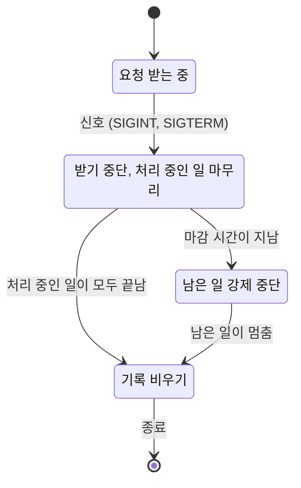


<div class="callout callout-summary" markdown="1">
<div class="callout-title callout-title--default" markdown="span">요약</div>

가게 문을 닫을 때는 입구에 "영업 끝" 팻말부터 걸어 새 손님을 막고, 이미 들어온 손님의 주문은 마저 내주고, 장부를 정리한 뒤 불을 끈다. 서버도 이 순서로 끝나야 처리하던 요청과 아직 내보내지 않은 기록을 잃지 않는다. 아무 준비 없이 끝내면 하던 일은 중간에 버려진다. 반대로 끝까지 기다리기만 하면 멈춘 요청 하나 때문에 영영 못 끝날 수 있어서, 기다리는 시간에 마감을 둔다.

</div>


## 예시로 보기

서버는 생각보다 자주 끝난다. 새 판을 배포할 때마다, 설정을 바꿀 때마다 프로세스가 내려가고 다시 뜬다. 터미널에서 Ctrl+C를 누르면 SIGINT가, 프로세스를 끝내 달라는 요청으로는 SIGTERM이 온다. 둘 다 아무 처리도 하지 않으면 프로세스가 그대로 끝난다[^3].

그 순간 처리하던 요청은 어떻게 될까? `#[tokio::main]`의 `main`이 끝나면 런타임이 버려진다([tokio 런타임과 태스크](/Hongs_Blog/studies/rust/tokio-runtime-tasks/)). 런타임을 따로 만들어 50ms짜리 태스크를 띄우고 10ms 뒤에 버렸더니, 그 태스크는 끝까지 돌지 못했다. 태스크는 다음 `.await`에서 멈춘 채 버려진다[^6]. 요청 중이던 클라이언트는 끊긴 연결을 받고, 메모리에 모아 둔 로그는 밖으로 나가지 못한다.

그래서 종료에도 순서를 둔다. 요청이 20ms 간격으로 6개 오고 하나에 80ms가 걸리는 서버를 흉내 내, 50ms에 종료 신호를 보냈다. 마감은 1초다.

```rust
shutdown.cancel();                          // 1. 신호 (진짜 서버에서는 Ctrl+C나 SIGTERM)
let mut rest = acceptor.await.unwrap();     // 2. 받기 반복이 멈췄는지 확인한다
tracker.close();                            // 3. 더 띄울 태스크가 없다고 알린다
let drained = timeout(deadline, tracker.wait()).await.is_ok(); // 4. 마감 안에서 기다린다
if !drained {
    hard.cancel();                          // 5. 마감을 넘기면 남은 일을 끊는다
    tracker.wait().await;
}
tel.flush();                                // 6. 마지막으로 기록을 내보낸다
```

내보낸 기록은 다음과 같았다.

```text
["받음 1", "받음 2", "받음 3", "받기 중단", "완료 1", "완료 2", "완료 3", "기록 비움"]
받음 3, 완료 3, 강제 중단 0, 받지 않은 요청 3, 마감 안에 끝남 true, 종료에 73ms
```

0, 20, 40ms에 온 요청 셋은 받았고, 50ms에 받기를 멈췄다. 그 뒤에 온 요청 셋은 큐에 남은 채 처리되지 않았다. 받은 셋은 모두 끝냈다. 40ms에 받은 3번은 120ms쯤 끝나므로 종료 시작에서 약 70ms 뒤다. 실측 72~75ms와 맞는다. 기록 비우기는 맨 마지막이다.



<div class="callout callout-check" markdown="1">
<div class="callout-title" markdown="span">검증: 받기 중단 → 마무리 → 기록 비우기 순서, 받은 요청이 모두 완료된 것, 5초짜리 요청을 마감 100ms에 끊고 102ms 안에 끝난 것, `close` 없이는 `wait`가 돌아오지 않는 것, 기다리지 않고 런타임을 버리면 태스크가 끝나지 못하는 것, 런타임을 버릴 때 `spawn_blocking` 작업은 기다리고 `shutdown_timeout`은 기다리지 않는 것을 실행해 확인했다 — [40_graceful-shutdown_impl.rs](/Hongs_Blog/studies/rust/code/40_graceful-shutdown_impl/). 신호는 실행이 저절로 끝나도록 토큰을 직접 취소해 흉내 냈다. 시간은 이 Mac(aarch64)의 디버그 빌드에서 잰 값이다.</div>

</div>


## 정의

tokio 문서는 안전한 종료를 보통 세 부분으로 나눈다. 언제 끝낼지 알아내기, 프로그램의 모든 부분에 끝내라고 알리기, 그 부분들이 끝나기를 기다리기다[^1]. 서버에서는 여기에 둘을 더한다. 기다리는 시간의 마감, 그리고 마지막 기록 비우기다.

| 단계 | 하는 일 | 도구 |
|---|---|---|
| 1. 신호 받기 | Ctrl+C, SIGTERM을 기다린다 | `tokio::signal::ctrl_c()`, `tokio::signal::unix::signal(SignalKind::terminate())` |
| 2. 알리기 | 받기를 멈추라고 모두에게 알린다 | `CancellationToken::cancel()` |
| 3. 기다리기 | 처리 중인 태스크가 끝나기를 기다린다 | `TaskTracker::close()` + `wait()` |
| 4. 마감 | 정한 시간이 지나면 남은 일을 끊는다 | `timeout(마감, tracker.wait())`, 두 번째 토큰 |
| 5. 기록 비우기 | 버퍼에 남은 로그·지표를 내보낸다 | 프로그램의 flush |

### 신호 받기

- `ctrl_c()`는 Ctrl+C 알림이 프로세스에 오면 끝나는 퓨처다[^2]. 이 퓨처를 처음 `poll`하는 순간 듣기 시작한다. 그 전에 온 Ctrl+C는 놓친다[^2]. 그래서 검증 코드도 서버를 띄우기 **전에** 신호 태스크부터 띄운다.
- Unix에서 처음 듣기 시작할 때 프로세스 전체의 신호 처리기가 설치되고, 원래 동작은 되돌아오지 않는다. 그 뒤로 Ctrl+C는 프로세스를 끝내지 않는다. 앱이 직접 끝내야 한다[^2].
- SIGTERM은 `SignalKind::terminate()`로 듣는다. Unix에서 프로세스를 끝내 달라고 보내는 신호다[^3]. Unix 전용이라 `#[cfg(unix)]`로 감싼다.
- 끝낼 이유가 여럿이면(신호, 관리용 API, 치명적 오류) mpsc 채널로 한곳에 모으고 `select!`로 함께 기다린다[^1].

[캡스톤 5](/Hongs_Blog/studies/rust/capstone-5/)의 서버는 두 신호를 이렇게 기다린다.

```rust
async fn shutdown_signal() {
    let ctrl_c = async { tokio::signal::ctrl_c().await.ok(); };
    #[cfg(unix)]
    let term = async {
        use tokio::signal::unix::{SignalKind, signal};
        if let Ok(mut s) = signal(SignalKind::terminate()) { s.recv().await; }
    };
    #[cfg(not(unix))]
    let term = std::future::pending::<()>();
    tokio::select! { () = ctrl_c => {}, () = term => {} }
}
```

### 알리기: CancellationToken

토큰을 복제하면 원본과 구별되지 않는 토큰이 하나 더 생기고, 어느 하나에 `cancel`을 부르면 모두 취소된다[^1][^4]. `cancelled()`는 취소되면 끝나는 퓨처이고 취소에 안전하다[^4]. 검증 코드는 토큰을 둘 쓴다. `shutdown`은 "그만 받아라", `hard`는 "하던 일도 그만둬라"다. 마무리할 시간을 먼저 주고, 마감을 넘겼을 때만 두 번째 토큰을 쓴다.

```rust
// 받기 반복
loop {
    tokio::select! {
        biased; // 종료 신호를 먼저 본다
        _ = shutdown.cancelled() => break,
        Some(req) = incoming.recv() => {
            tracker.spawn(handle(req, hard.clone(), tel.clone()));
        }
        else => break,
    }
}

// 요청 하나
async fn handle(req: Req, hard: CancellationToken, tel: Arc<Telemetry>) {
    tokio::select! {
        _ = sleep(req.cost) => tel.record(format!("완료 {}", req.id)),
        _ = hard.cancelled() => tel.record(format!("강제 중단 {}", req.id)),
    }
}
```

`biased;`를 쓰면 `select!`가 위의 가지부터 차례로 본다[^7]. 요청이 쉬지 않고 들어와도, 신호가 온 뒤 첫 바퀴에서 반드시 멈춘다. 기본 `select!`는 준비된 가지 중 무작위로 고르므로 요청 가지가 몇 번 더 뽑힐 수 있다([취소·타임아웃·select](/Hongs_Blog/studies/rust/cancellation-timeouts-select/)).

### 기다리기: TaskTracker

`tokio_util::task::TaskTracker`는 띄운 태스크가 끝나기를 기다리는 도구다[^5].

- `tracker.spawn(fut)`은 `tokio::spawn`과 같이 띄우면서 그 태스크를 센다.
- `close()`는 "더는 기다릴 대상을 늘리지 않는다"는 표시다. `wait()`는 **닫혀 있고 비어 있을 때만** 끝난다[^5]. 검증 코드에서 태스크가 모두 끝난 트래커도 `close` 전에는 50ms 안에 `wait`가 돌아오지 않았고(`false`), `close` 뒤에는 바로 돌아왔다(`true`).
- `close()`는 새 `spawn`을 막지 않는다[^5]. 그래서 받기를 먼저 멈춘 뒤에 `close`한다.
- `JoinSet`은 태스크마다 결과를 `join_next`로 꺼낼 때까지 들고 있어 메모리가 늘 수 있다. `TaskTracker`는 끝난 태스크를 바로 지운다. 복제해서 나눠 쓸 수 있고, 버려도 태스크를 abort하지 않는다[^5].

스레드에서는 같은 일을 채널로 한다. The Rust Book의 스레드 풀은 보내는 쪽을 버려 일꾼들의 `recv`를 끝낸 뒤 `join`한다[^9]([채널](/Hongs_Blog/studies/rust/channels/)).

### 마감

5초 걸리는 요청이 하나 끼어 있으면 끝까지 기다리는 서버는 5초를 기다린다. 요청이 멈춰 버렸다면 영원히 기다린다. 검증 코드의 두 번째 장면은 30ms, 5,000ms, 30ms짜리 요청 셋을 10ms 간격으로 받고 40ms에 종료를 시작했다. 마감은 100ms다.

```text
["받음 1", "받음 2", "받음 3", "완료 1", "받기 중단", "완료 3", "강제 중단 2", "기록 비움"]
마감 안에 끝남 false, 강제 중단 1, 종료에 102ms
```

1번은 종료 전에 끝났고, 3번은 마무리하는 동안 끝났다. 2번은 마감이 지나 `hard` 토큰으로 끊겼다. 종료는 5초가 아니라 101~102ms 만에 끝났다.

`timeout(마감, tracker.wait())`이 시간 초과로 끝나도 버려지는 것은 `wait()` 퓨처뿐이다. 태스크는 계속 돈다. 실제로 2번은 시간 초과 뒤에도 살아 있다가 `hard.cancel()`을 받고서야 "강제 중단 2"를 남겼다. 그래서 마감 뒤에 남은 일을 멈추는 길이 따로 있어야 한다. `JoinHandle::abort`로 버려도 되지만, 그러면 태스크가 "강제 중단"을 기록할 기회가 없다.

### 기록 비우기는 맨 마지막

tokio 문서는 태스크가 끝나기 전에 데이터를 파일이나 데이터베이스에 내보내는 일을 할 수 있다고 적는다[^1]. 프로그램 전체로 보면 그 일은 가장 마지막이어야 한다. 마무리하는 동안에도 기록이 생기기 때문이다. 두 번째 장면의 "완료 3"과 "강제 중단 2"는 "받기 중단" 뒤에 생겼다. 기록을 먼저 비웠다면 이 둘은 나가지 못했다.

### 런타임을 버릴 때

기다리지 않고 `main`이 끝나면 tokio는 이렇게 한다[^6].

| 일의 종류 | 런타임을 버릴 때 |
|---|---|
| `spawn`한 태스크 | 다음 `.await`에서 멈추고 버려진다. 끝까지 돈다는 보장이 없다 |
| `spawn_blocking` 작업 | 끝날 때까지 계속 돈다. 런타임을 버리는 쪽은 이것을 끝없이 기다린다 |
| `shutdown_timeout(d)` | 많아야 `d`만큼만 기다린다 |
| `shutdown_background()` | 기다리지 않는다 |

200ms짜리 `spawn_blocking` 작업이 남은 런타임을 그냥 버리니 192ms를 기다렸다. `shutdown_timeout(20ms)`는 20~25ms 만에 돌아왔다. `#[tokio::main]`은 런타임을 손에 쥐여 주지 않으므로, `shutdown_timeout`을 쓰려면 런타임을 `Builder`로 직접 만든다([tokio 런타임과 태스크](/Hongs_Blog/studies/rust/tokio-runtime-tasks/)에 펼친 모양이 있다).

## 증명

이 설계의 종료가 "마감 + 조금" 안에 끝난다는 것을 보인다. 실측(마감 100ms, 종료 101~102ms)은 이 주장을 거드는 실험이다.

<details class="callout callout-proof" markdown="1">
<summary class="callout-title" markdown="span">증명 스케치</summary>

**가정.** (가) 요청을 처리하는 태스크는 모두 `tracker.spawn`으로 띄웠다. (나) 각 태스크는 `select!`로 `hard.cancelled()`를 함께 기다린다. (다) 태스크는 `.await` 사이에서 스레드를 오래 붙잡지 않는다. (라) 기록 비우기는 길이가 정해진 일이다.

**1. 받기가 멈춘다.** `shutdown.cancel()`은 `cancelled()`를 기다리던 받기 반복을 깨운다. `biased`이므로 다음 바퀴에서 첫 가지가 뽑혀 반복을 빠져나온다. 그 뒤로는 새 태스크가 생기지 않는다.

**2. 기다림이 끝난다.** `close()` 뒤의 `wait()`는 트래커가 비면 끝난다. 비지 않으면 `timeout`이 마감 $$D$$에 `Err`로 끝난다. 어느 쪽이든 $$D$$ 안에 다음 줄로 간다.

**3. 남은 태스크가 멈춘다.** `hard.cancel()`은 `hard.cancelled()`를 기다리던 모든 태스크를 깨운다(가정 나). 깨어난 태스크의 `select!`는 그 가지를 골라 기록을 남기고 끝난다. 가정 (다) 때문에 깨어난 뒤 다음 `poll`까지 오래 걸리지 않는다. 가정 (가) 때문에 트래커가 세는 태스크는 이것이 전부다. 그래서 두 번째 `wait()`도 곧 끝난다.

**4. 합치면.** 신호부터 종료까지의 시간은 $$D$$ + (태스크들이 깨어나 끝나는 시간) + (기록 비우는 시간)이다. 뒤의 두 항은 가정 (다)·(라)로 작다.

**가정이 깨지면.** (다)가 깨져 핸들러가 `std::thread::sleep(5초)`처럼 `.await` 없이 돈다면, 토큰은 그 핸들러를 깨울 수 없다. timeout이 `.await` 없는 코드를 끊지 못한 것과 같은 이유다([취소·타임아웃·select](/Hongs_Blog/studies/rust/cancellation-timeouts-select/)). (가)가 깨져 `tokio::spawn`으로 띄운 태스크가 있다면, 트래커는 그 태스크를 기다리지 않고 런타임과 함께 버린다.

</details>


### 스스로 설명해 보기

<details class="callout callout-question" markdown="1">
<summary class="callout-title" markdown="span">첫 장면에서 "완료" 기록이 모두 "받기 중단" 뒤에 나온 이유는? 이것이 우연이 아닌 근거는?</summary>

받은 요청은 0, 20, 40ms에 왔고 하나에 80ms가 걸린다. 가장 빨리 끝나는 1번도 80ms에 끝난다. 받기는 50ms에 멈췄다. 그러니 어떤 요청도 50ms 전에 끝날 수 없다. 검증 코드는 "받기 중단" 앞에 "완료"가 하나도 없다는 것을 단언으로 확인한다.

</details>


<details class="callout callout-question" markdown="1">
<summary class="callout-title" markdown="span">두 번째 장면의 종료 시간이 마감 100ms를 1~2ms만 넘긴 것을 증명의 단계로 설명하라.</summary>

2단계에서 `timeout`이 100ms에 끝난다. 3단계에서 `hard.cancel()`이 2번 태스크를 깨운다. 2번은 `sleep(5초)`의 `.await`에서 멈춰 있었으므로 깨어나자마자 `hard.cancelled()` 가지를 고르고 "강제 중단 2"를 남긴다. 트래커가 비어 두 번째 `wait()`가 끝나고, 메모리 안의 기록 비우기는 순식간이다. 남은 1~2ms가 이 두 항이다.

</details>


<details class="callout callout-question" markdown="1">
<summary class="callout-title" markdown="span">이 순서(받기 중단 → 마무리 → 마감 → 기록 비우기)를 쓸 수 있는 다른 곳은?</summary>

메시지 큐를 읽는 작업자가 그렇다. 먼저 새 메시지 받기를 멈추고, 받아 둔 메시지를 처리하고, 처리 결과를 확정한 뒤 끝낸다. tokio 채널이라면 `Receiver::close()`로 새 메시지를 막고, 이미 들어온 것은 다 꺼낸다[^11]([async 연습](/Hongs_Blog/studies/rust/async-practice/) p4). 데이터베이스 연결 풀을 닫는 일은 요청 처리가 다 끝난 뒤, 기록 비우기와 같은 자리에 둔다.

</details>


## 보장하는 것과 보장하지 않는 것

| 이 설계가 보장한다 | 보장하지 않는다 |
|---|---|
| 신호 뒤에는 새 요청을 받지 않는다. 기록에서 "받기 중단" 뒤에 "받음"이 없다 | 받지 못한 요청의 처리. 큐에 남은 3개는 처리되지 않았다. 클라이언트가 다시 보내야 한다 |
| 받은 요청은 "완료"나 "강제 중단" 중 하나로 끝나고, 어느 쪽이든 기록된다 | 트래커 밖에서 `tokio::spawn`한 태스크를 기다리는 것 |
| 기록 비우기는 추적하던 태스크가 모두 끝난 뒤에 한 번 일어난다 | `.await` 없이 도는 코드나 `spawn_blocking` 작업을 끊는 것 |
| 위 증명의 가정이 맞으면 종료는 마감에서 조금만 넘겨 끝난다 | 밖에서 프로세스를 강제로 죽일 때 정리 코드가 도는 것 [확인필요: 강제 종료 신호를 다루는 1차 자료는 열어 보지 않았다] |

**실패 장면 1 — `close`를 잊었다.** 태스크가 다 끝나도 `wait()`가 돌아오지 않는다. 마감이 없으면 영원히 멈추고, 마감이 있으면 매번 마감까지 기다린다.

**실패 장면 2 — 기록부터 비웠다.** 마무리하는 동안 생긴 "완료 3", "강제 중단 2"가 나가지 못한다. 가장 궁금한 마지막 몇 초의 기록이 비어 있다.

**실패 장면 3 — 멈춘 블로킹 작업.** `spawn_blocking` 안의 일이 끝나지 않으면, 런타임을 버리는 `main`은 그것을 끝없이 기다린다[^6]. `shutdown_timeout`으로 기다림에 상한을 둔다.

**실패 장면 4 — 신호를 늦게 듣기 시작했다.** 초기화가 오래 걸리는 동안 온 Ctrl+C는 아직 아무도 듣지 않아 놓친다[^2]. 신호 태스크는 프로그램이 시작하자마자 띄운다.

**실패 장면 5 — 두 번째 Ctrl+C가 듣지 않는다.** 처리기를 설치하면 Ctrl+C가 더는 프로세스를 끝내지 않는다[^2]. 종료 절차 자체가 멈추면 운영자가 Ctrl+C를 다시 눌러도 소용없다. 마감을 두거나, 두 번째 신호에서 `std::process::exit`로 바로 끝내는 길을 마련한다.

## 활용

- **axum.** `axum::serve(listener, app).with_graceful_shutdown(signal)`은 `signal` 퓨처가 끝나면 서버의 종료 절차를 시작하고, 그 반환 퓨처는 `signal`이 끝난 뒤에야 `Ok(())`로 끝난다[^8]. 무엇을 얼마나 기다리는지는 그 문서에 적혀 있지 않다. 자세한 쓰임은 [axum으로 HTTP 서비스 만들기](/Hongs_Blog/studies/rust/axum-http/)에서 잇는다. 마감은 직접 둔다. [캡스톤 5](/Hongs_Blog/studies/rust/capstone-5/)는 서버 태스크와 백그라운드 태스크를 한 `TaskTracker`에 넣고, `signal`로 `token.clone().cancelled_owned()`을 넘긴 뒤, 종료 때 `token.cancel()` → `tracker.close()` → `timeout(10초, tracker.wait())` 순서로 부른다.
- **처리 중인 요청에도 시간 제한.** 요청마다 시간 제한(tower-http의 `TimeoutLayer`)을 걸어 두면 마무리 단계가 대개 그 시간 안에 끝나고, 마감까지 가는 일이 드물어진다. 캡스톤 5가 이렇게 한다.
- **배포 환경.** 배포 도구는 보통 SIGTERM을 보내고, 정해 둔 유예 시간이 지나면 프로세스를 강제로 끝낸다 [확인필요: 배포 플랫폼의 1차 문서는 열어 보지 않았다]. 앱의 마감은 그 유예 시간보다 짧게 잡는다.
- **기록과 지표.** 로그나 지표를 버퍼에 모아 보내는 구성이라면 그 flush가 맨 마지막 단계다: [tracing으로 관측하기](/Hongs_Blog/studies/rust/tracing-observability/).
- **흔한 실수.**
  - `tracker.close()`를 부르지 않는다.
  - 요청 처리를 `tracker.spawn`이 아니라 `tokio::spawn`으로 띄운다. 트래커가 기다리지 않는다.
  - `let _ = tracker.wait();`처럼 퓨처를 만들기만 하고 `.await`하지 않는다. 아무것도 기다리지 않는다. clippy의 `let_underscore_future`(기본 경고)가 "non-binding `let` on a future"로 짚고, `.await`도 `let`도 없이 쓰면 rustc가 "futures do nothing unless polled"로 경고한다[^10].
  - 마감 없이 `tracker.wait().await`만 둔다.
  - 모든 태스크를 `abort`로 끝낸다. 버퍼를 비우거나 연결을 닫는 async 정리 코드가 돌 기회가 없다([취소·타임아웃·select](/Hongs_Blog/studies/rust/cancellation-timeouts-select/)).

## 연결

- 선수: [채널](/Hongs_Blog/studies/rust/channels/)(보내는 쪽을 모두 버려 끝을 알리는 규칙), [tokio 런타임과 태스크](/Hongs_Blog/studies/rust/tokio-runtime-tasks/), [취소·타임아웃·select](/Hongs_Blog/studies/rust/cancellation-timeouts-select/)(`CancellationToken`, `biased`), [백프레셔와 큐 제한](/Hongs_Blog/studies/rust/backpressure/)(받기를 멈추면 큐에 남은 요청이 생긴다)
- 다음: [axum으로 HTTP 서비스 만들기](/Hongs_Blog/studies/rust/axum-http/)의 `with_graceful_shutdown`, [캡스톤 5 안전한 종료와 부하 조절](/Hongs_Blog/studies/rust/capstone-5/)
- 연습: [async 연습](/Hongs_Blog/studies/rust/async-practice/) p4(큐를 비우고 끝나는 작업자)

## 자주 하는 오해

<div class="callout callout-misconception" markdown="1">
<div class="callout-title" markdown="span">"`main`이 끝나면 tokio가 띄운 태스크들이 끝날 때까지 기다려 준다."</div>

틀렸다. 그럴듯해 보이는 이유는, 스레드를 `join`하듯 런타임도 하던 일을 마무리해 줄 것 같기 때문이다. 실제로는 런타임을 버리면 `spawn`한 태스크는 다음 `.await`에서 멈추고 버려진다. 끝까지 돈다는 보장이 없다[^6]. 50ms짜리 태스크를 띄우고 10ms 뒤 런타임을 버렸더니 그 태스크는 끝나지 못했다. 기다리고 싶은 태스크는 `TaskTracker`로 세고, `close` 뒤 `wait`해야 한다.

</div>


<div class="callout callout-misconception" markdown="1">
<div class="callout-title" markdown="span">"그러면 런타임을 버리는 순간 모든 일이 즉시 멈춘다."</div>

이것도 틀렸다. `spawn_blocking` 작업은 끝날 때까지 계속 돌고, 런타임을 버리는 쪽은 그것을 끝없이 기다린다[^6]. 200ms짜리 블로킹 작업이 남은 런타임을 버리는 데 192ms가 걸렸다. 기다림에 상한이 필요하면 `shutdown_timeout`을 쓴다. 20ms를 주었더니 20~25ms 만에 돌아왔다.

</div>


## 확인 문제

<details class="callout callout-question" markdown="1">
<summary class="callout-title" markdown="span">**C1** 출력을 예측하라.</summary>

```rust
let tracker = TaskTracker::new();
tracker.spawn(async {});
sleep(Duration::from_millis(10)).await;
let a = timeout(Duration::from_millis(50), tracker.wait()).await.is_ok();
tracker.close();
let b = timeout(Duration::from_millis(50), tracker.wait()).await.is_ok();
println!("{a} {b}");
```
**답:** `false true`.<br>
**이유:** 태스크는 이미 끝나 트래커가 비어 있지만, `wait()`는 닫혀 있고 비어 있을 때만 끝난다. `close` 전에는 50ms 안에 끝나지 않는다. 검증 코드 출력과 같다.

</details>


<details class="callout callout-question" markdown="1">
<summary class="callout-title" markdown="span">**C2** 종료 순서에서 기록 비우기(`flush`)를 마무리(`tracker.wait()`)보다 먼저 하면 두 번째 장면에서 무엇을 잃는가? 왜인가?</summary>

**답:** "완료 3"과 "강제 중단 2"를 잃는다.<br>
**이유:** 둘 다 "받기 중단" 뒤, 곧 마무리하는 동안 생긴 기록이다. 비우기를 먼저 하면 그 뒤에 생긴 기록은 버퍼에만 남고 프로그램이 끝난다.

</details>


<details class="callout callout-question" markdown="1">
<summary class="callout-title" markdown="span">**C3** "`main` 끝에 `tracker.wait().await` 한 줄만 두면 안전한 종료다." 이 주장이 틀리는 경우를 둘 들라.</summary>

**답:** (1) `close()`를 부르지 않았다. 태스크가 다 끝나도 `wait`가 돌아오지 않는다(검증 코드에서 `false`). (2) 5초짜리 요청이 남았다. 마감이 없으니 5초를 다 기다린다. 요청이 멈춰 있다면 영원히 기다린다. 받기를 먼저 멈추지 않았다면 그사이 새 요청도 계속 들어온다.

</details>


<details class="callout callout-question" markdown="1">
<summary class="callout-title" markdown="span">**C4** 런타임에 (가) 50ms 뒤 깃발을 세우는 태스크를 `spawn`하고 10ms 뒤 런타임을 `drop`한다. 80ms 더 기다린 뒤 깃발은? (나) 200ms짜리 `spawn_blocking` 작업을 띄우고 10ms 뒤 `drop`한다. `drop`에 걸리는 시간은 대략? `shutdown_timeout(20ms)`라면?</summary>

**답:** (가) `false`. (나) 약 190ms(실측 192ms), `shutdown_timeout`은 약 20ms(실측 20~25ms).<br>
**이유:** 태스크는 다음 `.await`에서 버려지고, 블로킹 작업은 끝까지 돈다. 그냥 버리면 그 작업을 끝없이 기다리고, `shutdown_timeout`은 주어진 시간만 기다린다.

</details>


<details class="callout callout-question" markdown="1">
<summary class="callout-title" markdown="span">**C5** 마감이 지난 요청을 멈출 때 `JoinHandle::abort()`와 두 번째 `CancellationToken` 중 무엇을 쓰나? 검증 코드의 기록 기준으로 답하라.</summary>

**답:** 두 번째 토큰. 태스크가 `hard.cancelled()` 가지에서 "강제 중단 2"를 기록하고 스스로 끝난다.<br>
**이유:** `abort()`는 태스크를 멈춘 `.await` 자리에서 버린다. 어느 요청이 끊겼는지 남길 코드가 돌지 않는다.<br>
**흔한 오답:** "abort가 더 확실하다." `.await`에서 기다리는 태스크라면 토큰을 받고 깨어나는 즉시 끝난다. 두 방법의 차이는 정리 코드가 도느냐다. `.await` 없이 도는 태스크는 둘 다 멈추지 못한다.

</details>


[^1]: Tokio Topics, Graceful Shutdown (Figuring out when to shut down, Telling things to shut down, Waiting for things to finish shutting down) — https://tokio.rs/tokio/topics/shutdown
[^2]: tokio 문서, Function `tokio::signal::ctrl_c` (Caveats) — https://docs.rs/tokio/latest/tokio/signal/fn.ctrl_c.html
[^3]: tokio 문서, Struct `tokio::signal::unix::SignalKind` — `interrupt`, `terminate` — https://docs.rs/tokio/latest/tokio/signal/unix/struct.SignalKind.html
[^4]: tokio-util 문서, Struct `tokio_util::sync::CancellationToken` — `cancel`, `cancelled`, `child_token` — https://docs.rs/tokio-util/latest/tokio_util/sync/struct.CancellationToken.html
[^5]: tokio-util 문서, Struct `tokio_util::task::TaskTracker` — `close`, `wait`, `spawn`, Comparison to `JoinSet` — https://docs.rs/tokio-util/latest/tokio_util/task/task_tracker/struct.TaskTracker.html
[^6]: tokio 문서, Struct `tokio::runtime::Runtime` — Shutdown, `shutdown_timeout`, `shutdown_background` — https://docs.rs/tokio/latest/tokio/runtime/struct.Runtime.html
[^7]: tokio 문서, Macro `tokio::select` — Fairness(`biased`) — https://docs.rs/tokio/latest/tokio/macro.select.html
[^8]: axum 문서, Struct `axum::serve::Serve` — `with_graceful_shutdown` — https://docs.rs/axum/latest/axum/serve/struct.Serve.html
[^9]: The Rust Programming Language, 21.3 Graceful Shutdown and Cleanup — https://doc.rust-lang.org/book/ch21-03-graceful-shutdown-and-cleanup.html
[^10]: Clippy Lints, `let_underscore_future` — https://rust-lang.github.io/rust-clippy/master/index.html (rustc 1.99.0에서 `cargo clippy`로 두 경고를 직접 띄워 확인했다)
[^11]: tokio 문서, Struct `tokio::sync::mpsc::Receiver` — `close`, `recv` — https://docs.rs/tokio/latest/tokio/sync/mpsc/struct.Receiver.html

