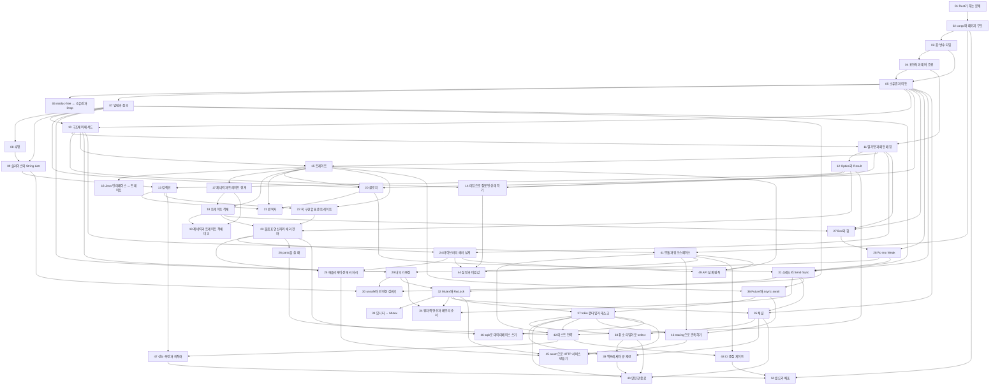


## 먼저 알아야 할 것
- [포인터](/Hongs_Blog/studies/data-structures/c-pointer/), [동적 메모리 할당](/Hongs_Blog/studies/data-structures/dynamic-memory-allocation/) (1-2학기 자료구조): C에서 주소와 힙을 손으로 다루던 방식. 소유권은 이것을 컴파일러가 대신 챙기는 규칙이다
- [참조 타입과 메모리 영역](/Hongs_Blog/studies/java/java-reference-types/), [인터페이스](/Hongs_Blog/studies/java/java-interface/) (2-1학기 자바 프로그래밍): 가비지 컬렉터가 있는 언어의 참조와 인터페이스
- [경쟁 조건과 임계 구역](/Hongs_Blog/studies/operating-systems/race-condition-critical-section/), [모니터](/Hongs_Blog/studies/operating-systems/monitor/) (3-1학기 운영체제): 동시성 단원의 배경

> 강의 자료 없이 공식 문서로 쓴 외부 학습 과목이다. 근거는 The Rust Programming Language, Rust Reference, 표준 라이브러리 문서, Edition Guide, Cargo Book, Clippy 린트 목록, Rust API Guidelines, 공식 릴리스 노트, tokio·axum·sqlx·tracing·thiserror·anyhow 문서, Mara Bos의 *Rust Atomics and Locks*다. 기준은 Rust 2024 에디션과 rustc 1.99.0이다. 코드는 모두 이 컴퓨터(aarch64 Mac)에서 rustfmt, clippy(경고를 오류로), 테스트, 실행을 거쳤고, 컴파일 오류 코드는 코드 안에서 rustc를 불러 확인했다. 의존성 버전은 `_시스템/Rust 계획/harness/Cargo.toml`에 고정했다. 시간을 잰 값은 이 컴퓨터에서 잰 것이라 다른 컴퓨터에서는 다르게 나온다. 9단원까지 개념을 익히고 10단원 캡스톤에서 단축 URL 서비스를 여섯 단계로 키운다.

## 1단원 · 시작과 도구

읽기 전에

1. 길이 3인 배열의 10번 칸을 읽으면 C와 Rust는 각각 어떻게 될까? → [Rust가 푸는 문제](/Hongs_Blog/studies/rust/why-rust/)
2. `255u8 + 1`은 `cargo run`과 `cargo run --release`에서 같은 결과를 낼까? → [값·변수·타입](/Hongs_Blog/studies/rust/values-variables-types/)
3. 함수 마지막 줄 `x + 1` 끝에 세미콜론을 붙이면 무엇이 달라질까? → [표현식과 제어 흐름](/Hongs_Blog/studies/rust/expressions-control-flow/)

| 번호 | 개념 | 한 줄 | 개념 코드 | 연습 |
|---|---|---|---|---|
| 01 | [Rust가 푸는 문제](/Hongs_Blog/studies/rust/why-rust/) | 실행 중 청소부 없이 컴파일러가 메모리 실수를 미리 막는다. 대가는 배우기 어렵고 컴파일이 느린 것 | [verify](/Hongs_Blog/studies/rust/code/01_why-rust_verify/) | — |
| 02 | [cargo와 패키지 구조](/Hongs_Blog/studies/rust/cargo-packages/) | 뼈대·의존성·빌드·테스트를 맡는 집사. 개발용 빌드는 정수가 넘치면 멈추고, 배포용은 감아 돈다 | [verify](/Hongs_Blog/studies/rust/code/02_cargo-packages_verify/) | — |
| 03 | [값·변수·타입](/Hongs_Blog/studies/rust/values-variables-types/) | 변수는 기본으로 못 고친다. 정수는 개발용 빌드에서 넘치면 멈추고, 배포용에서는 조용히 감아 돈다 | [verify](/Hongs_Blog/studies/rust/code/03_values-variables-types_verify/) | — |
| 04 | [표현식과 제어 흐름](/Hongs_Blog/studies/rust/expressions-control-flow/) | `if`·`match`·블록·`loop`가 모두 값을 내고, 줄 끝 세미콜론은 그 값을 버린다 | [verify](/Hongs_Blog/studies/rust/code/04_expressions-control-flow_verify/) | [Rust 첫걸음 연습](/Hongs_Blog/studies/rust/rust-basics-practice/) · [문제 코드](/Hongs_Blog/studies/rust/code/04_rust-basics-practice_p1/) · [문제 코드](/Hongs_Blog/studies/rust/code/04_rust-basics-practice_p2/) · [문제 코드](/Hongs_Blog/studies/rust/code/04_rust-basics-practice_p3/) · [문제 코드](/Hongs_Blog/studies/rust/code/04_rust-basics-practice_p4/) |

떠올려 보기: 노트를 닫고 dev·release 빌드의 차이, `mut`와 가림, '모든 것이 값을 낸다'를 서로 이어서 써 본다.

## 2단원 · 소유권과 빌림

읽기 전에

1. `String`을 `let s2 = s1;`로 넘긴 뒤 `s1`을 또 쓸 수 있을까? 힙의 글자는 몇 벌일까? → [소유권과 이동](/Hongs_Blog/studies/rust/ownership-move/)
2. `Vec` 첫 칸의 참조를 쥔 채 `push`하면 무엇이 위험할까? → [빌림과 참조](/Hongs_Blog/studies/rust/borrowing-references/)
3. `"안녕".len()`은 2일까 6일까? → [슬라이스와 String·&str](/Hongs_Blog/studies/rust/slices-strings/)

| 번호 | 개념 | 한 줄 | 개념 코드 | 연습 |
|---|---|---|---|---|
| 05 | [소유권과 이동](/Hongs_Blog/studies/rust/ownership-move/) | 힙 값마다 치울 주인을 하나 둔다. 넘기면 책임도 옮겨 가서 원래 변수는 더 못 쓴다 | [verify](/Hongs_Blog/studies/rust/code/05_ownership-move_verify/) | — |
| 06 | [malloc·free ↔ 소유권과 Drop](/Hongs_Blog/studies/rust/malloc-free-vs-ownership/) | C에서 사람이 기억하던 `free`를 주인의 범위 끝이 대신한다. 누수만은 막지 않는다 | [verify](/Hongs_Blog/studies/rust/code/06_malloc-free-vs-ownership_verify/) | — |
| 07 | [빌림과 참조](/Hongs_Blog/studies/rust/borrowing-references/) | 주인은 그대로 두고 잠깐 빌려 쓴다. 여럿이 읽거나, 하나만 고치거나 둘 중 하나다 | [verify](/Hongs_Blog/studies/rust/code/07_borrowing-references_verify/) | — |
| 08 | [수명](/Hongs_Blog/studies/rust/lifetimes/) | 돌려준 참조가 어느 입력에서 빌린 것인지 시그니처에 적는 꼬리표. 값을 더 살게 하지는 않는다 | [verify](/Hongs_Blog/studies/rust/code/08_lifetimes_verify/) | — |
| 09 | [슬라이스와 String·&str](/Hongs_Blog/studies/rust/slices-strings/) | 글을 가진 `String`과 그 한 구간을 빌린 `&str`·`&[T]`. 위치는 바이트로 센다 | [verify](/Hongs_Blog/studies/rust/code/09_slices-strings_verify/) | [빌림 오류 고치기 예제 사다리](/Hongs_Blog/studies/rust/borrow-errors-ladder/) · [문제 코드](/Hongs_Blog/studies/rust/code/09_borrow-errors-ladder_p1/) · [문제 코드](/Hongs_Blog/studies/rust/code/09_borrow-errors-ladder_p2/) · [문제 코드](/Hongs_Blog/studies/rust/code/09_borrow-errors-ladder_p3/) · [문제 코드](/Hongs_Blog/studies/rust/code/09_borrow-errors-ladder_p4/) |

떠올려 보기: 주인·이동·빌림·수명이 각각 C의 어떤 메모리 실수를 막는지 한 줄씩 써 본다.

## 3단원 · 데이터 모델링

읽기 전에

1. `..user1`로 새 구조체를 만든 뒤에도 `user1`을 통째로 쓸 수 있을까? → [구조체와 메서드](/Hongs_Blog/studies/rust/structs-methods/)
2. 열거형에 변형을 하나 더하면, 그 열거형을 `match`하던 코드는 어떻게 될까? → [열거형과 패턴 매칭](/Hongs_Blog/studies/rust/enums-pattern-matching/)
3. 주문 상태를 `bool` 필드 여러 개로 적으면 어떤 일이 생길 수 있을까? → [타입으로 잘못된 상태 막기](/Hongs_Blog/studies/rust/type-driven-design/)

| 번호 | 개념 | 한 줄 | 개념 코드 | 연습 |
|---|---|---|---|---|
| 10 | [구조체와 메서드](/Hongs_Blog/studies/rust/structs-methods/) | 관련 값을 한 묶음으로 묶고 함수를 붙인다. 첫 인자로 읽을지·고칠지·가져갈지 정한다 | [verify](/Hongs_Blog/studies/rust/code/10_structs-methods_verify/) | — |
| 11 | [열거형과 패턴 매칭](/Hongs_Blog/studies/rust/enums-pattern-matching/) | 여러 모양 중 하나인 값. `match`는 빠뜨린 경우를 잡지만, `_`로 뭉치면 못 잡는다 | [verify](/Hongs_Blog/studies/rust/code/11_enums-pattern-matching_verify/) | — |
| 12 | [Option과 Result](/Hongs_Blog/studies/rust/option-result/) | null 대신 '있음·없음'(Option)과 '성공·실패 사유'(Result) 상자에 담아, 열어 봐야만 쓰게 한다 | [verify](/Hongs_Blog/studies/rust/code/12_option-result_verify/) | — |
| 13 | [컬렉션](/Hongs_Blog/studies/rust/collections/) | 줄 세우는 `Vec`, 키로 찾는 `HashMap`, 키 순서대로 두는 `BTreeMap`. `HashMap`은 도는 순서를 약속하지 않는다 | [verify](/Hongs_Blog/studies/rust/code/13_collections_verify/) | — |
| 14 | [타입으로 잘못된 상태 막기](/Hongs_Blog/studies/rust/type-driven-design/) | 입구에서 한 번 검사하고 통과한 값에만 타입을 붙여, 잘못된 값과 상태를 아예 못 만들게 한다 | [verify](/Hongs_Blog/studies/rust/code/14_type-driven-design_verify/) | [데이터 모델링 연습](/Hongs_Blog/studies/rust/data-modeling-practice/) · [문제 코드](/Hongs_Blog/studies/rust/code/14_data-modeling-practice_p1/) · [문제 코드](/Hongs_Blog/studies/rust/code/14_data-modeling-practice_p2/) · [문제 코드](/Hongs_Blog/studies/rust/code/14_data-modeling-practice_p3/) |

떠올려 보기: 구조체·열거형·`Option`·`Result`·뉴타입이 함께 '잘못된 값은 아예 못 만든다'를 어떻게 이루는지 써 본다.

## 4단원 · 트레이트와 제네릭

읽기 전에

1. 내가 만든 트레이트를 표준 라이브러리의 `i32`에 구현할 수 있을까? → [트레이트](/Hongs_Blog/studies/rust/traits/)
2. `&Circle`이 8바이트라면 `&dyn Shape`는 몇 바이트일까? 늘어난 부분에는 무엇이 있을까? → [트레이트 객체](/Hongs_Blog/studies/rust/trait-objects/)
3. <code>v.iter().map(&#124;x&#124; println!("{x}"));</code>는 무엇을 찍을까? → [반복자](/Hongs_Blog/studies/rust/iterators/)

| 번호 | 개념 | 한 줄 | 개념 코드 | 연습 |
|---|---|---|---|---|
| 15 | [트레이트](/Hongs_Blog/studies/rust/traits/) | 여러 타입이 '이 일을 할 줄 안다'고 함께 지키는 메서드 목록. 남의 목록을 남의 타입에는 못 붙인다 | [verify](/Hongs_Blog/studies/rust/code/15_traits_verify/) | — |
| 16 | [Java 인터페이스 ↔ 트레이트](/Hongs_Blog/studies/rust/java-interface-vs-trait/) | 둘 다 메서드 목록 약속이다. 트레이트는 남의 타입에도 붙고, 필드가 없고, 기본으로 컴파일 때 몸통을 고른다 | [verify](/Hongs_Blog/studies/rust/code/16_java-interface-vs-trait_verify/) | — |
| 17 | [제네릭과 트레이트 경계](/Hongs_Blog/studies/rust/generics-trait-bounds/) | 빈칸 타입에 조건을 달면 컴파일러가 타입마다 사본을 찍어 빠르게 돈다. 대신 크기와 빌드 시간이 는다 | [verify](/Hongs_Blog/studies/rust/code/17_generics-trait-bounds_verify/) | — |
| 18 | [트레이트 객체](/Hongs_Blog/studies/rust/trait-objects/) | 주소 옆에 vtable 주소를 붙여 실행 중에 몸통을 고른다. 서로 다른 타입을 한 목록에 담는다 | [verify](/Hongs_Blog/studies/rust/code/18_trait-objects_verify/) | — |
| 19 | [제네릭과 트레이트 객체 비교](/Hongs_Blog/studies/rust/generics-vs-trait-objects/) | 섞어 담아야 하면 dyn, 작은 몸통을 아주 많이 부르면 제네릭, 정해진 몇 가지면 열거형 | [bench](/Hongs_Blog/studies/rust/code/19_generics-vs-trait-objects_bench/) | — |
| 20 | [클로저](/Hongs_Blog/studies/rust/closures/) | 둘레 변수를 잡는 이름 없는 함수. 잡은 값을 어떻게 쓰느냐가 Fn·FnMut·FnOnce를 정한다 | [verify](/Hongs_Blog/studies/rust/code/20_closures_verify/) | — |
| 21 | [반복자](/Hongs_Blog/studies/rust/iterators/) | next 하나에 어댑터를 잇는 게으른 사슬. 소비해야 돌고, 손으로 쓴 반복문만큼 빠르다 | [bench](/Hongs_Blog/studies/rust/code/21_iterators_bench/) · [verify](/Hongs_Blog/studies/rust/code/21_iterators_verify/) | — |
| 22 | [꼭 구현할 표준 트레이트](/Hongs_Blog/studies/rust/standard-traits/) | 타입을 만든 쪽이 먼저 붙일 derive 묶음. 같은 값은 해시도 같아야 한다 | [verify](/Hongs_Blog/studies/rust/code/22_standard-traits_verify/) | [트레이트와 반복자 연습](/Hongs_Blog/studies/rust/traits-iterators-practice/) · [문제 코드](/Hongs_Blog/studies/rust/code/22_traits-iterators-practice_p1/) · [문제 코드](/Hongs_Blog/studies/rust/code/22_traits-iterators-practice_p2/) · [문제 코드](/Hongs_Blog/studies/rust/code/22_traits-iterators-practice_p3/) · [문제 코드](/Hongs_Blog/studies/rust/code/22_traits-iterators-practice_p4/) |

떠올려 보기: 노트를 닫고 정적 디스패치와 동적 디스패치를 "몸통을 고르는 때, 함수 사본 수, 섞어 담기, 트레이트에 거는 조건" 네 줄 표로 써 본다.

## 5단원 · 에러 처리

읽기 전에

1. `?`는 에러를 무시하고 넘어갈까, 아니면 무엇을 할까? → [물음표 연산자와 에러 전파](/Hongs_Blog/studies/rust/error-propagation/)
2. 라이브러리가 에러를 문자열 하나로 돌려주면 부르는 쪽은 무엇이 곤란할까? → [라이브러리 에러 설계](/Hongs_Blog/studies/rust/library-errors/)
3. `catch_unwind`로 감싼 panic은 배포용 빌드에서도 늘 잡힐까? → [panic을 쓸 때](/Hongs_Blog/studies/rust/panic-policy/)

| 번호 | 개념 | 한 줄 | 개념 코드 | 연습 |
|---|---|---|---|---|
| 23 | [물음표 연산자와 에러 전파](/Hongs_Blog/studies/rust/error-propagation/) | `?` 한 글자로, 성공이면 값을 꺼내고 실패면 에러를 약속한 타입으로 바꿔 바로 돌려준다 | [verify](/Hongs_Blog/studies/rust/code/23_error-propagation_verify/) | — |
| 24 | [라이브러리 에러 설계](/Hongs_Blog/studies/rust/library-errors/) | 실패 방식마다 이름 붙인 열거형을 공개하고 원인을 사슬로 잇는다(thiserror). 공개한 에러는 약속이 된다 | [verify](/Hongs_Blog/studies/rust/code/24_library-errors_verify/) | — |
| 25 | [애플리케이션 에러 처리](/Hongs_Blog/studies/rust/application-errors/) | 어떤 에러든 받아 '무엇을 하다가'를 한 겹씩 덧붙이는 상자(anyhow)로 모아 사람에게 알린다 | [verify](/Hongs_Blog/studies/rust/code/25_application-errors_verify/) | — |
| 26 | [panic을 쓸 때](/Hongs_Blog/studies/rust/panic-policy/) | panic은 약속이 깨진 버그에만 쓰는 비상 정지다. 일어날 수 있는 실패는 `Result`로 돌려준다 | [verify](/Hongs_Blog/studies/rust/code/26_panic-policy_verify/) | — |

떠올려 보기: `?`·thiserror·anyhow·panic이 각각 어느 자리에 맞는지 한 문장씩 써 본다.

## 6단원 · 메모리

읽기 전에

1. `enum List { Cons(i32, List), Nil }`은 왜 컴파일되지 않을까? → [Box와 힙](/Hongs_Blog/studies/rust/box-heap/)
2. 두 `Rc`가 서로를 가리킨 채 변수가 모두 사라지면 메모리는 돌아올까? → [Rc·Arc·Weak](/Hongs_Blog/studies/rust/rc-arc-weak/)
3. `RefCell`로 감싸면 빌림 규칙은 사라질까, 다른 때에 검사될까? → [내부 가변성](/Hongs_Blog/studies/rust/interior-mutability/)

| 번호 | 개념 | 한 줄 | 개념 코드 | 연습 |
|---|---|---|---|---|
| 27 | [Box와 힙](/Hongs_Blog/studies/rust/box-heap/) | 값을 힙에 맡기고 주소 한 칸만 들고 다니기. 재귀 타입과 `dyn`에 쓴다 | [verify](/Hongs_Blog/studies/rust/code/27_box-heap_verify/) | — |
| 28 | [Rc·Arc·Weak](/Hongs_Blog/studies/rust/rc-arc-weak/) | 주인 여럿이 개수를 세며 함께 가지기. 순환은 새므로 뒤쪽 연결은 Weak로 둔다 | [verify](/Hongs_Blog/studies/rust/code/28_rc-arc-weak_verify/) | — |
| 29 | [내부 가변성](/Hongs_Blog/studies/rust/interior-mutability/) | `&self`로도 안을 고치는 상자. 빌림 규칙을 실행 중에 검사하고, 어기면 panic | [verify](/Hongs_Blog/studies/rust/code/29_interior-mutability_verify/) | — |
| 30 | [unsafe와 안전한 감싸기](/Hongs_Blog/studies/rust/unsafe-abstractions/) | 컴파일러가 증명 못 하는 다섯 가지를 서명하고 안전한 함수로 감싸기 | [impl](/Hongs_Blog/studies/rust/code/30_unsafe-abstractions_impl/) · [verify](/Hongs_Blog/studies/rust/code/30_unsafe-abstractions_verify/) | [에러와 메모리 연습](/Hongs_Blog/studies/rust/errors-memory-practice/) · [문제 코드](/Hongs_Blog/studies/rust/code/30_errors-memory-practice_p1/) · [문제 코드](/Hongs_Blog/studies/rust/code/30_errors-memory-practice_p2/) · [문제 코드](/Hongs_Blog/studies/rust/code/30_errors-memory-practice_p3/) · [문제 코드](/Hongs_Blog/studies/rust/code/30_errors-memory-practice_p4/) |

떠올려 보기: 노트를 닫고 Box·Rc·Arc·RefCell·Mutex를 "주인 수 / 고칠 수 있나 / 스레드 / 규칙 검사 시점" 네 칸 표로 채워 본다.

## 7단원 · 동시성

읽기 전에

1. `Rc`를 `thread::spawn`의 클로저로 옮기면 컴파일될까? → [스레드와 Send·Sync](/Hongs_Blog/studies/rust/threads-send-sync/)
2. 잠금을 쥔 스레드가 panic하면 그 `Mutex`는 어떻게 될까? → [Mutex와 RwLock](/Hongs_Blog/studies/rust/mutex-rwlock/)
3. 원본 `tx`는 버렸지만 복제본 하나가 남아 있으면, 받는 쪽의 `for v in rx` 반복은 어떻게 되나? → [채널](/Hongs_Blog/studies/rust/channels/)

| 번호 | 개념 | 한 줄 | 개념 코드 | 연습 |
|---|---|---|---|---|
| 31 | [스레드와 Send·Sync](/Hongs_Blog/studies/rust/threads-send-sync/) | '옮겨도 되나'(Send)·'함께 봐도 되나'(Sync) 꼬리표로, 잠금 없이 같은 값을 동시에 고치는 일을 컴파일 때 막는다 | [verify](/Hongs_Blog/studies/rust/code/31_threads-send-sync_verify/) | — |
| 32 | [Mutex와 RwLock](/Hongs_Blog/studies/rust/mutex-rwlock/) | 지킬 데이터를 잠금 안에 넣어 열쇠(가드) 없이는 못 만지게 한다. 가드가 사라지면 저절로 풀린다 | [verify](/Hongs_Blog/studies/rust/code/32_mutex-rwlock_verify/) | — |
| 33 | [모니터 ↔ Mutex](/Hongs_Blog/studies/rust/monitor-vs-mutex/) | 모니터의 데이터와 조건 변수가 `Mutex` 안의 데이터와 `Condvar`가 된다. 깨어나면 조건을 다시 본다 | [impl](/Hongs_Blog/studies/rust/code/33_monitor-vs-mutex_impl/) | — |
| 34 | [원자적 연산과 메모리 순서](/Hongs_Blog/studies/rust/atomics-memory-ordering/) | 쪼갤 수 없는 읽기·쓰기로 잠금 없이 센다. 변수 사이의 순서는 Release·Acquire 꼬리표로 지킨다 | [verify](/Hongs_Blog/studies/rust/code/34_atomics-memory-ordering_verify/) | — |
| 35 | [채널](/Hongs_Blog/studies/rust/channels/) | 스레드 사이 우체통. `sync_channel`로 칸을 제한하고, 보내는 쪽이 모두 사라져야 끝난다 | [verify](/Hongs_Blog/studies/rust/code/35_channels_verify/) | [동시성 연습](/Hongs_Blog/studies/rust/concurrency-practice/) · [문제 코드](/Hongs_Blog/studies/rust/code/35_concurrency-practice_p1/) · [문제 코드](/Hongs_Blog/studies/rust/code/35_concurrency-practice_p2/) · [문제 코드](/Hongs_Blog/studies/rust/code/35_concurrency-practice_p3/) · [문제 코드](/Hongs_Blog/studies/rust/code/35_concurrency-practice_p4/) |

떠올려 보기: Rust 컴파일러가 막아 주는 동시성 버그와 막지 못하는 버그를 두 칸으로 나눠 적어 본다.

## 8단원 · async

읽기 전에

1. `async fn`을 부르기만 하고 `.await`하지 않으면 본문이 돌까? → [Future와 async·await](/Hongs_Blog/studies/rust/futures-async-await/)
2. async 함수 안에서 `std::thread::sleep(300ms)`을 부르면, 같은 스레드의 다른 태스크는 어떻게 될까? → [tokio 런타임과 태스크](/Hongs_Blog/studies/rust/tokio-runtime-tasks/)
3. `#[tokio::main]`의 `main`이 그냥 끝나면, 처리 중이던 태스크는 끝까지 도는가? → [안전한 종료](/Hongs_Blog/studies/rust/graceful-shutdown/)

| 번호 | 개념 | 한 줄 | 개념 코드 | 연습 |
|---|---|---|---|---|
| 36 | [Future와 async·await](/Hongs_Blog/studies/rust/futures-async-await/) | 기다림을 '나중에 결과를 줄 값'으로 만든다. 실행기가 `poll`해야만 움직이고, `Waker`가 다시 불러 달라고 알린다 | [impl](/Hongs_Blog/studies/rust/code/36_futures-async-await_impl/) · [verify](/Hongs_Blog/studies/rust/code/36_futures-async-await_verify/) | — |
| 37 | [tokio 런타임과 태스크](/Hongs_Blog/studies/rust/tokio-runtime-tasks/) | 운영체제 스레드 몇 개 위에서 태스크 수만 개를 번갈아 돌린다. 스레드를 붙잡는 일은 따로 보낸다 | [impl](/Hongs_Blog/studies/rust/code/37_tokio-runtime-tasks_impl/) · [verify](/Hongs_Blog/studies/rust/code/37_tokio-runtime-tasks_verify/) | — |
| 38 | [취소·타임아웃·select](/Hongs_Blog/studies/rust/cancellation-timeouts-select/) | 일을 멈추는 길은 퓨처를 버리는 것뿐이다. 그래서 어느 `.await`에서 멈춰도 데이터를 잃지 않게 짠다 | [impl](/Hongs_Blog/studies/rust/code/38_cancellation-timeouts-select_impl/) | — |
| 39 | [백프레셔와 큐 제한](/Hongs_Blog/studies/rust/backpressure/) | 큐에 칸 수를 정해 느린 쪽 속도를 앞으로 전한다. 차면 기다리게 하거나 버린다 | [impl](/Hongs_Blog/studies/rust/code/39_backpressure_impl/) | — |
| 40 | [안전한 종료](/Hongs_Blog/studies/rust/graceful-shutdown/) | 받기 중단 → 마감 안에 마무리 → 기록 비우기 순서로 끝낸다 | [impl](/Hongs_Blog/studies/rust/code/40_graceful-shutdown_impl/) | [async 연습](/Hongs_Blog/studies/rust/async-practice/) · [문제 코드](/Hongs_Blog/studies/rust/code/40_async-practice_p1/) · [문제 코드](/Hongs_Blog/studies/rust/code/40_async-practice_p2/) · [문제 코드](/Hongs_Blog/studies/rust/code/40_async-practice_p3/) · [문제 코드](/Hongs_Blog/studies/rust/code/40_async-practice_p4/) |

떠올려 보기: poll·Waker·실행기·태스크·취소가 어떻게 이어지는지 그림 한 장으로 그려 본다.

## 9단원 · 프로덕션

읽기 전에

1. `format!`으로 사용자 입력을 SQL 문장에 넣으면 무엇이 잘못될까? → [sqlx로 데이터베이스 쓰기](/Hongs_Blog/studies/rust/sqlx-database/)
2. async 서버에서 두 요청의 로그 줄이 섞여 찍히면, 어느 줄이 어느 요청 것인지 어떻게 가려낼까? → [tracing으로 관측하기](/Hongs_Blog/studies/rust/tracing-observability/)
3. 공개 enum에 경우 하나만 더했을 뿐인데 왜 그 라이브러리를 쓰는 쪽의 빌드가 깨질까? → [API 설계 원칙](/Hongs_Blog/studies/rust/api-design/)

| 번호 | 개념 | 한 줄 | 개념 코드 | 연습 |
|---|---|---|---|---|
| 41 | [모듈과 워크스페이스](/Hongs_Blog/studies/rust/modules-workspaces/) | 코드를 방(모듈)으로 나누고 `pub`으로 열 문만 정한다. 패키지 여러 개는 워크스페이스로 함께 빌드한다 | [verify](/Hongs_Blog/studies/rust/code/41_modules-workspaces_verify/) | — |
| 42 | [테스트 전략](/Hongs_Blog/studies/rust/testing-strategy/) | 단위·통합·doc·성질 테스트를 여러 겹 그물로 친다. '어떤 입력에서도 맞는 규칙'을 적을수록 많이 잡는다 | [verify](/Hongs_Blog/studies/rust/code/42_testing-strategy_verify/) | — |
| 43 | [tracing으로 관측하기](/Hongs_Blog/studies/rust/tracing-observability/) | 요청 구간(span)을 열면 그 안의 로그 줄마다 요청 ID가 저절로 붙는다 | [verify](/Hongs_Blog/studies/rust/code/43_tracing-observability_verify/) | — |
| 44 | [설정과 비밀값](/Hongs_Blog/studies/rust/configuration-secrets/) | 환경 변수는 시작할 때 타입으로 검사해 틀리면 멈추고, 비밀값은 가려서 찍는다 | [verify](/Hongs_Blog/studies/rust/code/44_configuration-secrets_verify/) | — |
| 45 | [axum으로 HTTP 서비스 만들기](/Hongs_Blog/studies/rust/axum-http/) | 경로 표와 추출기가 요청을 핸들러 인자로 꺼내 주고, 에러는 응답으로 바뀐다 | [impl](/Hongs_Blog/studies/rust/code/45_axum-http_impl/) | [서비스 기초 연습](/Hongs_Blog/studies/rust/service-basics-practice/) · [문제 코드](/Hongs_Blog/studies/rust/code/45_service-basics-practice_p1/) · [문제 코드](/Hongs_Blog/studies/rust/code/45_service-basics-practice_p2/) · [문제 코드](/Hongs_Blog/studies/rust/code/45_service-basics-practice_p3/) · [문제 코드](/Hongs_Blog/studies/rust/code/45_service-basics-practice_p4/) |
| 46 | [sqlx로 데이터베이스 쓰기](/Hongs_Blog/studies/rust/sqlx-database/) | 연결 풀로 SQL을 그대로 쓴다. 사용자 입력은 문장에 붙이지 않고 따로 실어(바인드) 주입을 막는다 | [impl](/Hongs_Blog/studies/rust/code/46_sqlx-database_impl/) · [verify](/Hongs_Blog/studies/rust/code/46_sqlx-database_verify/) | — |
| 47 | [성능 측정과 최적화](/Hongs_Blog/studies/rust/performance-measurement/) | 짐작하지 말고 잰다. release로 빌드하고 `black_box`로 계산이 지워지지 않게 한 뒤, 가장 느린 곳만 고친다 | [bench](/Hongs_Blog/studies/rust/code/47_performance-measurement_bench/) | — |
| 48 | [CI 품질 게이트](/Hongs_Blog/studies/rust/ci-quality-gates/) | main에 들어가기 전에 서식·린트·테스트·최소 버전·의존성·API 호환을 기계가 매번 검사한다 | [verify](/Hongs_Blog/studies/rust/code/48_ci-quality-gates_verify/) | — |
| 49 | [API 설계 원칙](/Hongs_Blog/studies/rust/api-design/) | 공개 API는 약속이다. 이름 규칙·빌더·`#[must_use]`·봉인 트레이트로 깨는 변경을 막는다 | [verify](/Hongs_Blog/studies/rust/code/49_api-design_verify/) | — |
| 50 | [빌드와 배포](/Hongs_Blog/studies/rust/build-deploy/) | `--release --locked` 빌드, 정적 링크(musl), 다단계 Dockerfile, 빌드 정보와 상태 확인 | [verify](/Hongs_Blog/studies/rust/code/50_build-deploy_verify/) | [배포 준비 연습](/Hongs_Blog/studies/rust/release-readiness-practice/) · [문제 코드](/Hongs_Blog/studies/rust/code/50_release-readiness-practice_p1/) · [문제 코드](/Hongs_Blog/studies/rust/code/50_release-readiness-practice_p2/) · [문제 코드](/Hongs_Blog/studies/rust/code/50_release-readiness-practice_p3/) · [문제 코드](/Hongs_Blog/studies/rust/code/50_release-readiness-practice_p4/) |

CI 설정(YAML), `deny.toml`, Dockerfile, 쿠버네티스 상태 확인 설정은 문서에 실었지만 이 컴퓨터에서 실행하지 않았다. 문서마다 그렇게 표시했다.
떠올려 보기: 요청 하나가 라우터 → 추출기 → 핸들러 → IntoResponse를 지나는 동안 span과 설정값이 각각 어디에서 쓰이는지 노트를 닫고 써 본다.

## 10단원 · 캡스톤: 단축 URL 서비스

읽기 전에

1. axum 핸들러가 `Json` 거절을 직접 받지 않으면 415 응답 본문은 어떤 모양일까? → [캡스톤 3 axum API](/Hongs_Blog/studies/rust/capstone-3/)
2. 요청 시간 제한은 동시 처리 상한 앞에서 줄 선 시간까지 잴까? → [캡스톤 5 안전한 종료와 부하 조절](/Hongs_Blog/studies/rust/capstone-5/)
3. `if let Ok`로 입력을 걸러 내는 성질 테스트가 언제나 통과한다면 무엇을 먼저 의심해야 할까? → [캡스톤 6 테스트·CI·배포](/Hongs_Blog/studies/rust/capstone-6/)

단계마다 앞 단계 코드를 그대로 이어받는 한 파일 프로그램이다. 두 단계의 코드를 나란히 놓고 비교하면 바뀐 곳이 보인다. 실행하면 `127.0.0.1`의 빈 포트에 서버를 띄워 스스로 요청을 보내 확인하고 끝난다. 진짜 서버로 띄우는 법은 각 문서에 있다.
| 단계 | 문서 | 코드 | 한 줄 |
|---|---|---|---|
| 1 | [캡스톤 1 도메인 타입과 에러](/Hongs_Blog/studies/rust/capstone-1/) | [코드](/Hongs_Blog/studies/rust/code/24_capstone-1_p1/) | 서버도 DB도 없이, 검사를 통과해야만 생기는 `Url`·`Code` 타입과 thiserror 에러 열거형으로 서비스의 '말'을 정한다 |
| 2 | [캡스톤 2 SQLite 저장소](/Hongs_Blog/studies/rust/capstone-2/) | [코드](/Hongs_Blog/studies/rust/code/46_capstone-2_p1/) | 1단계 타입을 SQLite에 넣고 찾는 저장소 트레이트를 sqlx로 구현하고, 코드가 겹치면 최대 5번까지 다시 뽑는다 |
| 3 | [캡스톤 3 axum API](/Hongs_Blog/studies/rust/capstone-3/) | [코드](/Hongs_Blog/studies/rust/code/46_capstone-3_p1/) | 저장소 앞에 라우터·핸들러·JSON 에러를 달고 oneshot으로 테스트한다 |
| 4 | [캡스톤 4 관측성과 설정](/Hongs_Blog/studies/rust/capstone-4/) | [코드](/Hongs_Blog/studies/rust/code/46_capstone-4_p1/) | 환경 변수 설정 검증, 비밀값 가리기, 요청마다 tracing 스팬 |
| 5 | [캡스톤 5 안전한 종료와 부하 조절](/Hongs_Blog/studies/rust/capstone-5/) | [코드](/Hongs_Blog/studies/rust/code/46_capstone-5_p1/) | 토큰·트래커로 종료하고, 시간·동시 처리·본문 크기에 상한을 건다 |
| 6 | [캡스톤 6 테스트·CI·배포](/Hongs_Blog/studies/rust/capstone-6/) | [코드](/Hongs_Blog/studies/rust/code/50_capstone-6_p1/) | 테스트를 층으로 나누고, CI·deny.toml·릴리스 프로필·Dockerfile 초안을 만든다 |

떠올려 보기: 단축 URL 서비스의 여섯 단계를 순서대로 쓰고, 단계마다 그것이 없으면 운영에서 무엇이 깨지는지 한 줄씩 적는다.

## 다른 과목과의 연결
- [malloc·free ↔ 소유권과 Drop](/Hongs_Blog/studies/rust/malloc-free-vs-ownership/) ↔ [동적 메모리 할당](/Hongs_Blog/studies/data-structures/dynamic-memory-allocation/), [포인터 인자와 값 전달](/Hongs_Blog/studies/data-structures/pointer-parameters/) (1-2학기 자료구조): C에서 사람이 기억하던 `free`를 주인의 범위 끝이 대신한다
- [Java 인터페이스 ↔ 트레이트](/Hongs_Blog/studies/rust/java-interface-vs-trait/) ↔ [인터페이스](/Hongs_Blog/studies/java/java-interface/), [디폴트·정적·private 메서드](/Hongs_Blog/studies/java/java-interface-methods/) (2-1학기 자바 프로그래밍): 둘 다 메서드 목록 약속이고, 트레이트는 남의 타입에도 붙는다
- [모니터 ↔ Mutex](/Hongs_Blog/studies/rust/monitor-vs-mutex/) ↔ [모니터](/Hongs_Blog/studies/operating-systems/monitor/), [생산자-소비자 문제](/Hongs_Blog/studies/operating-systems/producer-consumer/) (3-1학기 운영체제): 모니터의 데이터와 조건 변수가 `Mutex` 안의 데이터와 `Condvar`가 된다
- [제네릭과 트레이트 경계](/Hongs_Blog/studies/rust/generics-trait-bounds/) ↔ [제네릭](/Hongs_Blog/studies/java/java-generics/) (2-1학기 자바 프로그래밍): 타입 매개변수에 조건을 다는 두 언어의 방법
- [물음표 연산자와 에러 전파](/Hongs_Blog/studies/rust/error-propagation/), [panic을 쓸 때](/Hongs_Blog/studies/rust/panic-policy/) ↔ [예외와 예외 클래스](/Hongs_Blog/studies/java/java-exception/), [예외 던지기](/Hongs_Blog/studies/java/java-throw/) (2-1학기 자바 프로그래밍): 예외를 던지는 대신 실패를 값(`Result`)으로 돌려준다
- [컬렉션](/Hongs_Blog/studies/rust/collections/) ↔ [배열 두 배 늘리기](/Hongs_Blog/studies/data-structures/array-doubling/), [해시 테이블의 홈 버킷과 충돌](/Hongs_Blog/studies/data-structures/hash-table-terms/) (1-2학기 자료구조), [딕셔너리와 집합](/Hongs_Blog/studies/algorithms/hash-dict-set/) (알고리즘): `Vec`과 `HashMap`의 속을 이루는 자료구조
- [꼭 구현할 표준 트레이트](/Hongs_Blog/studies/rust/standard-traits/) ↔ [동치관계와 분할](/Hongs_Blog/studies/discrete-math/equivalence-relations/), [부분순서와 위상 정렬](/Hongs_Blog/studies/discrete-math/partial-orders/) (공학수학 이산수학): `Eq`는 동치관계, `Ord`는 전순서의 약속이다
- [스레드와 Send·Sync](/Hongs_Blog/studies/rust/threads-send-sync/), [채널](/Hongs_Blog/studies/rust/channels/) ↔ [교착상태](/Hongs_Blog/studies/operating-systems/deadlock/), [메시지 전달](/Hongs_Blog/studies/operating-systems/message-passing/) (3-1학기 운영체제): 안전한 Rust는 데이터 경쟁을 컴파일 때 막지만 교착상태와 경쟁 조건은 막지 않는다
- [tokio 런타임과 태스크](/Hongs_Blog/studies/rust/tokio-runtime-tasks/) ↔ [사용자 수준 스레드와 커널 수준 스레드](/Hongs_Blog/studies/operating-systems/ult-klt/) (3-1학기 운영체제): 운영체제 스레드 몇 개 위에서 태스크 수만 개를 번갈아 돌린다
- [sqlx로 데이터베이스 쓰기](/Hongs_Blog/studies/rust/sqlx-database/) ↔ [SELECT-FROM-WHERE](/Hongs_Blog/studies/database-design/select-from-where/), [갱신 연산과 제약 위반](/Hongs_Blog/studies/database-design/update-constraint-violations/) (2-2학기 데이터베이스 설계): 수업에서 쓴 SQL을 프로그램에서 안전하게 보내는 법
- [성능 측정과 최적화](/Hongs_Blog/studies/rust/performance-measurement/) ↔ [지역성의 원리](/Hongs_Blog/studies/computer-architecture/locality-principle/) (2-1학기 컴퓨터 구조): 잰 속도 차이를 캐시와 지역성으로 읽는다
- [빌드와 배포](/Hongs_Blog/studies/rust/build-deploy/) ↔ [어셈블·링크·실행 과정](/Hongs_Blog/studies/assembly-language/assemble-link-execute/) (2-1학기 어셈블리어): 정적 링크와 동적 링크

## 흐름


