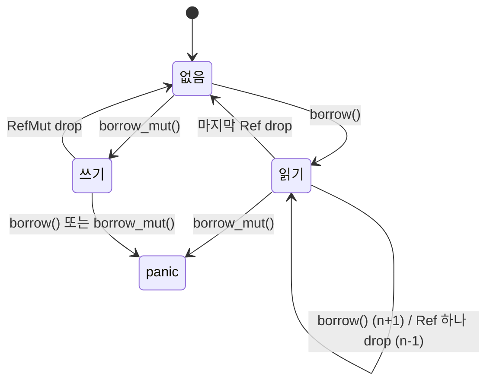


<div class="callout callout-summary" markdown="1">
<div class="callout-title callout-title--default" markdown="span">요약</div>

보통 Rust에서 값을 고치려면 그 값을 혼자 빌려야 한다. 내부 가변성은 여럿이 함께 보고 있는 값도 안쪽을 고칠 수 있게 해 주는 상자다. 규칙이 사라지는 것은 아니다. "읽는 사람 여럿, 또는 고치는 사람 하나"라는 규칙을 컴파일할 때 대신 실행 중에 검사한다. 그래서 규칙을 어기면 컴파일 오류 대신 실행 중에 프로그램이 멈춘다(panic). 그리고 이 상자들은 한 스레드 안에서만 쓸 수 있다. 스레드 사이에서는 잠금(`Mutex`) 같은 다른 도구를 쓴다.

</div>


## 예시로 보기

메시지를 보내는 트레이트가 있다. `send`는 `&self`를 받는다. 실제로 메일을 보내는 구현은 자기 자신을 고칠 일이 없으니 자연스러운 선택이다.

```rust
trait Messenger {
    fn send(&self, msg: &str);
}
```

테스트에서는 진짜로 보내는 대신 보낸 메시지를 `Vec`에 쌓아 두는 가짜(테스트 대역)를 만들고 싶다. 그런데 `&self`로는 필드를 고칠 수 없다[^1].

```
error[E0596]: cannot borrow `self.sent` as mutable, as it is behind a `&` reference
```

트레이트의 시그니처는 바꿀 수 없다. 필드를 `RefCell`로 감싸면 `&self`에서도 안을 고칠 수 있다[^1].

```rust
struct MockMessenger {
    sent: RefCell<Vec<String>>,
}
impl Messenger for MockMessenger {
    fn send(&self, msg: &str) {
        self.sent.borrow_mut().push(msg.to_string());
    }
}
```

사용량이 한도의 90%를 넘으면 경고를 보내는 함수에 이 가짜를 넘기고 95와 10을 차례로 넣었다. 쌓인 메시지는 `["over 90% of quota"]` 하나였다.

빌림 규칙은 여전히 지켜야 한다. 다만 검사가 실행 중에 일어난다.

```rust
let c = RefCell::new(5);
{
    let r1 = c.borrow();
    let r2 = c.borrow();                 // 읽기 빌림은 여러 개 된다
    let err = c.try_borrow_mut().unwrap_err();
    // format!("{err:?}") == "BorrowMutError"
    // err.to_string()   == "RefCell already borrowed"
}
{
    let mut w = c.borrow_mut();
    *w += 1;
    let err = c.try_borrow().unwrap_err();
    // format!("{err:?}") == "BorrowError"
    // err.to_string()   == "RefCell already mutably borrowed"
}
assert_eq!(*c.borrow(), 6);              // 빌림이 끝나면 다시 된다
```

`try_`가 붙지 않은 `borrow_mut()`로 같은 충돌을 내면 panic이다. 검증 코드에서 `borrow_mut()`를 두 번 쥐었을 때의 panic 메시지는 `"RefCell already borrowed"`였다[^3].

`RefCell`의 상태는 세 가지뿐이다. 아무도 안 빌림, 읽기 빌림 $$n$$개, 쓰기 빌림 1개.



<div class="callout callout-check" markdown="1">
<div class="callout-title" markdown="span">검증: E0596, `Cell` 세기, 가짜 메신저, `try_borrow_mut`·`try_borrow`의 에러 이름과 메시지, `borrow_mut` 두 번의 panic 메시지, 빌림을 오래 쥔 버그와 고친 판, `Rc<RefCell<Vec>>`, `OnceCell` 캐시와 `set` 두 번, 스레드 8개가 읽은 `LazyLock`의 초기화 1번, `Cell`·`RefCell`을 스레드로 넘길 때 E0277, `Arc<Mutex>` 4,000, 같은 버그를 `&mut self`로 쓴 판의 E0502, clippy `await_holding_refcell_ref`를 실행해 확인했다 — [29_interior-mutability_verify.rs](/Hongs_Blog/studies/rust/code/29_interior-mutability_verify/)</div>

</div>


## 정의

공유 참조(`&T`)를 통해서도 안의 상태를 바꿀 수 있는 타입을 내부 가변성이 있다고 한다[^6]. 원래 `&`가 가리키는 값은 바뀌지 않아야 한다. 이 약속을 끄는 유일하게 허락된 방법이 `std::cell::UnsafeCell<T>`다[^6]. `Cell`, `RefCell`, `OnceCell`, `Mutex`, 원자 타입은 모두 이것을 안에 두고, 밖에는 안전하게 쓸 수 있는 메서드만 내놓는다[^6]. 책은 이것을 "안에서는 `unsafe` 코드를 쓰고 바깥은 안전한 API로 감싼 패턴"이라고 설명한다[^1]. 감싸는 방법은 [unsafe와 안전한 감싸기](/Hongs_Blog/studies/rust/unsafe-abstractions/)에서 다룬다.

### 인터페이스

| 타입 | 주요 연산 | 안을 보여 주는 방식 | 규칙을 어기면 |
|---|---|---|---|
| `Cell<T>` | `get`(`T: Copy`), `set`, `replace`, `take`(`T: Default`), `into_inner` | 참조를 내주지 않는다. 값을 통째로 넣고 뺀다[^2] | 어길 방법이 없다 |
| `RefCell<T>` | `borrow`, `borrow_mut`, `try_borrow`, `try_borrow_mut` | `Ref<T>`, `RefMut<T>`(참조처럼 쓰는 손잡이)[^1] | panic, `try_`는 `Err` |
| `OnceCell<T>` | `get`, `set`, `get_or_init` | `&T`. 한 번 채우면 그대로 | 두 번째 `set`은 `Err(값)`[^4] |
| `LazyLock<T>` | 그냥 읽기(`*`, 메서드 호출) | 처음 읽을 때 초기화하고 `&T` | 초기화가 panic하면 그 뒤 모든 접근이 panic[^5] |

`Cell`의 `replace(7)`은 옛 값 3을 돌려주고, `take()`는 7을 꺼내며 기본값 0을 남겼다(검증 코드의 테스트). `OnceCell`에 `set(92)`가 `Ok(())`를 준 뒤 `set(62)`는 `Err(62)`를 줬고, `get()`은 `Some(&92)`였다.

### 표현 불변식

`RefCell`은 살아 있는 `Ref`와 `RefMut`의 수를 센다. 빌릴 때 올리고, 손잡이가 범위를 벗어나면 내린다[^1]. 읽기 손잡이 수를 $$r$$, 쓰기 손잡이 수를 $$w$$라 하면, `RefCell`은 언제나 다음을 지킨다.

$$
w = 0 \;\lor\; (w = 1 \land r = 0)
$$


쓰기 손잡이가 없거나, 쓰기 손잡이가 딱 하나이고 읽기 손잡이가 없다는 뜻이다. 컴파일러가 `&`와 `&mut`에 대해 검사하는 규칙과 같은 모양이다[^2]. `borrow()`는 $$w = 0$$일 때만, `borrow_mut()`는 $$r = w = 0$$일 때만 성공한다. 그 밖에는 손잡이를 주지 않고 panic하거나 `Err`를 돌려주므로 불변식이 깨지지 않는다.

`Cell`의 불변식은 더 단순하다. "안의 값을 가리키는 참조는 밖에 하나도 없다." `Cell`이 참조를 내주는 메서드를 아예 두지 않기 때문이다[^2]. `OnceCell`은 "한 번 채워지면 `&self`로는 다시 바뀌지 않는다"를 지킨다[^4].

### 비용

초기화를 빼면 모든 연산이 $$O(1)$$이다. 차이는 실행 중에 무엇을 확인하고, 확인에 걸리면 어떻게 되느냐에 있다.

| 연산 | 시간 | 실행 중 빌림 검사 | 걸리면 |
|---|---|---|---|
| `Cell`의 `get`·`set`·`replace` | $$O(1)$$, 값 복사 | 없음 | 걸릴 일이 없다 |
| `RefCell`의 `borrow`·`borrow_mut` | $$O(1)$$, 개수 확인과 고치기 | 있음. 원자적이지 않은 보통 연산[^8] | panic |
| `RefCell`의 `try_borrow`·`try_borrow_mut` | $$O(1)$$ | 있음 | `Err` |
| `OnceCell`의 `get`·`get_or_init` | 첫 초기화는 초기화 함수만큼, 그 뒤 $$O(1)$$ | 없음[^2] | 초기화 함수 안에서 다시 초기화하면 panic[^4] |
| `LazyLock` 읽기 | 첫 접근은 초기화만큼, 그 뒤 $$O(1)$$ | 없음 | 다른 스레드가 초기화 중이면 기다린다[^5] |

`RefCell`의 검사는 가볍지만 0은 아니다. 더 큰 비용은 실패할 수 있는 지점이 실행 중에 생긴다는 것이다. `Cell`은 값을 통째로 복사해 넣고 빼므로 숫자처럼 복사가 싼 타입에 쓴다[^2].

### 스레드에서 쓸 짝

`Cell`, `RefCell`, `OnceCell`은 `Sync`가 아니다. 즉 여러 스레드가 함께 참조할 수 없다[^2]. 스레드끼리는 아래 짝을 쓴다[^2].

| 한 스레드 | 여러 스레드 | 문서 |
|---|---|---|
| `RefCell<T>` | `RwLock<T>`, `Mutex<T>` | [Mutex와 RwLock](/Hongs_Blog/studies/rust/mutex-rwlock/) |
| `Cell<T>`(숫자) | `AtomicI32`·`AtomicU64` 같은 원자 타입. `Cell<i32>`를 스레드로 넘기면 컴파일러가 직접 `RwLock`이나 `AtomicI32`를 권한다 | [원자적 연산과 메모리 순서](/Hongs_Blog/studies/rust/atomics-memory-ordering/) |
| `OnceCell<T>` | `OnceLock<T>` | |
| `LazyCell<T, F>` | `LazyLock<T, F>` | |

`Mutex<T>`도 `Cell` 가족처럼 내부 가변성을 준다. `RefCell`이 `Rc` 안의 값을 고치게 해 주듯 `Mutex`는 `Arc` 안의 값을 고치게 해 준다[^7]. 검증 코드에서 `Arc<Mutex<i32>>`를 스레드 4개가 1,000번씩 올려 4,000이 나왔다.

## 왜 Cell은 검사 없이도 안전한가

`RefCell`은 실행 중에 개수를 세는데, `Cell`은 아무것도 세지 않는다. 그런데도 안전한 이유를 따져 본다.

<details class="callout callout-proof" markdown="1">
<summary class="callout-title" markdown="span">증명</summary>

1. *막아야 하는 것.* 빌림 규칙이 막는 사고는 둘이다. 누군가 참조로 읽고 있는 동안 값이 바뀌는 것, 그리고 두 스레드가 같은 값을 동시에 고치는 것(데이터 경쟁)이다.
2. *첫째 사고는 생길 수 없다.* `Cell`은 안의 값에 대한 참조를 밖으로 내주지 않는다. `get`은 복사본을, `replace`·`take`는 꺼낸 값을 돌려준다[^2]. 안을 가리키는 참조가 하나도 없으니 "읽는 도중에 바뀜"을 볼 수 있는 쪽이 없다.
3. *둘째 사고도 생길 수 없다.* `Cell`은 `Sync`가 아니다[^2]. 그래서 두 스레드가 같은 `Cell`을 함께 참조하는 코드는 컴파일되지 않는다. 검증 코드에서 `thread::scope` 안의 스레드가 바깥 `Cell`을 `set`하려 하자 E0277 ``Cell<i32>` cannot be shared between threads safely``가 났다.
4. 1의 두 사고가 모두 막혔으므로 `Cell`은 실행 중 검사 없이 안전하다.
5. *`RefCell`과의 차이.* `RefCell`은 `Ref`·`RefMut`라는 참조를 내준다. 2가 깨진다. 그래서 대신 개수를 세어 표현 불변식을 지키고, 지킬 수 없는 요청은 panic으로 거절한다.

</details>


### 스스로 설명해 보기

<details class="callout callout-question" markdown="1">
<summary class="callout-title" markdown="span">아래 `copy_first_buggy`는 컴파일된다. 어느 줄에서 왜 panic하는가?</summary>

```rust
fn copy_first_buggy(&self) {
    let names = self.names.borrow();
    if let Some(first) = names.first() {
        self.add(first);   // add 안에서 self.names.borrow_mut()
    }
}
```
`self.add(first)` 안의 `borrow_mut()`에서다. 이때 `names`라는 `Ref`가 아직 살아 있어 $$r = 1$$이다. `borrow_mut()`는 $$r = w = 0$$일 때만 성공하므로 panic한다. 검증 코드의 메시지는 `"RefCell already borrowed"`였다. 컴파일러는 `&self` 두 개만 보이니 아무 문제를 찾지 못한다.

</details>


<details class="callout callout-question" markdown="1">
<summary class="callout-title" markdown="span">고친 판의 `let first = self.names.borrow().first().cloned();`는 왜 이 줄 끝에서 빌림이 끝나는가?</summary>

`borrow()`가 만든 `Ref`를 변수에 담지 않았다. 문장 안에서만 쓰는 임시값이라 문장이 끝날 때 drop되고 $$r$$이 0으로 돌아간다. `cloned()`로 `String` 복사본을 얻었으니 `Ref`를 더 쥘 필요도 없다. 그다음 줄의 `add`는 $$r = w = 0$$에서 `borrow_mut()`를 하므로 성공한다. 결과는 `["a", "a"]`였다.

</details>


<details class="callout callout-question" markdown="1">
<summary class="callout-title" markdown="span">이 고침의 핵심 아이디어는? 다른 어디에 같은 방법을 쓰는가?</summary>

빌림을 짧게 쥐는 것이다. 필요한 값만 복사해 빌림을 끝낸 뒤 다른 메서드를 부른다. `Mutex` 가드도 같다. 잠금을 쥔 채 같은 잠금을 다시 얻으려는 함수를 부르면 그 호출이 돌아오지 않는다. 멈추거나 panic한다([Mutex와 RwLock](/Hongs_Blog/studies/rust/mutex-rwlock/)). [에러와 메모리 연습](/Hongs_Blog/studies/rust/errors-memory-practice/) p4의 이벤트 버스도 핸들러 목록을 복사한 뒤 빌림을 끝내고 핸들러를 부른다.

</details>


## 활용

std 문서는 내부 가변성을 "최후의 수단"에 가깝다고 본다. 먼저 `&mut`로 풀 수 있는지 본다[^2]. 그래도 필요한 자리는 다음과 같다.

- **함께 가지면서 고치기: `Rc<RefCell<T>>`.** `Rc`는 `&T`만 준다. 안에 `RefCell`을 넣으면 주인 여럿이 고칠 수 있다[^1][^2]. 검증 코드에서 주인 셋(`shared`, `a`, `b`) 중 `a`와 `b`가 각각 `push`하자 `shared`에서 `["from a", "from b"]`가 보였다.
- **겉으로는 안 바뀌는 메서드의 속사정.** 결과가 늘 같은 비싼 계산을 처음 한 번만 하고 저장해 둔다. `&self` 메서드 안에서 `OnceCell::get_or_init`을 쓴다[^2]. 검증 코드의 `Report::total()`은 두 번 불렀지만 합을 계산한 것은 한 번이었다. 호출 횟수를 세는 `Cell<u32>`도 같은 자리다.
- **테스트 대역.** 위의 가짜 메신저처럼 트레이트가 `&self`를 요구할 때([테스트 전략](/Hongs_Blog/studies/rust/testing-strategy/)).
- **전역 표와 설정.** `static`에는 실행 중에 만든 값을 바로 넣을 수 없다. `LazyLock`(Rust 1.80부터 안정판)은 처음 읽을 때 초기화하며 `static`에 쓸 수 있다[^5]. 검증 코드에서 HTTP 상태 코드 표를 `static STATUS_TEXT: LazyLock<HashMap<u16, &str>>`로 두고 스레드 8개가 동시에 읽었다. 초기화는 한 번만 돌았다. 초기화 함수가 panic하면 그 뒤로 모든 접근이 panic하고 되살릴 수 없다는 점은 알아 둔다[^5]. 그래서 실패할 수 있는 초기화(파일 읽기 등)는 `main`에서 `Result`로 처리하고 결과를 넘겨 준다([설정과 비밀값](/Hongs_Blog/studies/rust/configuration-secrets/)).
- **충돌을 값으로 받기.** 다시 들어올 수 있는 코드(콜백 안에서 같은 객체를 또 부름)에서는 `borrow_mut()` 대신 `try_borrow_mut()`로 `Err(BorrowMutError)`를 받아 처리할 수 있다[^3].
- **async에서 주의.** `RefCell`의 빌림을 쥔 채 `.await`하면 clippy의 `await_holding_refcell_ref`(suspicious, 기본 경고)가 잡는다[^9]. 기다리는 동안 다른 코드가 같은 `RefCell`을 빌리면 panic이 나기 때문이다. 검증 코드에서 `borrow_mut()` 뒤 `.await`에 ``this `RefCell` reference is held across an await point``가 나왔다. 빌림은 `.await` 전에 끝낸다([Future와 async·await](/Hongs_Blog/studies/rust/futures-async-await/)).
- **`const`에 넣지 않기.** 내부 가변성이 있는 값을 `const`로 선언하면 쓰는 자리마다 새 복사본이 생긴다. 고친 것이 남지 않는다. clippy `borrow_interior_mutable_const`(style, 기본 경고)가 잡는다[^9]. 공유할 값이면 `static`으로 둔다.
- **흔한 실수.** `let mut v = x.borrow_mut();`를 함수 맨 위에 두고 끝까지 쥔다. 그 사이에 부르는 다른 메서드가 같은 `RefCell`을 빌리면 panic이다. 빌림은 필요한 줄에서만 쓴다.

## 연결

- 선수: [빌림과 참조](/Hongs_Blog/studies/rust/borrowing-references/)(컴파일할 때의 규칙), [구조체와 메서드](/Hongs_Blog/studies/rust/structs-methods/)(`&self`), [Rc·Arc·Weak](/Hongs_Blog/studies/rust/rc-arc-weak/)
- 스레드 사이의 짝: [Mutex와 RwLock](/Hongs_Blog/studies/rust/mutex-rwlock/), [원자적 연산과 메모리 순서](/Hongs_Blog/studies/rust/atomics-memory-ordering/), 그리고 `Sync`의 뜻은 [스레드와 Send·Sync](/Hongs_Blog/studies/rust/threads-send-sync/)
- 안에서 쓰는 `UnsafeCell`과 감싸는 방법: [unsafe와 안전한 감싸기](/Hongs_Blog/studies/rust/unsafe-abstractions/)

## 자주 하는 오해

<div class="callout callout-misconception" markdown="1">
<div class="callout-title" markdown="span">"`RefCell`을 쓰면 빌림 규칙이 꺼진다"</div>

틀렸다. 규칙은 그대로이고, 검사하는 때만 컴파일할 때에서 실행할 때로 옮겨 간다. 컴파일러가 막던 코드가 `RefCell`로 바꾸면 컴파일되니 규칙이 사라진 것처럼 보인다. 실제로는 같은 규칙을 어기는 순간 panic이 난다. 확인하는 법: 읽기 빌림을 쥔 채 `try_borrow_mut()`를 불러 본다. `Err(BorrowMutError)`가 온다. 컴파일 오류가 실행 중 panic으로 바뀐 것이므로 더 늦게, 더 비싸게 발견된다. 그래서 `&mut`로 풀 수 있으면 그쪽이 낫다.

</div>


<div class="callout callout-misconception" markdown="1">
<div class="callout-title" markdown="span">"`Arc<RefCell<T>>`로 감싸면 스레드끼리 나눠 고칠 수 있다"</div>

틀렸다. `Arc`는 주인을 여럿 두는 일만 스레드에 안전하게 해 준다. 안의 `RefCell`은 개수를 보통 연산으로 세므로 두 스레드가 동시에 빌리면 개수가 틀어질 수 있다[^8]. 그래서 이런 코드는 컴파일되지 않는다. 검증 코드에서 `Arc<RefCell<i32>>`를 스레드로 넘기자 E0277 ``RefCell<i32>` cannot be shared between threads safely``였다. `Arc<Mutex<T>>`나 `Arc<RwLock<T>>`를 쓴다.

</div>


## 확인 문제

<details class="callout callout-question" markdown="1">
<summary class="callout-title" markdown="span">**C1** `let c = RefCell::new(5);` 뒤에 (1) `borrow()` 두 개를 쥔 채 `try_borrow_mut()` (2) 그 빌림을 모두 버리고 `borrow_mut()`로 1을 더한 채 `try_borrow()` (3) 모두 버린 뒤 `*c.borrow()`. 각 결과를 쓰라. 에러라면 `Debug` 이름과 메시지까지.</summary>

**답:** (1) `Err`, `BorrowMutError`, "RefCell already borrowed" (2) `Err`, `BorrowError`, "RefCell already mutably borrowed" (3) 6.<br>
**이유:** (1)은 $$r = 2$$라 쓰기 빌림이 안 된다. (2)는 $$w = 1$$이라 읽기 빌림도 안 된다. (3)은 손잡이가 모두 사라져 다시 빌릴 수 있고, (2)에서 더한 1이 남았다. 검증 코드의 실행 결과와 같다.

</details>


<details class="callout callout-question" markdown="1">
<summary class="callout-title" markdown="span">**C2** 본문의 `copy_first_buggy`를 `RefCell` 대신 그냥 `Vec<String>` 필드와 `&mut self`로 쓰면 무엇이 달라지는가?</summary>

**답:** `self.names.first()`가 만든 참조를 쥔 채 `self.add(...)`(`&mut self`)를 부르는 것이 컴파일 오류(E0502)가 된다. 같은 버그가 실행 전에 잡힌다.<br>
**이유:** 두 판이 어기는 규칙은 같다. "읽는 동안 고치지 않는다." `RefCell`은 이 검사를 실행 중으로 미뤘을 뿐이다. 검증 코드에서 `&mut self` 판을 컴파일하자 E0502가 났다.

</details>


<details class="callout callout-question" markdown="1">
<summary class="callout-title" markdown="span">**C3** 어느 타입을 쓰는가? (가) `&self` 파서가 몇 번 불렸는지 세기 (나) `&self` 메서드에서 비싼 합계를 처음 한 번만 계산 (다) 테스트 대역이 받은 메시지를 `Vec`에 쌓기 (라) 모든 스레드가 읽는 상태 코드 표 (마) 여러 스레드가 함께 올리는 요청 수</summary>

**답:** (가) `Cell<u32>` (나) `OnceCell<u64>` (다) `RefCell<Vec<String>>` (라) `static`에 `LazyLock` (마) `AtomicU64` 또는 `Mutex<u64>`.<br>
**이유:** (가)는 복사가 싼 숫자라 참조가 필요 없다. (나)는 한 번 채우고 그 뒤로는 읽기만 한다. (다)는 `Vec`에 `push`하려면 `&mut`가 잠깐 필요하다. (라)(마)는 여러 스레드라 `Sync`인 짝을 쓴다.<br>
**흔한 오답:** (마)에 `Cell`. `Cell`은 `Sync`가 아니라 컴파일되지 않는다.

</details>


<details class="callout callout-question" markdown="1">
<summary class="callout-title" markdown="span">**C4** "`Cell`은 검사를 안 하니 여러 스레드에서 쓰면 위험하지만, 컴파일은 된다"는 말을 반박하는 코드를 들라.</summary>

**답:** <code>let c = Cell::new(0); std::thread::scope(&#124;s&#124; { s.spawn(&#124;&#124; c.set(1)); });</code>. 컴파일되지 않는다(E0277, ``Cell<i32>` cannot be shared between threads safely``).<br>
**이유:** `Cell`은 `Sync`가 아니므로 다른 스레드가 `&Cell`을 쥘 수 없다. 컴파일러는 대신 `RwLock`이나 `AtomicI32`를 쓰라고 제안한다. 위험한 코드가 실행될 기회 자체가 없다.

</details>


[^1]: The Rust Programming Language, 15.5 `RefCell<T>` and the Interior Mutability Pattern (가짜 메신저 예, `borrow`·`borrow_mut`와 `Ref`·`RefMut`, 개수 세기, 실행 중 panic, `Rc<RefCell<T>>`, 안은 `unsafe`·밖은 안전한 API) — https://doc.rust-lang.org/book/ch15-05-interior-mutability.html
[^2]: std 문서, Module `std::cell` (`Cell`·`RefCell`·`OnceCell`·`LazyCell`, `OnceCell`은 복사 없이 실행 중 검사 없이 `&T`를 줌, 언제 쓰나와 "last resort", `Sync`가 아님, 스레드용 짝) — https://doc.rust-lang.org/std/cell/index.html
[^3]: std 문서, Struct `std::cell::RefCell` — `borrow_mut`(Panics), `try_borrow_mut`, `try_borrow` — https://doc.rust-lang.org/std/cell/struct.RefCell.html
[^4]: std 문서, Struct `std::cell::OnceCell` (1.70.0, `set`은 이미 채워졌으면 `Err(value)`, `get_or_init` 안에서 다시 초기화하면 panic, `!Sync`) — https://doc.rust-lang.org/std/cell/struct.OnceCell.html
[^5]: std 문서, Struct `std::sync::LazyLock` (1.80.0, 처음 접근할 때 초기화, `static`에 쓸 수 있음, 초기화 중 다른 스레드는 기다림, 초기화 panic은 되살릴 수 없는 독) — https://doc.rust-lang.org/std/sync/struct.LazyLock.html
[^6]: The Rust Reference, Interior mutability (`UnsafeCell<T>`이 공유 참조의 불변 요구를 끄는 유일한 방법, 표준 라이브러리의 안전한 API) — https://doc.rust-lang.org/reference/interior-mutability.html
[^7]: The Rust Programming Language, 16.3 Shared-State Concurrency — Similarities Between `RefCell<T>`/`Rc<T>` and `Mutex<T>`/`Arc<T>` — https://doc.rust-lang.org/book/ch16-03-shared-state.html
[^8]: std 문서, Struct `std::sync::Arc` — Thread Safety (`RefCell<T>`은 빌림을 원자적이지 않은 연산으로 추적하므로 `Arc<RefCell<T>>`는 나눌 수 없음) — https://doc.rust-lang.org/std/sync/struct.Arc.html
[^9]: Clippy Lints, `await_holding_refcell_ref`(suspicious, warn), `borrow_interior_mutable_const`(style, warn) — https://rust-lang.github.io/rust-clippy/master/index.html#await_holding_refcell_ref

