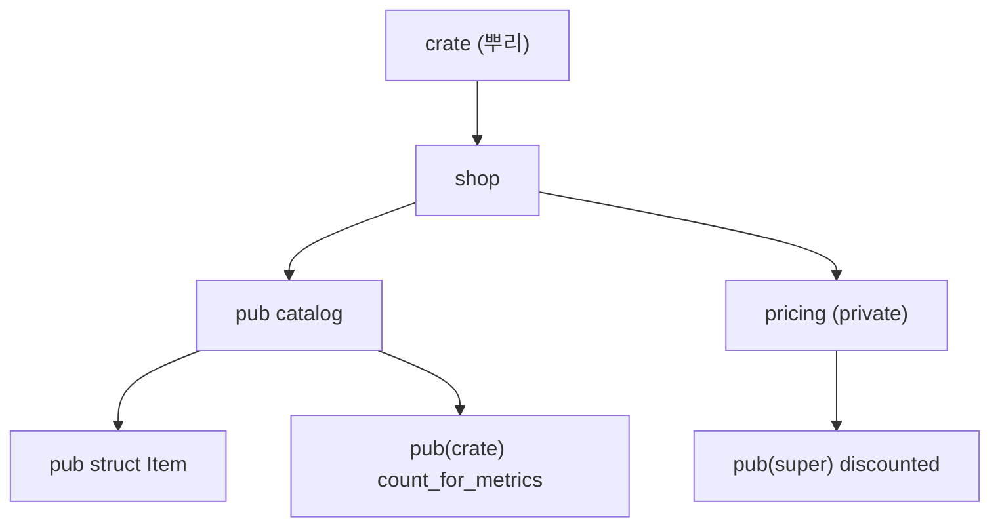


<div class="callout callout-summary" markdown="1">
<div class="callout-title callout-title--default" markdown="span">요약</div>

코드를 방으로 나누고, 방마다 "밖에 보여 줄 문"을 정하는 일이다. 방 하나가 모듈이고, 문을 여는 표시가 `pub`이다. 표시가 없으면 같은 방과 그 안쪽 방에서만 쓸 수 있다. 덕분에 안쪽 구현을 바꿔도 바깥 코드가 깨지지 않는다. 대신 무엇을 열지 정하는 것은 사람 몫이다. 한 번 `pub`으로 연 이름은 다른 사람이 쓰기 시작하므로 나중에 닫기 어렵다. 프로그램이 커지면 여러 패키지를 한 저장소에 묶어(워크스페이스) 잠금 파일과 빌드 폴더를 함께 쓴다.

</div>


## 예시로 보기

파일 하나에 상품, 가격 계산, 할인 규칙이 다 들어 있으면 처음엔 편하다. 그러다 할인 규칙을 고치면 그 함수를 직접 부르던 코드가 어디에 있는지 다 찾아야 한다. 할인 함수를 아무도 직접 못 부르게 막아 두었다면, 고칠 곳은 그 방 안뿐이다.

```rust
mod shop {
    pub use self::catalog::Item;      // 바깥에는 shop::Item으로 보여 준다

    pub mod catalog {
        pub struct Item {
            pub name: String,
            price_cents: u32,         // pub 없음: catalog 안에서만 읽는다
        }
        impl Item {
            pub fn new(name: &str, price_cents: u32) -> Item { /* … */ }
            pub fn price(&self) -> u32 {
                super::pricing::discounted(self.price_cents)
            }
        }
        pub(crate) fn count_for_metrics() -> usize { 1 }
    }

    mod pricing {                     // pub 없음: shop과 그 안쪽만 본다
        pub(super) fn discounted(cents: u32) -> u32 { cents - cents / 10 }
    }
}
```

`shop::Item::new("pen", 1000).price()`는 900이다. 바깥 코드가 할인 함수를 직접 부르면 컴파일러가 막는다.

```text
error[E0603]: module `pricing` is private
error[E0616]: field `price_cents` of struct `Item` is private
```

private 필드가 있는 구조체를 바깥에서 `Item { name, price_cents }`처럼 직접 만들려 해도 E0451로 막힌다. 그래서 `Item`은 반드시 `new`를 거쳐 만들어진다. 생성자에서 값을 검사하면 잘못된 `Item`이 생길 길이 없다([타입으로 잘못된 상태 막기](/Hongs_Blog/studies/rust/type-driven-design/)).



<div class="callout callout-check" markdown="1">
<div class="callout-title" markdown="span">검증: 위 오류 코드 E0603·E0616·E0451, 다른 크레이트에서 `pub(crate)` 함수를 부를 때의 E0603, 기능 플래그 두 경우, 워크스페이스 빌드와 `[workspace.lints]` 적용을 rustc와 cargo로 실제로 돌려 확인했다 — [41_modules-workspaces_verify.rs](/Hongs_Blog/studies/rust/code/41_modules-workspaces_verify/)</div>

</div>


## 크레이트와 패키지

컴파일러가 한 번에 다루는 코드 덩어리를 크레이트(crate)라 부른다. `rustc`에 파일 하나만 줘도 그 파일이 크레이트 하나다[^1].

- 실행 파일이 되는 것은 바이너리 크레이트다. `main` 함수가 있어야 한다[^1].
- `main`이 없고 다른 코드가 가져다 쓰는 것은 라이브러리 크레이트다[^1].
- 컴파일러가 읽기 시작하는 파일을 크레이트 뿌리(crate root)라 부른다. 이 파일이 모듈 나무의 뿌리 모듈이 된다[^1].

`Cargo.toml` 하나로 묶인 크레이트 모음이 패키지(package)다. 패키지에는 라이브러리 크레이트가 **최대 하나**, 바이너리 크레이트는 몇 개든 들어간다[^1]. cargo는 파일 이름으로 크레이트를 알아본다[^1].

```text
shortener/                 패키지 하나
├── Cargo.toml
└── src/
    ├── lib.rs             라이브러리 크레이트 뿌리 (이름: shortener)
    ├── main.rs            바이너리 크레이트 뿌리 (이름: shortener)
    └── bin/
        └── migrate.rs     바이너리 크레이트 하나 더 (이름: migrate)
```

서비스는 `lib.rs`에 거의 모든 코드를 두고 `main.rs`는 설정을 읽고 서버를 띄우는 몇 줄만 둔다. `tests/` 폴더의 통합 테스트는 라이브러리 크레이트만 가져다 쓸 수 있기 때문이다[^2].

## 모듈을 파일로 나누기

`mod catalog { … }`처럼 중괄호로 쓰면 그 자리에 모듈 몸통이 있다. `mod catalog;`처럼 세미콜론으로 끝내면 컴파일러가 모듈 이름과 같은 파일을 찾아 읽는다[^3].

```text
src/
├── lib.rs           mod shop;
├── shop.rs          pub mod catalog;  mod pricing;
└── shop/
    ├── catalog.rs
    └── pricing.rs
```

- `shop` 안의 `catalog`는 `src/shop/catalog.rs`에 둔다. `src/catalog.rs`에 두면 컴파일러는 뿌리 바로 아래의 `catalog`로 여긴다[^3].
- 예전 방식인 `src/shop/mod.rs`도 아직 통한다. 한 모듈에 두 방식을 함께 쓰면 컴파일 오류다[^3].
- `mod`는 C의 `#include`처럼 파일 내용을 붙여 넣는 명령이 아니다. 파일은 모듈 나무에 한 번만 들어가고, 다른 곳에서는 `crate::shop::catalog` 같은 경로로 부른다. `use`는 경로에 짧은 이름을 붙일 뿐, 어떤 파일을 컴파일할지와는 상관없다[^3].

## 가시성

아무 표시가 없으면 private이다. private 이름은 그 이름이 있는 모듈과 그 자손 모듈에서만 보인다[^4]. 예외가 둘 있다. `pub` 트레이트의 연관 항목과 `pub` 열거형의 변형은 저절로 public이다[^4].

| 표시 | 보이는 곳 |
|---|---|
| 없음 (`pub(self)`) | 지금 모듈과 그 자손 |
| `pub(super)` | 부모 모듈 (그리고 그 자손) |
| `pub(in crate::shop)` | 적어 준 조상 모듈 안 |
| `pub(crate)` | 이 크레이트 전체 |
| `pub` | 조상 모듈이 모두 보이는 어디서나, 다른 크레이트 포함 |

표의 내용은 Reference의 규칙을 옮긴 것이다[^4]. 마지막 줄의 조건이 중요하다. `pub fn`이라도 그것을 담은 모듈이 private이면 바깥 크레이트는 그 경로로 닿지 못한다[^4].

`pub use`는 다른 곳에 있는 이름을 여기서 다시 내보낸다(re-export). 위 예에서 `catalog` 모듈을 감추고 `shop::Item`만 보여 줄 수도 있다. 바깥 크레이트는 다시 내보낸 경로로는 닿고, 원래 경로로는 못 닿는다[^4]. 라이브러리는 안쪽 파일 구조를 자유롭게 바꾸면서 바깥 경로를 그대로 둘 수 있다.

`pub(crate)`의 효과는 크레이트 경계를 넘어야 보인다. 같은 코드를 라이브러리 크레이트 `shoplib`로 컴파일하고 다른 크레이트에서 `shoplib::shop::catalog::count_for_metrics()`를 부르면 E0603(``function `count_for_metrics` is private``)이 난다. 같은 크레이트 안에서는 아무 문제가 없다.

## 워크스페이스

서비스가 자라면 패키지 하나로는 불편하다. 도메인 타입은 여러 실행 파일이 같이 쓰고, 마이그레이션 도구와 서버는 따로 배포한다. 패키지 여러 개를 한 저장소에서 함께 다루는 묶음이 워크스페이스(workspace)다[^5].

```text
shortener/
├── Cargo.toml          [workspace] (패키지 없는 가상 매니페스트)
├── Cargo.lock          모든 멤버가 함께 쓰는 잠금 파일 하나
├── target/             모든 멤버가 함께 쓰는 빌드 폴더 하나
└── crates/
    ├── core/           도메인 타입·에러 (라이브러리)
    ├── storage/        sqlx 저장소 (라이브러리)
    └── server/         axum 서버 (바이너리)
```

```toml
# 루트 Cargo.toml
[workspace]
members = ["crates/*"]
resolver = "3"

[workspace.package]
edition = "2024"
version = "0.1.0"

[workspace.dependencies]
tokio = { version = "1", features = ["full"] }
shop-core = { path = "crates/core" }

[workspace.lints.rust]
unsafe_code = "forbid"
```

```toml
# crates/server/Cargo.toml
[package]
name = "shop-server"
version.workspace = true
edition.workspace = true

[dependencies]
tokio.workspace = true
shop-core.workspace = true

[lints]
workspace = true
```

- 멤버는 `Cargo.lock` 하나와 `target/` 하나를 함께 쓴다. `cargo check --workspace`처럼 명령 하나로 모든 멤버를 다룬다[^5].
- 패키지가 없는 루트(가상 매니페스트)에서는 `resolver`를 직접 적어야 한다. 에디션에서 짐작할 수 없기 때문이다[^5].
- `[workspace.dependencies]`는 의존성 버전을 루트 한곳에 적고, 멤버는 `이름.workspace = true`로 가져온다. 멤버 쪽 `features`는 루트 것에 더해진다. 워크스페이스 의존성은 `optional`이 될 수 없다[^5]. Cargo Book은 이 표를 Rust 1.64부터 쓸 수 있다고 적는다[^5].
- `[workspace.lints]`는 린트 수준을 루트에서 정하고, 멤버가 `[lints] workspace = true`로 따른다. 1.74부터 통한다[^5][^6].
- `[profile.*]`와 `[patch]`는 루트 `Cargo.toml`에서만 읽힌다. 멤버에 적으면 무시된다[^5].

검증 코드는 위 모양의 작은 워크스페이스를 임시 폴더에 만들고 `cargo run -p shop-app`을 돌린다. `Cargo.lock`과 `target/`이 루트에만 생겼다. `core` 멤버에 `unsafe` 블록을 넣으면 빌드가 이렇게 멈췄다.

```text
error: usage of an `unsafe` block
  = note: requested on the command line with `-F unsafe-code`
```

루트에 적은 `forbid`가 cargo를 거쳐 `-F unsafe-code` 옵션으로 멤버 컴파일에 붙은 것이다.

## 기능 플래그

`[features]`에 이름을 적으면 사용자가 그 기능을 켜고 끌 수 있다. 코드에서는 `#[cfg(feature = "json")]`로 갈라진다. 기능 플래그(feature flag)는 **켜면 무언가가 더해지기만** 해야 한다[^7].

여러 패키지가 같은 의존성을 쓰면 cargo는 그 의존성을 한 번만 빌드한다. 이때 각 패키지가 켠 기능을 모두 합쳐서 켠다(feature unification)[^7]. 그래서 내가 끄고 싶은 기능도 다른 의존성이 켜 두면 켜진다. 기능 하나가 다른 기능을 끄는 식으로 짜면, 내 코드와 상관없는 곳에서 빌드가 깨진다.

- 표준 라이브러리 없이 쓰는 지원은 `no_std` 기능 대신 `std` 기능을 두고 그것이 켜졌을 때만 `std`를 쓴다[^7].
- 두 기능이 정말 함께 켜질 수 없으면 `compile_error!`로 컴파일 때 막는다. 가능하면 이런 설계는 피한다[^7].
- 선택 의존성은 같은 이름의 기능을 저절로 만든다. `[features]`에서 `dep:이름`으로 적으면 그 자동 기능이 사라진다(1.60부터)[^7].
- `default` 기능은 의존성을 쓰는 쪽이 `default-features = false`를 적지 않는 한 켜진다. 기본 기능에서 하나를 빼면 SemVer상 깨지는 변경일 수 있다[^7].

검증 코드에서 `json`과 `yaml`을 함께 켠 크레이트는 문제없이 컴파일됐다. `sqlite`와 `postgres`를 함께 켜면 `compile_error!`가 걸려 멈췄다.

## 활용

- **lib + 얇은 main.** 서버 코드를 `lib.rs`에 두면 통합 테스트와 벤치마크가 같은 코드를 쓴다. `main.rs`에는 설정 읽기, 로그 초기화, 서버 띄우기만 둔다[^2].
- **기본은 private, 다음은 `pub(crate)`.** 크레이트 안 여러 모듈이 같이 쓰는 도우미는 `pub(crate)`로 둔다. `pub`은 다른 크레이트가 써야 하는 것에만 붙인다. 라이브러리에서 `pub`을 닫는 것은 깨지는 변경이다([API 설계 원칙](/Hongs_Blog/studies/rust/api-design/)).
- **겉은 평평하게.** 안쪽 모듈은 깊게 나누되, 사용자가 쓸 타입은 크레이트 뿌리에서 `pub use`로 다시 내보낸다.
- **워크스페이스 나누는 기준.** 따로 배포하는 것(서버, CLI, 마이그레이션 도구)과, 여러 곳에서 쓰는 순수 코드(도메인 타입)를 가른다. 크레이트는 컴파일 단위이므로 잘게 나누면 바뀌지 않은 크레이트를 다시 컴파일하지 않는다. 반대로 너무 잘게 나누면 경로와 `pub`만 늘어난다.
- **흔한 실수.** `src/shop/catalog.rs`를 만들어 놓고 `shop.rs`에 `pub mod catalog;`를 빠뜨린다. 파일은 있어도 모듈 나무에 없으니 컴파일되지 않는다. `mod`가 파일을 나무에 붙이는 유일한 길이다.
- **clippy.** `clippy::mod_module_files`는 `mod.rs` 파일을 금지하고, `clippy::module_name_repetitions`는 `shop::ShopItem`처럼 모듈 이름을 되풀이한 public 이름을 잡는다. 둘 다 restriction 그룹이라 기본으로는 꺼져 있다[^8]. 팀 규칙으로 쓰려면 `[workspace.lints.clippy]`에 켠다.

## 연결

- Java의 패키지와 접근 제한자도 이름을 묶고 보일 범위를 정한다. Java의 `default`(package-private)는 같은 패키지에서만 보이고 하위 패키지에서는 안 보인다. Rust의 private은 자손 모듈에서 보인다: [패키지](/Hongs_Blog/studies/java/java-package/), [접근 제한자](/Hongs_Blog/studies/java/java-access-modifier/), [모듈](/Hongs_Blog/studies/java/java-module/)
- 패키지와 `Cargo.toml`의 기초: [cargo와 패키지 구조](/Hongs_Blog/studies/rust/cargo-packages/)
- private 필드와 생성자로 잘못된 값을 막는 법: [타입으로 잘못된 상태 막기](/Hongs_Blog/studies/rust/type-driven-design/)
- 모듈 구조가 테스트 위치를 정한다: [테스트 전략](/Hongs_Blog/studies/rust/testing-strategy/)
- 워크스페이스 린트를 CI에서 강제하기: [CI 품질 게이트](/Hongs_Blog/studies/rust/ci-quality-gates/)

## 확인 문제

<details class="callout callout-question" markdown="1">
<summary class="callout-title" markdown="span">**C1** 다른 크레이트에서 `shoplib::shop::catalog::count_for_metrics()`를 부르면 컴파일되는가? `count_for_metrics`가 `pub(crate)`일 때와 `pub`일 때를 각각 답하라. `catalog` 모듈은 `pub mod`다.</summary>

**답:** `pub(crate)`이면 안 된다(E0603, ``function `count_for_metrics` is private``). `pub`이면 된다.<br>
**이유:** `pub(crate)`은 정의한 크레이트 안에서만 보인다. 다른 크레이트에서 보려면 함수가 `pub`이고 `shop`, `catalog` 같은 조상 모듈도 모두 `pub`이어야 한다.<br>
**흔한 오답:** "`catalog`가 `pub`이니 안의 것도 다 보인다." 모듈의 `pub`은 모듈 이름만 연다. 안의 항목은 각자 표시를 따른다.

</details>


<details class="callout callout-question" markdown="1">
<summary class="callout-title" markdown="span">**C2** 다음 셋 중 워크스페이스 멤버의 `Cargo.toml`에 적으면 **무시되는** 것은? (가) `[dependencies] tokio.workspace = true` (나) `[profile.release] lto = true` (다) `[lints] workspace = true`</summary>

**답:** (나).<br>
**이유:** `[profile.*]`, `[patch]`, `[replace]`는 루트 `Cargo.toml`에서만 읽힌다. (가)는 루트의 `[workspace.dependencies]`를 가져오고, (다)는 루트의 `[workspace.lints]`를 따른다.<br>
**흔한 오답:** (다). `[lints] workspace = true`는 멤버마다 적어야 루트 린트가 걸린다. 적지 않으면 그 멤버에는 루트 린트가 붙지 않는다.

</details>


<details class="callout callout-question" markdown="1">
<summary class="callout-title" markdown="span">**C3** 라이브러리 `fastjson`이 기능 `simd`와 `no_simd`를 두고, `no_simd`가 켜지면 SIMD 코드를 뺀다. 내 앱은 `no_simd`만 켰다. 이 설계가 내 앱을 깨뜨리는 상황을 하나 들라.</summary>

**답:** 내 앱이 쓰는 다른 의존성 `web`이 `fastjson`을 `simd` 기능으로 쓴다. cargo는 `fastjson`을 한 번만 빌드하며 두 기능을 합쳐 켠다. 그러면 `simd`와 `no_simd`가 함께 켜지고, 코드가 둘을 함께 다루지 못하면 컴파일 오류나 엉뚱한 동작이 난다.<br>
**이유:** 기능은 합집합으로 켜진다. 그래서 기능은 무언가를 더하기만 해야 한다. 고친 설계는 `simd` 하나만 두고, 꺼져 있으면 일반 코드를 쓰는 것이다.

</details>


[^1]: The Rust Programming Language, 7.1 Packages and Crates — https://doc.rust-lang.org/book/ch07-01-packages-and-crates.html
[^2]: The Rust Programming Language, 11.3 Test Organization (Integration Tests for Binary Crates) — https://doc.rust-lang.org/book/ch11-03-test-organization.html
[^3]: The Rust Programming Language, 7.5 Separating Modules into Different Files — https://doc.rust-lang.org/book/ch07-05-separating-modules-into-different-files.html
[^4]: The Rust Reference, Visibility and privacy (pub(in path), pub(crate), pub(super), pub(self); Re-exporting and Visibility) — https://doc.rust-lang.org/reference/visibility-and-privacy.html
[^5]: The Cargo Book, Workspaces (members, resolver, The `package` table, The `dependencies` table, The `lints` table, Root package) — https://doc.rust-lang.org/cargo/reference/workspaces.html
[^6]: The Cargo Book, The Manifest Format, The `[lints]` section ("Respected as of 1.74") — https://doc.rust-lang.org/cargo/reference/manifest.html
[^7]: The Cargo Book, Features (Feature unification, Mutually exclusive features, Optional dependencies, The `default` feature) — https://doc.rust-lang.org/cargo/reference/features.html
[^8]: Clippy Lints, `mod_module_files`, `module_name_repetitions` (restriction) — https://rust-lang.github.io/rust-clippy/master/index.html

