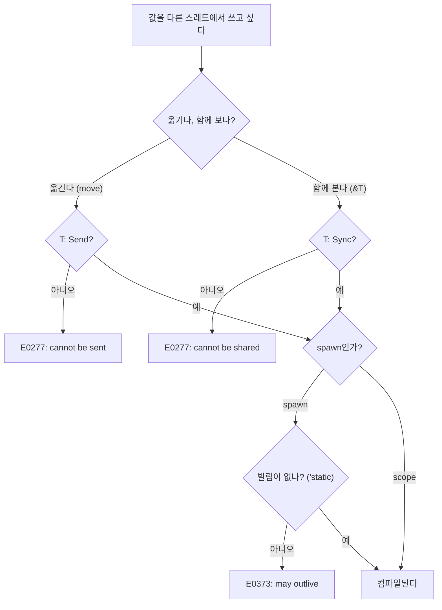


<div class="callout callout-summary" markdown="1">
<div class="callout-title callout-title--default" markdown="span">요약</div>

여러 일꾼(스레드)이 한 작업실에서 동시에 일할 때, Rust는 각 물건에 "다른 일꾼에게 넘겨도 되는가", "여럿이 함께 봐도 되는가"라는 꼬리표를 붙여 두고 컴파일할 때 검사한다. 그래서 둘이 같은 칸을 잠금 없이 동시에 고치는 사고는 안전한 코드에서 아예 컴파일되지 않는다. 대신 서로를 영원히 기다리는 멈춤이나, 순서를 잘못 짠 탓에 값이 틀어지는 논리 오류는 막아 주지 않는다.

</div>


## 예시로 보기

큰 배열의 합을 코어 네 개로 나눠 구하고 싶다. 파이썬이나 C라면 배열을 네 조각으로 나눠 스레드에 넘기면 된다. 이때 C에서는 한 스레드가 아직 배열을 읽는 중에 다른 곳에서 그 배열을 `free`해도 컴파일러가 아무 말도 하지 않는다. Rust는 이런 코드를 컴파일 단계에서 거절한다[^1].

가장 기본 도구는 `thread::spawn`이다. 새 스레드에서 돌릴 클로저를 받고, 그 스레드를 기다릴 손잡이(`JoinHandle`)를 돌려준다. `join`을 부르면 그 스레드가 끝날 때까지 기다렸다가 클로저가 돌려준 값을 받는다[^2].

```rust
use std::thread;

let v = String::from("abc");
let h = thread::spawn(move || v.len()); // v의 소유권이 새 스레드로 간다
assert_eq!(h.join().unwrap(), 3);
```

`move`를 빼면 클로저는 `v`를 빌리기만 하려 든다. 그런데 새 스레드가 언제 끝날지 컴파일러는 알 수 없다. `main`이 먼저 `v`를 버리면 새 스레드는 이미 사라진 값을 읽게 된다. 그래서 다음 오류가 난다[^2].

```text
error[E0373]: closure may outlive the current function, but it borrows `v`, which is owned by the current function
```

지역 변수를 빌린 채로 나눠 일하고 싶으면 `thread::scope`(1.63부터)를 쓴다. 범위(scope)가 끝나기 전에 그 안에서 띄운 스레드를 모두 기다려 주므로, 바깥 지역 변수를 빌려도 안전하다[^3].

```rust
fn parallel_sum(data: &[u64]) -> u64 {
    let chunk = data.len().div_ceil(4).max(1);
    thread::scope(|s| {
        let handles: Vec<_> = data
            .chunks(chunk)
            .map(|part| s.spawn(move || part.iter().sum::<u64>()))
            .collect();
        handles.into_iter().map(|h| h.join().unwrap()).sum()
    })
}
// parallel_sum(&(1..=1000).collect::<Vec<_>>()) == 500500
```

이번에는 [Rc](/Hongs_Blog/studies/rust/rc-arc-weak/)를 새 스레드로 넘겨 본다.

```rust
let r = Rc::new(5);
std::thread::spawn(move || { println!("{r}"); });
```

```text
error[E0277]: `Rc<i32>` cannot be sent between threads safely
  = help: within `{closure@...}`, the trait `Send` is not implemented for `Rc<i32>`
note: required by a bound in `spawn`
```

`Rc`의 참조 개수는 보통 정수다. 두 스레드가 같은 `Rc`를 동시에 `clone`하면 그 정수를 동시에 고치게 되고, 개수가 틀어진다. 그래서 `Rc`에는 "다른 스레드로 넘겨도 된다"는 꼬리표가 없다. 원자적 연산으로 개수를 세는 `Arc`에는 그 꼬리표가 있다[^4][^5].

<div class="callout callout-check" markdown="1">
<div class="callout-title" markdown="span">검증: spawn·join, panic이 join의 `Err`로 오는 것, scope 안 빌림, 위의 E0373·E0277 세 가지와 `MutexGuard`가 `Send`가 아닌 것, 잠금을 두 번 나눠 쥐면 갱신이 사라지는 것을 실행·컴파일해 확인했다 — [31_threads-send-sync_verify.rs](/Hongs_Blog/studies/rust/code/31_threads-send-sync_verify/)</div>

</div>


## 정의

**Send.** 어떤 타입의 값을 다른 스레드로 옮겨도(소유권을 넘겨도) 문제가 없다는 표시다[^4][^5].

**Sync.** 어떤 타입의 값을 여러 스레드가 `&`로 함께 봐도 문제가 없다는 표시다. 기호로 쓰면 다음과 같다[^4][^6].

$$T: \text{Sync} \iff \&T: \text{Send}$$


$$T$$는 아무 타입이다. 오른쪽은 "$$T$$를 가리키는 공유 참조를 다른 스레드로 보내도 된다"는 뜻이다. 즉 "함께 봐도 된다"는 "참조를 나눠 줘도 된다"와 같은 말이다.

둘 다 메서드가 하나도 없는 표시용 트레이트(marker trait)다. 컴파일러가 필드를 보고 저절로 붙인다(auto trait). 모든 필드가 `Send`이면 구조체도 `Send`이고, `Sync`도 같다[^5][^6]. 직접 붙이려면 `unsafe impl`을 써야 한다. 컴파일러가 검사할 수 없는 약속을 프로그래머가 대신 하는 셈이기 때문이다[^4].

| 타입 | Send | Sync | 이유 |
|---|---|---|---|
| `i32`, `String`, `Vec<T>` (T가 둘 다일 때) | 예 | 예 | 고칠 때는 `&mut`가 필요하므로 한 번에 한 곳만 고친다 |
| `Rc<T>` | 아니오 | 아니오 | 참조 개수를 원자적이지 않게 고친다 |
| `Arc<T>` (T: Send + Sync) | 예 | 예 | 참조 개수를 원자적으로 고친다 |
| `Cell<T>`, `RefCell<T>` | 예 (T: Send) | 아니오 | `&`만으로 값을 고치는데 잠금이 없다 |
| `Mutex<T>` (T: Send) | 예 | 예 | 잠근 스레드 하나만 안을 만진다 |
| `MutexGuard<T>` | 아니오 | 예 (T: Sync) | 잠근 스레드에서 풀어야 하는 플랫폼이 있다 |
| `*const T`, `*mut T` | 아니오 | 아니오 | 컴파일러가 가리키는 곳을 따라갈 수 없다 |

표의 근거는 std 문서의 `Send`, `Sync` 쪽 구현 목록이다[^5][^6]. `Cell`은 혼자 다른 스레드로 넘어가는 것은 괜찮다. 넘어간 뒤에는 그 스레드 하나만 쥐기 때문이다. 문제는 `&Cell`을 두 스레드가 함께 쥘 때다. 이 차이가 Send와 Sync를 나눠 둔 이유다.

**spawn의 조건.** `thread::spawn`의 선언은 이렇다[^7].

```rust
pub fn spawn<F, T>(f: F) -> JoinHandle<T>
where
    F: FnOnce() -> T + Send + 'static,
    T: Send + 'static,
```

- `Send`: 클로저는 만든 스레드에서 새 스레드로 옮겨 가고, 돌려준 값은 새 스레드에서 `join`한 스레드로 옮겨 온다.
- `'static`: 새 스레드는 자기를 만든 함수보다 오래 살 수 있다. 그래서 클로저가 지역 변수를 빌리면 안 된다. `'static`은 "값이 영원히 산다"가 아니라 "버려지기 전까지 끝이 없는 빌림이 없다"는 뜻이다. `String`처럼 빌림이 없는 값을 통째로 옮기면 이 조건을 채운다.

`thread::scope`는 `'static`을 요구하지 않는다. 대신 `Send`는 그대로 요구한다. 범위 안에서 `&Rc`나 `&Cell`을 쓰려고 하면 역시 E0277이 난다[^3][^6].

### 데이터 경쟁과 경쟁 조건

Rustonomicon은 데이터 경쟁(data race)을 세 조건으로 정한다[^8].

1. 두 개 이상의 스레드가 같은 메모리 칸에 동시에 접근한다.
2. 그중 적어도 하나는 쓰기다.
3. 그중 적어도 하나는 동기화되지 않았다.

안전한 Rust는 이것이 없다고 보장한다. 데이터 경쟁은 정의되지 않은 동작(undefined behavior)이기 때문이다. 그러나 Rust는 일반적인 경쟁 조건(race condition)은 막지 않는다. 경쟁 조건이란 결과가 스레드의 실행 순서에 따라 달라지는 상황이다([경쟁 조건과 임계 구역](/Hongs_Blog/studies/operating-systems/race-condition-critical-section/)). 교착상태나 잘못 짠 동기화도 "안전한" 동작으로 친다[^8].

## 보장하는 것과 보장하지 않는 것



| 보장한다 | 보장하지 않는다 |
|---|---|
| 안전한 코드에는 데이터 경쟁이 없다 | 교착상태가 없다는 것 |
| `Rc`·`Cell`처럼 스레드에 맞지 않는 타입을 다른 스레드로 넘기면 컴파일이 멈춘다 | "읽고 판단하고 쓰기"가 한 덩어리로 일어난다는 것 |
| 범위 스레드(scope)는 범위가 끝나기 전에 모두 끝난다 | 스레드가 어떤 순서로 돌지 |
| 새 스레드의 panic은 그 스레드만 멈추고 `join`의 `Err`로 온다 | `main`이 끝난 뒤에도 띄운 스레드가 끝까지 돈다는 것 |

**실패 시나리오 1: 갱신이 사라진다.** 두 스레드가 `Mutex<i32>`를 "잠그고 읽고 풀기", "잠그고 쓰고 풀기"로 두 번 나눠 쥔다. 두 스레드가 모두 0을 읽은 뒤 각자 1을 쓰면 결과는 2가 아니라 1이다. 데이터 경쟁은 없다. 모든 접근이 잠금 안에 있기 때문이다. 그래도 결과는 틀렸다. 검증 코드는 `Barrier`로 이 순서를 매번 만들어 1이 나오는 것을 확인했다. 읽기와 쓰기를 한 번의 잠금 안에서 하면 2가 나온다.

**실패 시나리오 2: main이 먼저 끝난다.** `main`이 끝나면 아직 도는 스레드도 모두 멈춘다. `join`하지 않은 스레드는 일을 마치지 못할 수 있다[^2].

**실패 시나리오 3: 스레드 안의 panic.** `spawn`한 스레드가 panic하면 `join`이 `Err`를 돌려준다. 그 안에 `panic!`에 준 값이 들어 있다[^7]. `scope`는 범위 안에서 panic한 스레드가 있으면 범위가 끝날 때 자기도 panic한다[^3].

## 증명

"안전한 Rust에는 데이터 경쟁이 없다"의 이유를 세 경우로 나눠 보인다. 엄밀한 증명은 Rust의 타입 체계 전체를 형식화해야 하므로 여기서는 [증명 스케치]만 둔다.

<details class="callout callout-proof" markdown="1">
<summary class="callout-title" markdown="span">증명 스케치</summary>

데이터 경쟁에는 두 스레드가 같은 칸에 동시에 접근하고, 적어도 하나가 쓰기인 상황이 필요하다. 쓰기가 일어나는 길은 셋뿐이다.
1. **소유자가 고친다.** 값을 다른 스레드로 옮기면 원래 스레드는 그 값을 더 쓸 수 없다(이동, [소유권과 이동](/Hongs_Blog/studies/rust/ownership-move/)). 같은 칸을 쥔 스레드는 하나뿐이다.
2. **`&mut`로 고친다.** `&mut T`는 살아 있는 동안 다른 참조와 함께 있을 수 없다([빌림과 참조](/Hongs_Blog/studies/rust/borrowing-references/)). 다른 스레드가 같은 칸의 참조를 쥘 수 없다.
3. **`&`로 고친다(내부 가변성).** `Cell`, `RefCell`, `Mutex`, 원자 타입처럼 `&`만으로 고칠 수 있는 타입이다. 이때 `&T`를 두 스레드가 함께 쥐려면 $$T$$: Sync여야 한다. 표준 라이브러리는 잠금이나 원자적 연산으로 접근을 동기화하는 타입에만 Sync를 붙인다. 그래서 세 번째 조건(동기화되지 않은 접근)이 빠진다.

세 길 모두에서 데이터 경쟁의 조건 하나가 깨진다. 이 논리는 `unsafe impl Send/Sync`가 정직하다는 전제 위에 서 있다. 그 약속이 틀리면 보장도 무너진다[^4][^8].

</details>


### 스스로 설명해 보기

<details class="callout callout-question" markdown="1">
<summary class="callout-title" markdown="span">증명 3번 길에서, `Cell<i32>`가 `Send`인데도 문제가 없는 이유는?</summary>

`Send`는 값을 통째로 옮기는 것이다. 옮긴 뒤에는 원래 스레드가 그 `Cell`을 쓸 수 없으므로 고치는 스레드는 하나다. 문제가 되는 것은 `&Cell`을 두 스레드가 함께 쥐는 경우이고, 그것은 Sync가 막는다.

</details>


<details class="callout callout-question" markdown="1">
<summary class="callout-title" markdown="span">`T: Sync`의 정의가 "`&T`: Send"인 까닭은?</summary>

여러 스레드가 값을 "함께 본다"는 것은 실제로는 같은 값을 가리키는 `&T`가 여러 스레드에 나눠져 있다는 뜻이다. 나눠 주는 행위가 곧 `&T`를 다른 스레드로 보내는 것이다. 그래서 두 말이 같다.

</details>


<details class="callout callout-question" markdown="1">
<summary class="callout-title" markdown="span">이 증명의 핵심 아이디어는? 같은 생각을 쓸 수 있는 다른 곳은?</summary>

"쓰기가 일어나는 모든 길을 나열하고, 길마다 타입 규칙 하나가 경쟁 조건 하나를 깨는 것을 보인다." 단일 스레드에서 `RefCell`이 실행 중에 빌림 규칙을 검사하는 이유도 같은 식으로 설명할 수 있다([내부 가변성](/Hongs_Blog/studies/rust/interior-mutability/)).

</details>


## 활용

- **나눠서 계산하기.** 데이터를 조각내 `thread::scope`로 돌리고 `join`으로 결과를 모으면 잠금이 필요 없다. 실무에서는 같은 일을 자동으로 해 주는 rayon 같은 크레이트를 많이 쓴다 [확인필요: rayon은 이 볼트의 하네스에 없어 직접 확인하지 않았다].
- **오래 사는 일꾼.** 서버의 백그라운드 작업처럼 함수보다 오래 사는 스레드는 `spawn`을 쓰고, 공유 데이터는 `Arc`로 감싸 `clone`해서 넘긴다: [Mutex와 RwLock](/Hongs_Blog/studies/rust/mutex-rwlock/), [채널](/Hongs_Blog/studies/rust/channels/).
- **스레드 만들기 실패 다루기.** `spawn`은 운영체제가 스레드를 못 만들면 panic한다. 이것을 `Result`로 받고 싶으면 `thread::Builder::spawn`을 쓴다[^7].
- **흔한 실수.**
  - `Arc<RefCell<T>>`처럼 Sync가 아닌 것을 `Arc`로 감싼다. 다른 스레드로 넘기는 순간 E0277이 난다. clippy의 `arc_with_non_send_sync`(suspicious 그룹, 기본 경고)가 미리 알려 준다[^9]. 스레드끼리 나눠 고칠 값이면 `Arc<Mutex<T>>`, 한 스레드 안이면 `Rc<RefCell<T>>`를 쓴다.
  - `JoinHandle`을 버리고 `join`하지 않는다. 결과도 panic도 잃고, `main`이 먼저 끝나면 일이 중간에 멈춘다.
  - `unsafe impl Send for 내타입 {}`을 "컴파일 오류를 없애는 주문"으로 쓴다. 필드에 `Rc` 같은 것이 있으면 정의되지 않은 동작이 된다. clippy의 `non_send_fields_in_send_ty`가 이런 필드를 찾는다(rustc 1.99.0의 `cargo clippy --explain`으로 확인)[^9].
- **성능.** 스레드는 운영체제 스레드 하나씩이다([사용자 수준 스레드와 커널 수준 스레드](/Hongs_Blog/studies/operating-systems/ult-klt/)의 커널 수준 스레드). 수천 개의 동시 연결은 스레드보다 async 태스크가 맞다: [tokio 런타임과 태스크](/Hongs_Blog/studies/rust/tokio-runtime-tasks/).

## 연결

- 선수: [소유권과 이동](/Hongs_Blog/studies/rust/ownership-move/), [빌림과 참조](/Hongs_Blog/studies/rust/borrowing-references/), [클로저](/Hongs_Blog/studies/rust/closures/), [Rc·Arc·Weak](/Hongs_Blog/studies/rust/rc-arc-weak/)
- `&`로 고치는 타입이 왜 따로 있는가: [내부 가변성](/Hongs_Blog/studies/rust/interior-mutability/)
- 운영체제의 스레드: [스레드](/Hongs_Blog/studies/operating-systems/thread/). 경쟁 조건의 정의와 `x = x + 1`의 20가지 순서: [경쟁 조건과 임계 구역](/Hongs_Blog/studies/operating-systems/race-condition-critical-section/)
- Rust가 막지 않는 교착상태: [교착상태](/Hongs_Blog/studies/operating-systems/deadlock/)
- 다음: [Mutex와 RwLock](/Hongs_Blog/studies/rust/mutex-rwlock/), [원자적 연산과 메모리 순서](/Hongs_Blog/studies/rust/atomics-memory-ordering/), [채널](/Hongs_Blog/studies/rust/channels/)

## 자주 하는 오해

<div class="callout callout-misconception" markdown="1">
<div class="callout-title" markdown="span">"Rust는 두려움 없는 동시성이라서 동시성 버그가 없다."</div>

틀렸다. The Book이 "fearless concurrency"라고 부르는 것은 많은 동시성 오류가 실행 중이 아니라 컴파일할 때 잡힌다는 뜻이다[^1]. 컴파일러가 보장하는 것은 데이터 경쟁이 없다는 것까지다. 그럴듯해 보이는 이유는, C나 Java에서 가장 흔하고 찾기 힘든 버그가 데이터 경쟁이었기 때문이다. 실제로는 교착상태, 잠금을 나눠 쥐어 갱신이 사라지는 일, 메시지 순서 가정이 틀리는 일이 그대로 생긴다[^8]. 검증 코드의 "잠금 두 번" 예는 컴파일도 되고 경고도 없지만 2 대신 1을 낸다.

</div>


<div class="callout callout-misconception" markdown="1">
<div class="callout-title" markdown="span">"`thread::scope`를 쓰면 아무 값이나 빌려 갈 수 있다."</div>

틀렸다. scope가 풀어 주는 것은 `'static` 조건뿐이다. `Send`·`Sync` 검사는 그대로다. `&Rc`나 `&Cell`을 범위 스레드에서 쓰면 E0277이 난다.

</div>


## 확인 문제

<details class="callout callout-question" markdown="1">
<summary class="callout-title" markdown="span">**C1** 다음 코드는 컴파일되는가? 안 되면 오류 코드와 이유를 쓰라. <code>let v = vec![1]; let h = std::thread::spawn(&#124;&#124; v.len()); h.join().unwrap();</code></summary>

**답:** 안 된다. E0373이다. 클로저가 `v`를 빌리는데, 새 스레드는 이 함수보다 오래 살 수 있어 `spawn`이 `'static`을 요구한다. `move`를 붙이거나 `thread::scope`를 쓴다.<br>
**흔한 오답:** "`Vec`이 Send가 아니라서." `Vec<i32>`는 Send다. 문제는 빌림의 수명이다.

</details>


<details class="callout callout-question" markdown="1">
<summary class="callout-title" markdown="span">**C2** `Cell<i32>`를 (가) `move`로 다른 스레드에 넘기는 것과 (나) `thread::scope` 안에서 두 스레드가 `&`로 함께 쓰는 것 중 무엇이 컴파일되는가? 그 차이를 Send·Sync로 설명하라.</summary>

**답:** (가)는 된다. (나)는 E0277(`Cell<i32>` cannot be shared between threads safely)이다. `Cell<i32>`는 Send이지만 Sync가 아니다.<br>
**이유:** 옮기면 고치는 스레드가 하나라 문제가 없다. 함께 쥐면 둘이 잠금 없이 `set`할 수 있어 데이터 경쟁이 된다.

</details>


<details class="callout callout-question" markdown="1">
<summary class="callout-title" markdown="span">**C3** "안전한 Rust 코드는 동시성 버그가 없다"의 반례를 `Mutex`만 써서 하나 만들라.</summary>

**답:** 두 스레드가 `let seen = *m.lock().unwrap();`로 읽고 잠금을 푼 뒤, `*m.lock().unwrap() = seen + 1;`로 다시 잠가 쓴다. 둘 다 0을 읽으면 결과는 1이다. 또는 두 스레드가 잠금 둘을 반대 순서로 잡아 교착상태에 빠진다.<br>
**이유:** 데이터 경쟁은 없다. 하지만 "읽고 더하고 쓰기"가 한 덩어리가 아니다. 컴파일러는 이 논리 오류를 보지 못한다.

</details>


<details class="callout callout-question" markdown="1">
<summary class="callout-title" markdown="span">**C4** 출력을 예측하라. <code>let h = std::thread::spawn(&#124;&#124; -&gt; i32 { panic!("boom") }); let r = h.join(); println!("{}", r.is_err());</code> 그리고 이 줄 다음 코드는 실행되는가?</summary>

**답:** `true`를 찍고, 다음 코드도 실행된다(panic 메시지는 표준 에러에 따로 찍힌다).<br>
**이유:** 새 스레드의 panic은 그 스레드만 멈춘다. `join`은 panic 값을 담은 `Err`를 돌려준다. 검증 코드에서 `Err` 안의 값이 `"boom"`인 것을 확인했다.

</details>


[^1]: The Rust Programming Language, 16 Fearless Concurrency — https://doc.rust-lang.org/book/ch16-00-concurrency.html
[^2]: The Rust Programming Language, 16.1 Using Threads to Run Code Simultaneously (Waiting for All Threads to Finish, Using move Closures with Threads) — https://doc.rust-lang.org/book/ch16-01-threads.html
[^3]: std 문서, `std::thread::scope` — https://doc.rust-lang.org/std/thread/fn.scope.html
[^4]: The Rust Programming Language, 16.4 Extensible Concurrency with Send and Sync (Implementing Send and Sync Manually Is Unsafe) — https://doc.rust-lang.org/book/ch16-04-extensible-concurrency-sync-and-send.html
[^5]: std 문서, `std::marker::Send` (Rc 설명, Implementors) — https://doc.rust-lang.org/std/marker/trait.Send.html
[^6]: std 문서, `std::marker::Sync` — https://doc.rust-lang.org/std/marker/trait.Sync.html
[^7]: std 문서, `std::thread::spawn` (Notes, Panics) — https://doc.rust-lang.org/std/thread/fn.spawn.html
[^8]: The Rustonomicon, Data Races and Race Conditions — https://doc.rust-lang.org/nomicon/races.html
[^9]: Clippy Lints, `arc_with_non_send_sync`, `non_send_fields_in_send_ty` — https://rust-lang.github.io/rust-clippy/master/index.html (rustc 1.99.0의 `cargo clippy --explain`으로 설명을 확인했다)

