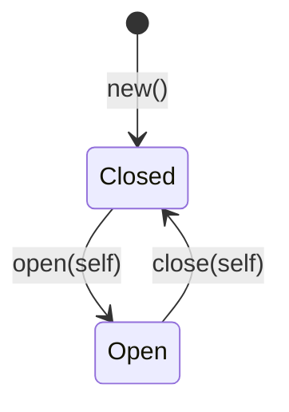


<div class="callout callout-summary" markdown="1">
<div class="callout-title callout-title--default" markdown="span">요약</div>

공항 보안 검색대를 한 번 통과한 승객에게는 탑승구마다 짐을 다시 뒤지지 않는다. 검사는 입구에서 한 번 하고, 통과했다는 표시(타입)를 붙여 안으로 들인다. 함수는 표시가 붙은 값만 받으므로 "검사를 깜빡한 값"이 들어올 길이 없다. 대가는 타입이 늘어나는 것이다. 모든 문자열을 감싸면 코드만 길어지니, 틀리면 사고가 나는 값에만 쓴다.

</div>


## 예시로 보기

회원 가입 함수가 이메일을 `String`으로 받는다고 하자. `@`가 있는지 검사하는 함수 `is_valid_email`도 있다. 문제는 검사를 부르는 걸 잊어도 컴파일된다는 것이다. 가입, 비밀번호 찾기, 알림 발송이 모두 `String`을 받으니 함수마다 다시 검사하거나, 어디선가 빠뜨린다.

방법을 바꾼다. "검사를 통과한 이메일"이라는 타입을 따로 만들고, 그 타입은 검사하는 함수로만 만들 수 있게 한다[^1].

```rust
mod domain {
    pub struct Email { value: String }      // 필드가 닫혀 있다

    impl Email {
        pub fn parse(raw: &str) -> Result<Self, EmailError> {
            let s = raw.trim();
            if s.is_empty() { return Err(EmailError::Empty); }
            let Some((local, domain)) = s.split_once('@') else {
                return Err(EmailError::MissingAt);
            };
            if local.is_empty() || !domain.contains('.') || domain.starts_with('.') {
                return Err(EmailError::BadDomain);
            }
            Ok(Self { value: s.to_ascii_lowercase() })
        }
        pub fn as_str(&self) -> &str { &self.value }
    }
}

fn send_welcome(to: &Email) { /* 다시 검사하지 않는다 */ }
```

필드 `value`에 `pub`이 없으므로 `domain` 모듈 밖에서 `Email { value: … }`로 직접 만들면 컴파일되지 않는다(E0451). 바깥에서 `Email`을 얻는 길은 `Email::parse`뿐이다. 그래서 `&Email`을 받는 함수는 "이 값은 검사를 통과했다"고 믿어도 된다[^1]. 이 검사는 아주 단순하게 줄인 것이다. 실제 서비스는 확인 메일을 보내 주소가 진짜인지 본다.

이 방식은 "검사하지 말고 해석하라(parse, don't validate)"라는 말로 불린다. 검사 함수가 `bool`을 돌려주면 그 결과는 다음 줄에서 잊힌다. 해석 함수가 새 타입을 돌려주면 검사 결과가 타입에 남는다.

<div class="callout callout-check" markdown="1">
<div class="callout-title" markdown="span">검증: E0308(뉴타입 섞임), E0451(닫힌 필드), E0392(표시 없는 타입 인자), E0599·E0382(타입 상태), 크기 0, `NonZero`, 이메일 해석 결과를 실행해 확인했다 — [14_type-driven-design_verify.rs](/Hongs_Blog/studies/rust/code/14_type-driven-design_verify/)</div>

</div>


## 네 가지 도구

### 1. 뉴타입: 같은 숫자라도 섞지 않기

값 하나를 튜플 구조체로 감싼 것을 뉴타입(newtype)이라 부른다. 필드 타입이 같아도 구조체마다 다른 타입이다[^7]. Rust API 지침의 예처럼 `f64`를 `Miles`와 `Kilometers`로 감싸면, `Miles`를 받는 함수에 `Kilometers`를 넣는 순간 E0308로 막힌다[^2].

```rust
struct Miles(f64);
struct Kilometers(f64);
fn drive(d: Miles) { … }
drive(Kilometers(3.0));   // error[E0308]: mismatched types
```

감싸도 크기는 그대로다. `Meters(f64)`는 `f64`와 같이 8바이트다. 실행 시간 비용 없이 컴파일 때만 구별한다.

같은 지침은 함수 인자에 `bool`이나 `Option`을 그대로 받지 말고 뜻을 담은 타입을 쓰라고 한다[^2]. `make_pizza(true, false)`는 무엇이 참인지 읽을 수 없다. `make_pizza(Size::Small, Shape::Round)`는 읽힌다.

### 2. 검사하는 생성자

위의 `Email::parse`가 이것이다. Rust Book의 `Guess` 예도 같다. 1~100 사이의 수만 담는 타입을 만들고, 필드를 닫고, 생성자에서만 범위를 검사한다. 그러면 `Guess`를 받는 함수는 본문에서 다시 검사할 필요가 없다[^1]. Book의 `Guess::new`는 범위를 벗어나면 패닉하지만, 바깥 입력을 받는 서비스에서는 `Result`를 돌려주는 쪽이 맞다.

std에는 이 모양을 위한 트레이트가 둘 있다.

- `TryFrom<T>`: 실패할 수 있는 변환이다. std 문서의 예도 0보다 큰 수만 받는 뉴타입 `GreaterThanZero`다[^3]. 구현하면 `let e: Email = raw.try_into()?;`처럼 쓴다.
- `FromStr`: 문자열에서 만드는 변환이다. 구현하면 `"12.5m".parse::<Meters>()`가 된다.

std에 이미 있는 뉴타입도 있다. `NonZero<u32>`(별칭 `NonZeroU32`)는 0이 아닌 수만 담는다. `NonZero::new(0)`은 `None`을 돌려준다[^4]. 0이 아님을 아니까 `Option<NonZero<u32>>`가 `u32`와 같은 4바이트가 된다([Option과 Result](/Hongs_Blog/studies/rust/option-result/)).

### 3. 열거형으로 말이 안 되는 조합 없애기

연결 상태를 `bool` 두 개로 적었다고 하자.

```rust
struct Conn { connected: bool, authenticated: bool, user: Option<String> }
```

조합은 $$2 \times 2 \times 2 = 8$$가지다. 그중 "연결 안 됐는데 로그인됨", "로그인 안 됐는데 사용자 이름 있음" 같은 말이 안 되는 조합이 섞여 있다. 코드 어딘가에서 이 조합이 만들어지지 않도록 사람이 계속 조심해야 한다.

열거형으로 바꾸면 말이 되는 세 상태만 남는다.

```rust
enum Conn {
    Disconnected,
    Connected { peer: String },
    Authenticated { peer: String, user: String },
}
```

사용자 이름은 `Authenticated`에만 있다. 로그인 안 된 연결에서 사용자 이름을 꺼내는 코드는 쓸 수조차 없다. 상태가 바뀌는 메서드는 `self`를 받아 새 상태를 돌려준다.

```rust
impl Conn {
    fn login(self, user: &str) -> Result<Conn, (Conn, &'static str)> {
        match self {
            Conn::Connected { peer } => Ok(Conn::Authenticated { peer, user: user.to_string() }),
            other => Err((other, "연결된 상태에서만 로그인할 수 있다")),
        }
    }
}
```

이 방식은 잘못된 순서를 **실행 중에** 걸러 낸다. 상태가 실행 중에 정해지는 경우(네트워크에서 온 이벤트)에 맞다.

### 4. 타입 상태: 잘못된 순서를 컴파일 때 막기

상태가 코드 흐름으로 정해지는 경우에는 상태를 타입 인자로 올린다. Rust Book의 블로그 글 예는 `DraftPost`, `PendingReviewPost`, `Post`를 서로 다른 타입으로 만든다. 초안에는 `content` 메서드가 없으므로 초안을 화면에 보여 주는 코드가 컴파일되지 않는다. 상태를 바꾸는 메서드는 `self`를 받아 옛 상태를 소비한다[^5].

상태마다 구조체를 따로 만들면 공통 필드와 메서드를 되풀이하게 된다. 그래서 상태를 크기 0짜리 표시 타입으로 두고 제네릭 인자에 넣는다.

```rust
struct Open;
struct Closed;

struct Door<State> {
    opened_count: u32,
    _state: PhantomData<State>,
}

impl Door<Closed> {
    fn new() -> Self { … }
    fn open(self) -> Door<Open> { … }      // 닫힌 문에만 있다
}
impl Door<Open> {
    fn close(self) -> Door<Closed> { … }   // 열린 문에만 있다
}
impl<S> Door<S> {
    fn opened_count(&self) -> u32 { self.opened_count }   // 어느 상태든
}
```

`PhantomData<State>`는 "이 구조체는 `State` 타입과 관련 있다"고 컴파일러에 알리는 크기 0짜리 표시다[^6]. 필드 어디에도 `State`를 쓰지 않은 채 타입 인자만 두면 컴파일러가 E0392(쓰이지 않은 타입 인자)로 거절하므로 이 표시가 필요하다. `Open`, `Closed`, `PhantomData<Open>` 모두 0바이트라서 `Door<Open>`은 `u32` 하나와 같은 4바이트다.



컴파일러가 막는 것은 둘이다.

| 잘못 | 막히는 이유 | 오류 |
|---|---|---|
| 열린 문을 또 `open()` | `Door<Open>`에는 `open`이 없다 | E0599 |
| `open()`한 뒤 옛 `Door<Closed>`를 다시 씀 | `open(self)`가 값을 가져갔다 | E0382 |

Book은 이 방식의 대가도 적는다. 상태가 바뀔 때마다 새 값을 받아 변수를 다시 묶어야 하고(`let post = post.approve();`), 상태 전환이 한 타입 안에 숨지 않는다. 그 대신 잘못된 상태가 컴파일 때 불가능해진다[^5].

## 무엇을 언제 쓰나

| 막고 싶은 실수 | 도구 | 언제 걸리나 |
|---|---|---|
| 단위·의미가 다른 같은 타입 값을 섞음 | 뉴타입 | 컴파일 |
| 검사 안 한 입력이 안쪽까지 들어감 | 닫힌 필드 + 검사하는 생성자 | 입구에서 실행 중 한 번 |
| 말이 안 되는 필드 조합 | 열거형 상태 | 컴파일(조합 자체가 없다) |
| 상태 순서를 어기는 호출 | 타입 상태 | 컴파일 |

## 활용

- **도메인 타입.** 사용자 ID, 주문 ID를 모두 `u64`로 두면 인자 순서를 바꿔 넣어도 컴파일된다. `UserId(u64)`, `OrderId(u64)`로 감싼다. 캡스톤 1에서 단축 URL의 코드와 원래 주소를 이렇게 만든다: [캡스톤 1 도메인 타입과 에러](/Hongs_Blog/studies/rust/capstone-1/)
- **경계에서 한 번만 해석.** HTTP 핸들러나 설정을 읽는 곳에서 바깥 입력을 도메인 타입으로 바꾸고, 안쪽 함수는 도메인 타입만 받는다. 실패는 [에러 열거형](/Hongs_Blog/studies/rust/library-errors/)으로 돌려준다.
- **빌더.** 필수 값이 빠진 채로 `build()`를 부르는 실수를 타입 상태로 막을 수 있다. API 지침은 필드가 많거나 선택 항목이 많은 값에 빌더를 권한다[^2]. 지침은 `&mut self`를 받고 돌려주는 빌더를 기본으로 권하고, 마지막 메서드가 소유권을 가져가야 할 때만 `self`를 받는 빌더를 쓰라고 한다[^2]. 타입 상태 빌더는 `self`를 받는 쪽이다.
- **흔한 실수.**
  - 뉴타입에 `pub` 필드를 둔다(`pub struct Email(pub String)`). 그러면 누구나 `Email("아무거나".into())`로 만들 수 있어 검사가 무의미해진다.
  - 뉴타입에 `Deref<Target = String>`를 구현해 `String`의 메서드를 모두 열어 준다. 그러면 `Email`이 그냥 문자열처럼 쓰여 따로 감싼 뜻이 흐려진다. 필요한 메서드(`as_str`)만 연다.
  - 상태가 실행 중에 정해지는데 타입 상태를 쓴다. "DB에서 읽은 주문이 결제됐는지"는 컴파일 때 모른다. 이때는 열거형 상태가 맞다.

## 연결

- 선수: [구조체와 메서드](/Hongs_Blog/studies/rust/structs-methods/)(튜플 구조체, `self`), [열거형과 패턴 매칭](/Hongs_Blog/studies/rust/enums-pattern-matching/), [Option과 Result](/Hongs_Blog/studies/rust/option-result/)(검사하는 생성자는 `Result`를 돌려준다)
- 필드를 닫는 규칙은 Java의 `private`과 같은 목적이다: [접근 제한자](/Hongs_Blog/studies/java/java-access-modifier/). 다른 점은 Rust의 공개 범위 단위가 클래스가 아니라 모듈이라는 것이다. 같은 모듈 안의 함수는 닫힌 필드를 볼 수 있다.
- 타입 인자와 `impl<S>`: [제네릭과 트레이트 경계](/Hongs_Blog/studies/rust/generics-trait-bounds/)
- 공개 API에서 이 원칙들: [API 설계 원칙](/Hongs_Blog/studies/rust/api-design/)

## 확인 문제

<details class="callout callout-question" markdown="1">
<summary class="callout-title" markdown="span">**C1** `pub struct Email(pub String);`과 `pub struct Email { value: String }` + `pub fn parse(...)`는 무엇이 다른가? 앞의 것으로는 왜 "검사를 통과한 이메일"을 보장할 수 없는가?</summary>

**답:** 앞의 것은 필드가 열려 있어 모듈 밖에서도 `Email("abc".into())`로 검사 없이 만들 수 있다. 뒤의 것은 필드가 닫혀 있어 밖에서 직접 만들면 E0451로 막히고, `parse`를 거쳐야만 값이 생긴다.<br>
**이유:** 보장의 근거는 "이 타입을 만드는 길이 검사 함수 하나뿐"이라는 사실이다. 만드는 길이 하나라도 더 열려 있으면 보장이 깨진다.

</details>


<details class="callout callout-question" markdown="1">
<summary class="callout-title" markdown="span">**C2** `struct Order { paid: bool, shipped: bool, tracking_no: Option<String> }`에서 만들 수 있지만 말이 안 되는 상태를 두 개 들어라. 그리고 그런 상태가 아예 없는 열거형으로 다시 써라.</summary>

**답:** 예: `paid: false, shipped: true`(돈을 안 냈는데 보냄), `shipped: false, tracking_no: Some(..)`(안 보냈는데 운송장 번호가 있음), `shipped: true, tracking_no: None`. 다시 쓰면 `enum Order { Pending, Paid, Shipped { tracking_no: String } }`.<br>
**이유:** 필드 셋의 조합은 8가지지만 실제 상태는 셋이다. 열거형은 실제 상태만 변형으로 두고, 운송장 번호를 `Shipped`에만 넣어 다른 상태에서는 꺼낼 수 없게 한다.<br>
**흔한 오답:** 생성자에서 조합을 검사하면 된다고 한다. 필드가 `pub`이거나 나중에 메서드가 필드를 따로 고치면 다시 깨진다.

</details>


<details class="callout callout-question" markdown="1">
<summary class="callout-title" markdown="span">**C3** 위의 `Email::parse`에 `" Kim@Corp.io"`, `"lee@corp"`, `""`, `"park@corp.io"`를 차례로 넣고, 성공이면 `as_str()`, 실패면 `{:?}`로 찍어 <code>&#124;</code>로 이으면?</summary>

**답:** <code>kim@corp.io &#124; BadDomain &#124; Empty &#124; park@corp.io</code><br>
**이유:** 첫째는 앞뒤 공백을 지우고 소문자로 바꾼다. 둘째는 `@` 뒤에 `.`이 없다. 셋째는 공백을 지우면 빈 문자열이라 `@`를 보기 전에 `Empty`로 끝난다.

</details>


[^1]: The Rust Programming Language, 9.3 To panic! or Not to panic!, Custom Types for Validation — https://doc.rust-lang.org/book/ch09-03-to-panic-or-not-to-panic.html
[^2]: Rust API Guidelines, Type safety(C-NEWTYPE, C-CUSTOM-TYPE, C-BUILDER) — https://rust-lang.github.io/api-guidelines/type-safety.html
[^3]: std 문서, Trait `std::convert::TryFrom` — https://doc.rust-lang.org/std/convert/trait.TryFrom.html
[^4]: std 문서, Struct `std::num::NonZero`(설명 본문, Layout, `new`) — https://doc.rust-lang.org/std/num/struct.NonZero.html
[^5]: The Rust Programming Language, 18.3 Implementing an Object-Oriented Design Pattern, Encoding States and Behavior as Types — https://doc.rust-lang.org/book/ch18-03-oo-design-patterns.html
[^6]: std 문서, Struct `std::marker::PhantomData` — https://doc.rust-lang.org/std/marker/struct.PhantomData.html
[^7]: The Rust Programming Language, 5.1 Defining and Instantiating Structs, Creating Different Types with Tuple Structs — https://doc.rust-lang.org/book/ch05-01-defining-structs.html

