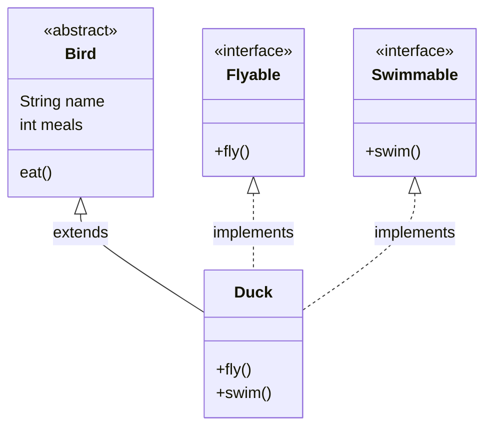


둘 다 `new`로 객체를 만들 수 없고, 몸통 없는 메서드를 두어 다른 클래스가 채우게 한다. 가르는 질문은 둘이다. "객체마다 다른 값을 담는 필드를 물려줘야 하는가"와 "한 클래스가 이것을 여러 개 가져야 하는가"다[^s1].

## 어느 쪽일까

**C1** (a) 개, 고양이, 새가 모두 이름과 나이를 갖고 같은 방식으로 숨을 쉰다. 우는 소리만 다르다. (b) TV, 조명, 에어컨은 서로 닮은 데가 없지만 모두 리모컨으로 켜고 끌 수 있어야 한다. 어느 쪽인가?

**답:** (a) 추상 클래스. 이름·나이 필드와 숨 쉬는 메서드를 부모에 한 번만 쓰고 물려준다. 인터페이스는 객체마다 다른 값을 담는 필드를 둘 수 없다. (b) 인터페이스. 물려줄 공통 필드가 없고, "켠다, 끈다"는 메서드 목록만 맞추면 된다.

**C2** (c) 오리는 새의 한 종류이면서 날 수도 있고 헤엄칠 수도 있다. 비행기도 날 수 있고 물고기도 헤엄칠 수 있다. `날 수 있다`와 `헤엄칠 수 있다`는 어느 쪽으로 만드는가? `새`는?

**답:** `날 수 있다`와 `헤엄칠 수 있다`는 인터페이스, `새`는 추상 클래스다. `class Duck extends Bird implements Flyable, Swimmable`로 쓴다. 
**이유:** 클래스는 부모를 하나만 둘 수 있다. 둘 다 추상 클래스로 만들면 오리는 하나만 고를 수밖에 없다. 인터페이스는 여러 개를 한꺼번에 구현할 수 있다. 또 비행기와 오리는 부모가 같을 이유가 없는데도 "난다"는 같은 목록에 넣을 수 있다.

## 결정적 차이

| | 추상 클래스 | 인터페이스 |
|---|---|---|
| 객체마다 다른 값을 담는 필드 | 둘 수 있다 | 둘 수 없다. 필드는 모두 `public static final` 상수다 |
| 생성자 | 있다. 자식 생성자가 `super(...)`로 부른다 | 없다 |
| 한 클래스가 가질 수 있는 수 | 부모는 하나뿐(`extends A`) | 여러 개(`implements A, B`) |
| 몸통 없는 메서드의 접근 범위 | `public`이 아니어도 된다 | 늘 `public` |
| 읽는 법 | 자식은 부모의 한 종류다 | 구현 클래스는 이 일을 할 수 있다 |
| `new`로 객체 만들기 | 안 된다 | 안 된다 |

위 네 줄이 선택을 바꾼다. 아래 두 줄은 선택에 따라오는 것과 둘이 같은 점이다[^1].

몸통이 있는 메서드는 양쪽 모두 둘 수 있다. 추상 클래스는 보통 메서드로, 인터페이스는 디폴트 메서드로 둔다([디폴트·정적·private 메서드](/Hongs_Blog/studies/software-project/java-interface-methods/)). 그래서 "몸통이 있느냐"는 둘을 가르지 못한다[^2].

실선 화살표(상속)는 `Duck`에서 하나만 나가고, 점선 화살표(구현)는 둘이 나간다[^s1].

검증: `Duck`을 `Bird`, `Flyable`, `Swimmable` 세 타입 변수에 넣어 부르기, 객체마다 따로 세는 `meals`, 인터페이스 필드의 `public static final`, 생성자 수(추상 클래스 1개, 인터페이스 0개) — [25_abstract-class-vs-interface_impl.java](/Hongs_Blog/studies/software-project/code/25_abstract-class-vs-interface_impl/)

## 둘 다 아닐 때

**C3** 둘 다 맞지 않는 상황 두 가지와 그때의 선택지를 쓰라.

**답:** ① 부모 자체도 객체로 만들어 써야 할 때 → `abstract` 없는 보통 클래스를 [상속](/Hongs_Blog/studies/software-project/java-inheritance/)한다. 추상 클래스로 두면 `new`가 막힌다. ② 한 종류도 아니고 같은 일을 하는 것도 아니고 그저 부품으로 쓸 때 → 상속도 구현도 하지 않고 필드로 가진다. 자동차는 타이어의 한 종류가 아니다. 자동차가 타이어를 필드로 가진다([다형성](/Hongs_Blog/studies/software-project/java-polymorphism/)의 `Car`와 `Tire`).

[^1]: 소프트웨어 프로젝트 11회 강의 자료 「Software Project 11. Interface (1)」, p.7 (인터페이스의 멤버 여섯 가지), p.9~11 (추상 클래스의 필드·생성자·메서드, `new` 불가). 소프트웨어 프로젝트 12회 강의 자료 「Software Project 12. Interface (2)」, p.3 (상수 필드), p.9 (인터페이스 여러 개 구현)
[^2]: 소프트웨어 프로젝트 12회 강의 자료 「Software Project 12. Interface (2)」, p.4 (디폴트 메서드는 실행할 수 있는 몸통을 가진다)
[^s1]: 보충 슬라이드는 두 개념을 따로 설명하고 나란히 비교하지 않는다. 가르는 질문 둘, 비교 표의 구성, `Bird`·`Flyable`·`Swimmable`·`Duck` 예와 그림, 카드 C1~C3은 원본에 없다. 표의 각 칸은 위 출처의 쪽에 있는 내용이고, 구현 코드와 JDK 21 컴파일로 확인했다. 부모를 둘 쓰면 `'{' expected`, 인터페이스에 생성자를 쓰면 `<identifier> expected` 오류가 난다.

