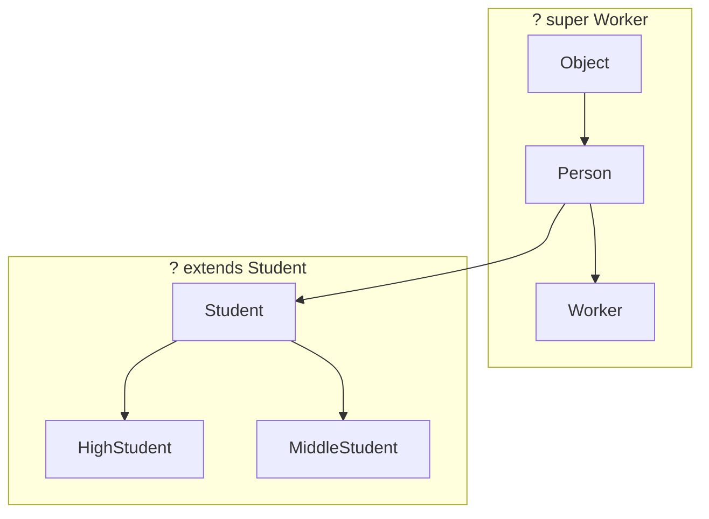


<div class="callout callout-summary" markdown="1">
<div class="callout-title callout-title--default" markdown="span">요약</div>

빈칸에 아무 종류나 들어오게 두면, 그 빈칸으로 받은 것에 "숫자로 바꿔라" 같은 일을 시킬 수 없다. 숫자가 아닌 것이 들어올 수도 있기 때문이다. 그래서 "숫자 집안만 들어올 수 있다"고 빈칸에 조건을 건다. 조건을 건 만큼 그 집안이 할 줄 아는 일을 마음 놓고 시킬 수 있다. 상자를 받는 쪽에서도 "학생 집안의 상자면 무엇이든" 또는 "직장인과 그 윗대의 상자면 무엇이든"처럼 범위로 받을 수 있다. 조심할 점은, 학생이 사람의 한 종류라고 해서 학생 상자가 사람 상자의 한 종류가 되지는 않는다는 것이다.

</div>


## 예시로 보기

두 값이 같은 크기인지 견주는 메서드를 [제네릭 메서드](/Hongs_Blog/studies/software-project/java-generics/)로 만든다. 정수든 실수든 받고 싶어서 타입을 빈칸 `T`로 두었다.

```java
public static <T> boolean compare(T t1, T t2) {
    double v1 = t1.doubleValue();
    …
}
```

```text
error: cannot find symbol
  symbol:   method doubleValue()
  location: variable t1 of type T
```

번역되지 않는다. `T` 자리에는 `String`도, 직접 만든 `Tv`도 올 수 있다. 그런 객체에는 `doubleValue()`가 없다. 번역기는 `T`가 무엇이든 될 수 있다고 보고, 모든 객체가 가진 메서드(`Object`의 메서드)만 부르게 한다[^s1].

`T`에 올 수 있는 타입을 `Number`와 그 자식으로 좁힌다[^1].

```java
public static <T extends Number> boolean compare(T t1, T t2) {
    double v1 = t1.doubleValue();   // Number의 doubleValue() 메서드 사용
    double v2 = t2.doubleValue();
    return (v1 == v2);
}
```

| 호출 | 결과 | 까닭 |
|---|---|---|
| `compare(10, 20)` | `false` | 10.0과 20.0은 다르다 |
| `compare(10, 10.0)` | `true` | `Integer` 10과 `Double` 10.0을 둘 다 실수 10.0으로 바꿔 견준다 |
| `compare(4.5, 4.5)` | `true` | |
| `compare("a", "b")` | 번역 오류 | `String`은 `Number`의 자식이 아니다 |

`Integer`와 `Double`은 모두 `Number`의 자식이다. `Number`에 `doubleValue()`가 있으므로 `T`가 그 가운데 무엇이 되든 이 메서드를 부를 수 있다[^s1].

## 정의

### 제한된 타입 파라미터

**제한된 타입 파라미터**는 아무 타입으로나 바꿀 수 없고, 어떤 클래스의 자식이거나 어떤 인터페이스를 구현했다는 관계가 있는 타입으로만 바꿀 수 있는 타입 파라미터다[^1].

```java
public <T extends 상위타입> 리턴타입 메서드(매개변수, …) { … }
```

`extends` 뒤의 상위 타입은 클래스여도 되고 인터페이스여도 된다[^1]. 인터페이스일 때도 `implements`가 아니라 `extends`를 쓴다. 상위 타입 자신도 들어올 수 있다[^s1].

### 와일드카드

**와일드카드**는 제네릭 타입을 매개변수나 돌려주는 타입으로 쓸 때, 타입 파라미터 자리에 어떤 범위 안의 타입이면 무엇이든 올 수 있게 하는 표시다. `?`로 쓴다[^2].

| 적는 법 | 받는 범위 |
|---|---|
| `제네릭타입<? extends Student>` | `Student`와 그 자손 |
| `제네릭타입<? super Worker>` | `Worker`와 그 조상 |
| `제네릭타입<?>` | 모든 타입 |

슬라이드의 클래스들로 범위를 그린다. `Worker`와 `Student`는 `Person`의 자식이고, `HighStudent`와 `MiddleStudent`는 `Student`의 자식이다[^2][^3].



화살표는 부모에서 자식으로 간다. `extends`는 기준 타입에서 아래쪽(자손)으로, `super`는 기준 타입에서 위쪽(조상)으로 범위를 잡는다[^s2].

지원자를 담는 제네릭 클래스와, 지원자를 받아 수강 신청을 하는 메서드 셋이다[^3][^4].

```java
public class Applicant<T> {
    public T kind;
    public Applicant(T kind) {
        this.kind = kind;
    }
}
```

```java
public class Course {
    // 누구나 신청할 수 있다
    public static void registerCourse1(Applicant<?> applicant) {
        System.out.println(applicant.kind.getClass().getSimpleName() + " registered the Course1.");
    }

    // 학생만 신청할 수 있다
    public static void registerCourse2(Applicant<? extends Student> applicant) {
        System.out.println(applicant.kind.getClass().getSimpleName() + " registered the Course2.");
    }

    public static void registerCourse3(Applicant<? super Worker> applicant) {
        System.out.println(applicant.kind.getClass().getSimpleName() + " registered the Course3.");
    }
}
```

`new Applicant<Person>(new Person())`처럼 지원자를 만들어 세 메서드에 넘긴 결과다[^5].

| 넘긴 것 | `registerCourse1` (`?`) | `registerCourse2` (`? extends Student`) | `registerCourse3` (`? super Worker`) |
|---|---|---|---|
| `Applicant<Person>` | 된다 | 번역 오류 | 된다 |
| `Applicant<Worker>` | 된다 | 번역 오류 | 된다 |
| `Applicant<Student>` | 된다 | 된다 | 번역 오류 |
| `Applicant<HighStudent>` | 된다 | 된다 | 번역 오류 |
| `Applicant<MiddleStudent>` | 된다 | 된다 | 번역 오류 |

되는 칸은 실행하면 `Person registered the Course1.`처럼 한 줄씩 찍힌다. 번역 오류 칸의 문구는 이렇다[^s3].

```text
error: incompatible types: Applicant<Person> cannot be converted to Applicant<? extends Student>
error: incompatible types: Applicant<Student> cannot be converted to Applicant<? super Worker>
```

<div class="callout callout-check" markdown="1">
<div class="callout-title" markdown="span">검증: `compare` 표의 세 줄, 슬라이드 `Main`의 출력 9줄, 와일드카드 변수에서 꺼내고 넣는 것, 카드 C4의 답 — [39_java-bounded-wildcard_impl.java](/Hongs_Blog/studies/software-project/code/39_java-bounded-wildcard_impl/). 표의 번역 오류 칸과 카드 C3의 답은 JDK 21 javac로 따로 확인했다.</div>

</div>


<div class="callout callout-warning" markdown="1">
<div class="callout-title" markdown="span">원본 오류 의심</div>

원문: p.14 코드의 주석 "Only Worker can register the Course3" / 문제점: `registerCourse3`의 매개변수는 `Applicant<? super Worker>`라서 `Worker`뿐 아니라 그 조상인 `Person`도 받는다. 같은 쪽의 코드도 `Applicant<Person>`을 넘기고 있다. / 수정안: "Worker와 그 조상(Person)만 신청할 수 있다" / 근거: `registerCourse3(new Applicant<Person>(new Person()))`이 번역되고 `Person registered the Course3.`를 찍는다(검증 코드).

</div>


### 둘은 어떻게 다른가

| | 제한된 타입 파라미터 | 와일드카드 |
|---|---|---|
| 모양 | `<T extends Number>` | `Applicant<? extends Student>` |
| 쓰는 자리 | 타입 파라미터를 선언하는 자리 | 이미 있는 제네릭 타입을 매개변수·돌려주는 타입으로 쓰는 자리 |
| 이름 | `T`라는 이름이 생긴다. 메서드 안에서 `T`를 타입으로 쓸 수 있다 | 이름이 없다 |
| 범위 | 위쪽 끝만 정한다(`extends`) | 위쪽 끝(`extends`)이나 아래쪽 끝(`super`)을 정한다 |

`compare(T t1, T t2)`처럼 "두 인자가 같은 타입 빈칸을 나눠 쓴다"는 것을 적으려면 이름이 있어야 하므로 타입 파라미터를 쓴다. "이 범위의 상자면 된다"만 말하면 될 때는 와일드카드가 짧다[^s2].

### 스스로 설명해 보기

<details class="callout callout-question" markdown="1">
<summary class="callout-title" markdown="span">1. `<T extends Number>`로 바꾸자 `t1.doubleValue()`가 번역되는 이유</summary>

번역기는 `T`로 선언한 변수에서, `T`가 무엇이 되든 반드시 있는 메서드만 부르게 한다. 조건이 없으면 `T`는 어떤 객체든 될 수 있어 `Object`의 메서드만 남는다. `extends Number`를 붙이면 `T`는 `Number`이거나 그 자손이고, 자손은 부모의 메서드를 물려받으므로 `doubleValue()`가 반드시 있다.

</details>


<details class="callout callout-question" markdown="1">
<summary class="callout-title" markdown="span">2. `registerCourse2`에 `Applicant<Person>`을 넘기면 안 되는 이유</summary>

`? extends Student`는 `Student`와 그 자손만 받는다. `Person`은 `Student`의 부모라서 범위 밖이다. `Person` 객체는 학생이 아닐 수 있다.

</details>


<details class="callout callout-question" markdown="1">
<summary class="callout-title" markdown="span">3. `registerCourse3`에 `Applicant<Student>`를 넘기면 안 되는 이유</summary>

`? super Worker`는 `Worker`와 그 조상(`Person`, `Object`)만 받는다. `Student`는 `Worker`의 조상이 아니다. 둘은 부모(`Person`)가 같은 형제다.

</details>


<details class="callout callout-question" markdown="1">
<summary class="callout-title" markdown="span">이 문서의 핵심 아이디어는?</summary>

빈칸에 들어올 타입의 범위를 좁히면, 좁힌 만큼 그 범위의 타입이 공통으로 가진 것을 믿고 쓸 수 있다. 범위는 상속 관계의 위아래로 잡는다.

</details>


<details class="callout callout-question" markdown="1">
<summary class="callout-title" markdown="span">이 방법을 쓸 수 있는 다른 상황은?</summary>

크기를 견줄 수 있는 것들 가운데 가장 큰 것 고르기. `<T extends Comparable<T>> T max(T a, T b)`로 선언하면 `a.compareTo(b)`를 부를 수 있다. 위쪽 끝이 [인터페이스](/Hongs_Blog/studies/software-project/java-interface/)인 경우다. `max(3, 8)`은 8, `max("apple", "banana")`는 `"banana"`를 돌려준다.

</details>


## 활용

- `extends`로 범위를 잡은 상자에서는 꺼내 쓰기가 안전하다. `Applicant<? extends Student> a`의 `a.kind`는 적어도 `Student`이므로 `Student` 변수로 받을 수 있다. 반대로 `a.kind = new Student();`는 번역되지 않는다. 실제 상자가 `Applicant<HighStudent>`일 수도 있기 때문이다[^s3].
- `super`로 범위를 잡은 상자에는 넣기가 안전하다. `Applicant<? super Student> b`에는 `b.kind = new Student();`를 쓸 수 있다. 실제 상자가 `Applicant<Person>`이든 `Applicant<Object>`든 `Student`는 들어간다. 꺼낼 때는 `Object`로만 받을 수 있다[^s3].
- `Applicant<?>`에서 꺼낸 것은 `Object`로만 받을 수 있다. 슬라이드의 세 메서드가 `kind`에서 `getClass()`만 부르는 이유다. `getClass()`는 `Object`의 메서드다.
- 오류 문구의 `cannot be converted to Applicant<? extends Student>`는 "넘긴 상자의 타입이 범위 밖"이라는 뜻이다. 넘긴 쪽의 `< >` 안 타입이 기준 타입의 위인지 아래인지를 그림에서 찾는다.

## 연결

- 선수: [제네릭](/Hongs_Blog/studies/software-project/java-generics/), [상속](/Hongs_Blog/studies/software-project/java-inheritance/)(범위는 부모·자식 관계로 잡는다)
- `extends` 범위의 상자에서 꺼낸 것을 기준 타입으로 받을 수 있는 것은 자식 객체를 부모 타입 변수에 넣는 [자동 타입 변환](/Hongs_Blog/studies/software-project/java-casting/) 덕분이다.
- [다형성](/Hongs_Blog/studies/software-project/java-polymorphism/)은 "자식 객체는 부모 타입 자리에 들어간다"이다. 아래 오해 항목은 이 규칙이 상자 타입까지 따라오지는 않는다는 이야기다.

## 자주 하는 오해

<div class="callout callout-misconception" markdown="1">
<div class="callout-title" markdown="span">"`Student`가 `Person`의 자식이니 `Applicant<Student>`도 `Applicant<Person>`의 자식이다"</div>

틀렸다. `Student` 객체는 `Person` 변수에 들어가지만, `Applicant<Student>` 객체는 `Applicant<Person>` 변수에 들어가지 않는다. `Applicant<Person> p = new Applicant<Student>(new Student());`는 `incompatible types: Applicant<Student> cannot be converted to Applicant<Person>` 오류로 번역되지 않는다. 그럴듯해 보이는 이유는 "학생 지원자도 사람 지원자다"가 말로는 맞기 때문이다. 왜 막는지는 이 줄이 된다고 쳐 보면 보인다. `p`는 `Applicant<Person>`이니 `p.kind = new Worker();`를 쓸 수 있다. 그런데 실제 객체는 학생 상자다. 학생 상자에 직장인이 들어가 버린다. 자식 타입의 상자까지 받고 싶으면 `Applicant<? extends Person>`으로 받는다. 이 변수로는 `kind`에 새 객체를 넣을 수 없으므로 위와 같은 사고가 나지 않는다.

</div>


## 확인 문제

<details class="callout callout-question" markdown="1">
<summary class="callout-title" markdown="span">**C1** `<T extends Number>`, `Applicant<? extends Student>`, `Applicant<? super Worker>`, `Applicant<?>`가 각각 받는 타입의 범위를 쓰라.</summary>

**답:** 차례로 `Number`와 그 자손(`Integer`, `Double` 등) / `Student`와 그 자손을 담은 `Applicant` / `Worker`와 그 조상을 담은 `Applicant` / 무엇을 담았든 모든 `Applicant`.<br>
**이유:** 기준 타입 자신도 범위에 든다. `extends`는 아래쪽, `super`는 위쪽이다. `super`를 "자식만"으로 뒤집어 외우는 실수가 잦다.

</details>


<details class="callout callout-question" markdown="1">
<summary class="callout-title" markdown="span">**C2** `public static <T> boolean compare(T t1, T t2)` 안에서 `t1.doubleValue()`를 부르면 번역되지 않는다. `compare(10, 20)`처럼 숫자만 넘길 생각인데도 왜 안 되는가?</summary>

**답:** 번역기는 메서드를 부르는 쪽이 무엇을 넘길지 모르는 채로 메서드 몸통을 검사한다. `T`에 조건이 없으면 `String`이 올 수도 있고, `String`에는 `doubleValue()`가 없다. 그래서 `Object`의 메서드만 부르게 한다. `<T extends Number>`로 "숫자 집안만 온다"를 선언에 적어야 한다.<br>
**이유:** 조건은 머릿속 계획이 아니라 선언에 적힌 것만 통한다. 적어 두면 `compare("a", "b")` 같은 잘못된 호출도 번역 때 걸러진다.

</details>


<details class="callout callout-question" markdown="1">
<summary class="callout-title" markdown="span">**C3** 본문의 클래스와 `Course`를 쓴다. 번역 오류가 나는 줄을 모두 고르라. ① `Course.registerCourse2(new Applicant<MiddleStudent>(new MiddleStudent()));` ② `Course.registerCourse3(new Applicant<Object>(new Object()));` ③ `Course.registerCourse3(new Applicant<MiddleStudent>(new MiddleStudent()));` ④ `Course.registerCourse2(new Applicant<Person>(new Person()));`</summary>

**답:** ③과 ④다.<br>
**이유:** ③: `? super Worker`는 `Worker`, `Person`, `Object`만 받는다. `MiddleStudent`는 `Worker`의 조상이 아니다. ④: `? extends Student`는 `Student`와 그 자손만 받는다. `Person`은 부모다. ①은 `MiddleStudent`가 `Student`의 자식이라 되고, ②는 `Object`가 모든 클래스의 조상이라 된다.

</details>


<details class="callout callout-question" markdown="1">
<summary class="callout-title" markdown="span">**C4** `static <T extends Number> double half(T t) { return t.doubleValue() / 2; }`가 있다. `System.out.println(half(7));`과 `System.out.println(half(2.5));`의 출력은? `half("7")`은 어떻게 되는가?</summary>

**답:** `3.5`와 `1.25`. `half("7")`은 번역 오류다.<br>
**이유:** `half(7)`에서 `T`는 `Integer`이고 `doubleValue()`가 7.0을 돌려주므로 7.0 / 2 = 3.5다. 정수 나눗셈으로 3이 나온다고 답하면 틀린다. `"7"`은 `String`이라 `Number`의 범위 밖이다.

</details>


<details class="callout callout-question" markdown="1">
<summary class="callout-title" markdown="span">**C5** "`Applicant<Student>`를 `Applicant<Person>` 변수에 넣을 수 있게 허락해도 문제없다"는 주장이 틀렸음을 보이는 코드 두 줄을 쓰라(허락됐다고 치고).</summary>

**답:** `Applicant<Person> p = new Applicant<Student>(new Student());` 다음에 `p.kind = new Worker();`.<br>
**이유:** `p`의 타입으로 보면 `kind`는 `Person`이라 `Worker`를 넣을 수 있다. 하지만 실제 객체는 학생 상자이므로, 이 상자를 `Applicant<Student>`로 알고 있는 다른 코드가 `kind`를 `Student`로 꺼내는 순간 깨진다. 자바는 첫 줄을 번역 단계에서 막아 이 일을 없앤다.

</details>


[^1]: 소프트웨어 프로젝트 17회 강의 자료 「Software Project 17. Generics」, p.10 (제한된 타입 파라미터, compare 메서드)
[^2]: 같은 자료, p.11 (와일드카드의 뜻, 세 가지 적는 법, 클래스 계층과 범위 그림)
[^3]: 같은 자료, p.12 (Person, Worker, Student, HighStudent, MiddleStudent, `Applicant<T>`)
[^4]: 같은 자료, p.13 (Course의 registerCourse1·2·3. 주석 "anyone can register the course", "only student can register the course")
[^5]: 같은 자료, p.14 (Main. 번역되지 않는 네 줄은 주석으로 막혀 있다)
[^s1]: <span class="fn-tag" title="수업 자료에 없고 따로 보탠 내용">보충</span> 조건 없는 `<T>`로 먼저 만들어 본 예와 오류 문구, `compare`를 부른 결과 표, "인터페이스일 때도 `extends`", "상위 타입 자신도 된다"는 원본에 없다. 결과는 검증 코드로, 오류 문구는 JDK 21 javac로 확인했다. 원본 p.10의 `compare`에는 `static`이 없다.
[^s2]: <span class="fn-tag" title="수업 자료에 없고 따로 보탠 내용">보충</span> 다이어그램은 원본 p.11의 그림을 Mermaid로 다시 그리고 `Object`를 더한 것이다(원본 그림의 `? super Worker` 범위는 `Person`과 `Worker`만 둘러싼다). 둘을 견준 표, 스스로 설명해 보기, `max` 예는 원본에 없다. `max`의 결과와 `Applicant<Object>`가 `registerCourse3`에 넘어가는 것은 직접 확인했다.
[^s3]: <span class="fn-tag" title="수업 자료에 없고 따로 보탠 내용">보충</span> 표는 원본 p.14의 호출 13줄을 정리한 것이다. 표의 `registerCourse2`·`registerCourse3`에 `Applicant<MiddleStudent>`를 넘긴 두 칸은 원본에 없어 직접 확인했다. 원본의 출력 문자열은 클래스 이름과 `registered` 사이에 빈칸이 없다(`"registered the Course1."`). 여기서는 빈칸을 넣었다. 오류 문구, 와일드카드 변수에서 꺼내고 넣는 규칙, 오해 항목, 카드 C2~C5는 원본에 없고 JDK 21에서 확인했다.

