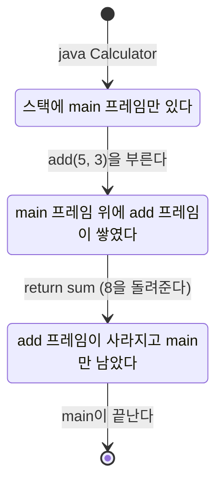


<div class="callout callout-summary" markdown="1">
<div class="callout-title callout-title--default" markdown="span">요약</div>

정수 같은 작은 값은 변수라는 칸에 그대로 들어간다. 배열이나 문자열처럼 큰 것은 따로 넓은 창고에 두고, 변수에는 그것이 있는 자리 번호만 적어 둔다. 집을 통째로 들고 다니지 않고 주소가 적힌 쪽지를 들고 다니는 것과 같다. 쪽지는 베끼기 쉬워서 큰 것을 싸게 주고받을 수 있다. 대신 쪽지를 베껴 가진 두 사람이 같은 집을 보고 있으므로, 한쪽이 집을 고치면 다른 쪽에게도 고쳐진 집이 보인다.

</div>


## 예시로 보기

학생 30명의 점수를 변수 30개에 담을 수는 없다. 한 덩어리로 묶은 배열이 필요하다. 그런데 배열은 크기가 제각각이라, 크기가 정해진 변수 칸에 통째로 넣을 수 없다. 그래서 자바는 덩어리를 다른 곳에 두고 변수에는 그곳의 주소만 넣는다.

이 차이는 변수를 다른 변수에 넣을 때 드러난다.

```java
int age = 20;
int copy = age;
copy = 30;
System.out.println(age);     // 20

int[] p = {1, 2, 3};
int[] q = p;
q[0] = 99;
System.out.println(p[0]);    // 99
```

위쪽은 `copy`를 고쳐도 `age`가 그대로다. 아래쪽은 `q`로 고쳤는데 `p`로 봐도 바뀌어 있다. 두 경우 모두 자바가 한 일은 같다. 변수 칸에 든 것을 그대로 베꼈다. 다만 칸에 든 것이 다르다.

```
 기본 타입: 칸에 값이 들어 있다        참조 타입: 칸에 주소가 들어 있다

 age  [ 20 ]                           p [ 5번지 ] ----+
 copy [ 30 ]   <- 20을 베낀 뒤 30으로                  +--> 5번지: [99][2][3]
                                       q [ 5번지 ] ----+
                                         (5번지라는 주소를 베꼈다)
```

`q = p`는 배열을 하나 더 만들지 않는다. 주소가 적힌 쪽지를 한 장 더 쓸 뿐이다. 그림의 "5번지"는 설명을 위해 지어낸 번호다. 자바는 실제 주소를 보여 주지 않는다[^s1].

<div class="callout callout-check" markdown="1">
<div class="callout-title" markdown="span">검증: 위 출력 20과 99, `Calculator` 예제의 출력 `5 + 3 = 8`, 메서드에 넘긴 `int`와 배열의 변화, 매개변수에 새 배열을 넣어도 원래 변수가 그대로인 것, 끝없는 재귀의 `StackOverflowError`, 카드 C2·C5 — [07_java-reference-types_impl.java](/Hongs_Blog/studies/software-project/code/07_java-reference-types_impl/)</div>

</div>


## 참조 타입

타입은 두 갈래다[^1].

| | 기본 타입 | 참조 타입 |
|---|---|---|
| 변수에 든 것 | 값 자체 | 객체가 만들어진 곳의 메모리 주소 |
| 종류 | 정수(`byte`, `char`, `short`, `int`, `long`), 실수(`float`, `double`), 논리(`boolean`) | 배열, 열거, 클래스, 인터페이스 |

객체는 메모리에 만들어진 데이터 덩어리다. 배열도 문자열도 객체다. 참조 타입 변수는 객체의 주소를 "참조한다"[^1]. 이름표 `p`가 가리키는 곳을 따라가면 객체가 있다는 뜻이다.

```java
int age = 20;                // 기본 타입: 칸에 20
String name = "박은지";      // 참조 타입: 칸에 문자열 객체의 주소
```

<div class="callout callout-warning" markdown="1">
<div class="callout-title" markdown="span">원본 오류 의심</div>

원문: 슬라이드 p.3의 코드 `float height = 170.5;` / 문제점: 이 줄은 컴파일되지 않는다. 소수점이 있는 리터럴은 `double`이고, `double`을 `float`에 넣으려면 변환이 필요하다. / 수정안: `float height = 170.5f;` 또는 `double height = 170.5;` / 근거: JDK 21의 `javac`가 `incompatible types: possible lossy conversion from double to float`라고 알린다.

</div>


## 세 메모리 영역

JVM은 운영체제에서 받은 메모리를 세 영역으로 나눠 쓴다[^2].

| 영역 | 들어가는 것 | 생기고 사라지는 때 |
|---|---|---|
| 메서드 영역(Method Area) | 바이트코드 파일을 읽어 들인 내용. 클래스마다 상수, 정적 필드, 메서드 코드, 생성자 코드 | 클래스를 읽어 들일 때 |
| 힙 영역(Heap Area) | 객체. 배열, 문자열 등 | `new`로 만들 때 생기고, 아무도 가리키지 않으면 JVM이 치운다 |
| 스택 영역(Stack Area) | 프레임. 메서드를 부를 때마다 하나씩 생기고, 그 안에 그 메서드의 변수가 들어간다 | 메서드를 부를 때 생기고 끝나면 사라진다 |

힙에 있는 객체의 주소는 메서드 영역의 상수와 스택의 변수가 들고 있다[^2]. 스택은 실행 줄기(스레드)마다 하나씩 따로 있고, 메서드 영역과 힙은 모두가 같이 쓴다[^3].

슬라이드의 `Calculator`로 따라가 본다[^3].

```java
public class Calculator {
    public static int add(int a, int b) {
        int sum = a + b;
        return sum;
    }

    public static void main(String[] args) {
        int result = add(5, 3);
        System.out.println("5 + 3 = " + result);   // 5 + 3 = 8
    }
}
```

`add` 안의 `int sum = a + b;`를 막 실행한 순간의 메모리다[^s2].

```
 메서드 영역                  스택 영역 (main 스레드)          힙 영역
+----------------------+    +--------------------------+    +------------------+
| Calculator 클래스    |    | add의 프레임   <- 맨 위  |    |                  |
|   add의 코드         |    |   a   = 5                |    |  String[] (길이 0)|
|   main의 코드        |    |   b   = 3                |    |        ^         |
|   상수 "5 + 3 = "    |    |   sum = 8                |    |        |         |
+----------------------+    +--------------------------+    |        |         |
                            | main의 프레임            |    |        |         |
                            |   args   = (주소) -------------------- +         |
                            |   result = (아직 없음)   |    |                  |
                            +--------------------------+    +------------------+
```



1. JVM이 `Calculator.class`를 읽어 메서드 영역에 올린다.
2. `main`을 부른다. 스택에 `main`의 프레임이 생기고 그 안에 `args`와 `result` 자리가 잡힌다.
3. `add(5, 3)`을 부른다. `main` 프레임 위에 `add`의 프레임이 쌓인다. 5와 3이 `a`와 `b`에 베껴진다.
4. `add`가 끝난다. 8을 돌려주고 `add`의 프레임이 통째로 사라진다. `a`, `b`, `sum`도 함께 사라진다.
5. 돌려받은 8이 `main` 프레임의 `result`에 들어간다.

접시를 쌓듯 나중에 쌓인 프레임이 먼저 치워진다. 스택(쌓아 올린 더미)이라는 이름이 여기서 왔다. [변수의 범위](/Hongs_Blog/studies/software-project/java-primitive-types/)가 블록으로 끊기는 것도 변수가 프레임 안에 살기 때문이다.

## 지켜 주는 것과 지켜 주지 않는 것

**지켜 주는 것**[^s3].

- 메서드의 변수는 그 메서드의 프레임 안에만 있다. 다른 메서드가 이름으로 건드릴 수 없다.
- 변수를 다른 변수에 넣거나 메서드에 넘길 때는 늘 칸에 든 것을 베낀다. 기본 타입이면 값이, 참조 타입이면 주소가 베껴진다.
- 객체는 그것을 가리키는 변수가 하나라도 남아 있으면 사라지지 않는다. 그 객체를 만든 메서드가 끝난 뒤에도 그렇다.

**지켜 주지 않는 것.**

- 아무도 가리키지 않게 된 객체를 언제 치우는지는 정해져 있지 않다. JVM이 알아서 정한다. 이 청소가 가비지 컬렉션이다.
- 주소 값 자체는 볼 수도 계산에 쓸 수도 없다. C의 포인터처럼 주소에 1을 더해 옆 칸으로 가는 일은 못 한다.
- 같은 객체를 가리키는 변수가 여럿일 때, 한 변수로 고친 것을 다른 변수에게 숨겨 주지 않는다.

**무너지는 경우.**

| 상황 | 일어나는 일 | 대처 |
|---|---|---|
| 메서드가 자기 자신을 끝없이 부른다 | 프레임이 계속 쌓여 스택이 꽉 찬다. `StackOverflowError`로 멈춘다 | 재귀가 끝나는 조건을 둔다 |
| 객체를 계속 만들면서 모두 붙잡고 있다 | 힙이 꽉 찬다. `OutOfMemoryError`로 멈춘다 | 안 쓰는 객체를 가리키는 변수를 없앤다 |
| 변수가 아무 객체도 가리키지 않는데 객체를 쓰려 한다 | `NullPointerException`으로 멈춘다 | [참조 비교와 null](/Hongs_Blog/studies/software-project/java-reference-equality/) |

### 스스로 설명해 보기

아래 코드의 각 줄이 끝난 뒤 스택과 힙이 어떻게 되는지 답한다[^s2].

```java
static void addTenToFirst(int[] arr) { arr[0] += 10; }
static void replace(int[] arr) { arr = new int[] {7, 7, 7}; arr[0] = 100; }

int[] data = {5, 6};       // 1
addTenToFirst(data);       // 2
replace(data);             // 3
```

<details class="callout callout-question" markdown="1">
<summary class="callout-title" markdown="span">1. 1번 줄에서 무엇이 어디에 생기는가</summary>

힙에 길이 2인 배열 `[5][6]`이 생긴다. `main` 프레임의 `data` 칸에 그 배열의 주소가 들어간다. 배열은 객체라서 힙에, 변수는 메서드의 것이라 스택에 있다(표의 힙·스택 줄).

</details>


<details class="callout callout-question" markdown="1">
<summary class="callout-title" markdown="span">2. 2번 줄이 끝나면 `data[0]`은 얼마이고, 왜 그런가</summary>

15다. 메서드를 부를 때 `data` 칸의 주소가 `arr` 칸에 베껴진다("늘 칸에 든 것을 베낀다"). `arr`와 `data`가 같은 배열을 가리키므로 `arr[0] += 10`은 그 하나뿐인 배열의 첫 칸을 고친다. 프레임은 사라져도 힙의 배열은 `data`가 가리키고 있어 남는다.

</details>


<details class="callout callout-question" markdown="1">
<summary class="callout-title" markdown="span">3. 3번 줄이 끝나면 `data[0]`은 100인가</summary>

아니다. 15 그대로다. `arr = new int[] {7, 7, 7}`은 `arr` 칸에 새 배열의 주소를 덮어쓴다. `arr` 칸은 `replace`의 프레임에 있고 `data` 칸은 `main`의 프레임에 있다. 서로 다른 칸이라 `data`는 여전히 처음 배열을 가리킨다. 100은 새 배열에 들어갔고, `replace`가 끝나면 그 배열을 가리키는 변수가 없어 쓰레기가 된다.

</details>


<details class="callout callout-question" markdown="1">
<summary class="callout-title" markdown="span">이 추적의 핵심 생각은?</summary>

"칸을 고치는가, 칸이 가리키는 객체를 고치는가"를 가른다. `arr[0] = ...`은 객체를 고친다. 그 객체를 가리키는 모두에게 보인다. `arr = ...`은 칸을 고친다. 그 칸의 주인에게만 보인다.

</details>


<details class="callout callout-question" markdown="1">
<summary class="callout-title" markdown="span">같은 생각을 쓸 수 있는 다른 상황은?</summary>

두 변수가 같은 배열을 가리킬 때의 대입(`q = p; q[0] = 99;`), 배열 칸에 든 객체(`String[]`의 각 칸도 주소다, [배열](/Hongs_Blog/studies/software-project/java-array/)), 2차원 배열을 복사했는데 안쪽 배열은 같이 쓰이는 경우.

</details>


## 활용

- 큰 배열을 메서드에 넘겨도 느려지지 않는다. 주소 하나만 베끼기 때문이다[^s3].
- 넘겨받은 배열을 메서드 안에서 고치면 부른 쪽 배열이 바뀐다. 원본을 지켜야 하면 복사본을 만들어 넘긴다([배열](/Hongs_Blog/studies/software-project/java-array/)의 복사).
- 흔한 실수: 배열을 "백업"한다며 `int[] backup = data;`라고 쓴다. 쪽지만 한 장 더 생겼을 뿐 배열은 하나다.
- 스택은 스레드마다 따로 있고 힙은 같이 쓴다. 그래서 여러 스레드가 지역 변수로 다투는 일은 없고, 힙의 객체를 두고 다툰다([스레드](/Hongs_Blog/studies/operating-systems/thread/)).

## 연결

- 선수: [JVM과 바이트코드](/Hongs_Blog/studies/software-project/jvm-bytecode/), [변수와 기본 타입](/Hongs_Blog/studies/software-project/java-primitive-types/)
- 주소끼리 비교하기, 주소가 없는 상태: [참조 비교와 null](/Hongs_Blog/studies/software-project/java-reference-equality/)
- 참조 타입의 두 대표: [String](/Hongs_Blog/studies/software-project/java-string/), [배열](/Hongs_Blog/studies/software-project/java-array/)
- 운영체제가 프로세스에 주는 메모리도 프로그램, 데이터, 스택으로 나뉜다: [프로세스 제어 블록](/Hongs_Blog/studies/operating-systems/process-control-block/). JVM의 세 영역은 그 안에서 JVM이 다시 나눈 것이다.
- 스레드마다 스택이 따로 있는 이유: [스레드](/Hongs_Blog/studies/operating-systems/thread/)

## 자주 하는 오해

<div class="callout callout-misconception" markdown="1">
<div class="callout-title" markdown="span">"배열 변수를 다른 변수에 넣으면 배열이 복사된다"</div>

틀렸다. 복사되는 것은 주소다. 배열은 여전히 하나이고 그것을 가리키는 변수가 둘이 된다. `int b = a;`가 값을 복사하니까 `int[] q = p;`도 내용을 복사하리라 믿기 쉽다. 실제로 두 줄은 똑같이 "칸에 든 것"을 복사한다. 다만 `int` 칸에는 값이, `int[]` 칸에는 주소가 들어 있다. 확인하는 법: `q[0] = 99;` 뒤에 `p[0]`을 찍으면 99가 나온다. `p == q`도 `true`다.

</div>


<div class="callout callout-misconception" markdown="1">
<div class="callout-title" markdown="span">"메서드에 배열을 넘기면 원본이 넘어가니까, 메서드 안에서 무엇을 해도 원본이 바뀐다"</div>

절반만 맞다. 넘어가는 것은 원본도 복사본도 아닌 주소의 사본이다. 그 주소를 따라가 배열의 칸을 고치면(`arr[0] = 1`) 부른 쪽에서도 보인다. 매개변수에 다른 배열을 넣으면(`arr = new int[3]`) 메서드 안의 쪽지만 바뀌고 부른 쪽 변수는 그대로다. 확인하는 법: 위 "스스로 설명해 보기"의 3번 줄 뒤에 `data[0]`을 찍으면 100이 아니라 15다.

</div>


## 확인 문제

<details class="callout callout-question" markdown="1">
<summary class="callout-title" markdown="span">**C1** JVM이 메모리를 나누는 세 영역의 이름과 각 영역에 들어가는 것을 쓰라.</summary>

**답:** 메서드 영역: 읽어 들인 바이트코드의 내용(클래스별 상수, 정적 필드, 메서드 코드, 생성자 코드). 힙 영역: 객체(배열 포함). 스택 영역: 메서드를 부를 때마다 생기는 프레임과 그 안의 변수.<br>
**이유:** 흔한 오답은 "참조 타입 변수는 힙에 있다"이다. 메서드 안에서 선언한 참조 변수의 칸은 스택에 있고, 그 칸이 가리키는 객체가 힙에 있다.

</details>


<details class="callout callout-question" markdown="1">
<summary class="callout-title" markdown="span">**C2** 다음 코드가 끝난 뒤 `a[0]`, `a[1]`의 값은?</summary>

```java
int[] a = {1, 2};
int[] b = a;
int[] c = {1, 2};
b[1] = 9;
c[0] = 7;
```
**답:** `a[0] = 1`, `a[1] = 9`.<br>
**이유:** `b`는 `a`와 같은 배열을 가리켜서 `b[1] = 9`가 `a`에도 보인다. `c`는 내용만 같은 다른 배열이라 `c[0] = 7`은 `a`와 상관없다.

</details>


<details class="callout callout-question" markdown="1">
<summary class="callout-title" markdown="span">**C3** 메서드가 끝나면 그 안의 변수는 모두 사라진다. 그런데 메서드 안에서 `new`로 만든 배열을 `return`하면 부른 쪽에서 계속 쓸 수 있다. 왜 그런가?</summary>

**답:** 사라지는 것은 스택의 프레임과 그 안의 변수 칸이다. 배열은 힙에 있다. `return`이 배열의 주소를 부른 쪽에 넘겨 주고, 부른 쪽 변수가 그 주소를 가지고 있는 한 배열은 치워지지 않는다.<br>
**이유:** 변수의 수명(프레임)과 객체의 수명(가리키는 변수가 있는 동안)은 따로 정해진다.

</details>


<details class="callout callout-question" markdown="1">
<summary class="callout-title" markdown="span">**C4** `int n = 3; String s = "hi"; int[] v = new int[2];`를 실행한 직후의 스택과 힙을 그림으로 그려라.</summary>

**답:**
```
스택 (main 프레임)        힙
n [ 3 ]
s [ 주소 ] ------------> String "hi"
v [ 주소 ] ------------> int[] [0][0]
```
**이유:** `n`은 기본 타입이라 칸에 3이 그대로 있다. `s`와 `v`는 참조 타입이라 칸에는 주소만 있고 객체는 힙에 있다. `new int[2]`의 칸은 0으로 채워진다.

</details>


<details class="callout callout-question" markdown="1">
<summary class="callout-title" markdown="span">**C5** `static void addTen(int n) { n += 10; }`와 `static void addTenToFirst(int[] arr) { arr[0] += 10; }`가 있다. `int x = 3; int[] arr = {3}; addTen(x); addTenToFirst(arr);` 뒤의 `x`와 `arr[0]`은? 왜 한쪽만 바뀌는가?</summary>

**답:** `x = 3`, `arr[0] = 13`.<br>
**이유:** 둘 다 칸에 든 것을 베껴 넘긴다. `x`의 칸에는 값 3이 있어 메서드는 3의 사본만 고친다. `arr`의 칸에는 주소가 있어 메서드는 같은 배열을 찾아가 고친다.

</details>


[^1]: 소프트웨어 프로젝트 4회 강의 자료 「Software Project 04. Reference Types」, p.2~3 (참조 타입, 타입 분류, 기본 타입과 참조 타입 예제 코드)
[^2]: 같은 자료, p.4 (메서드·힙·스택 영역)
[^3]: 같은 자료, p.5 (Calculator 코드, 런타임 데이터 영역 그림: 스레드마다 스택, 프레임 안의 변수)
[^s1]: <span class="fn-tag" title="수업 자료에 없고 따로 보탠 내용">보충</span> 첫 예시의 코드와 메모리 그림, 쪽지 비유는 원본에 없다. 출력은 구현 코드로 확인했다. "5번지" 같은 번호는 원본 p.7과 p.15의 그림이 쓰는 표기를 따랐다.
[^s2]: <span class="fn-tag" title="수업 자료에 없고 따로 보탠 내용">보충</span> `Calculator`의 메모리 그림과 상태 다이어그램, 다섯 단계 설명, 스스로 설명해 보기의 코드는 원본에 없다. 원본 p.4의 영역 설명과 p.5의 그림을 근거로 그렸고, 값은 구현 코드로 확인했다. 인자 없이 실행하면 `args`가 길이 0인 배열인 것은 배열 문서의 구현 코드에서 확인했다.
[^s3]: <span class="fn-tag" title="수업 자료에 없고 따로 보탠 내용">보충</span> 지켜 주는 것과 지켜 주지 않는 것, 무너지는 경우의 표, 활용 항목, 오해 항목, 카드 C1~C5는 원본에 없다. Java Virtual Machine Specification §2.5.2(스택과 `StackOverflowError`), §2.5.3(힙과 `OutOfMemoryError`), Java Language Specification §8.4.1(인자는 값으로 넘어간다)에 있다. `StackOverflowError`와 인자 넘기기는 구현 코드로 확인했고, `OutOfMemoryError`는 실행해 보지 않았다.

