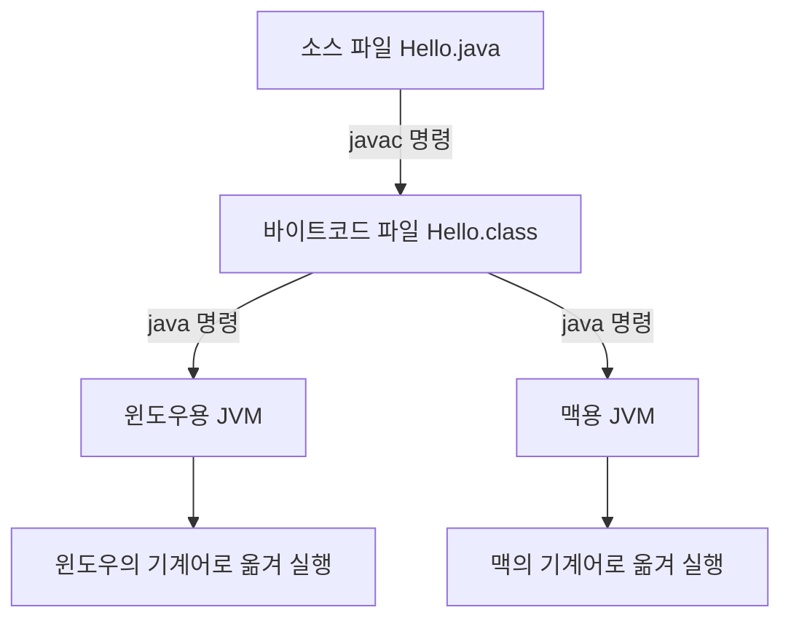


<div class="callout callout-summary" markdown="1">
<div class="callout-title callout-title--default" markdown="span">요약</div>

자바 프로그램은 컴퓨터가 바로 읽는 말로 번역되지 않는다. 먼저 어느 컴퓨터의 말도 아닌 중간 말로 한 번 번역해 두고, 실행할 때 각 컴퓨터에 깔린 통역 프로그램이 그 중간 말을 자기 컴퓨터의 말로 옮겨 가며 돌린다. 그래서 한 번 번역한 파일을 윈도우에서도 맥에서도 그대로 쓸 수 있다. 대신 그 통역 프로그램이 깔려 있지 않은 컴퓨터에서는 돌릴 수 없다.

</div>


## 예시로 보기

C로 짠 프로그램을 윈도우에서 번역(컴파일)하면 윈도우용 실행 파일이 나온다. 이 파일은 맥에서 돌지 않는다. 맥에서 쓰려면 맥에서 다시 번역해야 한다. 운영체제가 셋이면 번역도 세 번이다.

자바는 번역을 두 번으로 나눠 이 문제를 피한다[^1]. 아래 파일 하나로 따라가 본다[^2].

```java
package ch01.introduction;

public class Hello {
    public static void main(String[] args) {
        System.out.println("Hello, Java");
    }
}
```

사람이 쓴 이 글을 소스 파일(`Hello.java`)이라 부른다. 터미널에서 두 명령을 차례로 친다[^3].

```
javac -d bin src/ch01/introduction/Hello.java
java -cp bin ch01.introduction.Hello
```

- 첫 줄의 `javac`가 소스 파일을 읽어 `bin/ch01/introduction/Hello.class`를 만든다. 이 `.class` 파일에 든 중간 말을 바이트코드라 부른다.
- 둘째 줄의 `java`가 통역 프로그램을 띄운다. 이 통역 프로그램이 자바 가상 머신(JVM)이다. JVM이 `Hello.class`를 읽어 `Hello, Java`를 찍는다.

`Hello.class`를 사람이 읽을 수 있게 풀어 보면 `main` 안은 명령 네 줄이다[^s1].

```
0: getstatic     // System.out을 가져온다
3: ldc           // 문자열 "Hello, Java"를 가져온다
5: invokevirtual // println을 부른다
8: return
```

윈도우의 명령도 맥의 명령도 아니다. JVM만 알아듣는 명령이다.

<div class="callout callout-check" markdown="1">
<div class="callout-title" markdown="span">검증: 출력 `Hello, Java`, 실행 중인 클래스의 바이트코드가 `CA FE BA BE` 네 바이트로 시작하는 것 — [01_jvm-bytecode_impl.java](/Hongs_Blog/studies/software-project/code/01_jvm-bytecode_impl/). 두 명령의 결과(`bin/ch01/introduction/Hello.class` 생성)와 바이트코드 네 줄은 JDK 21에서 따로 실행해 확인했다[^s1].</div>

</div>


## 소스에서 실행까지



바이트코드 파일은 하나다. 갈라지는 것은 JVM이다. 운영체제마다 그 운영체제용 JVM이 따로 있고, 각 JVM이 같은 바이트코드를 자기 운영체제가 알아듣는 기계어로 옮긴다[^1][^s2]. 자바의 구호 "한 번 쓰면 어디서나 돈다(Write once, run anywhere)"가 이 뜻이다[^4].

**번역하는 두 가지 방식.** 프로그램을 기계어로 바꾸는 방식은 원래 둘이다[^5].

| 방식 | 하는 일 | 자바에서 |
|---|---|---|
| 컴파일러 | 소스 전체를 미리 한꺼번에 번역해 둔다. 틀린 곳이 있으면 오류 메시지를 낸다 | `javac`가 소스를 바이트코드로 |
| 인터프리터 | 실행하면서 명령을 하나씩 가져와 그때그때 번역한다 | JVM이 바이트코드를 기계어로 |

자바는 둘을 이어 붙였다. 앞 단계에서 오류를 미리 잡고, 뒤 단계에서 컴퓨터마다 다른 부분을 맞춘다.

**JVM 안에서 일어나는 일.** `java` 명령을 치면 JVM은 네 단계를 거친다[^1].

1. 클래스 로더(Class Loader)가 `.class` 파일을 찾아 메모리에 올린다.
2. 바이트코드 검증기(Bytecode Verifier)가 올린 바이트코드가 규칙에 맞는지 확인한다.
3. 실행 시스템(Java Runtime System)이 바이트코드를 실행한다.
4. 그 과정에서 운영체제(Native OS)에 일을 맡긴다. 화면에 글자를 찍는 것도 결국 운영체제가 한다.

<div class="callout callout-warning" markdown="1">
<div class="callout-title" markdown="span">원본 오류 의심</div>

원문: 슬라이드 p.10 오른쪽 그림의 제목 "Bytecode File (\*.java)" / 문제점: 같은 쪽 왼쪽 그림과 p.11~12는 바이트코드 파일을 `*.class`로 적는다. `javac`가 만드는 파일의 확장자는 `.class`다. / 수정안: "Bytecode File (\*.class)" / 근거: JDK 21에서 `javac -d bin src/ch01/introduction/Hello.java`를 실행하면 `bin/ch01/introduction/Hello.class`가 생긴다.

</div>


## JDK, JRE, JVM

셋은 큰 것이 작은 것을 품는다[^6].

```
+------------------------------------------+
| JDK  개발 도구 묶음 (javac, 디버거 등)   |
|  +------------------------------------+  |
|  | JRE  실행에 필요한 것 (자바 API)   |  |
|  |  +------------------------------+  |  |
|  |  | JVM  바이트코드를 돌리는 통역 |  |  |
|  |  +------------------------------+  |  |
|  +------------------------------------+  |
+------------------------------------------+
```

- JVM: 바이트코드를 실행한다.
- JRE(Java Runtime Environment): JVM에 실행할 때 쓰는 기본 라이브러리를 더한 것이다. 남이 만든 프로그램을 돌리기만 할 때 필요하다[^s2].
- JDK(Java Development Kit): JRE에 `javac` 같은 개발 도구를 더한 것이다. 프로그램을 만들려면 이것이 필요하다. 수업에서는 무료로 공개된 OpenJDK를 쓴다[^6].

## 패키지와 폴더

패키지는 관련된 클래스를 한 이름 아래 모으는 상자다. 이름이 겹치는 것을 막고 코드를 정리하려고 쓴다[^7]. 패키지 이름의 점은 폴더의 칸막이와 같다.

| 무엇 | 예 |
|---|---|
| 패키지 이름 | `ch01.introduction` |
| 소스 폴더 | `src/ch01/introduction` |
| 바이트코드 폴더 | `bin/ch01/introduction` |

`javac -d bin`의 `-d`는 바이트코드를 둘 폴더다. `java -cp bin`의 `-cp`는 JVM이 `.class`를 찾기 시작할 폴더다[^3]. 실행할 때는 파일 경로가 아니라 패키지까지 붙인 클래스 이름을 준다. `java -cp bin Hello`라고만 치면 JVM은 `bin/Hello.class`를 찾다가 `Could not find or load main class Hello`라며 멈춘다[^s1]. 자세한 규칙은 [패키지](/Hongs_Blog/studies/software-project/java-package/)에서 다룬다.

## 활용

- 자바는 1995년 선 마이크로시스템즈가 내놓았고, 2010년 오라클이 인수해 JDK를 배포한다. 안드로이드 앱, 데스크톱 프로그램, 웹사이트를 만드는 데 쓰인다[^4].
- 슬라이드가 꼽는 자바의 특징은 넷이다. 어느 운영체제에서나 돈다. 객체 지향 프로그래밍에 맞춰져 있다. 안 쓰는 메모리를 알아서 치운다(가비지 컬렉션). 무료 공개 라이브러리가 많다[^8].
- 흔한 실수: `java Hello.class`처럼 확장자를 붙여 실행한다. `java` 명령에는 클래스 이름을 준다.
- 흔한 실수: 소스를 고친 뒤 `javac`를 다시 돌리지 않는다. JVM이 읽는 것은 `.class`라서 옛 프로그램이 그대로 돈다.

## 연결

- 다음: [변수와 기본 타입](/Hongs_Blog/studies/software-project/java-primitive-types/)
- JVM이 실행 중에 메모리를 나눠 쓰는 방식: [참조 타입과 메모리 영역](/Hongs_Blog/studies/software-project/java-reference-types/)
- 패키지 선언과 import: [패키지](/Hongs_Blog/studies/software-project/java-package/)
- JVM도 운영체제 위에서 도는 프로그램 하나다: [프로세스](/Hongs_Blog/studies/operating-systems/process/)

## 과목별 관점

**컴파일러 (3-2학기).** 이 강의는 자바처럼 컴파일과 인터프리트를 이어 붙인 방식을 하이브리드 컴파일러(hybrid compiler)라 부르고, 예로 Java와 파이썬을 든다[^c2]. 강의가 더하는 것은 둘이다.

- **두 방식을 가르는 세 물음.** 무엇을 옮기나(원시 프로그램 전체 / 문장 하나), 언제 옮기나(프로그램이 돌기 전에 한 번 / 그 문장을 실행할 때마다), 무엇이 나오나(목적 프로그램 / 그 문장의 목적 코드)[^c1]. 위 표의 '하는 일' 칸을 셋으로 나눠 본 것이다.
- **두 토막이 각각 맡은 것.** 강의 그림은 컴파일러 쪽 상자에 "높은 효율(짧은 실행 시간)을 위해", 인터프리터 쪽 상자에 "여러 기계에서 그대로 돌게(이식성) 하려고"라고 적는다[^c2]. `javac`가 바이트코드를 미리 만들어 두는 것은 오류를 미리 잡는 데 더해 실행을 빠르게 하려는 것이기도 하다. 글자를 낱말로 끊고 문법을 따지는 일을 실행할 때마다 되풀이하지 않아도 되기 때문이다[^cs1].

두 방식의 장단점은 [컴파일과 인터프리트 비교](/Hongs_Blog/studies/compilers/compilation-vs-interpretation/)에, `javac` 같은 컴파일러 안에서 일어나는 여섯 단계는 [컴파일러의 구조](/Hongs_Blog/studies/compilers/compiler-structure/)에 있다.

## 확인 문제

<details class="callout callout-question" markdown="1">
<summary class="callout-title" markdown="span">**C1** `Hello.java`를 써서 화면에 글자가 찍히기까지, 어떤 명령이 어떤 파일을 만들고 무엇이 그 파일을 읽는지 순서대로 쓰라.</summary>

**답:** ① `javac`가 소스 파일 `Hello.java`를 바이트코드 파일 `Hello.class`로 번역한다. ② `java` 명령이 JVM을 띄운다. ③ JVM이 `Hello.class`를 읽어(클래스 로더 → 검증기 → 실행 시스템) 그 컴퓨터의 기계어로 옮겨 실행한다.<br>
**이유:** 흔한 오답은 "`java`가 `.java` 파일을 읽는다"이다. JVM이 읽는 것은 `.class`다.

</details>


<details class="callout callout-question" markdown="1">
<summary class="callout-title" markdown="span">**C2** 윈도우에서 만든 `Hello.class`를 맥에 복사하면 다시 번역하지 않고 돌릴 수 있다. C의 실행 파일은 왜 안 되고 이것은 왜 되는가? 안 되는 경우는 언제인가?</summary>

**답:** C의 실행 파일에는 윈도우용 기계어가 들어 있어 맥이 알아듣지 못한다. `.class`에는 어느 운영체제의 것도 아닌 바이트코드가 들어 있고, 맥에 깔린 맥용 JVM이 그것을 맥의 기계어로 옮긴다. 맥에 JVM이 없으면 돌릴 수 없다.<br>
**이유:** 운영체제마다 다른 부분을 프로그램이 아니라 JVM이 떠안는다. 그래서 JVM은 운영체제마다 따로 만들어야 한다.

</details>


<details class="callout callout-question" markdown="1">
<summary class="callout-title" markdown="span">**C3** ① 친구가 준 `.class` 파일을 돌려 보기만 한다. ② 내가 `.java`를 써서 프로그램을 만든다. 각각 JVM, JRE, JDK 중 최소한 무엇이 있어야 하는가?</summary>

**답:** ①은 JRE(JVM과 기본 라이브러리). ②는 JDK. `javac`는 JDK에만 들어 있다.<br>
**이유:** JVM만으로는 `System.out.println` 같은 기본 라이브러리가 없어 대부분의 프로그램이 돌지 않는다. JDK는 JRE를 품으므로 JDK가 있으면 ①도 된다.

</details>


<details class="callout callout-question" markdown="1">
<summary class="callout-title" markdown="span">**C4** 소스가 `src/app/util/Calc.java`에 있고 첫 줄이 `package app.util;`이다. 바이트코드를 `out` 폴더에 만들고 실행하는 두 명령을 쓰라. 바이트코드 파일은 어디에 생기는가?</summary>

**답:** `javac -d out src/app/util/Calc.java`, `java -cp out app.util.Calc`. 파일은 `out/app/util/Calc.class`에 생긴다.<br>
**이유:** `-d`로 준 폴더 아래에 패키지 이름대로 폴더가 생긴다. 실행할 때는 패키지까지 붙인 이름을 준다.

</details>


<details class="callout callout-question" markdown="1">
<summary class="callout-title" markdown="span">**C5** 자바의 두 토막 가운데 하나씩을 없앤다고 하자. (가) 바이트코드를 만들지 않고 JVM이 `.java` 소스를 한 문장씩 읽어 바로 실행한다. (나) JVM 없이 `javac`가 곧장 윈도우의 기계어를 낸다. 각각 무엇을 잃는가?</summary>

**답:** (가) 실행 속도와 실행 전 오류 검사를 잃는다. 문장을 실행할 때마다 글자를 끊고 문법을 따져야 하고, 틀린 문장은 그 문장에 닿아야 드러난다. (나) 다른 운영체제에서 그대로 도는 성질을 잃는다. 맥에서 쓰려면 맥용으로 다시 번역해야 한다.<br>
**이유:** 앞 토막(컴파일)은 짧은 실행 시간을, 뒤 토막(인터프리트)은 여러 기계에서 그대로 도는 것을 맡는다. 둘을 이어 붙여 두 가지를 함께 얻는다.

</details>


[^1]: 소프트웨어 프로젝트 2회 강의 자료 「Software Project 02. Java Language Basics (1)」, p.8~12 (소스 → 바이트코드 → 운영체제별 JVM, JVM 안의 네 단계)
[^2]: 같은 자료, p.13~14 (Hello.java)
[^3]: 같은 자료, p.17 (javac -d, java -cp)
[^4]: 같은 자료, p.3 (자바 소개)
[^5]: 같은 자료, p.6~7 (컴파일러와 인터프리터 그림)
[^6]: 같은 자료, p.5 (JDK, JRE, JVM 그림)
[^7]: 같은 자료, p.15~16 (패키지와 폴더 구조)
[^8]: 같은 자료, p.4 (자바의 특징)
[^s1]: <span class="fn-tag" title="수업 자료에 없고 따로 보탠 내용">보충</span> 바이트코드 네 줄(`javap -c` 출력), `java -cp bin Hello`의 오류 메시지, 카드 C4는 원본에 없다. JDK 21에서 직접 실행해 확인했다.
[^s2]: <span class="fn-tag" title="수업 자료에 없고 따로 보탠 내용">보충</span> JRE와 JDK의 차이 설명, 다이어그램 1개와 상자 그림 1개는 원본에 없다. 원본 p.5의 포함 관계 그림과 p.11~12의 흐름 그림을 근거로 그렸다. JVM이 바이트코드를 한 줄씩 옮기기만 하지 않고 자주 도는 부분을 통째로 기계어로 바꿔 두기도 한다는 것(JIT 컴파일)은 다루지 않았다.
[^c1]: 컴파일러 1회 강의 자료 「Lecture01 Compilers overview」, p.5 (컴파일과 인터프리트의 비교 표: What to translate, When to translate, Translation result)
[^c2]: 컴파일러 1회 강의 자료 「Lecture01 Compilers overview」, p.7 (Variation: Hybrid compilers. "For high efficiency (low execution time)", "For high portability". 예: Java, Python)
[^cs1]: <span class="fn-tag" title="수업 자료에 없고 따로 보탠 내용">보충</span> 미리 옮겨 두면 왜 빨라지는지의 설명과 카드 C5는 컴파일러 강의 슬라이드에 없다. 문장을 되풀이할 때 옮기는 횟수의 차이는 [02_compilation-vs-interpretation_verify.py](/Hongs_Blog/studies/compilers/code/02_compilation-vs-interpretation_verify/)의 장난감 언어로 확인했다.

